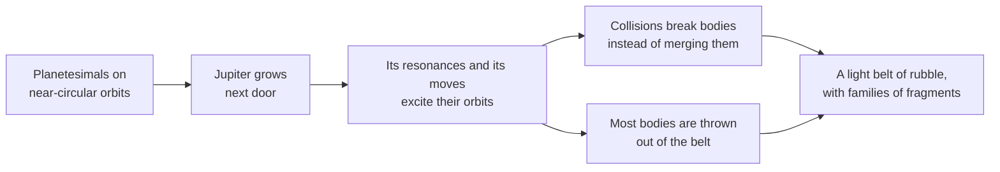

# How do asteroid belts form?

Seen from: the star view of a planetary system, with the "Belts" layer on,
and the "Small bodies" list in the system's panel.

## Short answer

An asteroid belt is a ring of rubble that never became a planet. The main
belt lies next to Jupiter, whose gravity stirred it: its bodies met too
fast to merge, and broke instead. The belt weighs today about a thirtieth
of the Moon: most of it was lost, probably to Jupiter and the other
giants. Jupiter also carves its edges and gaps, where an asteroid's year
is a simple fraction of Jupiter's.
Beyond Neptune lies a second, icier belt, the Kuiper belt, shaped the same
way by Neptune.

## The science

### A ring that never became a planet

The main belt lies between Mars and Jupiter. Pitjeva & Pitjev (2018)
weigh it from its pull on the planets and on spacecraft, and model it as a
ring from 2.08 to 3.27 AU. Its whole mass is (4.008 ± 0.029) × 10⁻⁴ Earth
masses. Four bodies hold half of it: Ceres 31 %, Vesta 9 %, Pallas 7 % and
Hygiea 3 % (Raymond & Nesvorný 2022).

**Orders of magnitude.** The Moon weighs 0.0122 Earth masses (NASA): the
whole belt is 3 % of the Moon. About 2 million of its bodies are larger
than 1 km (Maeda et al. 2021, as quoted by Uehata et al. 2022). Spread
over a ring from 2.1 to 3.3 AU and about 1 AU thick, that leaves a few
million km between neighbours: our own rough estimate.

Planets grow from small bodies, planetesimals, on calm orbits. In the
belt, growth stopped. Asteroids' orbits are excited today, with
eccentricities from 0 to 0.3 and inclinations from 0 to over 20°, while
the first planetesimals' orbits were nearly circular and flat (Morbidelli
et al. 2015; Raymond & Nesvorný 2022). Bodies on such crossing orbits hit
each other at high speed: many dozen large asteroids have been broken by
impacts over the Solar System's age (Nesvorný et al. 2015).



How the belt lost its mass is debated. The classical view is that it was
born with several Earth masses and was depleted by a factor of about 1000
(Raymond & Nesvorný 2022). Several processes can do it:

- **Jupiter's early migration.** In the Grand Tack model, Jupiter moved in
  to 1.5 AU while the disk still held gas, then back out. Its pull first
  emptied the belt, then refilled it: with bodies from 1 to 3 AU in the
  inner belt, and from among and beyond the giants in the outer belt
  (Walsh et al. 2011).
- **The giants' instability.** A later, violent reshuffle of the giant
  planets' orbits can also excite and empty the belt (Raymond & Nesvorný
  2022).
- **No mass to lose.** The belt may have formed nearly empty, and been
  filled with bodies scattered from elsewhere while the planets grew
  (Raymond & Izidoro 2017).

### Kirkwood gaps: where Jupiter's resonances cut

An asteroid in a mean-motion resonance goes round the Sun $j$ times while
Jupiter goes round $k$ times. Kepler's third law then puts it at

```math
a = a_J \left(\frac{k}{j}\right)^{2/3}
```

where $a_J$ is Jupiter's distance from the Sun.

**In words.** Every time the asteroid and Jupiter meet, they meet at the
same places on the asteroid's orbit. The giant's tugs then add up instead
of averaging out. In the strong resonances (3:1, 5:2, 2:1), the orbit
wanders chaotically, its eccentricity grows, and the asteroid ends on an
orbit that crosses the planets'. The resonance is emptied, and a gap opens
(Wisdom 1982, as reviewed by Nesvorný et al. 2015).

**Orders of magnitude.** With $a_J$ = 5.20 AU:

| Resonance | Distance | Share of $a_J$ | What lies there |
| --- | --- | --- | --- |
| 3:1 | 2.50 AU | 0.48 | a gap |
| 5:2 | 2.82 AU | 0.54 | a gap |
| 7:3 | 2.96 AU | 0.57 | a gap |
| 2:1 | 3.28 AU | 0.63 | the belt's outer edge |
| 3:2 | 3.97 AU | 0.76 | the Hildas, a stable group |
| 1:1 | 5.20 AU | 1.00 | the trojans |

Nesvorný et al. (2015) place the 5:2 at 2.82 AU and the 7:3 at 2.95 AU.
The belt's inner edge, near 2.1 AU, is set by another kind of resonance,
a secular one, between the slow turning of an asteroid's orbit and one of
the planets' own slow modes (the ν6 resonance, with Saturn). It makes
unstable all objects inside 2.1 AU at low to moderate inclinations
(Morbidelli et al. 2015; Raymond & Nesvorný 2022).

Not every resonance empties. Jupiter's 3:2 holds the largest population of
any of its resonances, the Hilda group: 1197 known in 2008 (Brož &
Vokrouhlický 2008). Its 1:1 holds the trojans (see
[What are Lagrange points and trojans?](lagrange-points.md)).

### Families: the belt's broken bodies

Since the belt's orbits were stirred, its bodies collide fast. Main-belt
asteroids orbit at 15 to 20 km/s, and a large impact can tear a body
apart. Its pieces drift off at about the speed needed to escape it, far
slower than their orbital speed, so their orbits start out alike: they
form a family, which the planets' tugs slowly spread (Nesvorný et al.
2015).

**Orders of magnitude.** Nesvorný et al. (2015) list 122 notable
families: 20 in the inner belt, 47 in the central belt, 46 in the outer
belt, 2 among the Hildas, 1 among the Hungarias and 6 among Jupiter's
trojans. K. Hirayama first spotted such groups in 1918.

### Rock inside, carbon and water outside

The belt lies between the rocky planets and the giants. Its inner part is
dominated by S types,
rocky bodies linked to the dry ordinary chondrites, and its outer part by
C types, linked to the carbonaceous chondrites, which hold about 10 %
water by mass (Raymond & Nesvorný 2022).

This was read as the trace of a temperature gradient across the belt when
the Solar System formed (DeMeo & Carry 2014). Surveys of
smaller asteroids have since shown that all asteroid types exist in every
region of the belt: the belt was mixed, by migration and scattering
(DeMeo & Carry 2014). Some models implant the C types from beyond Jupiter
while the giants grew (Raymond & Izidoro 2017).

### Beyond the giants: the Kuiper belt and the scattered disk

The same scheme shapes a belt outside the outermost giant. The main
classical Kuiper belt lies between Neptune's 3:2 and 2:1 resonances, from
39.4 to 47.8 AU. The number of bodies larger than 40 km drops sharply
beyond 48 AU. The Plutinos sit in the 3:2 itself. The scattered disk holds
bodies on eccentric, inclined orbits, out to about 90 AU with
eccentricities of 0.5 to 0.6 or more (Pitjeva & Pitjev 2018).

**Orders of magnitude.** The Kuiper belt weighs
(1.97 ± 0.30) × 10⁻² Earth masses with its 31 largest bodies: almost 50
times the main belt (Pitjeva & Pitjev 2018). The classical belt alone is
about 0.010 Earth masses, a few times Pluto (Bernstein et al. 2004).
Models of its formation need an initial 10 to 30 Earth masses (Pitjeva &
Pitjev 2018); the capture of Jupiter's trojans points to a disk of 14 to
28 Earth masses (Nesvorný et al. 2013). The Kuiper belt too has lost most
of its mass.

### Where a belt can survive next to a giant

Close to a planet's orbit, the resonances overlap and every orbit is
chaotic. For a small body at distance $a$ near a planet of mass $m$ at
distance $a_p$, round a star of mass $M$, this chaotic zone spans (Wisdom
1980, coefficient from Duncan et al. 1989, both as given by Pu & Wu 2015)

```math
\frac{|a - a_p|}{(a + a_p)/2} \le 1.49\,\mu^{2/7},
\qquad \mu = \frac{m}{M}
```

**In words.** A heavier planet clears a wider band round its orbit. A
belt can only last outside that band, and outside the resonances that
empty it.

**Orders of magnitude.** Jupiter ($\mu$ = 9.5 × 10⁻⁴) clears 4.2 to
6.4 AU; Neptune (5.1 × 10⁻⁵) clears 27.6 to 33.0 AU. The main belt ends
at Jupiter's 2:1, 3.3 AU, well short of this zone; the Kuiper belt starts
at Neptune's 3:2, 39.4 AU, well beyond it.

### Belts round other stars

Cold dust belts, like a dusty Kuiper belt, glow in the far infrared.
Herschel found them round 22 % of the F, G and K stars within 15 parsecs
(23 out of 105 stars), as often round old stars as round young ones
(Montesinos et al. 2016). Their brightness drops with age, as expected
when collisions slowly grind the belt down.

### What we do not know

- **The belt's starting mass.** Born with several Earth masses and
  depleted a thousandfold, or born nearly empty and filled later: both
  fit what we see (Raymond & Nesvorný 2022; Raymond & Izidoro 2017).
- **What emptied it.** Jupiter's early migration, the giants' later
  instability, or both (Raymond & Nesvorný 2022).

## In the app

### What you see

In the star view of a planetary system, the "Belts" layer draws each belt
as a cloud of points that turn round the star at Kepler's pace: the inner
ones faster than the outer ones. The Kirkwood gaps show as empty rings.
Rocky and mixed belts are drawn sand-coloured, icy ones pale blue. A label
names each belt and its range.

The "Small bodies" list in the system's panel gives each belt's range,
mass and composition, the giant whose resonances shape it, and its gaps.
A system can have four kinds:

- **Asteroid belt** (`inner`): between the rocky planets and the first
  cold giant.
- **Hildas** (`hildas`): in that giant's 3:2.
- **Kuiper belt** (`outer`): beyond the outermost giant.
- **Scattered disk** (`scattered`): the outermost giant's eccentric
  leftovers.

The points are far denser than real bodies, and the help says so.

### How it computes them

The system places its planets first, then
[`belts::draw_belts`](../../crates/mapgen/src/belts.rs) draws the belts
from a random stream of their own, so that the planets do not move:

1. **The inner belt** needs a giant beyond half the ice line that is not
   a hot Jupiter, the innermost one. Its zone runs from 0.40 of that
   giant's distance (the Sun's 2.1 AU edge, scaled) to its 2:1 at 0.63.
   A system without such a giant has no inner belt: its planetesimals are
   taken to have grown into planets.
2. **Room left by the planets.** Every other planet clears 5 of its Hill
   radii beyond its periapsis and apoapsis. The widest piece left is kept
   if its outer edge is at least 1.15 times its inner edge. When placing
   the planets, the system already pushes rocky planets out of the zone
   ([`system.rs`](../../crates/mapgen/src/system.rs)).
3. **Gaps** at the giant's 3:1, 5:2 and 7:3, each
   $0.012\,a\sqrt{\mu/\mu_J}$ wide, where $\mu_J$ is Jupiter's mass
   share.
4. **The Hildas** in a band round the giant's 3:2, if no planet crosses
   it, with a thousandth of the inner belt's mass.
5. **The outer belt**, for half of F, G and K stars, a quarter of M
   dwarfs and three in ten other stars: from the outermost giant's 3:2 to
   its 2:1, or at 11 to 18 times the ice line without a giant. With a
   giant, a scattered disk runs from its distance to four times it.
6. **Composition** from where the belt lies against the ice line: rocky
   inside, icy beyond, mixed across it.

The inner belt, trimmed (from `crates/mapgen/src/belts.rs`):

```rust
/// The inner belt's zone round its giant, as shares of its distance.
pub const INNER_ZONE: (f64, f64) = (0.40, 0.63);
/// Hill radii kept clear beyond a planet's periapsis and apoapsis.
const CLEARING_HILL: f64 = 5.0;

// Where a body going round `j` times while the planet goes round `k`
// times sits.
fn resonance(a: f64, j: f64, k: f64) -> f64 {
    a * (k / j).powf(2.0 / 3.0)
}

let inner_mass = log_uniform(1e-5, 1e-2, &mut rng); // Earth masses
let mu = giant.mass_earth / (star_mass * SUN_EARTH + giant.mass_earth);
let gaps = [(3.0, 1.0), (5.0, 2.0), (7.0, 3.0)]
    .iter()
    .map(|&(j, k)| resonance(giant.orbit_au, j, k))
    .filter(|&c| c > inner && c < outer)
    .map(|c| [c, 0.012 * c * (mu / MU_JUPITER).sqrt()])
    .collect();
```

Round the Sun, with the real planets, this gives a belt from 2.1 to
3.3 AU with gaps at 2.50, 2.82 and 2.95 AU, the Hildas near 4 AU, and a
Kuiper belt from 39.4 to 47.8 AU (the tests in `belts.rs`).

The star view draws the points
([`smallBodies.ts`](../../web/src/lib/viewer/smallBodies.ts)): 3000 for
an inner belt, 300 for the Hildas, 2500 for an outer belt and 1200 for a
scattered disk, spread evenly in distance but for the gaps, each on a
circular orbit tilted up to twice the belt's typical inclination.

The belts also set every body's crater rate
([`belts::impact_factor`](../../crates/mapgen/src/belts.rs)): four fifths
from the inner belt's mass and one fifth from the outer belt's and
scattered disk's, each against the Solar System's, times the effect of
the giant just outside the body's orbit.

### Where it departs from the science

- **The edges are scaled from the Solar System.** The inner edge at 0.40
  of the giant's distance copies the Sun's 2.1 AU edge. That edge comes
  from a secular resonance that Saturn dominates, not from Jupiter alone.
  A system with a single giant gets the same edge, where the real one
  could lie elsewhere or be missing.
- **Gaps are cut, not grown.** The app removes points in a band at each
  resonance. It does not follow orbits, so it has no chaotic zone, no
  eccentricity growth and no 4:1 or weaker gaps. The gap width scales
  with $\sqrt{\mu}$ as a rule of the app; we did not find a measured gap
  width to check it against.
- **One shape for the clearing.** Planets clear 5 Hill radii round their
  orbits. That is a little wider than the chaotic zone above, which spans
  3 Hill radii for Jupiter and 4 for the Earth, so belts stay on the safe
  side.
- **The masses are drawn.** The inner belt's mass is log-uniform from
  10⁻⁵ to 10⁻² Earth masses, which puts the Sun's 4 × 10⁻⁴ near the
  middle; the outer belt's from 10⁻³ to 1. The history that sets them
  (depletion, migration, instability) is not modelled. The Hildas' share,
  a thousandth of the belt, is a rough guess we could not check against a
  measured mass.
- **Outer belts are more common than seen.** Half of F, G and K stars get
  one, against the 22 % seen with Herschel. The app assumes that belts too
  faint to detect, like our own Kuiper belt, make up the difference; we
  did not find a measurement of that share.
- **Circular points.** Each point follows a circular orbit at its mean
  distance. The belt's eccentricity (0.15 for an inner belt, 0.3 for a
  scattered disk) is stored but not drawn, so a scattered disk looks like
  a wide ring rather than a cloud of long ellipses.
- **No families, no size distribution.** Points are spread evenly; the
  app draws no collisional families and no count of bodies by size.
- **Density.** Real belts are mostly empty space. The points stand for
  bodies far denser than real ones, as the planets' markers are larger
  than to scale.

## Sources

1. Pitjeva, E. V. & Pitjev, N. P. 2018, "Masses of the Main Asteroid Belt
   and the Kuiper Belt from the Motions of Planets and Spacecraft",
   *Astronomy Letters* 44, 554–566,
   [doi:10.1134/S1063773718090050](https://doi.org/10.1134/S1063773718090050),
   preprint [arXiv:1811.05191](https://arxiv.org/abs/1811.05191).
   Belt masses, the main belt's ring model, the Kuiper belt's structure.
2. Raymond, S. N. & Nesvorný, D. 2022, "Origin and Dynamical Evolution of
   the Asteroid Belt", in *Vesta and Ceres*, Cambridge University Press,
   [doi:10.1017/9781108856324.019](https://doi.org/10.1017/9781108856324.019),
   preprint [arXiv:2012.07932](https://arxiv.org/abs/2012.07932).
   Shares of the four largest bodies, excitation, depletion, composition.
3. Morbidelli, A., Walsh, K. J., O'Brien, D. P., Minton, D. A. & Bottke,
   W. F. 2015, "The Dynamical Evolution of the Asteroid Belt", in
   *Asteroids IV*, University of Arizona Press,
   [doi:10.2458/azu_uapress_9780816532131-ch026](https://doi.org/10.2458/azu_uapress_9780816532131-ch026),
   preprint [arXiv:1501.06204](https://arxiv.org/abs/1501.06204).
   The inner edge at 2.1 AU.
4. Walsh, K. J., Morbidelli, A., Raymond, S. N., O'Brien, D. P. &
   Mandell, A. M. 2011, "A low mass for Mars from Jupiter's early
   gas-driven migration", *Nature* 475, 206–209,
   [doi:10.1038/nature10201](https://doi.org/10.1038/nature10201),
   preprint [arXiv:1201.5177](https://arxiv.org/abs/1201.5177).
5. Raymond, S. N. & Izidoro, A. 2017, "The empty primordial asteroid
   belt", *Science Advances* 3, e1701138,
   [doi:10.1126/sciadv.1701138](https://doi.org/10.1126/sciadv.1701138),
   preprint [arXiv:1709.04242](https://arxiv.org/abs/1709.04242).
6. Nesvorný, D., Brož, M. & Carruba, V. 2015, "Identification and
   Dynamical Properties of Asteroid Families", in *Asteroids IV*,
   University of Arizona Press,
   [doi:10.2458/azu_uapress_9780816532131-ch016](https://doi.org/10.2458/azu_uapress_9780816532131-ch016),
   preprint [arXiv:1502.01628](https://arxiv.org/abs/1502.01628).
   Families, resonance locations, removal through the strong resonances.
7. Wisdom, J. 1982, "The origin of the Kirkwood gaps: a mapping for
   asteroidal motion near the 3/1 commensurability", *The Astronomical
   Journal* 87, 577,
   [doi:10.1086/113132](https://doi.org/10.1086/113132). Cited through
   Nesvorný et al. (2015).
8. Brož, M. & Vokrouhlický, D. 2008, "Asteroid families in the
   first-order resonances with Jupiter", *Monthly Notices of the Royal
   Astronomical Society* 390, 715–732,
   [doi:10.1111/j.1365-2966.2008.13764.x](https://doi.org/10.1111/j.1365-2966.2008.13764.x),
   preprint [arXiv:1104.4004](https://arxiv.org/abs/1104.4004).
9. DeMeo, F. E. & Carry, B. 2014, "Solar System evolution from
   compositional mapping of the asteroid belt", *Nature* 505, 629–634,
   [doi:10.1038/nature12908](https://doi.org/10.1038/nature12908),
   preprint [arXiv:1408.2787](https://arxiv.org/abs/1408.2787).
10. Bernstein, G. M. et al. 2004, "The Size Distribution of
    Trans-Neptunian Bodies", *The Astronomical Journal* 128, 1364–1390,
    [doi:10.1086/422919](https://doi.org/10.1086/422919), preprint
    [arXiv:astro-ph/0308467](https://arxiv.org/abs/astro-ph/0308467).
11. Nesvorný, D., Vokrouhlický, D. & Morbidelli, A. 2013, "Capture of
    Trojans by Jumping Jupiter", *The Astrophysical Journal* 768, 45,
    [doi:10.1088/0004-637X/768/1/45](https://doi.org/10.1088/0004-637X/768/1/45),
    preprint [arXiv:1303.2900](https://arxiv.org/abs/1303.2900).
12. Pu, B. & Wu, Y. 2015, "Spacing of Kepler Planets: Sculpting by
    Dynamical Instability", *The Astrophysical Journal* 807, 44,
    [doi:10.1088/0004-637X/807/1/44](https://doi.org/10.1088/0004-637X/807/1/44),
    preprint [arXiv:1502.05449](https://arxiv.org/abs/1502.05449).
    The chaotic zone (their eq. 3), after Wisdom (1980) and Duncan et
    al. (1989).
13. Montesinos, B. et al. 2016, "Incidence of debris discs around FGK
    stars in the solar neighbourhood", *Astronomy & Astrophysics* 593,
    A51,
    [doi:10.1051/0004-6361/201628329](https://doi.org/10.1051/0004-6361/201628329),
    preprint [arXiv:1605.05837](https://arxiv.org/abs/1605.05837).
14. Uehata, K., Terai, T., Ohtsuki, K. & Yoshida, F. 2022, "Size
    Distribution of Small Jupiter Trojans in the L5 Swarm", *The
    Astronomical Journal* 163, 213,
    [doi:10.3847/1538-3881/ac5b6d](https://doi.org/10.3847/1538-3881/ac5b6d),
    preprint [arXiv:2204.08617](https://arxiv.org/abs/2204.08617). The
    main belt's count of bodies over 1 km, after Maeda et al. (2021).
15. NASA Space Science Data Coordinated Archive, [Planetary fact
    sheet](https://nssdc.gsfc.nasa.gov/planetary/factsheet/) (masses and
    distances of the planets and the Moon).

## See also

- [docs/analysis/13-asteroids.md](../analysis/13-asteroids.md): the study
  behind the app's belts and trojans, with more sources.
- [What are Lagrange points and trojans?](lagrange-points.md): the
  bodies in a giant's 1:1 resonance.
- [How close can two planets orbit?](planet-spacing.md): the spacing that
  leaves a belt room.
- [docs/system-spec.md](../system-spec.md): small bodies in a system.
