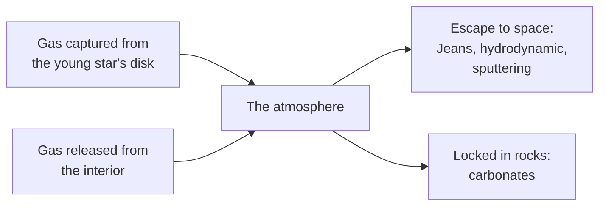

# What decides whether a world has an atmosphere?

Seen from: the planet view, where a world with air wears a halo of sky and
clouds and an airless one a hard edge against space, and the **Atmosphere**
line of the world card ("1.02 bar, water clouds", or "none").

## Short answer

A world keeps its air when its gravity holds the gas against the heat that
stirs it. Gas molecules move faster the hotter and the lighter they are, and
the fastest of them leave for space. A large, cold world holds on even to
light gases; a small, hot one loses even heavy ones. Sorted by the starlight
they get and by their escape velocity, the worlds of the Solar System fall
neatly on either side of a line, the "cosmic shoreline". Close to that line,
history decides: how much gas came out of the interior, how much escaped,
how much the rocks locked away. That is why Venus and Earth, nearly twins in
size, have 92 bar and 1 bar of air, and Titan, a cold moon with a quarter
of Earth's escape velocity, more than Earth.

## The science

### Escape velocity against thermal speed

To leave a world of mass $M$ for good from a distance $r$ of its centre, a
molecule must move faster than the escape velocity. In a gas at temperature
$T$, molecules of mass $m$ move at a typical thermal speed $u$, with
Boltzmann's constant $k$ and the gravitational constant $G$ (Gronoff et al.
2020, eq. 1):

```math
v_\text{esc} = \sqrt{\frac{2 G M}{r}},
\qquad
u = \sqrt{\frac{2 k T}{m}}
```

Their ratio, squared, is the Jeans parameter: the gravitational energy of a
molecule over its thermal energy (Gronoff et al. 2020):

```math
\lambda = \frac{G M m}{r\,k T} = \frac{v_\text{esc}^2}{u^2}
```

**In words.** The larger $\lambda$, the more tightly the gas is bound. It
grows with the world's mass and with the molecule's mass, and falls with the
temperature. It is measured where the air becomes so thin that molecules no
longer collide: the *exobase*, a few hundred kilometres up on Earth, where
the gas is far hotter than at the ground.

**Orders of magnitude.** At Earth's exobase, about 500 km up, the escape
velocity is 10.8 km/s. With an exospheric temperature of 1,000 K (it ranges
from 800 to 1,600 K, Gronoff et al. 2020, Table 2), a hydrogen atom moves at
4.1 km/s: $\lambda \approx 7$. An oxygen atom, 16 times heavier, has
$\lambda \approx 110$; a nitrogen molecule about 200.

### Jeans escape: the fast tail

The molecules at the exobase do not all move at the typical speed: a few,
in the tail of their distribution of speeds, are fast enough to leave. The
flux that escapes, for a density $N$ of molecules at the exobase, is
(Gronoff et al. 2020, eq. 5):

```math
\Phi = N\,\frac{u}{2\sqrt{\pi}}\,(1 + \lambda)\,e^{-\lambda}
```

**In words.** Escape falls off exponentially with $\lambda$. A light gas
on a warm, small world leaks steadily; a heavy gas on a large, cold one
hardly at all. When $\lambda$ drops to about 2 or 3, the gas no longer
leaks molecule by molecule but flows away as a whole, a *hydrodynamic*
wind (Gronoff et al. 2020).

**Orders of magnitude.** The factor $(1 + \lambda)\,e^{-\lambda}$ is
$9 \times 10^{-4}$ at $\lambda = 9.4$, $5 \times 10^{-9}$ at 22.3 and
$10^{-63}$ at 150. Gronoff et al. (2020, Table 2) give $\lambda$ for
hydrogen at each world's exobase:

| World | Exobase temperature | $\lambda$ for hydrogen |
| --- | --- | --- |
| Moon | 226 K | 0.8 |
| Mercury | 500 K | 2.2 |
| Titan | 180 K | 2.3 (37.3 for methane) |
| Mars | 240–300 K | 6.3–5.0 |
| Earth | 800–1,600 K | 9.4–5.0 |
| Venus | 290 K | 22.3 |
| Jupiter | 700–1,000 K | 311–218 |

Earth loses hydrogen but keeps its nitrogen and oxygen. Jupiter, with
$\lambda$ in the hundreds, keeps even hydrogen, its main gas.

### The cosmic shoreline

Zahnle & Catling (2017) arranged the bodies of the Solar System by the
starlight they get, the insolation $I$, and by their escape velocity. Those
with atmospheres and those without "are neatly divided". "The dividing line
goes as":

```math
I \propto v_\text{esc}^4
```

**In words.** A world four times closer to its star gets 16 times the light
and needs twice the escape velocity to keep its air. Exoplanets with known
masses and radii crowd against the same line, extended.

**Orders of magnitude.** Dividing the insolation (Earth's = 1) by the
escape velocity to the fourth (Earth's = 1) gives one number per world:
the higher it is, the closer the world lies to losing its air. From the
NASA fact sheets:

| World | Escape velocity | Insolation | $I / v_\text{esc}^4$ | Atmosphere |
| --- | --- | --- | --- | --- |
| Earth | 11.19 km/s | 1 | 1 | 1.01 bar |
| Venus | 10.36 km/s | 1.91 | 2.6 | 92 bar |
| Titan | 2.64 km/s | 0.011 | 3.5 | 1.47 bar |
| Mars | 5.03 km/s | 0.43 | 10.5 | 0.006 bar |
| Mercury | 4.3 km/s | 6.67 | 310 | none |
| Moon | 2.38 km/s | 1 | 490 | none |

Mars, with a thin atmosphere, sits close to the line; Mercury and the Moon
lie far beyond it. Titan's escape velocity is a quarter of Earth's, but at
Saturn's distance it gets about 1 % of Earth's light.

### Where the gas comes from, and where it goes

An atmosphere is a balance between what a world gains and what it loses.



- **Captured, then lost.** Proto-Venus and Earth probably captured small
  atmospheres of hydrogen from the young star's disk, lost to space after
  the disk dispersed, driven by the star's ultraviolet light (Lammer et al.
  2020). Their later air came out of their interiors, starting with steam
  atmospheres outgassed over their early magma oceans (Lammer et al. 2020).
- **Lost to space.** Mars lost much of its air. From the argon isotopes of
  its upper atmosphere, the MAVEN spacecraft found that "66% of the
  atmospheric argon has been lost to space", part of Mars's change from "an
  early, warm, wet environment to today's cold, dry atmosphere" (Jakosky
  et al. 2017).
- **Locked in rocks.** On Earth, the weathering of silicate rocks,
  followed by the deposition of carbonates, takes carbon dioxide out of the
  air. Its rate grows with the temperature, and the temperature with the
  carbon dioxide: a feedback that partly steadies the climate over
  geological time (Walker, Hays & Kasting 1981).

### The greenhouse effect

A world that only re-radiated the starlight it absorbs would sit at its
equilibrium temperature $T_\text{eq}$, which depends on the flux $F$ it gets,
the share $A$ it reflects (its Bond albedo) and the Stefan–Boltzmann constant
$\sigma$ (Méndez & Rivera-Valentín 2017, eq. 2, for a fast-spinning world
radiating like a black body). An atmosphere that lets sunlight in but holds
back the heat the ground radiates warms the surface to $T_s$ above it. The
share of the surface's heat it holds back measures the greenhouse effect
(Méndez & Rivera-Valentín 2017, eq. 5):

```math
T_\text{eq} = \left(\frac{(1 - A)\,F}{4\sigma}\right)^{1/4},
\qquad
g = 1 - \left(\frac{T_\text{eq}}{T_s}\right)^4
```

**In words.** $g = 0$ is no greenhouse at all; $g$ close to 1 means
almost all the heat the ground radiates is caught on its way out.

**Orders of magnitude.** From the NASA fact sheets:

| World | $T_\text{eq}$ | Mean surface | Warming | $g$ |
| --- | --- | --- | --- | --- |
| Mars | 210 K | about 214 K | about 4 K | 0.08 |
| Earth | 254 K | 288 K | 34 K | 0.40 |
| Venus | 227 K | 737 K | 510 K | 0.99 |

Venus reflects 77 % of the sunlight it gets, so its equilibrium temperature
is lower than Earth's, yet its ground is at 737 K: its 92 bar of carbon
dioxide hold back 99 % of the heat. Mars's thin air barely warms it; its
numbers are uncertain, as its effective surface temperature (214 K) and its
true annual mean (about 202 K) differ (Méndez & Rivera-Valentín 2017).

The greenhouse also bounds where a planet can keep liquid water.
Kopparapu et al. (2013) put the inner edge of the Sun's habitable zone at
0.99 AU, where a planet loses its water, and the outer edge at 1.70 AU,
where even the strongest carbon dioxide greenhouse can no longer keep it
warm.

### Surface pressure

The pressure at the ground is the weight of the air above each square metre:
it depends on how much gas a world holds, and on its gravity.

| World | Surface pressure | Mean surface temperature | Main gases |
| --- | --- | --- | --- |
| Venus | 92 bar | 737 K | CO₂ 96.5 %, N₂ 3.5 % |
| Earth | 1.014 bar | 288 K | N₂ 78 %, O₂ 21 % |
| Titan | 1.467 bar | 93.65 K | nitrogen, some methane |
| Mars | 0.00636 bar (0.004 to 0.0087) | about 214 K | CO₂ 95 % |
| Moon | about $3 \times 10^{-15}$ bar (at night) | | none |

Values: NASA fact sheets; Titan, the Huygens probe (Fulchignoni et al.
2005).

**Orders of magnitude.** Venus's atmosphere weighs $4.8 \times 10^{20}$ kg,
about 94 times Earth's $5.1 \times 10^{18}$ kg (NASA). Titan's gravity is
1.35 m/s², a seventh of Earth's (from its mass and radius, NASA), so its
1.47 bar mean about ten times more gas above each square metre than on
Earth.

### What we do not know

- **What draws the shoreline.** Zahnle & Catling (2017) test escape driven
  by the star's ultraviolet light, which should follow
  $I_\text{xuv} \propto v_\text{esc}^3\sqrt{\rho}$, unlike the observed
  line, and erosion by impacts, which fits a line at impact speeds of 4 to
  5 times the escape velocity. The observed line "may implicate thermal
  escape"; which process draws it is open.
- **Rocky exoplanets.** Whether rocky planets close to red dwarfs keep any
  air is not settled. Proxima Centauri b "is on the metaphorical beach",
  with hazards that include its star's ultraviolet and X-ray light (Zahnle
  & Catling 2017).

## In the app

### What you see

A world with air wears a halo of scattered light in the planet view, its
colour from the gas and its haze, and clouds drawn from the climate. Below
$10^{-4}$ bar the halo goes: an airless world shows a hard limb against
space. The world card gives the pressure and the kind of clouds; the form
has a **Pressure** field, logarithmic, from airless to 1,000 bar. The
choices behind the sky and the clouds are in
[docs/analysis/07-atmospheres.md](../analysis/07-atmospheres.md).

### How it computes them

Until part 3b of #423 the surface pressure was drawn like the sea level:
from the request, else from the planet type's preset, else from 0.7 to
1.5 bar. It now comes from the planet model's air (`planet::atmosphere`);
the table keeps the former presets' values, which
`planet::interim::draws_of` still gives the looks (in
[`looks/`](../../looks/)) of a world whose model leaves them open:

| Preset | Pressure | Greenhouse | Clouds |
| --- | --- | --- | --- |
| `terran` | 0.7 to 1.5 bar | 0 °C | water |
| `frozen` | 0.3 to 1.0 bar | 0 °C | water |
| `caustic` | 2 to 5 bar | 0 °C | sulfuric |
| `volcanic` | 5 to 20 bar | +20 °C | sulfuric |
| `barren` | 0 to 0.01 bar | 0 °C | none |
| `earth-like` | 1 bar | 0 °C | water |
| `mars-like` | 0.006 bar | 0 °C | dust |
| `venus-like` | 92 bar | +395 °C | sulfuric |
| `mercury-like` | 0 | 0 °C | none |
| `rocky-moon`, `icy-moon` | 0 | 0 °C | none |

The pressure then drives four rules (from
[`crates/mapgen/src/atmosphere.rs`](../../crates/mapgen/src/atmosphere.rs)
and [`generation.rs`](../../crates/mapgen/src/generation.rs)):

```rust
/// Below this surface pressure (bar) a world has no atmosphere to speak of:
/// no sky, no clouds.
pub const AIRLESS_BAR: f32 = 1e-4;

/// Below this surface pressure (bar) no water stays liquid: no rain, no
/// rivers or lakes, and no hydraulic erosion unless the preset asks for it
/// (valleys carved when the planet was wetter). Water's triple point is at
/// 0.006 bar.
pub const LIQUID_WATER_BAR: f32 = 0.01;

/// 1 up to 1 bar, then `1 / (1 + 0.1 (p − 1))`: 0.45 at 13 bar, 0.1 on
/// Venus (92 bar).
pub fn heat_contrast(pressure_bar: f32) -> f32 {
    1.0 / (1.0 + 0.1 * (pressure_bar - 1.0).max(0.0))
}

// In the climate: the planet's shift and its atmosphere's greenhouse.
let warming = planet.climate.temperature + planet.atmosphere.greenhouse;
```

1. **Airless** below $10^{-4}$ bar: no sky, no clouds.
2. **No liquid water** below 0.01 bar: no rain, rivers or lakes, and no
   erosion unless the preset asks for it.
3. **Heat carried to the poles.** Above 1 bar, each row's temperature is
   pulled towards the global mean by `heat_contrast`: a Venus-like world is
   nearly uniform, and the global mean does not move.
4. **Greenhouse.** The preset's `greenhouse` is added to every temperature.
   On a wet world with plate tectonics (at least 0.01 bar), a carbon cycle
   also regulates it across the habitable zone: from +30 °C at the inner
   edge, through Earth's climate at Earth's place, to −15 °C at the outer
   edge ([`star.rs`](../../crates/mapgen/src/star.rs),
   `star_temperatures`).

In the viewer, the halo's thickness and its optical depth grow with the
pressure: `0.03 + 0.02 log10(1 + p)` of the radius, and a gas depth that
goes as $p^{0.35}$, so dense atmospheres take the colour of their haze
([`sky.ts`](../../web/src/lib/sky.ts)).

The haze's own depth at the zenith is twice its density (0 to 1) up to
0.5, the density of every look but one: Earth's 0.1, Venus's 0.3, a
volcanic world's 0.45. Past 0.5 a haze thickens towards an opaque one,
a depth of 8 at 1 (`hazeDepth`), and scatters more and more evenly
(its anisotropy falls to 0): only a methane haze gets there.

#### Titan's orange haze

An air of more than 0.5 bar with more than 1 % methane gets a methane
haze (`planet::interim::sky_of`, `METHANE_HAZE`): the organics sunlight
makes from the methane high in the air (tholins). Seen from space, Titan
in true colour is an even orange-brown disc: the haze hides the surface
in visible light, and only a thin bluish layer shows at the limb (Porco
et al. 2005 [19]). The Huygens probe measured a haze optical depth of
several in the visible (Tomasko et al. 2005 [20]), absorbing blue most
(Tomasko et al. 2008 [21]). The app's methane haze has a density of 0.9,
a zenith depth of about 6.6 (the ground seen straight down through about
0.1 % of its light) and scatters 95 % of the red, 55 % of the green and
15 % of the blue it intercepts, the rest absorbed. A single scattering
leaves so thick a haze a dull brown, so the viewer counts the light it
scatters many times: of what each scattering keeps, a share `w` scatters
again, and a channel returns `a / (1 − w a)` of its single-scattering
share `a` (`hazeAlbedo`, `w` rising from 0 at a density of 0.5 to 0.55 at
1), which brightens and saturates the orange. Its density, colour, the
depth it maps to and that share are calibrations with Cassini's
true-colour images of Titan as their target.

Close in, the viewer thins a haze that hides the ground over the ground
(`hazeVeil`), so the surface can be looked at: from 1.5 radii up and
beyond (the default whole-disc view is 2.2 radii up) the disc is the
haze's, opaque; the depth over the ground then falls on a straight line
in log(depth) against log(altitude), so the ground starts to show about
0.6 radii up (10 to 22 % of its light for hazes of 0.7 to 1), reads
clearly at 0.2 radii (a depth of 0.5, 61 %) and is seen through a depth
of 0.25 at 0.05 radii and below (78 %). These altitudes and depths are a
calibration with no source.
The limb keeps its whole haze. This is a viewer convention, standing in
for the near-infrared windows through which Cassini mapped Titan's
surface (ISS at 938 nm, VIMS at 5 µm); a thinner haze (Earth, Mars,
Venus) is never thinned.

The liquid of a hydrocarbon world renders as dark seas and lakes of
methane and ethane (the `HydrocarbonSea` and `HydrocarbonLake` biomes),
never as the frozen water its `frozen` base look would make of them:
Titan's lakes and seas are the darkest surfaces of its radar and
near-infrared maps (Stofan et al. 2007 [22]; Brown et al. 2008 [23]).
Their near-black brown is a calibration with those maps as its target.

### Where it departs from the science

- **The pressure does not follow from the world.** The app draws it from
  the planet type, not from the world's mass, its starlight or its history.
  Nothing checks the cosmic shoreline: a `caustic` world of 0.3 Earth
  masses close to its star gets 2 to 5 bar, while it would sit about on the
  shoreline, like Mars. A `terran` world keeps 0.7 to 1.5 bar from 0.4 to
  2.5 Earth masses.
- **No escape, no outgassing.** The atmosphere does not change with time.
  A world's air is not lost, as Mars's was, nor released by its volcanoes;
  the `volcanic` type simply has thick air.
- **Moons are airless.** Every moon drawn round a planet gets the
  `rocky-moon` or `icy-moon` preset, at 0 bar. Titan, a moon with more air
  than Earth, cannot appear as one; only a world asked for as a giant's moon
  keeps its own type's air. The physical planet model can now derive a
  round moon (`planet::derive_moon_model`, see
  [planet-atmospheres.md](planet-atmospheres.md)): a Titan comes out a
  hydrocarbon world with about 1.5 bar of N₂ and a few percent of CH₄,
  Jupiter's moons airless and Triton with a thin N₂ air; round moons of
  drawn systems go through it (part 4 of #423).
- **Hydrocarbon lakes sit poleward of a set latitude.** On a world whose
  surface liquid is methane and ethane, such as a Titan, the app puts the
  liquid poleward of 55° and keeps the lower latitudes dry
  (`POLAR_LIQUID_LAT_DEG`, `WorldParams::liquid_poleward_deg`): the sea
  level is found over that band, so the liquid still covers about 1 % of
  the surface, and no lake, river mouth or sea forms nearer the equator.
  Titan's lakes lie almost all (about 97 % of their area) north of 55° N,
  its low latitudes being dune fields (Hayes 2016 [10]; Lorenz et al. 2006 [11]),
  because its circulation carries methane poleward (Mitchell 2008 [12];
  Schneider et al. 2012 [13]). The latitude is a calibration with Titan as its
  target, applied to every hydrocarbon world; the app does not derive it
  from the world's circulation, and does not model the north-south
  asymmetry of Titan's lakes (Aharonson et al. 2009 [14]). The edge of the
  band is a straight line of latitude.
- **Nitrogen keeps methane liquid, by a simple rule.** Pure methane
  freezes at 90.67 K, but a sea under a nitrogen air is a mixture: N₂
  dissolves in liquid methane, and the mixture freezes lower. Thompson,
  Zollweg & Gabis 1992 [15] find that methane condensing under Titan's air
  holds 16 to 30 % N₂, about half of what Raoult's law gives, and
  Richardson, Hartwig & Leachman 2019 [16] measured methane–ethane–nitrogen
  liquids freezing at 71.5 K (13.4 % N₂) and 74.0 K (7.9 % N₂), more than
  15 K below the pure ices. The app (`methane_freezes_k`) takes the N₂ in
  the liquid as half of Raoult's law at the surface's N₂ partial pressure
  and methane's triple point (nitrogen's vapour pressure from NIST's
  Antoine fit), at most 30 %, and lowers the freezing point as an ideal
  solution would (the Schröder–van Laar equation, with methane's enthalpy
  of fusion, 0.939 kJ/mol): about 78 K under Titan's 1.45 bar of N₂,
  pure methane's 90.67 K with no nitrogen, never below 70.4 K. It is a
  simple fit, not the full phase diagram: it leaves the ethane out, which
  lowers the freezing point further (the binary rule gives 81 and 85 K for
  Richardson's two liquids), so it errs towards freezing. Liquid methane
  is stable under any air above its triple-point pressure (0.1169 bar,
  NIST), from which `planet::classify` names a hydrocarbon world.
- **Titan's methane is an archetype's cause.** The model draws the methane
  a body's ices carry as 1 % of them times a log-normal scatter, which can
  leave a Titan too little to outlast its star's Lyman α. Titan's own
  air needs an interior reservoir: its lakes cannot sustain the
  atmosphere against photolysis over geologic time (Lorenz et al. 2008
  [17]) and episodic outgassing from methane clathrate resupplies it
  (Tobie, Lunine & Sotin 2006 [18]). `titan-like` sets the factor on the
  rule to 1 to 2 (`ch4`, as `co2` and `n2`), a calibration with Titan as
  its target; it sets the cause, the model still decides. Round a
  Sun-like star every asked Titan is then a hydrocarbon world; round an
  old K dwarf (8 Gyr) some lose their methane, and round an M dwarf their
  air, to the star's long-lasting ultraviolet.
- **The greenhouse is a number per type.** It does not come from the
  pressure or the gases: a world asked for at 92 bar with a `terran`
  preset gets Venus's heat transport but no greenhouse beyond the carbon
  cycle's few degrees. The `venus-like`
  preset carries its +395 °C by hand, set so its surface is about 460 °C.
- **Liquid water.** The app cuts water at 0.01 bar, just above water's
  triple point. Real water also boils away if the ground is warmer than
  the boiling point at that pressure; the app does not check it.
- **Titan's haze is one layer, scattered once.** The viewer's sky has one
  aerosol, of one colour and one scale height, below the gas's, and
  scatters the sunlight once. Titan's haze rises to 500 km, above most of
  its gas, its detached layer is bluer than the main one, and a thick
  haze scatters many times; the app stands in for it with an opaque
  orange layer that scatters evenly, its many scatterings a geometric
  series (see above), so its limb shows the
  gas's blue only faintly. The surface under the haze is still the
  `frozen` look's ice, lighter than Titan's dark organic dunes.
- **The halo is not to scale.** A real atmosphere is a hair's breadth
  round a planet seen whole; the app thickens it to a few percent of the
  radius so it shows, as the study says.

## Sources

1. Gronoff, G. et al. 2020, "Atmospheric escape processes and planetary
   atmospheric evolution", *Journal of Geophysical Research: Space
   Physics* 125, e2019JA027639,
   [doi:10.1029/2019JA027639](https://doi.org/10.1029/2019JA027639),
   preprint [arXiv:2003.03231](https://arxiv.org/abs/2003.03231). Thermal
   speed (eq. 1), Jeans flux (eq. 3–5), the Jeans parameter, the
   hydrodynamic limit, exobase temperatures and $\lambda$ (Table 2).
2. Zahnle, K. J. & Catling, D. C. 2017, "The cosmic shoreline: the
   evidence that escape determines which planets have atmospheres, and
   what this may mean for Proxima Centauri b", *The Astrophysical Journal*
   843, 122,
   [doi:10.3847/1538-4357/aa7846](https://doi.org/10.3847/1538-4357/aa7846),
   preprint [arXiv:1702.03386](https://arxiv.org/abs/1702.03386).
3. Lammer, H. et al. 2020, "Loss and fractionation of noble gas isotopes
   and moderately volatile elements from planetary embryos and early Venus,
   Earth and Mars", *Space Science Reviews* 216, 74,
   [doi:10.1007/s11214-020-00701-x](https://doi.org/10.1007/s11214-020-00701-x),
   preprint [arXiv:2011.01064](https://arxiv.org/abs/2011.01064).
4. Jakosky, B. M. et al. 2017, "Mars' atmospheric history derived from
   upper-atmosphere measurements of ³⁸Ar/³⁶Ar", *Science* 355, 1408–1410,
   [doi:10.1126/science.aai7721](https://doi.org/10.1126/science.aai7721).
5. Walker, J. C. G., Hays, P. B. & Kasting, J. F. 1981, "A negative
   feedback mechanism for the long-term stabilization of Earth's surface
   temperature", *Journal of Geophysical Research* 86, 9776–9782,
   [doi:10.1029/JC086iC10p09776](https://doi.org/10.1029/JC086iC10p09776).
6. Méndez, A. & Rivera-Valentín, E. G. 2017, "The equilibrium temperature
   of planets in elliptical orbits", *The Astrophysical Journal Letters*
   837, L1,
   [doi:10.3847/2041-8213/aa5f13](https://doi.org/10.3847/2041-8213/aa5f13),
   preprint [arXiv:1702.07314](https://arxiv.org/abs/1702.07314). The
   equilibrium temperature (eq. 2) and the normalised greenhouse effect
   (eq. 5).
7. Kopparapu, R. K. et al. 2013, "Habitable zones around main-sequence
   stars: new estimates", *The Astrophysical Journal* 765, 131,
   [doi:10.1088/0004-637X/765/2/131](https://doi.org/10.1088/0004-637X/765/2/131),
   preprint [arXiv:1301.6674](https://arxiv.org/abs/1301.6674).
8. Fulchignoni, M. et al. 2005, "In situ measurements of the physical
   characteristics of Titan's environment", *Nature* 438, 785–791,
   [doi:10.1038/nature04314](https://doi.org/10.1038/nature04314).
9. NASA Space Science Data Coordinated Archive, fact sheets for
   [Earth](https://nssdc.gsfc.nasa.gov/planetary/factsheet/earthfact.html),
   [Venus](https://nssdc.gsfc.nasa.gov/planetary/factsheet/venusfact.html),
   [Mars](https://nssdc.gsfc.nasa.gov/planetary/factsheet/marsfact.html),
   [Mercury](https://nssdc.gsfc.nasa.gov/planetary/factsheet/mercuryfact.html),
   [the Moon](https://nssdc.gsfc.nasa.gov/planetary/factsheet/moonfact.html),
   [Saturn](https://nssdc.gsfc.nasa.gov/planetary/factsheet/saturnfact.html)
   and [Saturn's
   moons](https://nssdc.gsfc.nasa.gov/planetary/factsheet/saturniansatfact.html)
   (escape velocities, insolation, pressures, temperatures, compositions,
   atmospheric masses; Titan's mass and radius).
10. Hayes, A. G. 2016, "The lakes and seas of Titan", *Annual Review of
    Earth and Planetary Sciences* 44, 57–83,
    [doi:10.1146/annurev-earth-060115-012247](https://doi.org/10.1146/annurev-earth-060115-012247).
11. Lorenz, R. D. et al. 2006, "The sand seas of Titan: Cassini RADAR
    observations of longitudinal dunes", *Science* 312, 724–727,
    [doi:10.1126/science.1123257](https://doi.org/10.1126/science.1123257).
12. Mitchell, J. L. 2008, "The drying of Titan's dunes: Titan's methane
    hydrology and its impact on atmospheric circulation", *Journal of
    Geophysical Research* 113, E08015,
    [doi:10.1029/2007JE003017](https://doi.org/10.1029/2007JE003017).
13. Schneider, T. et al. 2012, "Polar methane accumulation and rainstorms
    on Titan from simulations of the methane cycle", *Nature* 481,
    58–61,
    [doi:10.1038/nature10666](https://doi.org/10.1038/nature10666).
14. Aharonson, O. et al. 2009, "An asymmetric distribution of lakes on
    Titan as a possible consequence of orbital forcing", *Nature
    Geoscience* 2, 851–854,
    [doi:10.1038/ngeo698](https://doi.org/10.1038/ngeo698).
15. Thompson, W. R., Zollweg, J. A. & Gabis, D. H. 1992, "Vapor-liquid
    equilibrium thermodynamics of N₂ + CH₄: Model and Titan
    applications", *Icarus* 97, 187–199,
    [doi:10.1016/0019-1035(92)90127-S](https://doi.org/10.1016/0019-1035(92)90127-S).
16. Richardson, I. A., Hartwig, J. W. & Leachman, J. W. 2019,
    "Experimental effervescence and freezing point depression
    measurements of nitrogen in liquid methane-ethane mixtures",
    *International Journal of Thermal Sciences* 137, 534–538,
    [doi:10.1016/j.ijthermalsci.2018.12.024](https://doi.org/10.1016/j.ijthermalsci.2018.12.024).
17. Lorenz, R. D. et al. 2008, "Titan's inventory of organic surface
    materials", *Geophysical Research Letters* 35, L02206,
    [doi:10.1029/2007GL032118](https://doi.org/10.1029/2007GL032118).
18. Tobie, G., Lunine, J. I. & Sotin, C. 2006, "Episodic outgassing as
    the origin of atmospheric methane on Titan", *Nature* 440, 61–64,
    [doi:10.1038/nature04497](https://doi.org/10.1038/nature04497).

19. Porco, C. C. et al. 2005, "Imaging of Titan from the Cassini
    spacecraft", *Nature* 434, 159–168,
    [doi:10.1038/nature03436](https://doi.org/10.1038/nature03436).
20. Tomasko, M. G. et al. 2005, "Rain, winds and haze during the Huygens
    probe's descent to Titan's surface", *Nature* 438, 765–778,
    [doi:10.1038/nature04126](https://doi.org/10.1038/nature04126).
21. Tomasko, M. G. et al. 2008, "A model of Titan's aerosols based on
    measurements made inside the atmosphere", *Planetary and Space
    Science* 56, 669–707,
    [doi:10.1016/j.pss.2007.11.019](https://doi.org/10.1016/j.pss.2007.11.019).
22. Stofan, E. R. et al. 2007, "The lakes of Titan", *Nature* 445, 61–64,
    [doi:10.1038/nature05438](https://doi.org/10.1038/nature05438).
23. Brown, R. H. et al. 2008, "The identification of liquid ethane in
    Titan's Ontario Lacus", *Nature* 454, 607–610,
    [doi:10.1038/nature07100](https://doi.org/10.1038/nature07100).

## See also

- [docs/analysis/07-atmospheres.md](../analysis/07-atmospheres.md): the
  study behind the app's atmospheres, skies and clouds.
- [docs/analysis/10-stars.md](../analysis/10-stars.md): the star's light
  and the habitable zone.
- [What does an eccentric orbit change?](eccentric-orbits.md): the light a
  world gets over its year.
