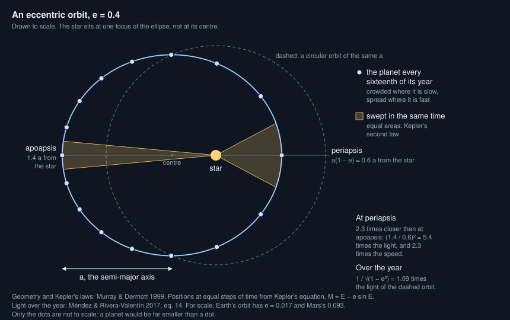
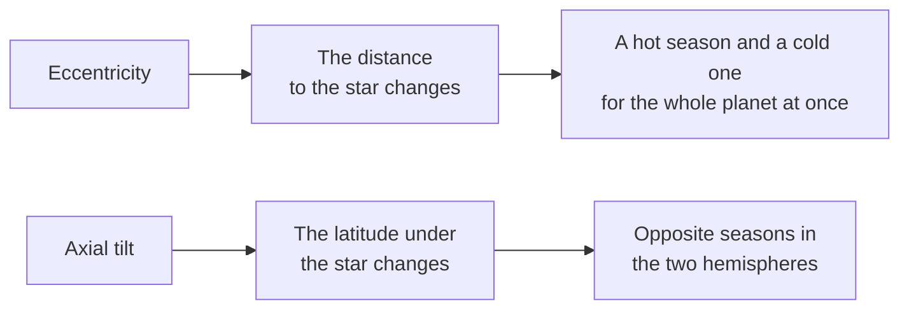

# What does an eccentric orbit change?

Seen from: the star view, where a world's orbit is drawn as an ellipse with
its periapsis and apoapsis, and the **Eccentricity** and **Starlight** lines
of the world card.

## Short answer

A planet's orbit is an ellipse, with the star at one focus rather than at
the centre. Its eccentricity says how stretched the ellipse is: at an
eccentricity of 0.1, the planet comes 10 % closer than on a circle of the
same size and goes 10 % farther. It moves fastest when it is closest.
Light fades with the square of the distance, so a planet gets more light
near the star, and over a whole year slightly more than on a circle of the
same size. Earth's eccentricity, 0.017, changes its light by 7 % over the
year, much less than its tilt does; Mars's, 0.093, by 45 %. Most planets
found round other stars by their star's wobble are more eccentric than
Earth, and a giant neighbour can stretch the orbit of a smaller planet.

## The science



### The ellipse

A planet on an orbit of semi-major axis $a$ (half the longest diameter of
the ellipse) and eccentricity $e$ is at a distance $r$ from its star when
it is at an angle $f$ from its closest point (Murray & Dermott 1999;
Méndez & Rivera-Valentín 2017):

```math
r = \frac{a\,(1 - e^2)}{1 + e\cos f},
\qquad
r_\text{peri} = a\,(1 - e),
\qquad
r_\text{apo} = a\,(1 + e)
```

**In words.** The closest point is the *periapsis* (the *perihelion* round
the Sun), the farthest the *apoapsis* (the *aphelion*). An eccentricity of
0 is a circle; the closer to 1, the longer and thinner the ellipse.

**Orders of magnitude.** Earth's eccentricity is 0.0167: it comes within
147.1 million km of the Sun and goes out to 152.1 million km. Mars's is
0.0935, from 206.7 to 249.3 million km; Mercury's 0.2056, from 46.0 to
69.8 million km (NASA fact sheets). Even Mercury's orbit looks almost
round; what shows is that the Sun sits off its centre.

### Kepler's second law: fast near, slow far

The line from the star to the planet sweeps equal areas in equal times
(Kepler's second law). The speed $v$ at distance $r$ follows from the
star's mass $M$ and the gravitational constant $G$ (the vis-viva equation,
Murray & Dermott 1999):

```math
v^2 = G M \left(\frac{2}{r} - \frac{1}{a}\right),
\qquad
\frac{v_\text{peri}}{v_\text{apo}} = \frac{1 + e}{1 - e}
```

**In words.** Near the star the planet falls inwards and speeds up; far
from it, it climbs outwards and slows down. It spends less of its year on
the near half of its orbit than on the far half.

**Orders of magnitude.** Earth moves at 30.29 km/s at perihelion and
29.29 km/s at aphelion; Mars at 26.50 and 21.97 km/s (NASA fact sheets).

Where the planet is at a given time follows from Kepler's equation. The
*mean anomaly* $M_a$ grows evenly with time, a full turn per year, and the
*eccentric anomaly* $E$ solves (Méndez & Rivera-Valentín 2017):

```math
M_a = E - e\sin E,
\qquad
r = a\,(1 - e\cos E)
```

**In words.** There is no formula that gives the place directly from the
date; the equation is solved step by step. It is what spaces the dots of
the figure above: crowded near the apoapsis, spread out near the periapsis.

### Light: the inverse square

A star of luminosity $L$ gives a planet at distance $r$ a flux (Méndez &
Rivera-Valentín 2017, eq. 1)

```math
F = \frac{L}{4\pi r^2},
\qquad
\frac{F_\text{peri}}{F_\text{apo}} = \left(\frac{1 + e}{1 - e}\right)^2
```

**In words.** Twice as close, four times the light. The swing grows fast
with the eccentricity, because both the near and the far distance move.

**Orders of magnitude.** From the NASA distances: Earth gets 6.9 % more
light at perihelion than at aphelion, Mars 45 % more, Mercury 2.3 times as
much. At $e = 0.4$, the ratio is 5.4.

### Over the year: a little more light

Averaged over a whole year, the time the planet spends at each distance
weighs the light it gets there. The mean flux is (Méndez &
Rivera-Valentín 2017, eq. 14, "a well known expression"):

```math
\langle F \rangle = \frac{L}{4\pi a^2}\,\frac{1}{\sqrt{1 - e^2}}
```

**In words.** The planet spends less time near the star, but it gets so
much more light there that the near part wins. The more eccentric the orbit,
the more light over a year than on a circle of the same semi-major axis.

**Orders of magnitude.** The factor $1/\sqrt{1 - e^2}$ is 1.0001 for Earth,
1.004 for Mars, 1.022 for Mercury and 1.25 for $e = 0.6$.

More light does not mean a warmer mean temperature, though. Méndez &
Rivera-Valentín (2017) average the equilibrium temperature itself over the
orbit and find that it "slowly decreases with eccentricity until
converging to a value 90% that of a circular orbit": the mean distance,
$a\,(1 + e^2/2)$, grows too, and the temperature goes as the fourth root
of the flux. To fourth order (their eq. 16):

```math
\langle T_\text{eq} \rangle \approx T_\text{eq,circle}
\left(1 - \frac{e^2}{16} - \frac{15\,e^4}{1024}\right)
```

**Orders of magnitude.** At $e = 0.2$ the mean equilibrium temperature is
0.3 % below that of a circle, at $e = 0.6$ 2.4 % below, about 6 K for a
planet like Earth.

### Seasons: tilt against eccentricity



Both make seasons, of different kinds. The distance changes the light the
whole planet gets at once. The tilt moves the star north and south in the
sky, so one hemisphere's summer is the other's winter.

**Orders of magnitude.** Earth is tilted 23.44° and its light changes by
6.9 % between perihelion and aphelion: its seasons come from its tilt. Mars
is tilted 25.19° and its light changes by 45 %: both count (NASA fact
sheets). On an orbit of $e = 0.5$, the planet would get nine times as much
light at periapsis as at apoapsis: a short, hot season every year, in both
hemispheres.

### How eccentric are planets?

Kipping (2013) fitted the eccentricities of 396 planets found by radial
velocities with a Beta distribution:

```math
p(e) \propto e^{a-1}\,(1 - e)^{b-1},
\qquad a = 0.867 \pm 0.044,\quad b = 3.03 \pm 0.17
```

**In words.** Low eccentricities are the most common, but the tail is long:
many planets have orbits far more stretched than any in the Solar System.

**Orders of magnitude.** From these values: a mean of 0.22, a median of
0.17, a third of planets below 0.1, one in ten above 0.5. Earth's 0.0167
sits among the roundest 8 %. Kipping (2013) also finds that short- and
long-period planets follow distinct distributions, which he links to tides
circularising the closest orbits.

Small planets are calmer. Van Eylen et al. (2019) find that the
eccentricities of small planets that transit alone follow half a Gaussian
of width 0.32 ± 0.06, those in systems of several transiting planets one of
width 0.083 (+0.015, −0.020): a mean of about 0.07.

### A giant's pull: forced eccentricity

A giant planet on an eccentric orbit pulls harder on the side of its orbit
where it passes closer. Averaged over thousands of orbits, this lopsided
pull stretches the orbit of a smaller planet inside it: a *secular*
perturbation. For a planet at $a$
starting on a circle, inside a companion at $a_g$ with eccentricity $e_g$,
the eccentricity grows and shrinks as (Thébault et al. 2006, eq. 1, after
Heppenheimer 1978):

```math
e(t) = 2\,e_F\left|\sin\frac{u\,t}{2}\right|,
\qquad
e_F = \frac{5}{4}\,\frac{a}{a_g}\,\frac{e_g}{1 - e_g^2}
```

$e_F$ is the *forced eccentricity*; $u$ sets the period of the swing, and
grows with the companion's mass. Thébault et al. (2006) write it for a
companion star; nothing in it depends on the companion being a star.

**In words.** The planet's eccentricity swings between 0 and twice the
forced value. How far it swings depends on the distances and the giant's
eccentricity, not on the giant's mass: a lighter giant only takes longer.

**Orders of magnitude.** Jupiter ($e_g = 0.0487$, 5.20 AU) forces about
0.012 on a planet at Earth's distance. A Jupiter at 5 AU with $e_g = 0.2$
would force 0.052 on a planet at 1 AU. Earth's eccentricity does swing:
the largest term in it has a period of 405,000 years, set by the slow
turning of the orbits of Venus and Jupiter (the $g_2 - g_5$ term of
Laskar et al. 2004).

### What we do not know

- **The climate of eccentric worlds.** Méndez & Rivera-Valentín (2017) note
  that climate models find the habitable zone of planets on very elongated
  orbits "wider than expected from the mean flux approximation". Real
  temperatures "also depend on orbital variations of albedo and
  greenhouse", which a mean over the orbit leaves out.
- **Earth's orbit over long times.** Laskar et al. (2004) compute Earth's
  orbit over 250 million years, but beyond 40 to 50 million years "the
  chaotic evolution of the orbits prevents a precise determination of the
  Earth's motion".

## In the app

### What you see

- **Star view.** The world's orbit is an ellipse with the star at a focus,
  labelled at its periapsis and apoapsis with their distances. The planet
  moves along it at Kepler's pace when the view is animated. The panel
  gives the eccentricity with the two distances, and the speed: on
  average, at periapsis and at apoapsis.
- **World card.** **Eccentricity** ("0.093 · 1.38 AU to 1.67 AU", or
  "circular") and **Starlight**, the mean over the year.
- **Form.** An **Eccentricity** field from 0 to 0.9, or drawn.
- **Giants.** The star view's **Giant planets** section gives the
  **Forced eccentricity** the giants impose on the world.

### How it computes them

1. **The draw.** Without a value, `draw_eccentricity` draws from Kipping's
   Beta law, as the ratio of two gamma variates, kept at most 0.9. A
   tidally locked planet gets 0. The example presets use the real values:
   Earth 0.0167, Mars 0.0934, Venus 0.0068, Mercury 0.2056.
2. **The giants.** When the eccentricity was drawn, it is raised to at
   least the forced eccentricity of the giants: the formula above, its
   ratio inverted for a giant inside the world's orbit, summed over the
   giants as the square root of the sum of squares, at most 0.5.
3. **The light.** `StarInfo::new` stores the periapsis and apoapsis, the
   light at each, and the mean over the year, which uses the factor
   $1/\sqrt{1 - e^2}$. The climate takes that mean flux (`relative_flux`):
   it sets the heat a world absorbs over a year.
4. **The equilibrium temperature** is the mean over the year of Méndez &
   Rivera-Valentín (2017, eq. 16): the circular orbit's, at the
   semi-major axis, times $1 - e^2/16 - 15e^4/1024$
   (`mean_temperature_factor`). It falls a little as the eccentricity
   grows, while the mean flux rises. A giant's equilibrium temperature is
   computed the same way (`describe` in `giants.rs`).
5. **Systems.** A whole system draws each planet's eccentricity from the
   same law, times 0.4 in systems of four or more planets (packed systems
   are calmer, He et al. 2020); hot Jupiters get 0.
6. **The viewer** solves Kepler's equation by Newton's method
   (`keplerPosition` in
   [`starSystem.ts`](../../web/src/lib/viewer/starSystem.ts)) and gives the
   speeds by the vis-viva equation (`orbitalSpeed`).

The rules, trimmed (from
[`crates/mapgen/src/star.rs`](../../crates/mapgen/src/star.rs) and
[`crates/mapgen/src/giants.rs`](../../crates/mapgen/src/giants.rs)):

```rust
/// `1 / sqrt(1 − e²)` (1.0001 for Earth, 1.02 for Mercury, 1.25 at e = 0.6).
pub fn mean_flux_factor(eccentricity: f32) -> f32 {
    1.0 / (1.0 - eccentricity * eccentricity).max(1e-6).sqrt()
}

/// `1 − e²/16 − 15e⁴/1024` (Méndez & Rivera-Valentín 2017, eq. 16; 0.997
/// at e = 0.2, 0.976 at 0.6).
pub fn mean_temperature_factor(eccentricity: f32) -> f32 {
    let e2 = eccentricity * eccentricity;
    1.0 - e2 / 16.0 - 15.0 * e2 * e2 / 1024.0
}

// In `StarInfo::new`: the mean flux, and the mean temperature.
let at = |au: f32| v.luminosity / (au * au);
let insolation = at(orbit_au) * mean_flux_factor(eccentricity);
equilibrium_k: equilibrium_k(at(orbit_au)) * mean_temperature_factor(eccentricity),

/// The beta distribution fitted by Kipping (2013) (a = 0.867, b = 3.03).
pub fn draw_eccentricity(rng: &mut impl RngExt) -> f32 {
    let (x, y) = (gamma(0.867, rng), gamma(3.03, rng));
    ((x / (x + y)) as f32).min(ECCENTRICITY.max)
}

/// `(5/4)(a/a_g) e_g/(1 − e_g²)` inside the giant's orbit, the ratio
/// inverted outside it.
pub fn forced_eccentricity(a: f64, a_g: f64, e_g: f64) -> f64 {
    let ratio = if a < a_g { a / a_g } else { a_g / a };
    1.25 * ratio * e_g / (1.0 - e_g * e_g).max(1e-6)
}
```

The request ([`request.rs`](../../crates/mapgen/src/request.rs)) then
raises a drawn eccentricity, up to three times as the giants are drawn
again round the new orbit:

```rust
if eccentricity_drawn && !locked {
    for _ in 0..3 {
        let forced = crate::giants::GiantSystem::draw(&params)
            .map_or(0.0, |g| g.forced_eccentricity);
        if forced <= params.eccentricity {
            break;
        }
        params.eccentricity = forced.min(ECCENTRICITY.max);
    }
}
```

### Where it departs from the science

- **No seasons from the orbit.** The climate is a yearly mean. It takes the
  extra light of an eccentric orbit, but not its swing: a world at
  $e = 0.5$ gets nine times more light at periapsis than at apoapsis, yet
  its maps show one mean year. The viewer's season control moves the sun
  with the tilt only.
- **A climate from the mean flux.** The card's equilibrium temperature
  is the mean over the year, which falls with the eccentricity, but the
  climate scales with the mean flux, which rises. A world whose climate
  scales as $S^{1/4}$ is 5.7 % warmer at $e = 0.6$, in kelvins, than on a
  circle, while its equilibrium temperature reads 2.4 % lower. The mean
  flux sets the heat absorbed over a year, but the climate models that
  Méndez & Rivera-Valentín (2017) cite find the habitable zone of very
  eccentric planets wider than the mean flux predicts.
- **A giant's law for every world.** Kipping's fit comes from planets found
  by radial velocities, mostly giants. A lone rocky world drawn from it has
  a median of 0.17, while small planets in multi-planet systems average
  about 0.07 (Van Eylen et al. 2019). Whole systems scale it by 0.4, which
  comes close; single worlds do not.
- **The forced eccentricity is a floor.** In secular theory, the
  eccentricity swings: from 0 to twice the forced value for a planet that
  started circular. The app takes the forced value as a lower bound and
  never lets the drawn value fall below it. It also adds several giants'
  forcings as a sum of squares, ignoring how their orbits line up.
- **Outside a giant's orbit.** Thébault et al. (2006) give the formula for
  a planet inside its perturber's orbit. For a world beyond a giant, the
  app inverts the ratio; the sources here do not cover that case.
- **A low-order formula.** Thébault et al. (2006) find its amplitude within
  10 % of their simulations for the cases they explored, and its period off
  by up to 70 %. The app applies it to any world that keeps the spacing
  of [How close can two planets orbit?](planet-spacing.md) from a giant,
  about 6.6 mutual Hill radii for an Earth and a Jupiter, however close
  that is.

## Sources

1. Murray, C. D. & Dermott, S. F. 1999, *Solar System Dynamics*, Cambridge
   University Press, chapter 2 (the two-body problem: the ellipse, Kepler's
   laws, the vis-viva equation).
2. Méndez, A. & Rivera-Valentín, E. G. 2017, "The equilibrium temperature
   of planets in elliptical orbits", *The Astrophysical Journal Letters*
   837, L1,
   [doi:10.3847/2041-8213/aa5f13](https://doi.org/10.3847/2041-8213/aa5f13),
   preprint [arXiv:1702.07314](https://arxiv.org/abs/1702.07314). Distances
   and anomalies (§3), the mean flux (eq. 14), the mean equilibrium
   temperature (eq. 15–16).
3. Kipping, D. M. 2013, "Parametrizing the exoplanet eccentricity
   distribution with the Beta distribution", *Monthly Notices of the Royal
   Astronomical Society* 434, L51–L55,
   [doi:10.1093/mnrasl/slt075](https://doi.org/10.1093/mnrasl/slt075),
   preprint [arXiv:1306.4982](https://arxiv.org/abs/1306.4982).
4. Van Eylen, V. et al. 2019, "The orbital eccentricity of small planet
   systems", *The Astronomical Journal* 157, 61,
   [doi:10.3847/1538-3881/aaf22f](https://doi.org/10.3847/1538-3881/aaf22f),
   preprint [arXiv:1807.00549](https://arxiv.org/abs/1807.00549).
5. Thébault, P., Marzari, F. & Scholl, H. 2006, "Relative velocities among
   accreting planetesimals in binary systems: the circumprimary case",
   *Icarus* 183, 193–206,
   [doi:10.1016/j.icarus.2006.01.022](https://doi.org/10.1016/j.icarus.2006.01.022),
   preprint [arXiv:astro-ph/0602046](https://arxiv.org/abs/astro-ph/0602046).
   The secular eccentricity, eq. 1 and 3.
6. Heppenheimer, T. A. 1978, "On the formation of planets in binary star
   systems", *Astronomy & Astrophysics* 65, 421,
   [ADS 1978A&A....65..421H](https://ui.adsabs.harvard.edu/abs/1978A%26A....65..421H).
   The original of the formula; quoted here through Thébault et al. (2006).
7. Laskar, J., Robutel, P., Joutel, F., Gastineau, M., Correia, A. C. M. &
   Levrard, B. 2004, "A long-term numerical solution for the insolation
   quantities of the Earth", *Astronomy & Astrophysics* 428, 261–285,
   [doi:10.1051/0004-6361:20041335](https://doi.org/10.1051/0004-6361:20041335).
8. NASA Space Science Data Coordinated Archive, fact sheets for
   [Earth](https://nssdc.gsfc.nasa.gov/planetary/factsheet/earthfact.html),
   [Mars](https://nssdc.gsfc.nasa.gov/planetary/factsheet/marsfact.html),
   [Mercury](https://nssdc.gsfc.nasa.gov/planetary/factsheet/mercuryfact.html)
   and
   [Jupiter](https://nssdc.gsfc.nasa.gov/planetary/factsheet/jupiterfact.html)
   (eccentricities, perihelion and aphelion distances, orbital speeds,
   tilts).

## See also

- [docs/analysis/10-stars.md](../analysis/10-stars.md): the study behind
  the app's stars and orbits, with the eccentric orbits follow-up.
- [docs/analysis/12-gas-giants.md](../analysis/12-gas-giants.md): the
  giants and their forced eccentricity.
- [Why are giant planets far from their star, and what is a hot
  Jupiter?](giant-planet-placement.md): where the giants that force an
  eccentricity come from.
