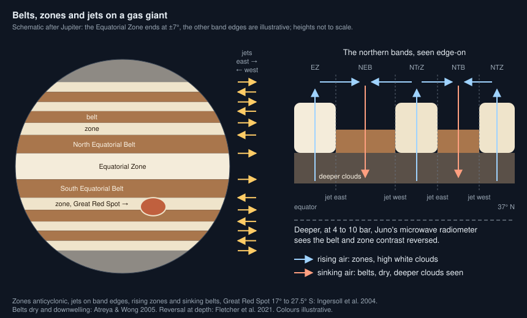
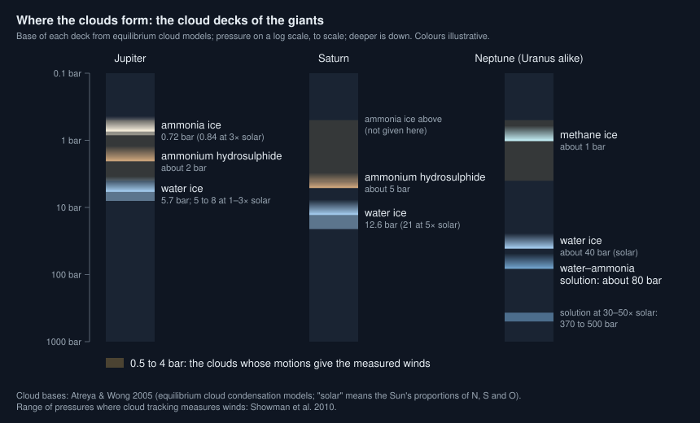

# Why do gas giants have bands?

Seen from: the planet view of a giant world (the `gas-giant`, `ice-giant`
and `hot-jupiter` presets): its banded globe, the **Clouds** and **Winds**
rows of its **Info** panel, the **Wind** and **Cloud tops** layers, and the
**Band drift** switch.

## Short answer

A giant planet spins fast, and on a fast-spinning sphere large eddies cannot
grow freely in the north–south direction: the turbulence organises itself
into east–west jets. The faster and larger the planet, and the slower its
winds, the more jets it has. Between the jets the air rises in some bands
and sinks in others. Where it rises, it carries ammonia up into high white
clouds (the zones); where it sinks, the air is dry and we see deeper, darker
clouds (the belts). Each gas condenses at its own depth, so the colour of a
giant depends on its temperature: cream and brown with ammonia clouds, blue
when methane absorbs the red light, white, azure or nearly black on hotter
giants.

## The science



### Jets: what a fast spin does to turbulence

On a rotating planet, the Coriolis effect depends on latitude. Its change
with latitude $\varphi$, for a planet of radius $a$ turning at the angular
rate $\Omega$, is $\beta = 2\Omega\cos\varphi / a$. Eddies smaller than a
certain size behave like ordinary turbulence. Larger ones turn into waves
that travel east and west, and their energy piles up in zonal jets. That
size is the Rhines scale, for winds of speed $U$ (Rhines 1975; Ingersoll
et al. 2004):

```math
L_\beta = \left(\frac{U}{\beta}\right)^{1/2},
\qquad
\beta = \frac{2\Omega\cos\varphi}{a}
```

**In words.** Jets are about as wide as the Rhines scale. A faster spin or
a smaller planet (a larger $\beta$) makes the jets narrower; faster winds
make them wider. Rhines (1975) showed that zonal jets grow out of decaying
turbulence this way. In shallow-water models of the giants on a sphere,
zonal jets "are verified to scale closely with the Rhines scale" (Scott &
Polvani 2007).

**Orders of magnitude.** Jupiter turns in 9.925 hours and has an
equatorial radius of 71,492 km (NASA fact sheet). With $U = 100$ m/s, a
typical speed of its jets, many of which "exceed 100 m s⁻¹" (Ingersoll
et al. 2004), $L_\beta$ is about 4,500 km at the equator, 3.6° of latitude.

Counting how many jets of that width fit from pole to pole gives the number
of jets (Showman et al. 2010, eq. 39):

```math
N_\text{jet} \sim \left(\frac{2\Omega a}{U}\right)^{1/2}
```

**In words.** The number of jets grows as the square root of the spin and
of the size, and falls as the square root of the wind speed. Rapidly
rotating planets "will tend to exhibit numerous strongly banded jets,
whereas slowly rotating planets will exhibit fewer jets with weaker
banding" (Showman et al. 2010).

**Orders of magnitude.** For Jupiter, the formula gives about 16 jets; for
Neptune (16.11 hours, 24,764 km, winds of 400 m/s), about 4. Jupiter and
Saturn each have about 20 jets, Uranus and Neptune three broad ones, with
peak speeds from about 150 m/s on Jupiter to over 400 m/s on Saturn and
Neptune (Showman et al. 2010). On the ice giants the equatorial jet blows
westward, against the spin, and the two high-latitude jets eastward; in the
shallow-water models, equatorial jets become "increasingly and consistently
retrograde" as the deformation radius shrinks (Scott & Polvani 2007).

### Belts and zones: where the air rises and sinks

On Jupiter, "the white bands are called zones and the dark bands are called
belts", and the jets are strongest on the boundaries between them
(Ingersoll et al. 2004). The zones are anticyclonic: in the northern
hemisphere they have an eastward jet on their poleward edge and a westward
jet on their equatorward edge. The belts turn the other way. The
Equatorial Zone lies between the eastward jets at ±7° of latitude.

The traditional view is that the air in the zones is slowly rising and the
air in the belts slowly sinking (Ingersoll et al. 2004). Several
observations agree with it:

- the visible cloud deck is higher in the zones and lower in the belts
  (Ingersoll et al. 2004), or at least the zones carry thicker high clouds
  and haze (Sudarsky et al. 2000);
- the belts hold less ammonia and thinner clouds, and the holes in the
  clouds that let heat through from below (the 5-µm hot spots) lie in the
  belts (Ingersoll et al. 2004);
- "the belts represent relatively dry, downwelling regions" (Atreya &
  Wong 2005).

The colours do not come from the height alone. The colour differences of
belts and zones are thought to come mostly from "chromophores", coloured
compounds probably made by sunlight in the upper atmosphere, within the
ammonia cloud deck and seen better where the clouds and haze are thinner
(Sudarsky et al. 2000). What they are is not known. For
the Great Red Spot, the products of ammonia and acetylene under ultraviolet
light match its colour in the laboratory (Carlson et al. 2016).

### Clouds at different depths



Rising air cools. Each gas condenses where its partial pressure reaches its
saturation pressure, which sets the base of its cloud. For a giant of the
Sun's composition the decks stack, from the top: ammonia ice, ammonium
hydrosulphide (NH₄SH, from ammonia and hydrogen sulphide) and water. In
Jupiter's equilibrium cloud models, ammonia condenses at 0.72 bar (0.84 bar
for three times the Sun's nitrogen), NH₄SH near 2 bar and water at 5.7 bar
for the Sun's oxygen, 5 to 8 bar for one to three times it (Atreya & Wong
2005).

**In words.** On a colder planet each gas reaches its condensation
temperature deeper down, so the same clouds form at higher pressures.

**Orders of magnitude.** Saturn is colder than Jupiter, so its decks sit
deeper: NH₄SH near 5 bar, water at 12.6 bar for the Sun's oxygen, 21 bar
for five times it (Atreya & Wong 2005). On Neptune, colder still, the top
cloud at about 1 bar is methane ice, and water condenses only near 40 bar.
The winds measured by tracking clouds come from the levels at 0.5 to 4 bar
(Showman et al. 2010).

### Why ice giants are blue

Uranus and Neptune hold far more methane than Jupiter. Methane absorbs red
light. In the words of Atreya & Wong (2005), "the aqua-marine color of
Uranus and Neptune ... is a direct consequence of the scattering of the
Sun's bluish-green light by their atmospheres in which the Sun's red light
is absorbed effectively by the large quantities of methane", and their white
clouds are methane ice.

Neptune is often shown deep blue and Uranus pale cyan. The difference is
smaller than those images suggest: Uranus is less blue, because of a
thicker haze, but "it is much less significant than is commonly believed due
to a long-standing misperception of Neptune's 'true' colour" (Irwin et al.
2024).

### Storms

Long-lived vortices sit in the bands. The Great Red Spot is an anticyclone,
a high-pressure centre, from 17°S to 27.5°S. Its oval shape appears in
drawings from 1831. It was 39,000 km long from east to west in 1880 and
17,000 km around 2000 (Ingersoll et al. 2004), and it keeps shrinking: by
0.194° of longitude a year in length and 0.048° a year in width (Simon et
al. 2018). Its 2017 length in their fit, about 14° of longitude, is still
some 16,000 km at its latitude, more than Earth's diameter. It drifts
westward, by about 0.36° of longitude a day (Simon et al. 2018). Many
smaller
anticyclones, the white ovals, sit in the zones (Ingersoll et al. 2004).

### Hotter giants: the cloud classes

Close to a star, a giant is too warm for some of these clouds. Sudarsky,
Burrows & Pinto (2000) sorted giant planets by their effective temperature
$T_\text{eff}$, the temperature at which they radiate, into five classes by
the clouds that form high in their atmosphere:

| Class | $T_\text{eff}$ | Top clouds | The light |
| --- | --- | --- | --- |
| I, "Jovian" | ≲ 150 K | ammonia ice | methane absorption |
| II, "water cloud" | ~250 K | water ice | highest visible albedo |
| III, "clear" | ≳ 350 K | none high up | sodium and potassium absorb |
| IV | 900–1500 K | silicates, deep | lowest albedo |
| V | ≳ 1500 K | silicates, high | far brighter than IV |

A class III giant reflects much of the blue light, with a spherical albedo
up to about 0.6, but under a tenth of the red (Sudarsky et al. 2000): it
would look blue. Class IV giants are as dark as the darkest bodies of the
Solar System. In class V, or in giants of low surface gravity (below
10 m/s²), the silicate cloud forms high enough to reflect much of the light
before the alkali metals absorb it.

### What we do not know

- **How deep the bands go.** Juno's microwave radiometer sees the banded
  structure throughout the troposphere, but the contrast between belts and
  zones changes sign between 4 and 10 bar, near the water clouds (Fletcher
  et al. 2021). The simple picture of rising zones and sinking belts may
  hold only above that level. In the upper troposphere the observed
  circulation, with cold air rising, must itself be driven mechanically
  (Ingersoll et al. 2004).
- **How high the zones' clouds stand.** Some analyses find no appreciable
  difference in altitude between belts and zones, only thicker high clouds
  and haze over the zones (Sudarsky et al. 2000, citing Chanover et al.
  1997).
- **Which wind speed sets the scale.** The jet count depends on $U$, and a
  giant's winds span a wide range. With Saturn's 400 m/s equatorial jet the
  formula gives about 7 jets, a third of what Saturn shows.
- **Why the equatorial jet goes one way or the other.** It blows eastward
  on Jupiter and Saturn, westward on Uranus and Neptune. Shallow-water
  models get both, depending on their parameters (Scott & Polvani 2007).
- **What colours the clouds.** The chromophores are still unidentified
  (Sudarsky et al. 2000; Carlson et al. 2016).

## In the app

### What you see

A giant world is all clouds. Its globe shows pale zones and dark belts from
an equatorial zone to the polar regions, wavy edges where neighbouring jets
shear, white ovals, and on some a great spot (gas giants) or a dark spot
with bright companion clouds (ice giants). With **Band drift** on, each band
turns at the pace of its own wind, some backwards. The **Info** panel gives
its cloud class (**Clouds**: "ammonia clouds, banded cream and brown", "water
clouds, bright white", and so on) and **Winds**: the jets in each
hemisphere and the strongest westward and eastward winds. The **Wind**
layer shows the eastward wind, and **Cloud tops** the height of the clouds,
"deep belts" to "high storms". The star view draws giants not yet generated
as spheres with simple bands in the same colours.

### How it computes them

[`giant_world.rs`](../../crates/mapgen/src/giant_world.rs) draws the look
of a giant (`Look::draw`), then samples it on every pixel:

1. **The cloud class.** The effective temperature combines the starlight
   (its equilibrium temperature) and an internal heat of
   $100\,\text{K}\times(M/M_J)^{0.4}$ for a gas giant, 40 K for an ice giant:
   $T_\text{eff} = (T_\text{eq}^4 + T_\text{int}^4)^{1/4}$. `cloud_class` in
   [`giants.rs`](../../crates/mapgen/src/giants.rs) turns it into a class:
   below 150 K, I; below 350 K, II; below 900 K, III; below 1500 K, IV;
   above, V. Each class, and the kind of giant, has its palette of zone,
   belt, storm and polar colours. A cold ice giant gets cyan to deep blue.
2. **The jets.** The spin is drawn (9 to 12 hours for a gas giant, 14 to 19
   for an ice giant; a hot giant is locked, its day its year). The jets in
   each hemisphere follow the Rhines count, $0.45\sqrt{\Omega R/U}$, with a
   typical wind $U$ of 100 m/s for gas giants, 300 for ice giants and
   2,000 for hot ones, between 1 and 8.
3. **The bands.** An equatorial zone (±6° to 11° on a gas giant), then
   $2J-1$ bands in each hemisphere for $J$ jets, belts and zones in turn,
   narrower towards the poles, up to the polar regions (58° to 74°).
4. **The winds.** A gas giant gets a jet on every band edge, eastward on
   the poleward edge of a zone, westward on its equatorward edge, weaker
   towards the poles, and an eastward equatorial jet. An ice giant gets a
   smooth profile, westward at the equator and eastward at high latitudes.
   A hot giant gets one broad eastward jet at the equator.
5. **Each pixel.** The latitude it samples is shifted by noise stretched
   along the bands, more on the band edges. Storms swirl the bands around
   them. Zones are high and cool, belts low and 6 K warmer at the cloud
   tops.

The jets and bands, trimmed (from `crates/mapgen/src/giant_world.rs`):

```rust
const GAS_WIND: f64 = 100.0; // m/s, Jupiter's jets
const ICE_WIND: f64 = 300.0; // broader, faster winds of ice giants
const HOT_WIND: f64 = 2000.0; // a hot Jupiter's superrotation
/// Jets per hemisphere at √(ΩR/U) = 1: Jupiter (ΩR/U ≈ 126) gets five.
const JET_FACTOR: f64 = 0.45;

let omega = 2.0 * PI / (f64::from(rotation_hours) * 3600.0);
let jets = ((JET_FACTOR * (omega * radius_m / wind).sqrt()).round() as u32)
    .clamp(1, 8);
// Each hemisphere: belts and zones in turn, narrower poleward.
let count = (2 * jets - 1) as usize;
let weights: Vec<f32> = (0..count)
    .map(|k| rng.random_range(0.5..1.5) * (1.0 - 0.55 * k as f32 / count as f32))
    .collect();
```

With Jupiter's spin and radius this gives five jets in each hemisphere,
counted as the eastward ones: the wind profile has nine alternating jets in
each hemisphere and one at the equator, 19 in all, close to Jupiter's
"∼20". With Neptune's, it gives one.

The storms are drawn with the bands: a great spot on 45 % of gas giants,
17° to 26° south, 15° to 29° of longitude long; two to eight white ovals
between 20° and 50°; a dark spot with bright companion clouds on half the
ice giants. Hot giants get none.

The viewer moves each band with its wind, read from `wind_profile` every
2° of latitude (`giantColour` in
[`shaders.ts`](../../web/src/lib/viewer/shaders.ts)). The fastest band goes
round in two minutes, the others in proportion, and each storm drifts whole
at the wind of its centre. A giant not generated yet is drawn from its
preview, a sine pattern of bands in the zone and belt colours
([`previewTexture.ts`](../../web/src/lib/viewer/previewTexture.ts)).

### Where it departs from the science

- **The wind speed is an input.** On a real giant the winds come out of the
  same turbulence as the jets; the app takes one typical speed per kind of
  giant. A gas giant always counts with 100 m/s, so a Saturn-like giant
  gets four jets in each hemisphere, while its real equatorial jet blows
  at over 400 m/s.
- **Ice giants have one fixed wind profile.** It peaks at 240 m/s both ways:
  westward at the equator, eastward near 69°, changing sign at 35°. It does
  not depend on the giant's spin or size, so every ice giant has the same
  three jets, whatever the Rhines count says.
- **The bands are colours, not cloud layers.** Zones and belts are drawn as
  pale and dark colours, with cloud tops 0.06 elevation units above or
  below the deck. No ammonia, NH₄SH or water layer is modelled, nor the
  thinner clouds that let the deeper ones show in the belts. The palettes
  are chosen by eye for each class.
- **Only the cloud tops.** The app has nothing below them, so the reversal
  Juno sees below 4 to 10 bar never shows. It would matter only in a view of
  the depths, which the app does not have.
- **Class boundaries.** Sudarsky et al. (2000) give about 250 K for class II
  and above 350 K for class III; the app puts everything from 150 to 350 K in
  class II. A giant of 300 K is drawn white; it might be clear instead.
- **Class V ignores gravity.** Sudarsky et al. (2000) also put giants of low
  surface gravity (below 10 m/s²) in class V at lower temperatures, which
  the app does not. And it paints class V a darkish grey, lighter than
  class IV but darker than "much higher albedos than those of Class IV"
  suggests.
- **Methane blue only for cold ice giants.** An ice giant of class II or
  above gets the same palette as a gas giant of that class.
- **The internal heat is a rule of thumb.** $100\,\text{K}\times(M/M_J)^{0.4}$
  for gas giants and a fixed 40 K for ice giants, with no age. It sets the
  class of giants far from their star: a giant of ten Jupiter masses gets
  250 K of internal heat, hence water clouds, wherever it orbits.
- **The Great Red Spot does not follow the bands.** It is placed at 17° to
  26° south whatever band lies there, and it does not shrink with time.
  In the viewer it drifts at the wind of its centre, which can be fast if it
  sits on a jet; the real one drifts slowly westward.
- **Band drift is a sight.** The fastest band turns in two minutes; the
  relative speeds are kept, not the true pace. The help text says so.
- **The preview's bands.** A giant not generated yet shows a regular sine
  of bands whose count is the jets per hemisphere, not the bands it will
  get once generated.

## Sources

1. Rhines, P. B. 1975, "Waves and turbulence on a beta-plane", *Journal of
   Fluid Mechanics* 69, 417–443,
   [doi:10.1017/S0022112075001504](https://doi.org/10.1017/S0022112075001504).
2. Scott, R. K. & Polvani, L. M. 2007, "Forced-dissipative shallow-water
   turbulence on the sphere and the atmospheric circulation of the giant
   planets", *Journal of the Atmospheric Sciences* 64, 3158–3176,
   [doi:10.1175/JAS4003.1](https://doi.org/10.1175/JAS4003.1).
3. Showman, A. P., Cho, J. Y-K. & Menou, K. 2010, "Atmospheric circulation
   of exoplanets", in Seager, S. (ed.), *Exoplanets*, University of Arizona
   Press, 471–516, preprint
   [arXiv:0911.3170](https://arxiv.org/abs/0911.3170). The jet count
   (eq. 39), the jets and wind speeds of the four giants, the pressures of
   cloud tracking.
4. Ingersoll, A. P. et al. 2004, "Dynamics of Jupiter's atmosphere", in
   Bagenal, F., Dowling, T. E. & McKinnon, W. B. (eds), *Jupiter: The
   Planet, Satellites and Magnetosphere*, Cambridge University Press,
   105–128,
   [CaltechAUTHORS](https://authors.library.caltech.edu/records/8wqax-apm75).
   Belts and zones, the Rhines scale, rising zones and sinking belts, the
   Great Red Spot.
5. Atreya, S. K. & Wong, A. S. 2005, "Coupled clouds and chemistry of the
   giant planets: a case for multiprobes", *Space Science Reviews* 116,
   121–136,
   [doi:10.1007/s11214-005-1951-5](https://doi.org/10.1007/s11214-005-1951-5).
   Cloud bases of Jupiter, Saturn and Neptune; the colour of the ice giants.
6. Sudarsky, D., Burrows, A. & Pinto, P. 2000, "Albedo and reflection
   spectra of extrasolar giant planets", *The Astrophysical Journal* 538,
   885–903, [doi:10.1086/309160](https://doi.org/10.1086/309160), preprint
   [arXiv:astro-ph/9910504](https://arxiv.org/abs/astro-ph/9910504).
7. Fletcher, L. N. et al. 2021, "Jupiter's temperate belt/zone contrasts
   revealed at depth by Juno microwave observations", *Journal of
   Geophysical Research: Planets* 126, e2021JE006858,
   [doi:10.1029/2021JE006858](https://doi.org/10.1029/2021JE006858),
   preprint [arXiv:2110.14620](https://arxiv.org/abs/2110.14620).
8. Irwin, P. G. J. et al. 2024, "Modelling the seasonal cycle of Uranus's
   colour and magnitude, and comparison with Neptune", *Monthly Notices of
   the Royal Astronomical Society* 527, 11521–11538,
   [doi:10.1093/mnras/stad3761](https://doi.org/10.1093/mnras/stad3761).
9. Simon, A. A. et al. 2018, "Historical and contemporary trends in the
   size, drift, and color of Jupiter's Great Red Spot", *The Astronomical
   Journal* 155, 151,
   [doi:10.3847/1538-3881/aaae01](https://doi.org/10.3847/1538-3881/aaae01).
10. Carlson, R. W. et al. 2016, "Chromophores from photolyzed ammonia
    reacting with acetylene: application to Jupiter's Great Red Spot",
    *Icarus* 274, 106–115,
    [doi:10.1016/j.icarus.2016.03.008](https://doi.org/10.1016/j.icarus.2016.03.008).
11. NASA Space Science Data Coordinated Archive, [Jupiter fact
    sheet](https://nssdc.gsfc.nasa.gov/planetary/factsheet/jupiterfact.html)
    and [Neptune fact
    sheet](https://nssdc.gsfc.nasa.gov/planetary/factsheet/neptunefact.html)
    (radii, rotation periods).

## See also

- [docs/analysis/12-gas-giants.md](../analysis/12-gas-giants.md): the study
  behind the app's giant planets and giant worlds.
- [Why are giant planets far from their star, and what is a hot
  Jupiter?](giant-planet-placement.md)
- [How far can rings reach?](ring-extent.md) and [Why are ring moons so
  small?](ring-moons.md)
- The README's **giant worlds** and **giants** paragraphs, for the options
  and the data stored in `world.json`.
