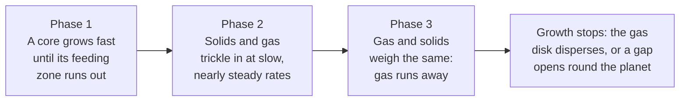
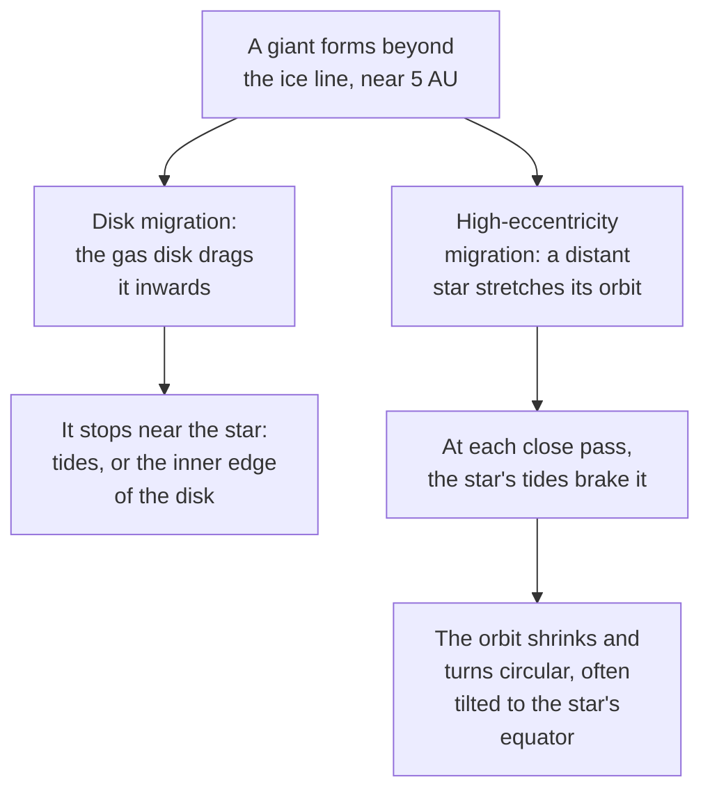

# Why are giant planets far from their star, and what is a hot Jupiter?

Seen from: the star view, where a world's giant neighbours circle beyond its
own orbit, and the **Giant planets** section of its panel, which marks a few
of them "hot Jupiter".

## Short answer

A giant planet starts as a solid core that grows large enough to pull in the
gas of the young star's disk. Close to the star only rock and metal are
solid. Beyond the ice line, about 2.7 AU from the young Sun, water freezes
too, and there is about four times more solid matter to build a core. That
is why most giants orbit between 1 and 10 AU. About one Sun-like star in a
hundred has a hot Jupiter instead: a giant that goes round its star in a few
days. It cannot have formed there; it moved inwards later, either through
the gas disk or on a stretched orbit that the star's tides then shrank.

## The science

### The ice line: where water freezes

Hayashi (1981) modelled the disk of gas and dust around the young Sun, the
solar nebula. Where the disk is clear enough for sunlight to reach it, its
temperature $T$ at a distance $r$ from a star of luminosity $L$ is
(Hayashi 1981, eq. 2.3):

```math
T = 280\,\text{K}\;\left(\frac{r}{1\,\text{AU}}\right)^{-1/2}
\left(\frac{L}{L_\odot}\right)^{1/4}
```

Water ice condenses below 170 K. Setting $T = 170$ K gives the ice line:

```math
r_\text{ice} = \left(\frac{280}{170}\right)^2
\sqrt{\frac{L}{L_\odot}}\;\text{AU}
\approx 2.7\,\sqrt{\frac{L}{L_\odot}}\;\text{AU}
```

**In words.** The farther from the star, the colder the disk. Past a certain
distance, water vapour freezes into grains of ice, and those grains add to
the rock and metal available to build planets. A brighter star pushes that
line outwards, as the square root of its luminosity.

**Orders of magnitude.** For the Sun, the ice line falls at 2.7 AU, between
Mars (1.5 AU) and Jupiter (5.2 AU), in the asteroid belt. Hayashi's solids
weigh $7.1\,r^{-1.5}$ g/cm² inside it and $30\,r^{-1.5}$ g/cm² beyond it:
the ice multiplies the material for planets by about 4.2 at the line. He
assumed that almost all the dust between 1.55 and 7 AU went into Jupiter's
core, because ice made the dust near Jupiter's orbit much denser and its
growth "much faster". A star a quarter as bright as the Sun has its ice line
at 1.35 AU.

### Core accretion: a race against the disk

Pollack et al. (1996) followed a growing giant through three phases:



The mass at which the gas starts to run away, when the core and the
envelope weigh about the same, is the *crossover mass*. Earlier models had
put this "critical" core mass at about 10 to 30 Earth masses, as Pollack et
al. (1996) recall. The length of phase 2 sets how long the whole
growth takes.

**In words.** The core has to come first, and it has to be big before the
gas is gone. A core that grows too slowly ends up as a small planet with a
thin envelope, or with none.

**Orders of magnitude.** Pollack et al. (1996) needed about 10 g/cm² of
planetesimals near Jupiter's orbit, three to four times the "minimum-mass"
nebula there, to build Jupiter and Saturn in 1 to 10 million years. The gas
of the solar nebula is thought to last about $10^7$ years. Their models
suggest that the gas was gone while Uranus and Neptune were still in phase 2,
which is why those two have small gas envelopes.

### How common giant planets are, and where

Surveys that measure the wobble of a star under the pull of its planets
(radial velocities) count giant planets round Sun-like stars. Cumming et al.
(2008) fitted how many there are by mass $M$ and orbital period $P$:

```math
dN = C\,M^{\alpha}\,P^{\beta}\;d\ln M\;d\ln P,
\qquad \alpha = -0.31 \pm 0.2,\quad \beta = 0.26 \pm 0.1
```

**In words.** Light giants are more common than heavy ones, and giants on
long orbits more common than on short ones. Counted in equal steps of the
logarithm of the mass, there are $10^{0.31} \approx 2$ times more planets
for every factor of 10 lighter.

**Orders of magnitude.** In their sample, 10.5 % of Sun-like stars have a
planet of 0.3 to 10 Jupiter masses with a period of 2 to 2,000 days, and
the share of planets jumps by a factor of 5 beyond periods of 300 days.
Extended out to 20 AU, 17 to 20 % of stars have a gas giant. M dwarfs are 3
to 10 times less likely to have a Jupiter-mass planet (Cumming et al. 2008).

Fulton et al. (2021) counted farther out. Giant planets are most frequent
between 1 and 10 AU; their occurrence rises by a factor of about 4 around
1 AU. They find 14.1 giant planets per 100 stars between 2 and 8 AU, and
8.9 per 100 between 8 and 32 AU, where the count seems to fall.

### Metal-rich stars have more giants

Fischer & Valenti (2005) measured the iron content of stars with and
without planets. Astronomers write it $[\text{Fe/H}]$: the logarithm of
the star's ratio of iron to hydrogen, relative to the Sun's. They found
that the chance of forming a gas giant grows as "the square of the number
of metal atoms":

```math
P_\text{giant} \propto \left(10^{[\text{Fe/H}]}\right)^2
= 10^{\,2\,[\text{Fe/H}]}
```

**In words.** More metals in the star means more dust in its disk, so more
material for cores. Twice the iron gives four times the chance.

**Orders of magnitude.** Fewer than 3 % of stars with $-0.5 <
[\text{Fe/H}] < 0$ have a giant detected by radial velocities; at
$[\text{Fe/H}] > +0.3$, twice the Sun's iron, 25 % do (Fischer & Valenti
2005).

### Hot Jupiters

In 1995 Mayor & Queloz found a planet of about Jupiter's mass round the
Sun-like star 51 Pegasi. It moves on a nearly circular orbit only 0.05 AU
from its star, "about seven stellar radii" (Lin et al. 1996). Kepler's third
law gives its year, for a semi-major axis $a$ round a star of mass $M_\star$
(Murray & Dermott 1999):

```math
\frac{P}{1\,\text{yr}} = \left(\frac{a}{1\,\text{AU}}\right)^{3/2}
\left(\frac{M_\star}{M_\odot}\right)^{-1/2}
```

**In words.** Closer orbits are faster: the year shortens as the distance
to the power 3/2.

**Orders of magnitude.** At 0.05 AU from a star like the Sun, a year lasts
about 4 days. Jupiter, at 5.2 AU, takes 11.9 years. Such planets are called
hot Jupiters: round a Sun-like star, the light at 0.05 AU is 400 times what
Earth gets.

They are rare. Wright et al. (2012) find hot Jupiters round
1.2 ± 0.38 % of F, G and K dwarfs near the Sun. Howard et al. (2012) count
0.004 ± 0.001 planets per star with periods under 10 days and 8 to 32 Earth
radii in the Kepler field: 40 % of the rate near the Sun. They are lonely:
Steffen et al. (2012) searched the Kepler data near hot Jupiter candidates
and found no sign of other planets close by, unlike round warm Jupiters and
hot Neptunes.

### How a hot Jupiter gets there

Lin et al. (1996) argue that 51 Pegasi's planet is "extremely unlikely to
have formed at its present location". Two ways in are proposed:



- **Disk migration** (Lin et al. 1996): the planet forms near 5 AU and
  migrates inwards through what is left of the disk. It may stop where the
  star's tides hold it, or where the star's magnetic field has cleared the
  inner disk.
- **High-eccentricity migration** (Fabrycky & Tremaine 2007): a distant
  companion star slowly stretches the planet's orbit (Kozai cycles). Tides
  raised at each close pass to the star then shrink it. The resulting orbit
  "will typically be misaligned with the equator of its host star".

### Inflated hot Jupiters

Hot Jupiters are often larger than models of cold giants allow. Thorngren &
Fortney (2018) find that giants with an equilibrium temperature above
1,000 K are significantly larger than expected. The equilibrium temperature
is the temperature a body would have if it only re-radiated the starlight
it absorbs. For a flux $S$, in units of the flux Earth gets, and a Bond
albedo $A$ (the share of the light it reflects), it is (Méndez &
Rivera-Valentín 2017, eq. 4, for a fast-spinning body):

```math
T_\text{eq} = 278.5\,\text{K}\;(1 - A)^{1/4}
\left(\frac{S}{S_\oplus}\right)^{1/4}
\approx 255\,\text{K}\left(\frac{S}{S_\oplus}\right)^{1/4}
\quad (A = 0.3)
```

**In words.** Doubling the starlight raises the temperature by only a fifth:
it goes as the fourth root of the flux. With Earth's albedo, 0.3, Earth
itself comes out at 255 K (254 K in the NASA Earth fact sheet).

**Orders of magnitude.** At 0.05 AU from a Sun-like star, $S = 400\,S_\oplus$
and $T_\text{eq} \approx 1{,}100$ K, above the line. Thorngren & Fortney
(2018) find that the share of the starlight turned into internal heat rises
with $T_\text{eq}$ to a peak of about 2.5 % near 1,500 K, then falls at higher
temperatures. A few percent is enough to puff the planet up.

### What we do not know

- **Which migration dominates.** In situ formation, disk migration and
  high-eccentricity migration have all been proposed. "No origin channel
  alone satisfactorily explains all the evidence"; two together plausibly
  do (Dawson & Johnson 2018).
- **How cores grew in time.** Building a core from kilometre-sized
  planetesimals is slow. Sweeping up pebbles drifting through the gas
  shortens it by a factor 30 to 1,000 at 5 AU (Lambrechts & Johansen 2012).
- **Where the ice line was.** Hayashi's nebula is a single snapshot: he set
  the young Sun's luminosity to today's "for simplicity". The ice line of a
  real disk, which changes as it ages, need not sit where this snapshot
  puts it.
- **What heats inflated planets.** Thorngren & Fortney (2018) see
  "evidence for the Ohmic dissipation model", heating by electric currents,
  since only that model predicted the fall at high temperatures. Their
  title still ends with a question mark.

## In the app

### What you see

Each rocky world has the giant planets its seed draws, unless it was made
with `--giants none`. The star view draws them on their orbits. The world's
own system keeps its scale; beyond a dashed circle, distances grow
logarithmically, so a giant at 30 AU still fits on the screen. Hot Jupiters
sit just outside the star's disk, which is not to scale either.

The panel's **Giant planets** section lists each one by its letter
(`b`, `c`, …): its kind (gas giant, ice giant or hot Jupiter), mass, orbit
and year, and in its tooltip its cloud class, radius, temperature,
eccentricity and rings. A whole system (`--system`) places its giants among
its other planets. The rules and their sources are in
[docs/analysis/12-gas-giants.md](../analysis/12-gas-giants.md); the README's
**giants** paragraph sums them up.

### How it computes them

Round a world, [`GiantSystem::draw`](../../crates/mapgen/src/giants.rs)
draws the giants on a random stream of their own, so the world's other
drawn values do not change:

1. **How many.** A Poisson number of gas giants of mean 0.25 round a
   Sun-like star of the Sun's metallicity, and of ice giants of mean 0.3.
   Gas giants are multiplied by $10^{2[\text{Fe/H}]}$ (at most 10) and by
   the star's mass (kept within 0.1 and 2.5 solar masses). Ice giants
   follow the metallicity more weakly, $10^{0.5[\text{Fe/H}]}$, and the
   square root of the star's mass.
2. **A hot Jupiter** with odds of 1 %, multiplied the same way, and by
   0.2 when the world itself orbits within 0.5 AU ("hot Jupiters are
   lonely"); at most 20 %.
3. **Masses.** Gas giants from 0.1 to 13 Jupiter masses, with
   $dN/d\ln M \propto M^{-0.31}$; ice giants log-uniform from 10 to 50
   Earth masses.
4. **Distances.** The ice line is $2.7\sqrt{L}$ AU. Gas giants sit at
   $10^{0.3 \pm 0.4}$ times it (a log-normal: two thirds of them within
   2.1 to 13 AU round the Sun, around a median of 5.4 AU), ice giants at
   $10^{0.7 \pm 0.3}$ times it. A hot Jupiter gets a period of 1 to 10
   days, log-uniform, and a circular orbit. Every orbit stays within 0.02
   and 60 AU.
5. **Spacing.** A giant too close to the world or to another giant,
   apoapsis to periapsis, is drawn again up to six times, then dropped.
   Close means fewer mutual Hill radii than `hill_spacing` asks of the
   pair: 10 for two Earth masses, fewer for heavier pairs, about 6.6 for
   an Earth and a Jupiter, 6.4 for a Jupiter and a Saturn (see [How close
   can two planets orbit?](planet-spacing.md)). At most four giants stay.

The draw, trimmed (from `crates/mapgen/src/giants.rs`):

```rust
const GAS_GIANTS: f64 = 0.25;
const ICE_GIANTS: f64 = 0.3;
pub const HOT_JUPITERS: f64 = 0.01;
// Distances, as `log10` of a multiple of the ice line: mean and spread.
const GAS_ORBIT: (f64, f64) = (0.3, 0.4);
const ICE_ORBIT: (f64, f64) = (0.7, 0.3);

let gas_mean =
    GAS_GIANTS * 10f64.powf(2.0 * metals).min(10.0) * mass_factor;
let ice_line = 2.7 * f64::from(star.luminosity).sqrt();
// A rocky world close in leaves little room for a hot Jupiter.
let lonely = if world.orbit < 0.5 { 0.2 } else { 1.0 };
// For each giant that is not hot:
let orbit =
    ice_line * 10f64.powf(mean + spread * normal(&mut rng));
```

Each giant then gets its equilibrium temperature from the light it gets
at its semi-major axis (255 K × $S^{1/4}$, Earth's albedo), averaged over
its year as for the world (see [What does an eccentric orbit
change?](eccentric-orbits.md)). It is a hot giant above 1,000 K. Its
radius is inflated (`gas_giant_radius`, the law `giant_radius` and
`giant_radius_of` take from 30 Earth masses) by the heat its interior gets
(`inflation_heat`): the flux times the share of it turned into heat, the
Gaussian that Thorngren & Fortney (2018, eq. 34) fitted, relative to its
peak. That heat is greatest near 1,700 K, 0.8 of it at 1,500 K, half at
2,200 K, 4 % at 1,000 K. A Jupiter mass grows by 0.7 times the heat:
1.7 times its cold radius at its peak, 1.37 times at 2,200 K. Lighter
giants grow more, at most 1.9 times. Giants under 30 Earth masses are
not inflated; one of known composition (a planet of the model) still
grows with its light through the `S^0.044` of its envelope (Lopez &
Fortney 2014, see [planet-interiors.md](planet-interiors.md)), 1.5
times thicker at 1 000 times Earth's light than at 0.1.

From `crates/mapgen/src/giants.rs`, trimmed:

```rust
/// The heat a hot giant's interior gets from its star's light, relative to
/// the most any giant gets: the flux times the share of it turned into
/// heat, the Gaussian in `log F` of Thorngren & Fortney (2018).
fn inflation_heat(equilibrium_k: f32) -> f32 {
    const PEAK_LOG_F: f32 = 0.14;
    const SPREAD: f32 = 0.37;
    // Earth's flux, Gerg s⁻¹ cm⁻².
    const EARTH_FLUX: f32 = 1.361e-3;
    let flux = (equilibrium_k / equilibrium_k_of_earth()).powi(4)
        * EARTH_FLUX;
    // The log of the heat: the Gaussian share times the flux.
    let ln_power = |x: f32| {
        -(x - PEAK_LOG_F).powi(2) / (2.0 * SPREAD * SPREAD)
            + x * std::f32::consts::LN_10
    };
    let peak = PEAK_LOG_F + SPREAD * SPREAD * std::f32::consts::LN_10;
    (ln_power(flux.max(1e-12).log10()) - ln_power(peak)).exp()
}

// In `gas_giant_radius`:
let heat = inflation_heat(equilibrium_k);
let inflation = (1.0
    + 0.7 * heat * (JUPITER_EARTH_MASSES / m.max(30.0)).powf(0.25))
.min(1.9);
cold * if m > 30.0 { inflation } else { 1.0 }
```

A whole system ([`system.rs`](../../crates/mapgen/src/system.rs)) places
each planet type in a band of distances (`band`), from the star out:

| Type | May sit in | Prefers |
| --- | --- | --- |
| Hot Jupiter | 0.02 to 0.1 AU | 0.03 to 0.07 AU |
| Gas giant | half the ice line to 60 AU | the ice line to 4 times it |
| Ice giant | the ice line to 60 AU | 2.5 to 10 times the ice line |

Its planets keep the same spacing, `hill_spacing` mutual Hill radii, and
a hot Jupiter keeps the others beyond four times its period. When the
planets are left to the draw (`drawn_slots`), giants come with the same
means and log-normal distances as round a world, as slots of a giant
origin and an orbit, not a type: each drawn planet gets a mass from the
mass function of its origin, its physical model, and is typed by the
class the model gives it (`gas-giant`, `ice-giant`, `hot-jupiter`, …),
not by its origin. A hot Jupiter is drawn
last (`drawn_hot_jupiter`), so the other planets' draws do not change:
the same odds of 1 %, times the same metallicity and star mass factors,
at most 20 %, on a period of 1 to 10 days within 0.1 AU.

### Where it departs from the science

- **Giants are placed, not grown or moved.** The app draws where giants
  end up; it models neither core accretion nor migration. A hot Jupiter
  appears at its final orbit, circular, in the plane of the others. The
  misaligned orbits that high-eccentricity migration leaves are not drawn.
- **The counts are stretched beyond the surveys.** The mean of 0.25 gas
  giants per star matches Fulton et al. (2021), who count 0.23 between 2
  and 32 AU. The app spreads them over all distances and over 0.1 to 13
  Jupiter masses, while Cumming et al. (2008) fitted the $M^{-0.31}$ law
  above 0.3 Jupiter masses and for periods under 2,000 days. It is an
  extrapolation in both directions.
- **One metallicity law for every giant.** Fischer & Valenti (2005)
  measured $10^{2[\text{Fe/H}]}$ for giants found by radial velocities,
  mostly close in. The app applies it to every gas giant and to hot
  Jupiters, capped at 10 times. The weaker law for ice giants,
  $10^{0.5[\text{Fe/H}]}$, is a choice, not a fit.
- **Today's luminosity sets the ice line.** The app uses the star's present
  luminosity in $2.7\sqrt{L}$, the simplification Hayashi (1981) made for
  the young Sun. It ignores how the disk changes as it ages.
- **Inflation from the heat, by a rule.** The heat follows Thorngren &
  Fortney (2018); how much the radius grows with it is the app's choice,
  a straight line in the heat, not their evolution models. Its stronger
  inflation for lighter giants is a choice too, not from the paper.
- **Two temperature scales.** Thorngren & Fortney (2018) count the
  equilibrium temperature of a black body with no albedo. The app counts
  it with Earth's albedo, which reads the same flux 8.5 % cooler. The
  heat's peak, near 1,700 K in the app, is about 1,860 K on their scale.
  The heat itself is computed from the flux, so the two agree.
- **Beyond the data.** Thorngren & Fortney (2018) plot their fits up to
  about 2,500 K on their scale, where their abstract puts the efficiency
  near 0.2 %. Beyond, the app carries the Gaussian on, and the inflation
  falls towards nothing: a Jupiter mass is 1.15 times its cold radius at
  the app's 2,500 K, 1.02 times at 3,000 K. Whether the hottest giants
  stay inflated is left to that extrapolation.
- **Lonely, but not always.** Steffen et al. (2012) found no sign of close
  neighbours to hot Jupiters. Round a world, the app only lowers the odds
  (by five) of a hot Jupiter when the world orbits within 0.5 AU; it does
  not forbid it. In a drawn system the odds ignore the other planets, and
  the spacing then pushes them beyond four times the hot Jupiter's period.
- **Two mass laws for hot Jupiters.** Round a world, a hot Jupiter takes
  the gas giants' masses, 0.1 to 13 Jupiter masses. In a system, it takes
  the type's own, log-uniform from 0.3 to 3 Jupiter masses.

## Sources

1. Hayashi, C. 1981, "Structure of the solar nebula, growth and decay of
   magnetic fields and effects of magnetic and turbulent viscosities on the
   nebula", *Progress of Theoretical Physics Supplement* 70, 35–53,
   [doi:10.1143/PTPS.70.35](https://doi.org/10.1143/PTPS.70.35).
   Temperature (eq. 2.3), ice at 170 K, solid surface densities
   (eq. 2.4–2.5), Jupiter's core.
2. Pollack, J. B., Hubickyj, O., Bodenheimer, P., Lissauer, J. J.,
   Podolak, M. & Greenzweig, Y. 1996, "Formation of the giant planets by
   concurrent accretion of solids and gas", *Icarus* 124, 62–85,
   [doi:10.1006/icar.1996.0190](https://doi.org/10.1006/icar.1996.0190).
   The three phases, the crossover mass, surface densities, formation times.
3. Cumming, A. et al. 2008, "The Keck Planet Search: detectability and the
   minimum mass and orbital period distribution of extrasolar planets",
   *Publications of the Astronomical Society of the Pacific* 120, 531–554,
   [doi:10.1086/588487](https://doi.org/10.1086/588487), preprint
   [arXiv:0803.3357](https://arxiv.org/abs/0803.3357).
4. Fulton, B. J. et al. 2021, "California Legacy Survey. II. Occurrence of
   giant planets beyond the ice line", *The Astrophysical Journal Supplement
   Series* 255, 14,
   [doi:10.3847/1538-4365/abfcc1](https://doi.org/10.3847/1538-4365/abfcc1),
   preprint [arXiv:2105.11584](https://arxiv.org/abs/2105.11584).
5. Fischer, D. A. & Valenti, J. 2005, "The planet-metallicity
   correlation", *The Astrophysical Journal* 622, 1102–1117,
   [doi:10.1086/428383](https://doi.org/10.1086/428383).
6. Mayor, M. & Queloz, D. 1995, "A Jupiter-mass companion to a solar-type
   star", *Nature* 378, 355–359,
   [doi:10.1038/378355a0](https://doi.org/10.1038/378355a0).
7. Lin, D. N. C., Bodenheimer, P. & Richardson, D. C. 1996, "Orbital
   migration of the planetary companion of 51 Pegasi to its present
   location", *Nature* 380, 606–607,
   [doi:10.1038/380606a0](https://doi.org/10.1038/380606a0).
8. Murray, C. D. & Dermott, S. F. 1999, *Solar System Dynamics*, Cambridge
   University Press, chapter 2 (Kepler's laws).
9. Wright, J. T. et al. 2012, "The frequency of hot Jupiters orbiting
   nearby solar-type stars", *The Astrophysical Journal* 753, 160,
   [doi:10.1088/0004-637X/753/2/160](https://doi.org/10.1088/0004-637X/753/2/160),
   preprint [arXiv:1205.2273](https://arxiv.org/abs/1205.2273).
10. Howard, A. W. et al. 2012, "Planet occurrence within 0.25 AU of
    solar-type stars from Kepler", *The Astrophysical Journal Supplement
    Series* 201, 15,
    [doi:10.1088/0067-0049/201/2/15](https://doi.org/10.1088/0067-0049/201/2/15),
    preprint [arXiv:1103.2541](https://arxiv.org/abs/1103.2541). Hot
    Jupiter occurrence, §3.
11. Steffen, J. H. et al. 2012, "Kepler constraints on planets near hot
    Jupiters", *Proceedings of the National Academy of Sciences* 109,
    7982–7987,
    [doi:10.1073/pnas.1120970109](https://doi.org/10.1073/pnas.1120970109),
    preprint [arXiv:1205.2309](https://arxiv.org/abs/1205.2309).
12. Fabrycky, D. & Tremaine, S. 2007, "Shrinking binary and planetary
    orbits by Kozai cycles with tidal friction", *The Astrophysical
    Journal* 669, 1298–1315,
    [doi:10.1086/521702](https://doi.org/10.1086/521702), preprint
    [arXiv:0705.4285](https://arxiv.org/abs/0705.4285).
13. Thorngren, D. P. & Fortney, J. J. 2018, "Bayesian analysis of
    hot-Jupiter radius anomalies: evidence for Ohmic dissipation?", *The
    Astronomical Journal* 155, 214,
    [doi:10.3847/1538-3881/aaba13](https://doi.org/10.3847/1538-3881/aaba13),
    preprint [arXiv:1709.04539](https://arxiv.org/abs/1709.04539). The
    heating efficiency, the Gaussian of eq. 34.
14. Méndez, A. & Rivera-Valentín, E. G. 2017, "The equilibrium temperature
    of planets in elliptical orbits", *The Astrophysical Journal Letters*
    837, L1,
    [doi:10.3847/2041-8213/aa5f13](https://doi.org/10.3847/2041-8213/aa5f13),
    preprint [arXiv:1702.07314](https://arxiv.org/abs/1702.07314). The
    equilibrium temperature, eq. 4, and its mean over an eccentric orbit,
    eq. 16.
15. Dawson, R. I. & Johnson, J. A. 2018, "Origins of hot Jupiters",
    *Annual Review of Astronomy and Astrophysics* 56, 175–221,
    [doi:10.1146/annurev-astro-081817-051853](https://doi.org/10.1146/annurev-astro-081817-051853),
    preprint [arXiv:1801.06117](https://arxiv.org/abs/1801.06117).
16. Lambrechts, M. & Johansen, A. 2012, "Rapid growth of gas-giant cores
    by pebble accretion", *Astronomy & Astrophysics* 544, A32,
    [doi:10.1051/0004-6361/201219127](https://doi.org/10.1051/0004-6361/201219127),
    preprint [arXiv:1205.3030](https://arxiv.org/abs/1205.3030).
17. NASA Space Science Data Coordinated Archive, [Earth fact
    sheet](https://nssdc.gsfc.nasa.gov/planetary/factsheet/earthfact.html)
    and [Jupiter fact
    sheet](https://nssdc.gsfc.nasa.gov/planetary/factsheet/jupiterfact.html)
    (Earth's black-body temperature; Jupiter's orbit and period).

## See also

- [docs/analysis/12-gas-giants.md](../analysis/12-gas-giants.md): the study
  behind the app's giant planets, with more sources.
- [What does an eccentric orbit change?](eccentric-orbits.md): how an
  eccentric giant stretches a world's orbit.
- [Why are ring moons so small?](ring-moons.md): the rings and small moons
  of the app's giants.
- [docs/system-spec.md](../system-spec.md): how a whole system places its
  planets.
- The README's **giants** paragraph: [README.md](../../README.md).
