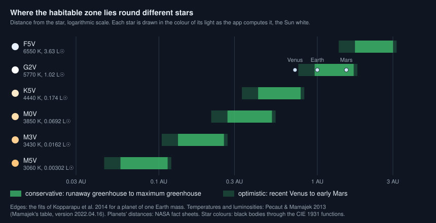
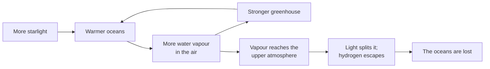
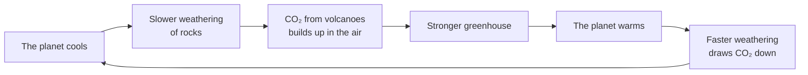

# What is the habitable zone?

Seen from: the star view (the green ring round the star, and "Habitable
zone" on its card), the world card ("in the habitable zone"), and the
form's "Habitable zone position".

## Short answer

The habitable zone is the ring of distances from a star where a planet
like Earth could keep liquid water on its surface. Too close, and its
water vapour traps so much heat that the oceans boil away: that is the
inner edge. Too far, and even a thick carbon dioxide atmosphere cannot
keep it above freezing: that is the outer edge. Round the Sun the zone runs
from about 0.95 to 1.68 times Earth's distance. A dimmer star has a zone
closer in, and narrower in kilometres. Being in the zone does not make a
planet habitable, still less inhabited: Mars is in it today, and frozen.

## The science



### A definition: liquid water on the surface

The habitable zone is "traditionally defined as the circumstellar region
in which a terrestrial-mass planet with a CO₂-H₂O-N₂ atmosphere can sustain
liquid water on its surface" (Kopparapu et al. 2013). It is a statement
about one kind of planet, rocky with an air like Earth's, and about one
place for water, the surface.

### Light falls with the square of the distance

A star of luminosity $L$ spreads its light over a sphere. At a distance
$d$, a planet gets the flux $S$, here in units of what Earth gets ($L$ in
Sun luminosities, $d$ in astronomical units, AU):

```math
S = \frac{L}{d^2}
```

**In words.** Twice as far, four times less light.

**Orders of magnitude.** Earth gets 1,361 W/m² from the Sun. Venus, at
0.723 AU, gets 2,601 W/m², 1.91 times as much; Mars, at 1.52 AU, gets
586 W/m², 0.43 times as much (NASA fact sheets).

### The equilibrium temperature

A planet that gets the flux $S$, in W/m², reflects a share $A$ of it (its
Bond albedo) and radiates the rest as a black body over its whole surface.
It settles at the equilibrium temperature $T_\text{eq}$, with $\sigma$ the
Stefan–Boltzmann constant ($5.67\times10^{-8}$ W m⁻² K⁻⁴):

```math
T_\text{eq} = \left(\frac{S\,(1-A)}{4\sigma}\right)^{1/4}
```

The 4 is the ratio of the planet's surface to the disc it shows its star.

**In words.** The temperature a planet would have with no greenhouse
effect. It grows only as the fourth root of the light: sixteen times the
light only doubles it.

**Orders of magnitude.** From the NASA fact sheets: Earth, albedo 0.29,
is at 254 K (−19 °C), but its greenhouse effect raises its mean to 288 K
(15 °C). Venus, albedo 0.77, is at 227 K, colder than Earth, yet its
surface is at 737 K. Mars, albedo 0.25, is at 210 K and its mean surface
at about 214 K. The equilibrium temperature alone says little about a
surface. Kopparapu et al. (2013) prefer the flux for that reason: the
albedo changes with the star, from 0.01 to 0.1 for a planet of a late M
dwarf to 0.38 to 0.51 for one of an F star.

### The inner edge: a runaway greenhouse

Water vapour is a greenhouse gas. On a warmer planet more water
evaporates, which warms it further. Leconte et al. (2013): "Above a certain
critical insolation, this destabilizing greenhouse feedback can 'runaway'
until all the oceans are evaporated."



Two limits come from this. The **moist greenhouse**: the upper air turns
wet, and "warming may also cause oceans to escape to space before the
runaway greenhouse occurs" (Leconte et al. 2013). Starlight splits the
water vapour, and its hydrogen escapes (Luger & Barnes 2015). The
**runaway greenhouse**: the oceans boil away. Kopparapu et al. (2013), with
a one-dimensional cloud-free model, put them at 0.99 AU and 0.97 AU from
the Sun. With a three-dimensional climate model, Leconte et al. (2013)
find the runaway threshold at "about 375 W/m²" of mean sunlight, a quarter
of the flux facing the star: the inner edge is "pushed inward to ∼0.95
AUs".

### The outer edge: the maximum greenhouse

Far from its star, a planet can stay warm with more carbon dioxide.
Volcanoes release it; the weathering of rocks at the surface takes it back,
but only while the surface stays above freezing (Kopparapu et al. 2013).
This carbonate-silicate cycle works as a thermostat (Walker et al. 1981).
Kopparapu et al. (2013) take it as their "working hypothesis": "atmospheric
CO₂ would accumulate as these planets cooled".



But CO₂ also scatters starlight back to space, "2.5 times better than
air" (Kopparapu et al. 2013). Past about 8 bar of CO₂, adding more cools
the planet more than it warms it. That maximum greenhouse sets the outer
edge at 1.70 AU from the Sun (Kopparapu et al. 2013).

### The optimistic edges: recent Venus and early Mars

Two more edges come from the planets themselves (Kopparapu et al. 2013).
Venus seems to have had no liquid water for at least a billion years: the
light it gets defines the **recent Venus** edge, 0.75 AU. Mars had rivers
3.8 billion years ago, when the Sun gave about 75 % of its present light;
Mars then got 0.75 × 0.43 = 0.32 times Earth's light today, which puts the
**early Mars** edge at 1.77 AU.

| Edge, round the Sun | Kasting et al. 1993 | Kopparapu et al. 2013 |
| --- | --- | --- |
| Recent Venus | 0.75 AU | 0.75 AU |
| Runaway greenhouse | 0.84 AU | 0.97 AU |
| Moist greenhouse | 0.95 AU | 0.99 AU |
| Maximum greenhouse | 1.67 AU | 1.70 AU |
| Early Mars | 1.77 AU | 1.77 AU |

Both columns are from Table 1 of Kopparapu et al. (2013). Kopparapu et al.
(2014) then took the 3D runaway limit of Leconte et al. (2013) as the
conservative inner edge, scaled to every star.

### How the zone scales with the star

The edges depend on the star's luminosity and on the colour of its light.
Kopparapu et al. (2013, 2014) give the flux at each edge, $S_\text{eff}$,
as a fit to the star's effective temperature $T_\text{eff}$, with
$T_\star = T_\text{eff} - 5780$ K, for 2,600 to 7,200 K. The distance
follows from $S = L/d^2$:

```math
S_\text{eff} = S_{\text{eff}\odot} + aT_\star + bT_\star^2 + cT_\star^3
+ dT_\star^4,
\qquad
d = \sqrt{\frac{L/L_\odot}{S_\text{eff}}}\ \text{AU}
```

The coefficients for a planet of one Earth mass (Kopparapu et al. 2014,
Table 1; the $d$ of this table is a coefficient, not the distance):

| Edge | $S_{\text{eff}\odot}$ | $a$ | $b$ | $c$ | $d$ |
| --- | --- | --- | --- | --- | --- |
| Recent Venus | 1.776 | 2.136e−4 | 2.533e−8 | −1.332e−11 | −3.097e−15 |
| Runaway greenhouse | 1.107 | 1.332e−4 | 1.58e−8 | −8.308e−12 | −1.931e−15 |
| Maximum greenhouse | 0.356 | 6.171e−5 | 1.698e−9 | −3.198e−12 | −5.575e−16 |
| Early Mars | 0.32 | 5.547e−5 | 1.526e−9 | −2.874e−12 | −5.011e−16 |

**In words.** A dimmer star's zone is closer in, as the square root of its
luminosity. A cooler star's zone also sits at a lower flux. Its redder
light is scattered less by the air, and water and CO₂ absorb more of it in
the near-infrared, so the planet keeps more of the light it gets
(Kopparapu et al. 2013).

**Orders of magnitude.** For the Sun the fit gives 0.95 to 1.68 AU
(1.107 and 0.356 times Earth's light). With the temperatures and
luminosities of Pecaut & Mamajek (2013):

| Star | Teff (K) | L (L☉) | Edge fluxes (× Earth) | Zone (AU) |
| --- | --- | --- | --- | --- |
| F5V | 6,550 | 3.6 | 1.21–0.40 | 1.73–3.00 |
| G2V | 5,770 | 1.02 | 1.11–0.36 | 0.96–1.70 |
| K5V | 4,440 | 0.17 | 0.97–0.28 | 0.42–0.78 |
| M0V | 3,850 | 0.069 | 0.94–0.26 | 0.27–0.52 |
| M5V | 3,060 | 0.0030 | 0.92–0.24 | 0.057–0.113 |

The zone of an M5 dwarf would fit inside Mercury's orbit, 0.39 AU (NASA).

The planet matters too. Kopparapu et al. (2014) give a heavier planet a
thicker air, and find that it widens its zone: the inner edge sits at
about 10 % less light for a planet of 0.1 Earth masses and about 7 % more
for one of 5 Earth masses. The outer edge hardly moves.

### What it does not mean

- **Not habitable, not inhabited.** The zone only says where the light
  allows liquid water. Mars, at 1.52 AU, is inside even the conservative
  zone, and its mean surface is at about 214 K (NASA).
- **Not the same for every planet.** The edges assume an Earth-like air
  of nitrogen, water and CO₂, and they come from models without clouds:
  "the actual HZ boundaries" may lie farther in and farther out
  (Kopparapu et al. 2013).
- **Not a guarantee round red dwarfs.** A young M dwarf spends a long
  time brighter than it will be. Its planets "could have been in runaway
  greenhouses for several hundred Myr" and lose "several Earth oceans of
  water" before the star settles (Luger & Barnes 2015).

### What we do not know

- **The inner edge.** It moves with the climate model: 0.97 to 0.99 AU in
  one dimension (Kopparapu et al. 2013), 0.95 AU in three (Leconte et al.
  2013), "as close as 0.93 AU" in another 3D model (Kopparapu et al. 2014,
  citing Wolf & Toon 2013).
- **Tidally locked planets.** Thick clouds under the star of a locked
  planet reflect so much light that it "can be habitable at twice the
  stellar flux found by previous studies" (Yang et al. 2013).
- **Other gases.** Hydrogen would add warming and push the outer edge out
  (Kopparapu et al. 2014).

## In the app

### What you see

In the star view a green ring marks the habitable zone, and the star's
card gives its edges ("0.962 AU to 1.7 AU" for a G2V star). The world
card says where the planet stands: "in the habitable zone
(0.07)", "closer than the habitable zone" or "beyond the habitable zone",
with its equilibrium temperature. The form can place a planet by its
"Habitable zone position" instead of a distance in AU: 0 at the inner
edge, 1 at the outer edge, Earth at about 0.07.

Until part 3b of #423 each planet type had its own range of positions
(in the former `presets/`, now gone: an archetype of `archetypes/` places
its planet by its own insolation instead):

| Preset | Position | Where |
| --- | --- | --- |
| `terran` | 0.05 to 0.75 | inside the zone |
| `caustic` | −0.25 to 0.1 | warm, near the inner edge |
| `frozen` | 1.0 to 1.35 | just beyond the outer edge |
| `volcanic` | −0.5 to 4 | anywhere: its heat is internal |
| `barren` | −1 to 4 | anywhere: it has no water |

A planetary system placed its terran planets between 0.95 times the inner
edge and 1.05 times the outer edge (`band` in `system.rs`, removed with the
presets).

### How it computes them

The zone lives in [`star.rs`](../../crates/mapgen/src/star.rs):

1. **The edge fluxes** come from the fit of Kopparapu et al. (2014): the
   runaway greenhouse (1 Earth mass) inside, the maximum greenhouse
   outside, with the temperature clamped to 2,600–7,200 K.
2. **The edges in AU** are $\sqrt{L/S}$, with the luminosity of the star's
   type (see [What does a G-type star mean?](star-types.md)).
3. **A position** $h$ gives the flux geometrically between the edges,
   $S = S_\text{in}\,(S_\text{out}/S_\text{in})^h$, so it carries on
   smoothly beyond them. The same position gives the same climate round
   any star.
4. **The equilibrium temperature** is Earth's, 255 K, times $S^{1/4}$,
   with $S$ the light at the orbit's semi-major axis. On an eccentric
   orbit it is the mean over the year, a little lower (see [What does an
   eccentric orbit change?](eccentric-orbits.md)). The zone position,
   like the climate, uses the mean light over the year, a little more
   than at the semi-major axis.

Trimmed, from `crates/mapgen/src/star.rs`:

```rust
/// Kopparapu et al. 2014, runaway greenhouse (inner) and maximum
/// greenhouse (outer), for a 1 M⊕ planet, in S⊕.
pub fn habitable_fluxes(teff_k: f32) -> (f32, f32) {
    let t = (teff_k.clamp(2600.0, 7200.0) - 5780.0) as f64;
    let fit = |s: f64, a: f64, b: f64, c: f64, d: f64| {
        (s + a * t + b * t * t + c * t.powi(3) + d * t.powi(4)) as f32
    };
    (
        fit(1.107, 1.332e-4, 1.580e-8, -8.308e-12, -1.931e-15),
        fit(0.356, 6.171e-5, 1.698e-9, -3.198e-12, -5.575e-16),
    )
}

/// Flux at a position in the zone (0 inner edge, 1 outer edge).
pub fn flux_at(teff_k: f32, position: f32) -> f32 {
    let (inner, outer) = habitable_fluxes(teff_k);
    inner * (outer / inner).powf(position)
}

/// Equilibrium temperature with Earth's Bond albedo (0.3), K.
pub fn equilibrium_k(flux: f32) -> f32 {
    255.0 * flux.powf(0.25)
}
```

The zone also drives the climate (`star_temperatures`). A planet with
plate tectonics and liquid water is "regulated", like Earth by its
carbonate-silicate cycle: its sea-level temperatures shift by +30 °C at
the inner edge (`REGULATED_INNER`), by nothing at Earth's position, and
by −15 °C at the outer edge (`REGULATED_OUTER`). Beyond the edges, and for
every other planet, temperatures in kelvin scale as $S^{1/4}$.

### Where it departs from the science

- **One pair of edges.** The app uses the conservative edges only. Recent
  Venus and early Mars are not drawn, though a Mars-like world at 1.52 AU
  is inside the zone, as the real Mars is.
- **Hot stars are extrapolated.** The fit holds from 2,600 to 7,200 K. The
  app clamps hotter stars to 7,200 K: an A, B or O star gets the edge
  fluxes of an early F star, scaled to its luminosity. The cards do not
  say so. Cooler stars than 2,600 K, the last M dwarfs, are clamped the
  same way.
- **One planet mass.** The edges are those of a planet of one Earth mass,
  whatever the planet's mass. For a planet of 5 Earth masses the inner
  edge would sit at about 7 % more light, a little closer in.
- **Earth's albedo everywhere.** The equilibrium temperature assumes an
  albedo of 0.3 for every planet. A Venus-like world reads about 300 K,
  where the real Venus, white with clouds, is at 227 K.
- **The model Sun is a little bright.** The G2V row of the table gives
  1.02 Sun luminosities, so Earth at 1 AU reads 1.02 times Earth's light
  and its zone 0.96 to 1.70 AU. The climate divides by that row, so an
  Earth-like world keeps Earth's climate.
- **Regulation is a rule, not a model.** The +30 °C and −15 °C shifts are
  the app's choice. They put an Earth-like planet's mean, 14 °C at Earth's
  place, near −1 °C at the outer edge: close to the 273 K mean that
  Kopparapu et al. (2013) ask of a planet there.
- **Locked planets keep the same edges.** A tidally locked planet of an M
  dwarf gets the same zone as a spinning one; its clouds, which Yang et
  al. (2013) find double the inner edge's flux, are not modelled.
- **No early history.** A red dwarf's bright youth and its water loss are
  not modelled: an M dwarf's planet in the zone keeps its oceans.

## Sources

1. Kopparapu, R. K. et al. 2013, "Habitable zones around main-sequence
   stars: new estimates", *The Astrophysical Journal* 765, 131,
   [doi:10.1088/0004-637X/765/2/131](https://doi.org/10.1088/0004-637X/765/2/131),
   preprint [arXiv:1301.6674](https://arxiv.org/abs/1301.6674); erratum
   *ApJ* 770, 82,
   [doi:10.1088/0004-637X/770/1/82](https://doi.org/10.1088/0004-637X/770/1/82).
   The definition, the edges round the Sun (Table 1), the effect of the
   star's colour, the albedos.
2. Kopparapu, R. K. et al. 2014, "Habitable zones around main-sequence
   stars: dependence on planetary mass", *The Astrophysical Journal
   Letters* 787, L29,
   [doi:10.1088/2041-8205/787/2/L29](https://doi.org/10.1088/2041-8205/787/2/L29),
   preprint [arXiv:1404.5292](https://arxiv.org/abs/1404.5292). The
   coefficients (Table 1), the planet mass, the 3D inner edges.
3. Kasting, J. F., Whitmire, D. P. & Reynolds, R. T. 1993, "Habitable
   zones around main sequence stars", *Icarus* 101, 108–128,
   [doi:10.1006/icar.1993.1010](https://doi.org/10.1006/icar.1993.1010).
   Its edges as Kopparapu et al. (2013) quote them.
4. Leconte, J. et al. 2013, "Increased insolation threshold for runaway
   greenhouse processes on Earth-like planets", *Nature* 504, 268–271,
   [doi:10.1038/nature12827](https://doi.org/10.1038/nature12827),
   preprint [arXiv:1312.3337](https://arxiv.org/abs/1312.3337).
5. Walker, J. C. G., Hays, P. B. & Kasting, J. F. 1981, "A negative
   feedback mechanism for the long-term stabilization of Earth's surface
   temperature", *Journal of Geophysical Research* 86, 9776–9782,
   [doi:10.1029/JC086iC10p09776](https://doi.org/10.1029/JC086iC10p09776).
6. Yang, J., Cowan, N. B. & Abbot, D. S. 2013, "Stabilizing cloud
   feedback dramatically expands the habitable zone of tidally locked
   planets", *The Astrophysical Journal Letters* 771, L45,
   [doi:10.1088/2041-8205/771/2/L45](https://doi.org/10.1088/2041-8205/771/2/L45),
   preprint [arXiv:1307.0515](https://arxiv.org/abs/1307.0515).
7. Luger, R. & Barnes, R. 2015, "Extreme water loss and abiotic O₂
   buildup on planets throughout the habitable zones of M dwarfs",
   *Astrobiology* 15, 119–143,
   [doi:10.1089/ast.2014.1231](https://doi.org/10.1089/ast.2014.1231),
   preprint [arXiv:1411.7412](https://arxiv.org/abs/1411.7412).
8. Pecaut, M. J. & Mamajek, E. E. 2013, *The Astrophysical Journal
   Supplement Series* 208, 9,
   [doi:10.1088/0067-0049/208/1/9](https://doi.org/10.1088/0067-0049/208/1/9),
   preprint [arXiv:1307.2657](https://arxiv.org/abs/1307.2657), with
   Mamajek's [table](https://www.pas.rochester.edu/~emamajek/EEM_dwarf_UBVIJHK_colors_Teff.txt)
   of 2022.04.16 (temperatures and luminosities).
9. NASA Space Science Data Coordinated Archive,
   [Earth](https://nssdc.gsfc.nasa.gov/planetary/factsheet/earthfact.html),
   [Venus](https://nssdc.gsfc.nasa.gov/planetary/factsheet/venusfact.html),
   [Mars](https://nssdc.gsfc.nasa.gov/planetary/factsheet/marsfact.html)
   and [Mercury](https://nssdc.gsfc.nasa.gov/planetary/factsheet/mercuryfact.html)
   fact sheets (irradiance, Bond albedo, black-body and mean
   temperatures, distances).

## See also

- [docs/analysis/10-stars.md](../analysis/10-stars.md): the study behind
  the app's stars, orbits and climate by star.
- [What does a G-type star mean?](star-types.md): the stars whose light
  sets the zone.
- [What colour would plants be under another star?](plant-colours.md):
  life in the zone of another star.
- [docs/system-spec.md](../system-spec.md): where each planet type sits
  in a planetary system.
