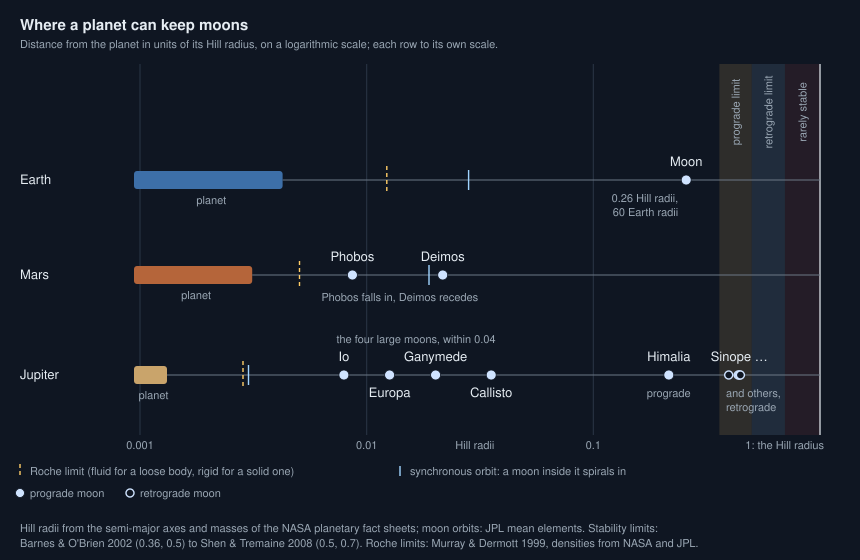
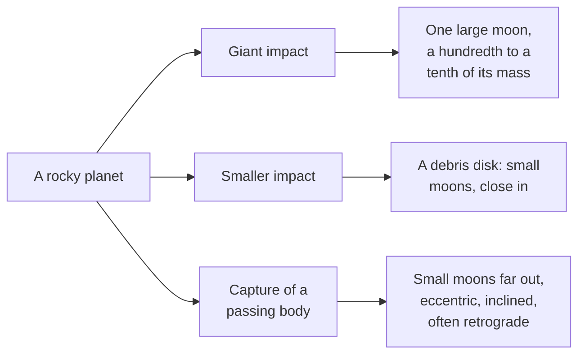

# How many moons can a planet keep, and how large?

Seen from: the world card's **Moons** row and the body card in the **Info**
panel (which list a planet's moons), the **Moons** field of the generation
form, and the star view, where **Hill spheres** draws how far each planet's
gravity holds moons against the star's.

## Short answer

A moon can only last in a shell round its planet. Too close, inside the Roche
limit, the planet's tides tear a loose body apart. Too far, beyond about a
third to a half of the Hill radius, the star's pull wins and the orbit does not
last; moons going round backwards can stay a little farther out. Tides then
move moons inwards or outwards, and a planet its star has despun loses all but
its lightest. Rocky planets get their big moons from giant impacts, which can
leave a moon of a hundredth (the Moon) to a tenth (Charon) of the planet's
mass; about one rocky planet in twelve may have one. Giant planets grow whole
families of moons in a disk, which together weigh about a ten-thousandth of the
planet.

## The science



### The outer edge: the Hill sphere

A planet of mass $m$ on an orbit of semi-major axis $a$ round a star of mass
$M$ controls a region of radius (Barnes & O'Brien 2002, eq. 5):

```math
r_H = a\left(\frac{m}{3M}\right)^{1/3}
```

Not all of it is safe. The outermost stable orbit "has been generally
thought to lie between 1/3 and 1/2 the radius of the Hill sphere" (Barnes &
O'Brien 2002, after Burns 1986). Barnes & O'Brien take 0.36 $r_H$ for
prograde moons and 0.50 $r_H$ for retrograde ones, which go round against
the planet's motion. Longer integrations find that "many prograde and
retrograde satellites can survive out to radii ∼ 0.5rH and ∼ 0.7rH,
respectively" (Shen & Tremaine 2008). Tilt matters too: orbits inclined
between 55° and 130° to the planet's orbit are generally unstable (Carruba
et al. 2002, as summarised by Shen & Tremaine 2008).

**In words.** The Hill radius grows with the planet's distance from its
star and, slowly, with its mass. Only the inner third to half of it holds
moons for long, a little more for retrograde ones.

**Orders of magnitude.** The Earth's Hill radius is 1.5 million km
(from NASA's masses and orbit); the Moon, at 384,400 km, sits at 0.26 of
it. Jupiter's is 53 million km, 760 Jupiter radii. Its four large moons all
orbit within 0.04 of it. Its small outer moons reach 0.22 $r_H$ on prograde
orbits (Himalia) and 0.45 on retrograde ones (Sinope, JPL elements), as
Shen & Tremaine (2008) note: retrograde irregular moons "extend to larger
semi-major axes than prograde ones".

### The inner edge: the Roche limit

A body held together by its own gravity, of density $\rho_m$, is torn apart
inside the Roche limit of a planet of radius $R$ and density $\rho_p$
(Murray & Dermott 1999):

```math
d_\text{fluid} \approx 2.44\,R\left(\frac{\rho_p}{\rho_m}\right)^{1/3}
\qquad
d_\text{rigid} \approx 1.26\,R\left(\frac{\rho_p}{\rho_m}\right)^{1/3}
```

**In words.** A loose body (the fluid limit) must stay about two and a half
planet radii out; a solid one, held by its strength too, can go closer.
[Why are ring moons so small?](ring-moons.md) tells the rest.

**Orders of magnitude.** For the Moon (3.34 g/cm³) round the Earth
(5.51 g/cm³), the fluid limit is 2.9 Earth radii, 18,400 km (NASA
densities). The Moon orbits twenty times farther out.

### Tides move moons: the synchronous orbit

A planet that turns in a time $T$ has a synchronous orbit, where a moon
would go round in exactly one planetary day (Kepler's third law):

```math
a_\text{sync} = \left(\frac{G\,m\,T^2}{4\pi^2}\right)^{1/3}
```

Above it, the planet turns faster than the moon goes round, and its spin
carries the tidal bulge ahead of the moon, which pulls the moon forwards
and outwards. Below it, the bulge lags behind and the moon is pulled down
(Barnes & O'Brien 2002).

**In words.** The planet's spin sets a dividing line. Moons outside it
slowly recede; moons inside it spiral in until they hit the planet or break
up at the Roche limit.

**Orders of magnitude.** The Earth's synchronous orbit is at 42,200 km; the
Moon, far above it, recedes by 3.8 cm a year (NASA). Mars's is at
20,400 km. Phobos, at 9,375 km, is below it and Deimos, at 23,457 km, above
it (JPL elements). Phobos's orbit is decaying: it will break into a ring or
strike Mars (Black & Mittal 2015).

A planet close to its star is slowed by the star's tides. As its spin
slows, its synchronous orbit moves outwards past its moons, which then
spiral in: "Stellar tides brake a planet's rotation and, together with
tidal migration, act to remove satellites; this process limits the
lifetimes of larger moons in extrasolar planetary systems" (Barnes &
O'Brien 2002). Heavier moons go first: "more massive satellites are removed
more quickly than less massive ones". A planet locked to its star turns
once a year; by Kepler's third law its synchronous orbit then lies at
$a\,(m/M)^{1/3}$, which is $3^{1/3} \approx 1.44$ Hill radii, outside its
Hill sphere: every moon it could hold is below it.

Time is what saves the lightest. A moon starting at the edge of the stable
zone, a share $f$ of the Hill radius, spirals in at a rate that grows
steeply with its mass. Setting its lifetime to the age $T$ of the system,
Barnes & O'Brien (2002, eq. 8) get the heaviest moon that is still there:

```math
M_m \le \frac{2}{13}
\left(\frac{(f\,a_p)^3}{3\,M_\star}\right)^{13/6}
\frac{M_p^{8/3}\,Q_p}{3\,k_{2p}\,T\,R_p^5\sqrt{G}}
```

$a_p$ is the planet's orbital distance, $M_\star$ the star's mass, $M_p$,
$R_p$, $Q_p$ and $k_{2p}$ the planet's mass, radius, tidal quality factor
and Love number. Barnes & O'Brien wrote it for close-in giants; the app
applies it to rocky planets too, with their own $Q_p$ and $k_{2p}$.

**In words.** The farther the planet from its star, the larger the Hill
sphere and the longer the fall: the limit climbs as the 6.5th power of the
distance, and the heavier the planet, the heavier the moons that last.
Close in, only moonlets remain.

**Orders of magnitude.** With the app's $Q_p = 100$ and $k_{2p}$ of rock, this
article's evaluation gives about $2 \times 10^{18}$ kg for an Earth at 0.07 AU
from a red dwarf of type M5V: a moonlet of about 60 km at Phobos's density,
nowhere near the Moon's $7 \times 10^{22}$ kg (NASA). With a giant's own tides
(Juno's $k_2$, $Q \approx 5 \times 10^4$), a Jupiter locked to the Sun at 0.12
AU keeps moons up to about $10^{22}$ kg: lighter than every Galilean moon.

### How large: giant impacts, debris and capture

Rocky planets get moons in three ways.



**Giant impacts.** A large oblique collision throws debris into orbit, or
sends the impactor's remains off as a moon in one piece. Models of the
Moon-forming impact leave a disk of about 1 to 3 % of the planet's mass
(Canup 2005). For Pluto, low-velocity oblique impacts by a body of 30 to
50 % of the system's mass give a moon of 10 to 15 % of the planet's mass;
"such an impact probably produced an intact Charon" (Canup 2005). These two
systems stand apart: every other moon in the Solar System is below about
2 × 10⁻⁴ of its planet's mass (Canup 2005).

The barycentre of a planet and a moon of mass ratio $q$ (moon over planet)
at a distance $a$ lies at

```math
d_\text{bary} = a\,\frac{q}{1+q}
```

from the planet's centre.

**In words.** A heavy enough moon, far enough out, moves the balance point
outside the planet: the two then orbit a point in empty space, a binary.

**Orders of magnitude.** The Moon is 0.0123 of the Earth's mass (NASA): the
barycentre is 4,670 km from the Earth's centre, inside the Earth. Charon is
0.122 of Pluto's mass (JPL's GM for Charon, NASA's mass for Pluto), 19,600
km out: the barycentre is 2,130 km from Pluto's centre, outside its radius
of 1,188 km.

**Debris disks.** "Phobos and Deimos are likely remnants of a low-mass disk
generated by the impact of a Vesta to Ceres-sized body with Mars" (Canup &
Salmon 2018). Rosenblatt et al. (2016) accrete them in the outer part of
such a disc, with larger moons forming in its denser inner part.

**Capture.** A passing body must lose energy to stay. The giants' small
outer moons, on distant, inclined and eccentric orbits, "are thought to be
captured objects" (Canup & Ward 2006). Triton orbits Neptune backwards,
inclined 157° to its equator (JPL). It may have been one of a pair of
bodies passing Neptune, whose gravity broke the pair up, ejecting one
member and keeping the other (Agnor & Hamilton 2006).

### How often: large moons are not rare

Of the four rocky planets, only the Earth has a large moon; Mars has two
small ones, Mercury and Venus none (NASA fact sheets). The sample is too
small for odds. Elser et al. (2011) followed the collisions in simulations
of Earth-like planets forming in the habitable zone and find "more than 1
in 12 terrestrial planets hosting a massive moon, with a low-end estimate
of 1 in 45 and a high-end estimate of 1 in 4".

Small worlds have companions often. Among the four brightest Kuiper belt
objects, three have satellites. Brown et al. (2006) find this "is
inconsistent with the fraction of satellites in the Kuiper belt at large at
the 99.1% confidence level", which suggests the largest bodies got theirs
in a different way.

### Giant planets: a fixed share of mass

Giants grow their regular moons in a disk of gas and solids round them. The
moons of Jupiter, Saturn and Uranus "each contain a similar fraction of
their respective planet's mass (∼10⁻⁴)", from 1.1 × 10⁻⁴ to 2.5 × 10⁻⁴.
Canup & Ward (2006) explain it as a balance: the disk feeds the moons while
its gas drags them into the planet, so

```math
\frac{M_T}{M_P} \sim 10^{-4}
```

where $M_T$ is the total mass of the regular moons and $M_P$ the planet's.
The same process "could limit the largest moons of extrasolar Jupiter-mass
planets to Moon-to-Mars size".

**In words.** However much material passes through the disk, the moons
that survive weigh about a ten-thousandth of their planet. A larger planet
has larger moons, never an Earth round a Jupiter.

**Orders of magnitude.** Io, Europa, Ganymede and Callisto together weigh
2.1 × 10⁻⁴ of Jupiter; Titan alone 2.4 × 10⁻⁴ of Saturn; Uranus's five
large moons 1.0 × 10⁻⁴ of Uranus (JPL GMs, NASA masses). Io, Europa and
Ganymede turn in 1.77, 3.53 and 7.16 days (JPL): each period twice the
last, a 1:2:4 chain, which by Kepler's third law puts each orbit
$2^{2/3} \approx 1.59$ times the last.

### What we do not know

- **No exomoon is confirmed.** Teachey & Kipping (2018) report evidence for
  a Neptune-sized moon round Kepler-1625b and write that exomoons are
  bodies "of which there are currently no confirmed examples". Every
  frequency above comes from the Solar System and from simulations.
- **The odds of a giant impact.** Elser et al. (2011) give a range of a
  factor of eleven, and they modelled planets like the Earth round a star
  of one solar mass, with Jupiter and Saturn. The paper says these systems
  "do not represent general systems with terrestrial planets", and neither
  its abstract nor its conclusion gives a dependence of the odds on the
  star, the planet's mass or its distance.
- **Where small moons come from.** Phobos and Deimos, impact debris or
  captured asteroids, is still argued; the disk models above are the
  current favourite.

## In the app

### What you see

- The world card's **Moons** row counts the moons and names them; the body
  card in the **Info** panel links to each. Each moon is a body of its own,
  opened in the planet view.
- The generation form's **Moons** field takes "auto" (the seed's moons),
  none, or 1 to 6. Its help reads "about one rocky planet in 12 has a large
  moon, small worlds often a companion, others small debris or captured
  moons, planets despun by their star only moonlets light enough to outlast
  its tides". When a number is asked, a drawn star and orbit that leave no
  room (a planet its star has despun, a Hill sphere too small) are drawn
  again; set ones are refused ("No stable orbits for 2 moons: the star and
  orbit chosen keep the planet too close to its star, whose tides pull down
  all but the lightest moons"). A giant asked for more moons than it keeps
  gets a similar message.
- In the star view the moons circle their planet on orbits not to scale,
  retrograde ones backwards, and a binary planet swings round its
  barycentre. The **Hill spheres** switch draws each planet's Hill sphere
  at periapsis.

### How it computes them

A rocky planet's moons come from `MoonSystem::draw` in
[moons.rs](../../crates/mapgen/src/moons.rs), on a noise stream of their
own:

1. **The planet.** Its mass follows from its size by the mass–radius
   relation of rocky planets (`rocky_gravity` in
   [world.rs](../../crates/mapgen/src/world.rs), after Zeng et al. 2016).
   Its Hill radius is taken at periapsis. A planet its star has despun
   (locked, or in the 3:2 resonance: see
   [Why does a world always show the same face to its
   host?](tidal-locking.md)) keeps only the moons light enough to outlast
   the system, by the equation above (`lasting_moon_kg`, with the Love
   number of rock and $Q = 100$): a moonlet of 60 km round an Earth at
   0.07 AU from an M5V dwarf, never a giant-impact moon. They are all
   marked as decaying.
2. **One draw per origin**, each with its odds:
   - **giant impact**: 1 in 12 from 0.4 Earth radii up, 1 in 2 below 0.25
     (linear in between); a mass ratio of 0.005 to 0.03, up to 0.15 on
     small worlds; 10 to 65 planet radii out (8 to 25 on small worlds);
   - **debris**: 1 in 5 when there is no impact moon; one or two small
     moons 2.2 to 9 planet radii out, sized like Phobos round Mars and
     scaled with the planet;
   - **capture**: 15 %, about 1 in 7; one to three moons of 1 to 30 km,
     0.05 to 0.3 Hill radii out, eccentric, half of them retrograde, at
     inclinations of 130 to 170° (retrograde) or 10 to 55°, outside the
     unstable band of 55 to 130°.
3. **The stable zone.** A moon is kept only from the Roche limit (fluid for
   round moons, rigid for irregular ones) out to a third of the Hill
   radius, or half for a retrograde one, from periapsis to apoapsis, and
   only if it is light enough to last on a despun planet. A moon closer
   than eight mutual Hill radii to a heavier one, or than 1.2 times its
   orbit, is dropped.
4. **Tides.** The planet's day is drawn from 12 to 36 hours (a despun
   planet turns once a year, or three times every two years in 3:2). A
   moon above the synchronous orbit recedes, one below it or retrograde
   falls in, one beyond a tenth of the Hill radius hardly moves. The
   planet turns with its largest moon when that moon's tides despin it
   within the system's age (`despin_gyr`, the despinning time of
   [Why does a world always show the same face to its
   host?](tidal-locking.md)): the Earth would need 35 Gyr to do it for
   the Moon, Pluto under 0.05 Gyr for Charon. A binary is a planet whose
   barycentre with that moon lies outside it.

The stable zone, trimmed (from `crates/mapgen/src/moons.rs`):

```rust
// Stable orbits only: beyond the Roche limit, within the Hill sphere,
// and light enough to outlast the age on a planet its star has despun.
let stable = |c: &Candidate| {
    let roche = if c.round() {
        2.44 * r_p * (planet_density / c.density).cbrt()
    } else {
        1.26 * r_p * (planet_density / c.density).cbrt()
    };
    let reach = if c.inclination_deg > 90.0 {
        RETROGRADE_REACH // 0.5
    } else {
        PROGRADE_REACH // 1/3
    };
    c.a_km * (1.0 - c.eccentricity) > roche
        && c.a_km * (1.0 + c.eccentricity) < reach * hill
        && c.mass_kg <= lasting(reach)
};
```

A giant draws its moons with `of_giant` in the same file, whether it is a
giant world or a giant of a planetary system
([system.rs](../../crates/mapgen/src/system.rs) calls `MoonSystem::draw`
for it). Two to five regular moons share 1 to 2.5 × $10^{-4}$ of its
mass (uniform, the Solar System's range, Canup & Ward 2006), on a resonant
chain, each orbit $2^{2/3}$ times the last, from 4 to 8 giant radii
outwards: beyond the Roche limit and its rings, and within a third of the
Hill radius, where the chain stops (room left for an eccentricity of
0.03). The disk leaves either a chain of moons of comparable mass, or one
dominant moon, in the chain's outer half, holding 90 to 97 % of the mass
as Titan does at Saturn. A heavy giant opens a gap in the nebula, cuts its
disk's inflow and keeps several moons; a light one keeps feeding its disk
until only its last large moon is left (Sasaki, Stewart & Ida 2010), so
the odds of a dominant moon are $1/(1 + (M/174\,M_\oplus)^2)$, a
calibration that gives Saturn one 77 % of the time and Jupiter a chain 77 %
of the time. A moon is icy beyond the disk's ice line, rocky inside it; the
line moves out with the giant's equilibrium temperature,
$11\,(T_\mathrm{eq}/110\,\mathrm{K})^4$ giant radii (a calibration: 11
radii for Jupiter, between Europa and Ganymede, 3.5 for Saturn, inside its
first moon). Moons on a chain keep a forced eccentricity, log-uniform from
0.001 to 0.01 (Ganymede 0.0013, Io 0.0041, Europa 0.009, JPL); a dominant
moon up to 0.03 (Titan 0.0288). On 35 % of ice giants
(unless a number of moons is asked), a captured retrograde Triton, 1.5 to
3 times $10^{-4}$ of the giant's mass, orbits 12 to 16 radii out; the
regular moons then weigh a fiftieth of the usual and keep inside its
orbit. A hot giant keeps none,
and a giant its star has locked only the moons light enough to last
(`giant_locked`, the same equation with a giant's own $k_2$ and $Q$):

```rust
let disk = disk_mass_ratio(&mut rng); // 1e-4 to 2.5e-4
let kind = disk_shape(f64::from(mass_earth), &mut rng); // Chain or Dominant
for k in 0..count {
    let a_radii = base * 1.587_401f64.powi(k as i32) * rng.uniform(0.95, 1.05);
    // The chain ends at the edge of the stable zone.
    if a_radii * r_g * (1.0 + DOMINANT_MAX_ECCENTRICITY) >= PROGRADE_REACH * hill { break; }
    slots.push(a_radii);
}
// ... a dominant moon in the outer half takes 0.9 to 0.97, the rest by weight
let mass = disk * m_g * share * if captured_triton { 0.02 } else { 1.0 };
let icy = a_radii > disk_ice_line_radii(f64::from(star.equilibrium_k));
```

A rocky world drawn as the moon of a giant
([exomoon.rs](../../crates/mapgen/src/exomoon.rs)) gets siblings on the same
chain round it. Ring moons are drawn apart (see
[Why are ring moons so small?](ring-moons.md)).

### Where it departs from the science

- **The odds are calibrations.** Elser et al.'s 1 in 12 applies to every
  rocky planet from 0.4 Earth radii, round any star and at any distance,
  though they simulated Earth-like planets of a Sun-like star, and the
  paper gives no dependence on the star, the planet's mass or its
  distance to scale by. The odds of debris and captured moons (1 in 5,
  about 1 in 7) are assumptions: no statistics exist. The companion of one
  small world in two rests loosely on Brown et al.'s three Kuiper belt
  objects in four. The code labels all of them as calibrations.
- **The stable zone is strict.** A third and a half of the Hill radius are
  the cautious end of the published range (Shen & Tremaine 2008 find
  moons out to about 0.5 and 0.7; Barnes & O'Brien take 0.36 and 0.5). The
  app loses some far moons a real planet could keep, never the reverse.
- **Inclinations against the equator, limits against the orbit.** Captured
  moons are drawn outside the unstable band of 55 to 130° (Carruba et al.
  2002, via Shen & Tremaine 2008), but the app's inclinations are to the
  planet's equator and those limits to its orbit; for a tilted planet the
  two differ, so a drawn moon may sit in the unstable band.
- **Light moons on despun planets, from one equation.** Barnes & O'Brien's
  limit is for a moon starting at the edge of the stable zone and falling
  in under the star's tides; the app applies it with one $Q$ and one
  Love number for all rocky planets and drops the moons above it. A
  despun planet may keep a moonlet in reality in more cases, or fewer
  (the equation is only good to orders of magnitude).
- **Present places, no history.** A giant-impact moon is placed 10 to 65
  planet radii out, as the Moon is now, without the tidal migration from
  much closer in that took it there (Canup 2005). Migration is a label,
  not a computed rate.
- **Masses from size.** The planet's mass follows from the mass–radius
  relation of rocky planets, never less dense than uncompressed rock (the
  Moon's 3.34 g/cm³). A small icy world comes out almost twice as dense
  as Pluto (1.85 g/cm³), so heavier, which makes binaries rarer than a
  Pluto-like density would.
- **An exact chain.** Every giant's moons sit on a 1:2:4… chain, however
  many there are. At Jupiter only Io, Europa and Ganymede do: Callisto's
  period is 2.33 times Ganymede's (JPL).
- **A temperature for the ice line.** The disk's ice line follows the
  giant's equilibrium temperature today, a proxy for the nebula it formed
  in, with a steep power fitted to Jupiter and Saturn alone; the disk's
  own accretion heating, which sets the line in the models, is not
  computed.
- **The Earth-sized moon of a giant.** A rocky world drawn as a giant's moon
  (one in 50, or on request) is far above the $10^{-4}$ scaling: it would
  have to be captured. Its siblings follow the scaling.

## Sources

1. Barnes, J. W. & O'Brien, D. P. 2002, "Stability of satellites around
   close-in extrasolar giant planets", *The Astrophysical Journal* 575,
   1087–1093, [doi:10.1086/341477](https://doi.org/10.1086/341477),
   preprint [arXiv:astro-ph/0205035](https://arxiv.org/abs/astro-ph/0205035).
   The Hill radius (eq. 5), the stability limits, moon loss by stellar
   tides and the heaviest moon that lasts (eq. 8).
2. Shen, Y. & Tremaine, S. 2008, "Stability of the distant satellites of the
   giant planets in the solar system", *The Astronomical Journal* 136,
   2453–2467,
   [doi:10.1088/0004-6256/136/6/2453](https://doi.org/10.1088/0004-6256/136/6/2453),
   preprint [arXiv:0806.2882](https://arxiv.org/abs/0806.2882). Also
   summarises Carruba et al. 2002 on unstable inclinations.
3. Murray, C. D. & Dermott, S. F. 1999, *Solar System Dynamics*, Cambridge
   University Press, §4.7 (Roche limits).
4. Canup, R. M. 2005, "A giant impact origin of Pluto-Charon", *Science*
   307, 546–550,
   [doi:10.1126/science.1106818](https://doi.org/10.1126/science.1106818).
5. Canup, R. M. & Salmon, J. 2018, "Origin of Phobos and Deimos by the
   impact of a Vesta-to-Ceres sized body with Mars", *Science Advances* 4,
   eaar6887,
   [doi:10.1126/sciadv.aar6887](https://doi.org/10.1126/sciadv.aar6887).
6. Rosenblatt, P. et al. 2016, "Accretion of Phobos and Deimos in an
   extended debris disc stirred by transient moons", *Nature Geoscience* 9,
   581–583, [doi:10.1038/ngeo2742](https://doi.org/10.1038/ngeo2742).
7. Black, B. A. & Mittal, T. 2015, "The demise of Phobos and development of
   a Martian ring system", *Nature Geoscience* 8, 913–917,
   [doi:10.1038/ngeo2583](https://doi.org/10.1038/ngeo2583).
8. Agnor, C. B. & Hamilton, D. P. 2006, "Neptune's capture of its moon
   Triton in a binary–planet gravitational encounter", *Nature* 441,
   192–194, [doi:10.1038/nature04792](https://doi.org/10.1038/nature04792).
9. Elser, S., Moore, B., Stadel, J. & Morishima, R. 2011, "How common are
   Earth–Moon planetary systems?", *Icarus* 214, 357–365,
   [doi:10.1016/j.icarus.2011.05.025](https://doi.org/10.1016/j.icarus.2011.05.025),
   preprint [arXiv:1105.4616](https://arxiv.org/abs/1105.4616).
10. Brown, M. E. et al. 2006, "Satellites of the largest Kuiper belt
    objects", *The Astrophysical Journal* 639, L43–L46,
    [doi:10.1086/501524](https://doi.org/10.1086/501524), preprint
    [arXiv:astro-ph/0510029](https://arxiv.org/abs/astro-ph/0510029).
11. Canup, R. M. & Ward, W. R. 2006, "A common mass scaling for satellite
    systems of gaseous planets", *Nature* 441, 834–839,
    [doi:10.1038/nature04860](https://doi.org/10.1038/nature04860).
12. Teachey, A. & Kipping, D. M. 2018, "Evidence for a large exomoon
    orbiting Kepler-1625b", *Science Advances* 4, eaav1784,
    [doi:10.1126/sciadv.aav1784](https://doi.org/10.1126/sciadv.aav1784).
13. NASA Space Science Data Coordinated Archive, planetary fact sheets:
    [Earth](https://nssdc.gsfc.nasa.gov/planetary/factsheet/earthfact.html),
    [Moon](https://nssdc.gsfc.nasa.gov/planetary/factsheet/moonfact.html),
    [Mars](https://nssdc.gsfc.nasa.gov/planetary/factsheet/marsfact.html),
    [Jupiter](https://nssdc.gsfc.nasa.gov/planetary/factsheet/jupiterfact.html),
    [Saturn](https://nssdc.gsfc.nasa.gov/planetary/factsheet/saturnfact.html),
    [Uranus](https://nssdc.gsfc.nasa.gov/planetary/factsheet/uranusfact.html)
    and [Pluto](https://nssdc.gsfc.nasa.gov/planetary/factsheet/plutofact.html).
14. JPL Solar System Dynamics, [planetary satellite mean
    elements](https://ssd.jpl.nasa.gov/sats/elem/) and [physical
    parameters](https://ssd.jpl.nasa.gov/sats/phys_par/) (orbits, periods,
    GMs).
15. Zeng, L., Sasselov, D. D. & Jacobsen, S. B. 2016, "Mass–radius
    relation for rocky planets based on PREM", *The Astrophysical Journal*
    819, 127,
    [doi:10.3847/0004-637X/819/2/127](https://doi.org/10.3847/0004-637X/819/2/127).
    The mass–radius relation the app gives a rocky planet, read in the
    preprint [arXiv:1512.08827](https://arxiv.org/abs/1512.08827): $R/R_\oplus =
    (1.07 - 0.21\,\mathrm{CMF})\,(M/M_\oplus)^{1/3.7}$ for 1 to 8 Earth
    masses and a core mass fraction of 0 to 0.4. Earth's fraction, 0.33,
    gives $M = R^{3.7}$, the app's form; the app also uses it below 1 Earth
    mass, out of the range the authors give.
16. Sasaki, T., Stewart, G. R. & Ida, S. 2010, "Origin of the different
    architectures of the Jovian and Saturnian satellite systems", *The
    Astrophysical Journal* 714, 1052,
    [doi:10.1088/0004-637X/714/2/1052](https://doi.org/10.1088/0004-637X/714/2/1052).

## See also

- [docs/analysis/11-moons.md](../analysis/11-moons.md): the study behind
  the app's moons, their odds and the stable zone.
- [docs/analysis/12-gas-giants.md](../analysis/12-gas-giants.md), "On their
  own moons": a giant's regular moons and the $10^{-4}$ scaling.
- [Why does a world always show the same face to its
  host?](tidal-locking.md)
- [Why are ring moons so small?](ring-moons.md)
- [Why are small moons shaped like potatoes?](moon-shapes.md)
- [docs/system-spec.md](../system-spec.md): moons as bodies of a system.
