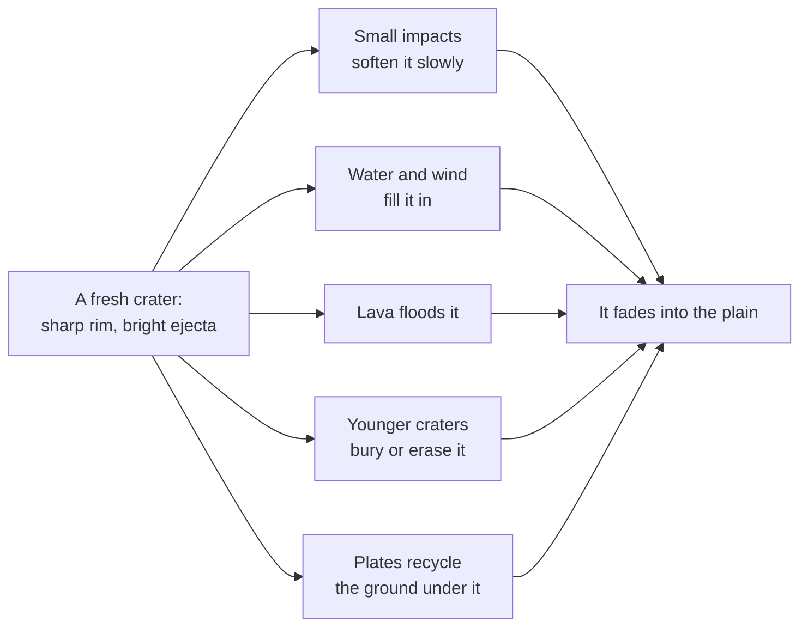

# How do impact craters form and fade?

Seen from: the planet view of a dead world (`barren`, `mars-like`,
`mercury-like`): its globe and map, the *Epoch* panel of the dock (the time
slider), and the *Geology* line of the world card ("stagnant lid,
surface 4 Ga").

## Short answer

Every rocky surface is hit by asteroids and comets. Small impacts leave
simple bowls; above a size set mostly by gravity, the crater collapses into a
flat floor with a central peak, then a ring of peaks. Most impacts happened
in the first few hundred million years, and the rate has been low and steady
for the last three billion years, so counting craters tells how old a surface
is. Craters then fade: younger impacts batter them, water and wind fill them,
lava floods them, plates recycle the ground they sit on. A world without air,
water or tectonics keeps them for billions of years; Earth keeps almost
none.

## The science

### How many: the cratering record dates a surface

The Moon is the reference. Its rocks, brought back by the Apollo and Luna
missions, were dated in the laboratory, and the crater density of the plains
they came from was counted. Neukum, Ivanov & Hartmann (2001) fit the
cumulative number $N_1$ of craters of 1 km or more per km² on a surface of
age $T$ (in Ga, billions of years) with:

```math
N_1(T) = a\left(e^{bT} - 1\right) + c\,T,
\quad a = 5.44\times10^{-14}\ \text{km}^{-2},\ b = 6.93\ \text{Ga}^{-1},
\ c = 8.38\times10^{-4}\ \text{km}^{-2}\,\text{Ga}^{-1}
```

Marchi et al. (2009) quote the same coefficients from Neukum's earlier
work, and fit the same function to their own model.

**In words.** Two terms: an exponential, a flux that fell steeply and
dominates on surfaces older than about 3.6 Ga, and a straight line, the
constant flux since. A surface twice as cratered is not twice as old:
the old part of the curve is steep.

**Orders of magnitude.** A 4 Ga surface carries 0.063 craters of 1 km or more
per km², a 3.5 Ga surface 0.0048, a 3 Ga surface 0.0026. Half the craters of
a 4 Ga surface formed in its first 110 million years. At today's flux the
whole Moon (3.8 × 10⁷ km²) gets one crater of 1 km or more about every
30 000 years.

The sizes follow a power law. With $N(>D)$ the number of craters larger than
$D$ per km²:

```math
N(>D) = N_1\,D^{-\beta}, \qquad \beta \approx 2 \quad (D \text{ in km})
```

**In words.** Each halving of the size gives about four times as many
craters. Hartmann (2005) fits the lunar curve in pieces: a slope of −1.80
from 1.4 to 64 km, −2.2 above 64 km, and −3.82 below 1.4 km, where
secondary craters (thrown out by larger impacts) take over.

**Orders of magnitude.** With $\beta = 2$, a 4 Ga Moon carries
0.063 / 20² × 3.8 × 10⁷ ≈ 6 000 craters of 20 km or more (about 5 500
with Hartmann's −1.80 slope from 1.4 km). Head et al.
(2010) catalogued more than 5 000 on the Moon from laser altimetry
(NASA SVS).

Applying the lunar curve to another body needs the ratio of its impact rate
to the Moon's: "on the basis of models predicting the impactor flux ratio
between the reference body and another generic body, it is possible to
estimate the age of the latter" (Marchi et al. 2009).

### Saturation

A surface cannot hold craters without limit. Once craters cover it, each new
one erases about as many as it adds: the surface reaches *saturation
equilibrium* (Gault 1970). Head et al. (2010) found that "the most-densely
cratered portion of the highlands reached a state of saturation
equilibrium". For craters of a single size packed edge to edge, a hexagonal
packing holds $2/(\sqrt3\,D^2) \approx 1.15\,D^{-2}$ craters per km²; real
surfaces saturate well below that, at densities that vary from one surface to
another (Xiao & Werner 2015).

### Simple and complex craters


A small impact digs a bowl. Its steep walls slump a little into it, and it
stays a *simple crater*, about a fifth as deep as it is wide (Melosh &
Ivanov 1999). A larger one collapses: the floor rises into a central peak,
the walls slide into terraces, and the floor flattens. That is a *complex
crater*. The collapse happens once gravity wins over the strength of the
rock. O'Keefe & Ahrens (1993), from impact simulations, find the transition
diameter $D_t$ for a crust of effective strength $Y$ and density $\rho$ under
a gravity $g$:

```math
D_t = 9.0\,\frac{Y}{\rho\,g}
```

**In words.** The stronger the rock, the larger a crater it can hold up; the
stronger the gravity, the sooner it collapses. For the same rock, $D_t$
scales as $1/g$. The strength that matters is not that of intact rock: the
impact shatters and shakes the ground, which behaves for a short while as a
weak material. Melosh & Ivanov (1999) call its apparent strength "very low:
only a few bars"; the Bingham fluid that reproduces the collapsed craters
needs a yield stress "in the vicinity of 30 bars" (3 MPa).

**Orders of magnitude.** The transition lies at about 15 km on the Moon
(Melosh & Ivanov 1999), 15 to 20 km by other counts (Silber et al. 2017,
"approximately 20 km"). Earth (9.8 m/s²) turns complex at 3 to 5 km
depending on the rock (Melosh & Ivanov 1999), Mars (3.7 m/s²) at 7 to 8 km
(Barnouin et al. 2012). Mercury breaks the rule: with the same gravity as
Mars it turns complex at about 12 km. Barnouin et al. (2012) recall Pike's
explanation: Mars's crust, richer in volatiles and sediments, is weaker.

How deep they are, on the Moon, for a diameter $D$ and a depth $d$ from the
rim to the floor, both in km (Pike 1977, as given by Feoktistova & Ipatov
2021):

```math
d = 0.196\,D^{1.01} \quad (D < 15\ \text{km}),
\qquad
d = 1.044\,D^{0.301} \quad (D \ge 15\ \text{km})
```

**In words.** Simple craters keep the same shape at every size. Complex
craters barely get deeper as they widen: their collapse spreads them out.

**Orders of magnitude.** A 10 km lunar crater is 2.0 km deep (1 : 5). A
100 km one is 4.2 km deep (1 : 24): a shallow dish with a central peak.

Larger still, the central peak gives way to a ring of peaks. On the Moon,
Baker et al. (2011) count "3 protobasins (137-170 km", with a ring and a
peak, and "17 peak-ring basins (rim-crest diameters range from 207 km to
582 km)". That transition also appears to scale as $1/g$ (Melosh & Ivanov
1999). The largest basins, like Orientale, are surrounded by several rings
of scarps; that transition "does not scale as 1/g" and depends on a weak
layer under the surface (Melosh & Ivanov 1999).

Around every crater lies its *ejecta blanket*, the rock thrown out of it,
thickest at the rim and thinning about as the cube of the distance
(McGetchin, Settle & Head 1973).

### How craters fade



**On airless worlds** the main eraser is cratering itself. Countless small
impacts stir the ground and let it creep downhill, which smooths relief as
heat spreads in a solid. With $h$ the height of the ground, $t$ the time and
$\kappa$ a *topographic diffusivity*:

```math
\frac{\partial h}{\partial t} = \kappa\,\nabla^2 h
```

**In words.** Bumps flatten and hollows fill, the sharpest ones fastest. A
feature fades once $\sqrt{\kappa t}$, the distance the creep reaches, is a
fair share of its size.

**Orders of magnitude.** Fassett & Thomson (2014) measured craters of 800 m
to 5 km on the lunar maria and find "~5.5 m2/Myr" over the past 3 Ga, so
$\sqrt{\kappa t} \approx 130$ m in 3 Ga. In that time "a 1 km diameter crater
is reduced to approximately ~52% of its initial depth and a 300 m diameter
crater is reduced to only ~7%", and "craters smaller than ~200–300 m are
degraded beyond recognition". Large craters are hardly touched: they are
erased by younger craters and their ejecta instead.

**With water** craters fill much faster. On Mars, Forsberg-Taylor, Howard &
Craddock (2004) find "a small population of post‐Noachian craters with
little infilling, whereas most Noachian craters are strongly infilled", the
pattern of erosion by running water, which also wears small craters first.
On Earth, "unlike the Moon, small craters on Earth are rapidly eroded"
(Bland & Artemieva 2006).

**Volcanism and tectonics** erase whole surfaces. Venus's craters are spread
at random over the whole planet and almost none is flooded by lava: the
planet was resurfaced about 300 million years ago (Strom, Schaber & Dawson
1994; Schaber et al. 1992 found about 0.5 Ga). Io resurfaces itself "faster
than comets and asteroids can mark it with large craters" (NASA).

**Icy moons** show the same rule in ice, which flows and melts far more
readily than rock. Callisto, warmed by little more than its rocks' decay,
keeps a surface saturated with craters about 4 Ga old; Ganymede's dark
terrain is as old, its bright grooved terrain about 2 Ga. Europa, kneaded
by Jupiter's tides, has very few craters: its surface is only 40 to 90
million years old (Zahnle et al. 2003). Enceladus's south polar terrain,
where its plumes vent, is nearly free of craters, while its old plains
elsewhere are cratered.

### Air screens small impactors

A thick atmosphere slows and breaks up small bodies before they reach the
ground.

- **Venus** (92 bar): its craters range "from 1.5 to 280 km", and the
  density of craters smaller than 35 km "declines rapidly with decreasing
  diameters because of atmospheric filtering" (Schaber et al. 1992).
- **Earth** (1 bar): iron bodies of a few metres reach the ground and dig
  craters of about 100 m, while stony bodies of more than 10⁸ kg (some tens
  of metres across) can still break up low in the air, as at Tunguska
  (Bland & Artemieva 2006).
- **Mars** (0.006 bar): new craters of 3.9 m and more appear at a rate of
  1.65 × 10⁻⁶ per km² per year, and more than half form in clusters
  (Daubar et al. 2013): even that thin air breaks some impactors up.
- **Titan** (1.5 bar): under its low gravity its air weighs ten times
  Earth's per square metre. It strongly slows and breaks up impactors
  well under 1 km across (Artemieva & Lunine 2003); only about 60 craters
  are known on the whole moon (Neish & Lorenz 2012), its methane rain and
  dunes wearing and burying the rest. What screens an impactor is the mass
  of air it must cross, the column, more than the pressure.

### What we do not know

- **The early flux.** The lunar curve rests on few dated samples: of 18
  calibration points, "12 of which are older than 3 Gyr", and "the region
  from 1 Gyr to 3 Gyr lacks completely in data points" (Marchi et al. 2009).
  Whether the early flux declined smoothly or spiked at about 3.9 Ga (the
  Late Heavy Bombardment) is debated (Boehnke & Harrison 2016).
- **The transition diameter.** Gravity sets its trend, but rock strength,
  layering and impact speed move it: Mercury and Mars, with the same
  gravity, differ by 1.5 to 2 times (Barnouin et al. 2012; Silber et al.
  2017 for the role of impact speed).
- **Saturation.** The equilibrium density is not a single number (Xiao &
  Werner 2015).

## In the app

### What you see

Dead worlds are covered in craters: `mercury-like` (4 Ga, airless) is
densely cratered; `mars-like` shows worn old craters and sharp young ones;
`venus-like` has scattered ones and none small; `terran` worlds keep only a
few large, faint ones. Fresh craters wear bright ejecta
and rays. Some old basins are flooded with dark lava, like the lunar maria.
Zooming in on the globe reveals smaller craters, down to a few pixels of the
detail tile.

The *Epoch* panel of the dock holds the time slider, on worlds without
liquid water today: from the surface age (4 Ga on `mercury-like`, 3.5 Ga on
`mars-like`, the end of its wet era) to a billion years ahead. Going back,
craters disappear one by one, youngest first, and the others look fresher;
going forward, new ones appear. The surface age is a field of the generation
form ("Surface age (Ga)"), and the world card shows it with the tectonic
regime.

### How it computes them

[`craters.rs`](../../crates/mapgen/src/craters.rs) draws a crater field that
depends only on the planet and the seed:

1. **How many.** `crater_density` is the lunar chronology above. The density
   is multiplied by the body's flux against the Moon's, and its craters are
   the Moon's at `D / crater_scale` (`impacts::rates`, see "The flux from
   the orbit" below). A moon takes its system's impact factor (or its
   giants', 0.7 to 1.8) and the Moon's crater size.
2. **Where and how large.** Diameters are split into octaves
   `[2^k, 2^(k+1)]` km, each with its own grid on a cube projected on the
   sphere. Each cell holds a Poisson number of craters, set by the octave's
   share of Hartmann's piecewise law (`size_share`: slope −3.82 below
   1.4 km, −1.80 to 64 km, −2.2 above), placed at random from the cell's
   hash; within an octave, diameters follow the local slope. The base map
   draws the craters of 4 pixels or more; the detail tiles add the smaller
   ones.
3. **Saturation.** Each octave is capped on its own at
   $0.75 \times 0.115 / D^2$ craters per km² (`SATURATION`, 0.115: a tenth
   of the hexagonal packing). The craters kept are the youngest formed: the
   oldest are erased first. At an epoch, the craters formed by then are kept
   youngest first, so erased ones come back in the past. Up to twice the
   kept count is drawn (`ERASED_DRAWN`), so that the detail tiles stay
   cheap.
4. **Ages** invert the chronology, so most craters of an old surface are
   very old. A second population, at today's flux (the term $c$), holds the
   craters still to come, up to 1 Ga ahead.
5. **Air.** No crater below `0.1 km × c^0.75`, and fewer up to ten times
   that, $c$ the air's column, its surface pressure over its gravity,
   against Earth's (1 bar under 9.81 m/s²): 3.2 km and 32 km on Venus
   (a column 100 times Earth's), 0.6 km and 6 km on a Titan (ten times),
   4 m on Mars.
6. **Shape.** A radial profile with a transition $D_t$. A planet takes
   it from O'Keefe & Ahrens's $9.0\,Y/(\rho g)$ with the strength and
   density of its crust, read from its model (`generation::crust_kind`):
   - **dry rock** (Mercury, Venus, and plate worlds like Earth, whose
     crust is recycled): $Y$ = 12.5 MPa at 2.8 g/cm³, which gives Earth
     4.0 km, Mercury 10.9 km and Venus 4.4 km;
   - **wet rock**, a crust rich in volatiles: no plates, no runaway and
     over 0.001 Earth oceans of water kept (Mars, about 0.006), 1.5 times
     weaker, the low end of Barnouin et al.'s factor between Mercury and
     Mars: 7.2 km on Mars;
   - **ice**, an ice world (at least 5 % water and ices, 0.01 oceans of
     them at the surface, no liquid water): 0.37 MPa at 0.917 g/cm³,
     where an icy moon of the same gravity turns complex. An ocean world's
     sea floor and a frozen Earth's ground under its ice sheet stay rock.

   The strengths are calibrations on those bodies, not measured
   strengths. A moon keeps the lunar law, a round one whose model gives
   it a crust too (the rock strength would put the Moon at 24 km):
   `15 km × 1.62 / g`, times 0.15 when its bulk density is under
   2.5 g/cm³ (ice). Below the transition, a bowl $0.2\,D$ deep. Above it, Pike's
   complex depth law, written in transition diameters,
   $0.157\,D_t\,(D/D_t)^{0.301}$ (4.2 km at 100 km on the Moon); the depth
   passes from the bowl to that law as the crater turns complex, from 1 to
   1.5 transitions, because Pike's two fits do not meet. On icy bodies
   (bulk density under 2.5 g/cm³) complex craters are 0.4 as deep (a calibration:
   Schenk 2002 measures 1.1 ± 0.3 km at 26 km across on Ganymede and
   Callisto, against 2.8 km from Pike's law on the Moon, a ratio of
   0.4). A central peak grows with the complex crater; a ring
   replaces it from 137/15 = 9.1 transitions (protobasins) to
   207/15 = 13.8 (peak-ring basins), the Moon's onsets of Baker et al. (2011)
   over its 15 km transition. A rim of $0.036\,D$ and ejecta thinning as
   $(r/R)^{-3}$ surround it, with irregular outlines.
7. **Small craters.** The rim and ejecta of a crater only a few pixels wide
   would be caught or missed by chance by the pixel under the crest, a ring
   of dots. They fade in with the crater's size in pixels: nothing at 4
   pixels across, full from 12. The floor keeps its depth.
8. **Superposition.** Craters are drawn oldest first. Inside a crater the
   old relief is replaced (15 % of it kept); outside, ejecta thinning as
   $(r/R)^{-3}$ out to 3 radii bury it. The floor lies flat at the mean
   level of the site, but the wall and the rim stand on the ground they
   are dug in: from half a radius out to the rim, the profile passes from
   that level to the pixel's own ground. Without it, a large crater on a
   slope (its rim is low against its radius) lost its rim uphill, where the
   ground climbs higher than the rim stands.
9. **Wear.** Each crater keeps a share of its relief: the diffusion of small
   impacts since it formed, and on worlds that had water, an exponential
   wear for the time it spent in the wet era (`[geology] wet_until`).
   Craters of the wet era are drawn before the hydraulic erosion, which wears
   them further; the others after it, fresh. Craters on the floor of a sea
   that is still there leave nothing.

The profile and the wear, trimmed (from `crates/mapgen/src/craters.rs`):

```rust
// Shape (Profile::shaped): Pike's complex depth law, in transition
// diameters, blended from the simple bowl as the crater turns complex.
let complex = f64::from(smoothstep(1.0, 1.5, (d / t) as f32));
let simple_depth = 0.2 * d;
let complex_depth =
    complex_depth * COMPLEX_DEPTH * t * (d / t).powf(COMPLEX_DEPTH_EXPONENT);
let depth = simple_depth + complex * (complex_depth - simple_depth);
let ring = f64::from(smoothstep(
    PROTOBASIN_TRANSITIONS as f32,
    PEAK_RING_TRANSITIONS as f32,
    (d / t) as f32,
));

// fn wear: diffused since it formed, until the epoch shown.
let since_ga = (crater.age_ga - self.epoch_ga).max(0.0);
let diffused = DIFFUSIVITY_M2_PER_MA * since_ga * 1000.0;
let mut wear = 1.0 / (1.0 + diffused / (DIFFUSION_SHARE * radius_m * radius_m));
let exposure = (crater.age_ga - self.wet_until_ga).max(0.0);
if exposure > 0.0 && self.erosion > 0.0 {
    let lasts = WEAR_GA * crater.diameter_km / WEAR_KM / self.erosion;
    wear *= (-exposure / lasts).exp();
}
```

`t` is the transition diameter, `craters::transition_km` (step 6), and
`complex_depth` is 1, or 0.4 on ice. Diffusion is that of a
hollow spreading under $\partial h / \partial t = \kappa\,\nabla^2 h$: it
keeps its volume, so its depth falls as the inverse of its widening area, not
exponentially. A crater of radius $R$ keeps $1 / (1 + \kappa t / (s R^2))$ of
its relief, with $\kappa$ = 5.5 m²/Ma and $s$ = `DIFFUSION_SHARE` = 0.0715,
set so that a 1 km crater keeps 52 % after 3 Ga as Fassett & Thomson (2014)
measure; a 300 m one keeps 8.9 % (they find about 7 %). `WEAR_GA` and
`WEAR_KM` make a 20 km crater keep $1/e$ of its relief after 0.1 Ga of water
at erosion 1.

**Orders of magnitude.** A Moon-sized world with a 4 Ga surface has about
5,500 craters of 20 km or more (Head et al. count more than 5,000 on the
Moon). A
crater of 170 m or less is worn out (below 3 % of its relief, `WORN_OUT`)
after 3 Ga.

**The flux from the orbit.** [`impacts.rs`](../../crates/mapgen/src/impacts.rs)
gives a world with a model its flux per unit area and its crater size
against the Moon's, the reference of the chronology (a body at 1 AU from a
Sun-like star, $g$ = 1.62 m/s², $v_{esc}$ = 2.37 km/s). A moon, a round
one with its model included, keeps the Moon's craters at its system's
rate ($I$ alone): its impactors are focused by its planet, which this
rate does not know.

$$\frac{\phi}{\phi_m} = I \cdot B_{20}\!\left(B_6\!\left(\frac{n(a)}{n(1\,\mathrm{AU})}\right) \cdot
\frac{v_\infty}{v_{\infty,m}} \cdot
\frac{1 + v_{esc}^2/v_\infty^2}{1 + v_{esc,m}^2/v_{\infty,m}^2}\right),
\qquad
\frac{D}{D_m} = \left(\frac{g}{g_m}\right)^{-\mu/(2+\mu)}
\left(\frac{v}{v_m}\right)^{2\mu/(2+\mu)}$$

with $B_C(s) = s\,C / (s + C - 1)$ a smooth ceiling: 1 at the Moon's, rising
to $C$, never above it.

- $I$ is the system's impactors, `belts::impact_factor` (its giants and
  belts; 1 with Jupiter and the main belt), or the giants drawn for a world
  alone (`giants::impact_factor`). A lone world (a planet alone with its
  star, or one asked for without giants) has neither drawn: its unknown
  context takes the Solar System's impactors, $I$ = 1, and its flux is its
  orbit's alone. The floor of 0.05 × 0.7 is for a world of a drawn system
  without belts or giants.
- $v_\infty$, the impactors' speed far from the body, is Earth's
  $\sqrt{(1.04 \times 19.7)^2 - 11.2^2}$ = 17.2 km/s (Le Feuvre & Wieczorek
  2011: the Moon's mean impact speed of 19.7 km/s, and Earth's 1.04 times
  it, Table 3, without Earth's escape speed), scaled as the orbital speed
  $\sqrt{G M_\star / a}$. A swarm strikes a body at a rate proportional to
  that speed, through a cross-section $\pi R^2 (1 + v_{esc}^2/v_\infty^2)$
  (gravitational focusing).
- $n(a)$ is the asteroids crossing the orbit: the near-Earth ones
  everywhere, plus the belt's own (at $2.7\sqrt{L}$ AU, inside the ice line)
  where their eccentricity reaches the orbit,
  $n = 1 + N \exp(-(1 - a/a_{belt})^2 / 2\sigma^2)$. $N$ = 1223 is the main
  belt's (1.2 ± 0.5) × 10⁶ asteroids of 1 km or more (Tedesco & Désert
  2002) over the 981 ± 19 near-Earth ones (Mainzer et al. 2011). Against
  the Moon's, $s = n(a)/n(1\,\mathrm{AU})$ is bounded smoothly by a ceiling
  of 6, $B_6(s)$: a planet near the belt clears it or is destabilised by
  it, and the Mars-crossers that remain give Mars about three times the
  Moon's flux (Le Feuvre & Wieczorek: 2.76 averaged, 3.20 today).
- The whole orbit's flux, crossers, speed and focusing together, is
  bounded the same way by a ceiling of 20, $B_{20}$: the speed grows as
  $\sqrt{M_\star / a}$ without end close to a star (an Earth-sized world
  at 0.005 AU of the Sun would get about 14 times the Moon's flux, and more
  around a heavier star). The spread $\sigma$ = 0.135 and both ceilings are
  calibrations with no source: $\sigma$ is set on Mars's 2.6 under both
  ceilings, the crossers' ceiling at about twice what Mars gets, the
  whole flux's so that the Solar System's look-alikes lose only 2 to 3 %
  of their flux to it.
- The crater of the same impactor follows π-scaling in the gravity regime
  (Holsapple 1993), with $\mu$ = 0.55 for wet and rocky targets (0.4 for dry
  sands and soils) and the impact speed $v = \sqrt{v_\infty^2 + v_{esc}^2}$
  against the Moon's cited $v_m$ = 19.7 km/s. The Moon is not rebuilt from
  the same $v_\infty$: Le Feuvre & Wieczorek's Moon and Earth do not share
  one (Earth's 17.2 km/s and the Moon's escape speed would give the Moon
  17.3 km/s), and the cited speed keeps Earth's 1.04. The speed ratio
  $v/v_m$ is left as it is up to 1.5, above every look-alike's (Mercury's
  1.42), and bounded smoothly beyond by Mercury's mean impact speed, 2.16
  times the Moon's (Le Feuvre & Wieczorek, Table 3), as
  $1.5 + 0.66 \tanh((v/v_m - 1.5)/0.66)$: the π-scaling has not been
  tested much beyond the Solar System's impact speeds. The knee and the use
  of Mercury's speed as the ceiling are calibrations.

Among the Solar System's impactors ($I$ = 1), the archetypes get:

| World | Flux (rule) | Target | Crater size (rule) | Target |
|---|---|---|---|---|
| `mercury-like` | 1.55 | 1.82 | 0.98 | 1.18 |
| `venus-like` | 1.42 | 1.75 | 0.74 | 0.78 |
| `earth-like` | 1.38 | 1.58 | 0.69 | 0.69 |
| `mars-like` | 2.60 | 2.6 | 0.74 | 0.751 |

Mars's targets are Hartmann's isochron page (2.6 for asteroid impactors;
Mars's craters against the Moon's for the same impactor, 0.865 × 0.868 =
0.751); with them its craters of 1.4 to 64 km are 10^0.191 = 1.55 times the
Moon's at equal age, and the rule gives 1.52. The others are Le Feuvre &
Wieczorek (2011, Table 3): impact rates of 1.82, 1.75 and 1.58 times the
Moon's, and the crater sizes their impact speeds (2.16, 1.28, 1.04 times the
Moon's) and gravities (2.2, 5.3, 5.9) give through the same π-scaling. Where
the two disagree (Mars: 2.76 times the Moon's flux at 0.53 times its speed,
a crater 0.64 times as wide), Hartmann's values are kept, as before. The
tests hold each value within 20 %. A world closer to the belt than Mars
gets more impactors, up to the ceiling: from 0.3 to 3 AU around a Sun-like
star, a Mars-sized world peaks at 4.0 times the Moon's flux (near 2 AU), an
Earth-sized one, which focuses more, at 5.9 (at 3 AU). Closer to the star
the speed raises the flux and the craters, both bounded: at 0.005 AU, the
closest orbit a request takes, an Earth-sized world gets 8.4 times the
Moon's flux around the Sun and 10.3 around an A0V star, never above 20,
and its craters 0.94 times the Moon's (1.17 for a Mars-sized one) instead
of growing with the speed. Since the flux is bounded, so is the
population of future craters, which has no saturation cap.

**Epochs.** [`epoch.rs`](../../crates/mapgen/src/epoch.rs) shows the
surface at another time $t$. The generation keeps the elevation without the
craters of the dry era (`raw_data/elevation_base.png`). At an epoch, the
craters at least $t$ old (and, in the future, those formed by then) are
drawn on it again with the same `CraterField::apply`, each diffused for its
age minus $t$; the temperature and the biomes follow the new relief. Only
worlds below `LIQUID_WATER_BAR` (0.01 bar) offer epochs, back to the surface
age or to `wet_until`, whichever is more recent: on a wet world the relief
would move lakes and rivers, which are not recomputed.

**Rays and maria.** Fresh craters brighten their floor, ejecta and 6 to 14
rays into `raw_data/albedo.png`, which fade with age, `1/e` every 250 Ma.
On presets with `[geology] maria`, 30 to 90 % of the basins of 100 km or
more are flooded flat at a date of that window and darkened.

### Where it departs from the science

- **The crust's strength is calibrated, in three kinds.** O'Keefe &
  Ahrens's law is sourced, but its strengths are not: they are fitted so
  that Earth, Mercury and Mars land in their measured ranges, and a crust
  is dry rock, wet rock or ice, with nothing in between. One rock strength
  cannot fit both Earth and the Moon: the planets' 12.5 MPa puts the Moon
  at 24 km against its 15, so moons keep the lunar law until they get a
  model (part 4). The impact speed, which Barnouin et al. (2012) name as a
  second cause of the gap between Mercury and Mars, is folded into wet
  rock's weakening. Icy simple craters keep rock's bowl (#311).
- **No multi-ring basins.** The largest basins, up to the planet's radius,
  are peak-ring craters scaled up. Orientale's rings of scarps are not drawn:
  their onset does not scale as $1/g$ and no rule scales it from the Moon.
- **The flux from the orbit is a sketch.** The chronology is the Moon's,
  scaled by a flux and a crater size drawn from the orbit. The asteroids'
  supply is one belt at $2.7\sqrt{L}$ AU whose crossers spread as a
  Rayleigh law of eccentricity, its spread calibrated on Mars and bounded
  by a calibrated ceiling of six times the Moon's crossers (no source gives
  the impact rate of a planet between Mars and the belt), not the
  drawn belts nor the resonances that feed near-Earth asteroids; comets
  only enter through the system's impact factor. The encounter speed
  scales as the orbital speed, which puts Mars's impacts at 14.9 km/s
  where Le Feuvre & Wieczorek find about 10, and Mercury's at 28 where
  they find 43: the rule's crater sizes stay within 20 % of the targets
  above, but its speeds are not theirs. Mercury, Venus and Earth come out
  10 to 16 % below Le Feuvre & Wieczorek's fluxes. Moons keep the Moon's
  craters at their system's rate until they get a model (part 4).
- **The deep past of old surfaces lacks its oldest craters.** At most twice
  the kept count is drawn per octave. Where an octave formed more than that
  (craters of 1 km on surfaces older than about 4.2 Ga, sub-km ones at
  4 Ga), the oldest are never drawn, so going far back in time shows fewer
  craters than equilibrium would.
- **Small craters outlast Fassett & Thomson's.** The diffusion matches their
  1 km crater (52 %) and nearly their 300 m one, but craters wear out (below
  3 % of their relief) only under about 170 m, where they find craters
  smaller than 200 to 300 m "degraded beyond recognition". It only shows in
  the detail tiles of old surfaces: base-map craters lose under 1 %.
- **Calibrations with no source.** The wet-era wear (a 20 km crater keeping
  $1/e$ of its relief after 0.1 Ga of water, larger ones in proportion) gives
  worn Noachian craters on `mars-like`, but no study fixes these numbers.
  `SATURATION` (a tenth of hexagonal packing) is a choice: real equilibrium
  densities vary. The rays fade with `1/e` in 250 Ma, gone in about 1 Ga,
  chosen for the time scale of the Moon's young craters, not fitted. The ice
  factor 0.4 is one crater depth ratio, 1.1 km on Ganymede against
  2.8 km from Pike's law on the Moon at 26 km, which Schenk (2002) gives
  as a depth that begins to fall below the complex-crater trend, applied to
  every complex crater.
- **The air filter is a fit.** `0.1 km × c^0.75` on the column matches
  Venus's smallest craters (3.2 km against 1.5 km observed) and Mars's
  (4 m against craters of a few metres) roughly. It ignores what the
  impactor is made of: on Earth iron bodies get through where stony ones
  of the same size do not. On Titan it thins craters only up to about
  6 km, where its air depletes them up to about 20 km (Wood et al. 2010):
  its methane rain's wear (erosion half Earth's) removes most of the rest.
- **An ice lid's age follows its heat by a calibration.** A world with an
  ice crust and a stagnant lid keeps `1 / (1 + (F / 10 mW/m²)⁴)` of the
  surface age a rock lid would (70 to 95 % of its system's age), `F` its
  internal heat flux, tidal and radiogenic
  (`planet::interim::ICE_LID_HALF_FLUX_W_M2`). The law is a choice that
  puts Callisto (2 to 5 mW/m² in the model) near 4 Ga, Ganymede 2 to 4 Ga
  and Europa (about 35 mW/m² of tides) under 0.1 Ga; no study gives it.
  One age stands for the whole surface: Ganymede's two terrains and
  Enceladus's young south pole (its model's tides give it a quarter of the
  heat it radiates) are not told apart, Enceladus taking its old plains'
  age, and Triton, whose surface is young from the heat of its capture,
  keeps an old one.
- **Sea floors are cleared by the preset, not by plates.** A crater on the
  floor of a sea that still fills the basins leaves nothing on any world,
  whatever its tectonic regime: the rule reads only the sea, and plate
  recycling is not modelled apart.
- **The slider stops at the wet era.** Worlds with liquid water today offer
  no epochs, and dry worlds stop at the end of their wet era: before it,
  rivers and lakes would change too.

## Sources

1. Neukum, G., Ivanov, B. A. & Hartmann, W. K. 2001, "Cratering records in
   the inner Solar System in relation to the lunar reference system",
   *Space Science Reviews* 96, 55–86,
   [doi:10.1023/A:1011989004263](https://doi.org/10.1023/A:1011989004263).
   The chronology; its coefficients checked in Marchi et al. 2009.
2. Marchi, S., Mottola, S., Cremonese, G., Massironi, M. & Martellato, E.
   2009, "A new chronology for the Moon and Mercury", *Astronomical
   Journal* 137, 4936–4948,
   [doi:10.1088/0004-6256/137/6/4936](https://doi.org/10.1088/0004-6256/137/6/4936),
   preprint [arXiv:0903.5137](https://arxiv.org/abs/0903.5137).
3. Hartmann, W. K. 2005, "Martian cratering 8: Isochron refinement and the
   chronology of Mars", *Icarus* 174, 294–320,
   [doi:10.1016/j.icarus.2004.11.023](https://doi.org/10.1016/j.icarus.2004.11.023).
   The slopes as given on Hartmann's [isochron
   page](https://www.psi.edu/epo/resources/special-topics-in-planetary-science/isochrons-for-martian-crater-populations)
   at the Planetary Science Institute.
4. Head, J. W. et al. 2010, "Global distribution of large lunar craters:
   implications for resurfacing and impactor populations", *Science* 329,
   1504–1507,
   [doi:10.1126/science.1195050](https://doi.org/10.1126/science.1195050);
   NASA Scientific Visualization Studio, [Counting craters on the
   Moon](https://svs.gsfc.nasa.gov/3662).
5. Gault, D. E. 1970, "Saturation and equilibrium conditions for impact
   cratering on the lunar surface: criteria and implications", *Radio
   Science* 5, 273–291,
   [doi:10.1029/RS005i002p00273](https://doi.org/10.1029/RS005i002p00273).
6. Xiao, Z. & Werner, S. C. 2015, "Size-frequency distribution of crater
   populations in equilibrium on the Moon", *JGR Planets* 120, 2277–2292,
   [doi:10.1002/2015JE004860](https://doi.org/10.1002/2015JE004860).
7. Melosh, H. J. & Ivanov, B. A. 1999, "Impact crater collapse", *Annual
   Review of Earth and Planetary Sciences* 27, 385–415,
   [doi:10.1146/annurev.earth.27.1.385](https://doi.org/10.1146/annurev.earth.27.1.385).
8. O'Keefe, J. D. & Ahrens, T. J. 1993, "Planetary cratering mechanics",
   *JGR Planets* 98, 17011–17028,
   [doi:10.1029/93JE01330](https://doi.org/10.1029/93JE01330).
9. Silber, E. A., Osinski, G. R., Johnson, B. C. & Grieve, R. A. F. 2017,
   "Effect of impact velocity and acoustic fluidization on the
   simple-to-complex transition of lunar craters", *JGR Planets* 122,
   800–821,
   [doi:10.1002/2016JE005236](https://doi.org/10.1002/2016JE005236),
   preprint [arXiv:1704.04247](https://arxiv.org/abs/1704.04247).
10. Barnouin, O. S. et al. 2012, "The morphology of craters on Mercury:
    results from MESSENGER flybys", *Icarus* 219, 414–427,
    [doi:10.1016/j.icarus.2012.02.029](https://doi.org/10.1016/j.icarus.2012.02.029).
    Mercury's transition, Mars's (after Garvin & Frawley 1998), and Pike's
    explanation.
11. Pike, R. J. 1977, "Size-dependence in the shape of fresh impact craters
    on the Moon", in *Impact and Explosion Cratering*, Pergamon, 489–509
    ([ADS](https://ui.adsabs.harvard.edu/abs/1977iecp.symp..489P)); depth
    laws as quoted by Feoktistova, E. A. & Ipatov, S. I. 2021, "Depths of
    Copernican craters on lunar maria and highlands", *Earth, Moon, and
    Planets* 125, 1,
    [doi:10.1007/s11038-021-09538-y](https://doi.org/10.1007/s11038-021-09538-y),
    preprint [arXiv:2103.00291](https://arxiv.org/abs/2103.00291).
12. Baker, D. M. H. et al. 2011, "The transition from complex crater to
    peak-ring basin on the Moon", *Icarus* 214, 377–393,
    [doi:10.1016/j.icarus.2011.05.030](https://doi.org/10.1016/j.icarus.2011.05.030)
    (abstract).
13. McGetchin, T. R., Settle, M. & Head, J. W. 1973, "Radial thickness
    variation in impact crater ejecta: implications for lunar basin
    deposits", *Earth and Planetary Science Letters* 20, 226–236,
    [doi:10.1016/0012-821X(73)90162-3](https://doi.org/10.1016/0012-821X(73)90162-3).
14. Fassett, C. I. & Thomson, B. J. 2014, "Crater degradation on the lunar
    maria: topographic diffusion and the rate of erosion on the Moon", *JGR
    Planets* 119, 2255–2271,
    [doi:10.1002/2014JE004698](https://doi.org/10.1002/2014JE004698).
15. Forsberg-Taylor, N. K., Howard, A. D. & Craddock, R. A. 2004, "Crater
    degradation in the Martian highlands", *JGR Planets* 109, E05002,
    [doi:10.1029/2004JE002242](https://doi.org/10.1029/2004JE002242).
16. Bland, P. A. & Artemieva, N. A. 2006, "The rate of small impacts on
    Earth", *Meteoritics & Planetary Science* 41, 607–631,
    [doi:10.1111/j.1945-5100.2006.tb00485.x](https://doi.org/10.1111/j.1945-5100.2006.tb00485.x).
17. Schaber, G. G. et al. 1992, "Geology and distribution of impact craters
    on Venus: what are they telling us?", *JGR Planets* 97, 13257–13301,
    [doi:10.1029/92JE01246](https://doi.org/10.1029/92JE01246).
18. Strom, R. G., Schaber, G. G. & Dawson, D. D. 1994, "The global
    resurfacing of Venus", *JGR Planets* 99, 10899–10926,
    [doi:10.1029/94JE00388](https://doi.org/10.1029/94JE00388).
19. Daubar, I. J., McEwen, A. S., Byrne, S., Kennedy, M. R. & Ivanov, B.
    2013, "The current martian cratering rate", *Icarus* 225, 506–516,
    [doi:10.1016/j.icarus.2013.04.009](https://doi.org/10.1016/j.icarus.2013.04.009).
20. Boehnke, P. & Harrison, T. M. 2016, "Illusory Late Heavy
    Bombardments", *PNAS* 113, 10802–10806,
    [doi:10.1073/pnas.1611535113](https://doi.org/10.1073/pnas.1611535113).
21. Schenk, P. M. 2002, "Thickness constraints on the icy shells of the
    galilean satellites from a comparison of crater shapes", *Nature* 417,
    419–421,
    [doi:10.1038/417419a](https://doi.org/10.1038/417419a). Read in the
    NASA NTRS copy: at a diameter of about 26 km on Ganymede and Callisto,
    "crater depths begin to decrease slightly (d ≈ 1.1 ± 0.3 km)". The
    ratio of 0.4 to the Moon is computed here from Pike's law.
22. NASA, [Io](https://science.nasa.gov/jupiter/jupiter-moons/io/), and
    NASA Space Science Data Coordinated Archive, [planetary fact
    sheet](https://nssdc.gsfc.nasa.gov/planetary/factsheet/) (surface
    gravities).
23. Le Feuvre, M. & Wieczorek, M. A. 2011, "Nonuniform cratering of the
    Moon and a revised crater chronology of the inner Solar System",
    *Icarus* 214, 1–20,
    [doi:10.1016/j.icarus.2011.03.010](https://doi.org/10.1016/j.icarus.2011.03.010).
    Read in the [HAL copy](https://hal.science/hal-00768797): the Moon's
    mean impact speed of 19.7 km/s (§ 4.1) and Table 3, impact rate, mean
    impact speed and gravity against the Moon's.
24. Holsapple, K. A. & Housen, K. R., "Craters from impacts and
    explosions", the notes behind Holsapple's cratering calculator (read):
    the gravity-regime π-scaling and "for wet and rocky targets [µ] is about
    0.55", after Holsapple, K. A. 1993, "The scaling of impact processes in
    planetary sciences", *Annual Review of Earth and Planetary Sciences*
    21, 333–373.
25. Tedesco, E. F. & Désert, F.-X. 2002, "The Infrared Space Observatory
    deep asteroid search", *Astronomical Journal* 123, 2070–2082 (abstract
    read): (1.2 ± 0.5) × 10⁶ main-belt asteroids larger than 1 km.
26. Mainzer, A. et al. 2011, "NEOWISE observations of near-Earth objects:
    preliminary results", *Astrophysical Journal* 743, 156,
    [arXiv:1109.6400](https://arxiv.org/abs/1109.6400) (abstract read):
    981 ± 19 near-Earth asteroids larger than 1 km.
27. Zahnle, K., Schenk, P., Levison, H. & Dones, L. 2003, "Cratering
    rates in the outer Solar System", *Icarus* 163, 263–289,
    [doi:10.1016/S0019-1035(03)00048-4](https://doi.org/10.1016/S0019-1035(03)00048-4).
    Europa's surface 40 to 90 Ma old; Callisto's and Ganymede's dark
    terrain about 4 Ga.
28. Neish, C. D. & Lorenz, R. D. 2012, "Titan's global crater
    population: a new assessment", *Planetary and Space Science* 60,
    26–33,
    [doi:10.1016/j.pss.2011.02.016](https://doi.org/10.1016/j.pss.2011.02.016).
    About 60 craters on Titan.
29. Artemieva, N. & Lunine, J. 2003, "Cratering on Titan: impact melt,
    ejecta, and the fate of surface organics", *Icarus* 164 (abstract, as
    summarised by a search): impactors over 1 km hardly affected by
    Titan's air, those well under it strongly decelerated and broken up.
30. Wood, C. A. et al. 2010, "Impact craters on Titan", *Icarus* 206
    (abstract, as summarised by a search): 24 possible craters under
    20 km, consistent with an air that destroys most but not all small
    impactors (Ivanov, Basilevsky & Neukum 1997).

## See also

- [docs/analysis/08-geology.md](../analysis/08-geology.md): the study behind
  the app's craters and time slider, sections 3, 5 and 6.
- [Do all rocky planets have plate tectonics?](plate-tectonics.md): the
  other way a surface is renewed.
- [What decides whether a world has an atmosphere?](atmospheres.md): the air
  that screens small impactors.
- The README's [Impact craters](../../README.md#impact-craters) and
  [Epochs](../../README.md#epochs--a-surface-through-time) sections.
