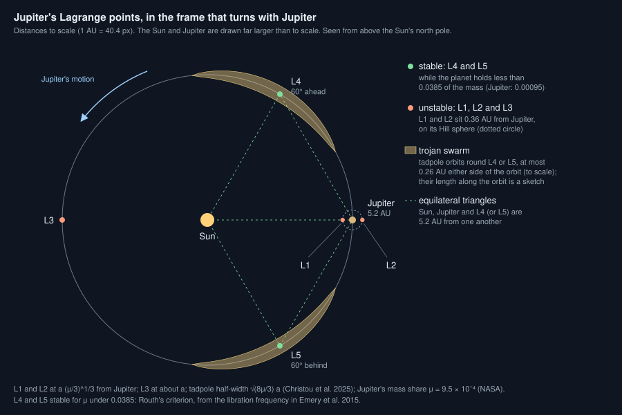
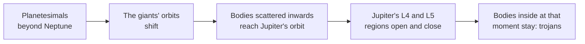

# What are Lagrange points and trojans?

Seen from: the star view of a planetary system, with the "Trojans" and
"Lagrange points" layers on and a planet selected, and the trojan counts
in the "Small bodies" list of the system's panel.

## Short answer

Round a star and a planet, five places balance the two pulls: a small body
put there turns with the planet and keeps its place. Three of them, L1, L2
and L3, lie on the line through the star and the planet, and are
unstable: a body drifts away. The other two, L4 and L5, lie on the
planet's orbit 60° ahead of it and 60° behind it. They are stable as long
as the planet is light enough, which every planet of the Solar System is.
Small bodies gather there, swinging slowly round the point: the trojans.
Jupiter holds hundreds of thousands of them.

## The science



### Five points of balance

Take a star of mass $M$, a planet of mass $m$ on a circular orbit of
radius $a$, and a body too light to pull on either: the restricted
three-body problem. Watch it from a frame that turns with the planet. The
star, the planet and the frame then stand still, and five points balance
the two pulls and the frame's turning.

The planet's share of the mass sets everything:

```math
\mu = \frac{m}{M + m}
```

- **L1 and L2** lie on either side of the planet, on the line to the star,
  at about the planet's Hill radius from it (Murray & Dermott 1999):

  ```math
  r_H \approx a\left(\frac{\mu}{3}\right)^{1/3}
  ```

- **L3** lies on the planet's orbit, on the far side of the star.
- **L4 and L5** lie on the orbit 60° ahead of and 60° behind the planet
  (Emery et al. 2015). Each makes an equilateral triangle with the star
  and the planet.

**In words.** At L1 a body would orbit faster than the planet, being
closer to the star, but the planet's pull back slows it to the planet's
pace; at L2 the planet's pull speeds it up. Both lie where the planet's
own gravity stops dominating. L4 and L5 are where the star's and the
planet's pulls add up to exactly the pull needed to orbit at the planet's
pace.

**Orders of magnitude.** Jupiter's $\mu$ is 9.5 × 10⁻⁴ (NASA masses): its
Hill radius is 0.36 AU, 53 million km. Solving the balance exactly puts
its L1 2 % closer than that and its L2 2 % farther. The Earth's L1 and L2
($\mu$ = 3.0 × 10⁻⁶) lie 1.5 million km away. The Hill radius is
defined this way by Obertas et al. (2017); the distances are our own
arithmetic.

### Why L4 and L5 hold, and when they do not

A body pushed a little off L4 does not fall away: it loops round the
point. Its motion has a fast period, close to the planet's year, and a
slow one, the libration. For a planet with mean motion $n_p$ (its angle
per unit time), the slow frequency is (Emery et al. 2015):

```math
\nu_l = n_p \sqrt{\frac{1 - \sqrt{1 - 27\mu(1-\mu)}}{2}}
\;\approx\; n_p\sqrt{\frac{27\mu}{4}}
```

**In words.** The lighter the planet, the slower a trojan swings round
its point. The inner square root must stay real: the motion is a loop only
while $27\mu(1-\mu) < 1$. Solving for $\mu$ gives Routh's criterion
(Routh 1874):

```math
\mu < \frac{1}{2}\left(1 - \sqrt{\frac{23}{27}}\right) \approx 0.0385
```

Above it, a body pushed off L4 or L5 drifts away: no trojans can last.

**Orders of magnitude.** Jupiter's trojans swing round their point in
about 148 years; their fast period, 11.9 years, is Jupiter's year (Emery
et al. 2015). Round the Sun, a planet up to about 40 Jupiter masses meets
Routh's criterion: every planet does. The Moon round the Earth ($\mu$ = 0.012)
meets it too. Charon round Pluto does not: $\mu$ is 0.11 (NASA masses).

### Tadpoles and horseshoes

A trojan never sits on its point. It loops round it on a path that, seen
in the turning frame, is long along the orbit and narrow across it: a
*tadpole* orbit. The widest tadpole reaches, on each side of the planet's
orbit (Christou et al. 2025, eq. 4, the classical result of Murray &
Dermott 1999):

```math
\delta a_\text{max} \simeq \sqrt{\frac{8\mu}{3}}\;a
```

**In words.** A swarm of trojans is a thin, curved band along the orbit,
centred on L4 or L5. Its width grows only as the square root of the
planet's mass share.

**Orders of magnitude.** For Jupiter, 0.050 of its distance: ±0.26 AU.
For Mars, 0.00141 AU (Christou et al. 2025). For the Earth, ±0.0028 of
its distance, about 420 000 km.

A wider loop can take in L4, L5 and L3 at once: a *horseshoe* orbit
(Balsalobre-Ruza et al. 2023). Saturn's moons Janus and Epimetheus, of
comparable mass, follow such orbits round each other and swap orbits
every four years (Noyelles 2010). Their orbits are 151 472 and 151 422 km
in radius (NASA).

### Jupiter's trojans

- **Discovery.** Max Wolf found the first, near Jupiter's L4, in 1906
  (Emery et al. 2015).
- **Numbers.** About 2.6 × 10⁵ are larger than 1 km: 1.5 × 10⁵ at L4 and
  1.1 × 10⁵ at L5. The main belt holds about 2 × 10⁶ bodies of that size
  (Uehata et al. 2022, after Maeda et al. 2021 for the main belt).
- **Lopsided swarms.** L4 holds more: 1.4 ± 0.2 times as many as L5
  among bodies larger than 10 km (Grav et al. 2011), 1.40 ± 0.15 among
  bodies larger than 2 km (Uehata et al. 2022).
- **Dark.** Their mean albedo is 0.07 (Grav et al. 2011): they reflect
  7 % of the light. The largest are mostly of the D spectral type (DeMeo
  & Carry 2014).



**Where they came from.** Jupiter's trojans were long thought to have
formed near 5 AU. In a newer picture, they formed beyond Neptune and were
captured when the giant planets' orbits shifted (Emery et al. 2015). In
the first such model, Jupiter and Saturn crossed their 1:2 resonance,
which made the trojan regions unstable for a while; the bodies inside
when they turned stable again were trapped (Morbidelli et al. 2005, as
reviewed by Emery et al. 2015). In a later one, Jupiter's orbit jumped
after an encounter with an ice giant, and its trojan regions landed among
scattered bodies. It reproduces the trojans' orbits and total mass, and
may explain why L4 holds more (Nesvorný et al. 2013).

### Hildas: a 3:2 cousin

Jupiter's 3:2 resonance, at 3.97 AU, holds the largest population of any
of its resonances, the Hildas: 1197 known in 2008 (Brož & Vokrouhlický
2008). They go round the Sun three times while Jupiter goes round twice.
They are not at a Lagrange point, but like the trojans they live in a
resonance where orbits last, where most of Jupiter's resonances empty (see
[How do asteroid belts form?](asteroid-belts.md)).

### Who keeps trojans

A planet's trojans also feel the other planets.

- **Mars, Neptune, and two of Saturn's moons** (Tethys and Dione) hold
  stable trojans. Neptune's are thought to be many; Saturn and Uranus
  have none that last, because the other planets disturb them on times
  short against the Solar System's age (Emery et al. 2015).
- **Mars** has 16 known trojans, 15 of them confirmed stable residents,
  most of them at L5 (Christou et al. 2025).
- **The Earth** has only passing ones: 2010 TK7, then 2020 XL5, captured
  in the 15th century and 99.5 % likely to leave L4 within about
  10 000 years (Hui et al. 2021).
- **Saturn's moons.** Telesto and Calypso share Tethys's orbit; Helene and
  Polydeuces share Dione's (NASA).

### Round other stars

No trojan has been confirmed round another star. ALMA images of the young
system PDS 70 show emission at about 4σ at the L5 point of the forming
planet PDS 70 b, from 0.03 to 2 lunar masses of dust. The authors call it
tentative, and expected a repeat observation to test it from February
2026 (Balsalobre-Ruza et al. 2023).

### What we do not know

- **Why L4 holds more.** A jump of Jupiter's orbit can produce the
  asymmetry (Nesvorný et al. 2013), but such captures give asymmetries of
  30 to 80 %, not always in favour of L4 (Emery et al. 2015).
- **Neptune's trojans.** They are thought to be many (Emery et al. 2015),
  but their total is an estimate, not a count.
- **Trojans elsewhere.** None is confirmed outside the Solar System.

## In the app

### What you see

In the star view of a planetary system:

- **Trojans** (on by default): two swarms of points round each planet's
  L4 and L5, 60° ahead of it and 60° behind, moving with it. Labels give
  the counts of the selected or pinned planets' swarms.
- **Lagrange points** (off by default): the selected planet's five points,
  green when stable (L4 and L5), orange when not.
- The "Small bodies" list gives each planet's count of trojans larger
  than 1 km at L4 and at L5.

### How it computes them

The system draws each planet's trojans once the planets are placed
([`belts::draw_trojans`](../../crates/mapgen/src/belts.rs)), from a random
stream of their own:

1. **Routh's criterion.** No trojans if the planet's mass share is 0.0385
   or more.
2. **A heavier giant nearby.** No trojans if a more massive giant orbits
   within a period ratio of 3. This removes Saturn's, to Jupiter, and
   Uranus's, to Saturn, as in the Solar System. A rocky neighbour does not
   count: Mars, next to the heavier Earth, keeps its own.
3. **A count by type**, log-uniform: 10⁴ to 10⁶ for a gas giant or the
   outermost ice giant, 10³ to 10⁵ for another ice giant, 0 to 10³ for a
   hot Jupiter, 0 to 100 for a rocky planet.
4. **The split** between L4 and L5: their ratio is drawn from 0.7 to 1.45.

Trimmed (from `crates/mapgen/src/belts.rs`):

```rust
/// Routh's limit on the mass share for stable L4 and L5 points.
pub const ROUTH: f64 = 0.038_520_896_504_551_1;

let (u, r) = (rng.random::<f64>(), 0.7 + 0.75 * rng.random::<f64>());
let mu = p.mass_earth / (star_mass * SUN_EARTH + p.mass_earth);
// Only a heavier giant empties the points: Jupiter Saturn's,
// Saturn Uranus's. A rocky neighbour does not (the Earth leaves
// Mars its trojans, Christou et al. 2025).
let perturbed = planets.iter().any(|q| {
    q.id != p.id && q.giant() && q.mass_earth > p.mass_earth && {
        let ratio = (q.orbit_au / p.orbit_au).max(p.orbit_au / q.orbit_au);
        ratio.powf(1.5) < 3.0 // period ratio, by Kepler's third law
    }
});
if mu >= ROUTH || perturbed {
    return None;
}
```

The star view places the points
([`smallBodies.ts`](../../web/src/lib/viewer/smallBodies.ts)):

```ts
export function lagrangePoints(a: number, mu: number): LagrangePoint[] {
  const hill = Math.cbrt(mu / 3);
  const stable = mu < ROUTH;
  return [
    { name: 'L1', angle: 0, au: a * (1 - hill), stable: false },
    { name: 'L2', angle: 0, au: a * (1 + hill), stable: false },
    { name: 'L3', angle: Math.PI, au: a * (1 - (7 * mu) / 12), stable: false },
    { name: 'L4', angle: Math.PI / 3, au: a, stable },
    { name: 'L5', angle: -Math.PI / 3, au: a, stable },
  ];
}
```

Each swarm gets from a few to 400 points, by the logarithm of its count.
Each point sits on a tadpole: 60° from the planet plus or minus 5° to 35°,
so from 25° to 95° away, and up to $\sqrt{8\mu/3}\,a$ from the orbit at
its widest. The swarm reaches at least 4 % of the orbit's radius on each
side, and its points are tilted up to 20° above and below the orbit's
plane.

### Where it departs from the science

- **A rule, not a stability test.** "A heavier giant within a period
  ratio of 3" is the app's shortcut for "the other planets disturb them".
  It matches the Solar System: Saturn and Uranus lose their swarms, Mars,
  Jupiter and Neptune keep theirs. It follows no orbit, so it cannot tell
  a swarm that lasts from one that slowly leaks away.
- **Every rocky planet gets a few.** Each rocky planet draws 0 to 100
  trojans, whether its points hold them or not. Mars's 16 fit, but the
  Earth's real ones only pass through (Hui et al. 2021), and the app
  gives Venus and Mercury as many.
- **The counts are drawn, not grown.** No capture is modelled. The ranges
  put Jupiter's 2.6 × 10⁵ inside the gas giants' range, but a giant's
  count does not depend on its mass or on how much material lay beyond.
- **The lopsided swarms are random.** The L4/L5 ratio is drawn from 0.7 to
  1.45 for every planet. Jupiter's measured 1.4 sits near the top, and
  either swarm can be the richer one, as capture models allow.
- **Frozen loops.** Each point keeps its place on its tadpole: the swarm
  turns with the planet but does not librate. Jupiter's trojans would take
  about 148 years to go round their loop.
- **Wider than to scale.** The 4 % floor makes small planets' swarms
  visible. Jupiter's, 5 % wide, is drawn to scale; the Earth's, 0.28 %
  wide, is drawn about 14 times too wide.
- **L1, L2 and L3 approximately.** The formulas are the first terms of a
  series in $\mu$: for Jupiter, L1 and L2 are off by 2 % of their
  distance to the planet. L3 lies at $a\,(1 + 5\mu/12)$ from the
  system's centre of mass, which sits $\mu a$ from the star towards the
  planet; the app places it from the star, at $a\,(1 - 7\mu/12)$ (our
  own expansion, checked numerically). When L1 and L2
  fall inside the planet's marker, they are drawn just outside it, not to
  scale.
- **No co-orbital moons.** Moons have no trojans in the app: no Telesto,
  no Calypso. Horseshoe orbits are not drawn either.

## Sources

1. Murray, C. D. & Dermott, S. F. 1999, *Solar System Dynamics*,
   Cambridge University Press,
   [doi:10.1017/CBO9781139174817](https://doi.org/10.1017/CBO9781139174817).
   The restricted three-body problem and the positions of L1 and L2, not
   checked against the book: we checked them by solving the balance
   numerically. Cited for the tadpole width through Christou et al.
   (2025).
2. Routh, E. J. 1874, "On Laplace's Three Particles, with a Supplement on
   the Stability of Steady Motion", *Proceedings of the London
   Mathematical Society* s1-6, 86–97,
   [doi:10.1112/plms/s1-6.1.86](https://doi.org/10.1112/plms/s1-6.1.86).
3. Emery, J. P., Marzari, F., Morbidelli, A., French, L. M. & Grav, T.
   2015, "The Complex History of Trojan Asteroids", in *Asteroids IV*,
   University of Arizona Press,
   [doi:10.2458/azu_uapress_9780816532131-ch011](https://doi.org/10.2458/azu_uapress_9780816532131-ch011),
   preprint [arXiv:1506.01658](https://arxiv.org/abs/1506.01658).
   Libration frequencies, discovery, origin, other planets' trojans.
4. Obertas, A., Van Laerhoven, C. & Tamayo, D. 2017, "The stability of
   tightly-packed, evenly-spaced systems of Earth-mass planets orbiting a
   Sun-like star", *Icarus* 293, 52–58,
   [doi:10.1016/j.icarus.2017.04.010](https://doi.org/10.1016/j.icarus.2017.04.010),
   preprint [arXiv:1703.08426](https://arxiv.org/abs/1703.08426). The
   Hill radius.
5. Christou, A. A. et al. 2025, "New asteroid clusters and evidence of
   collisional fragmentation in the L5 Trojan cloud of Mars", *Astronomy
   & Astrophysics* 698, A42,
   [doi:10.1051/0004-6361/202553804](https://doi.org/10.1051/0004-6361/202553804),
   preprint [arXiv:2502.16231](https://arxiv.org/abs/2502.16231).
   Tadpole width (eq. 4), Mars's trojans.
6. Balsalobre-Ruza, O. et al. 2023, "Tentative co-orbital submillimeter
   emission within the Lagrangian region L5 of the protoplanet PDS 70 b",
   *Astronomy & Astrophysics* 675, A172,
   [doi:10.1051/0004-6361/202346493](https://doi.org/10.1051/0004-6361/202346493),
   preprint [arXiv:2307.12811](https://arxiv.org/abs/2307.12811).
7. Noyelles, B. 2010, "Theory of the rotation of Janus and Epimetheus",
   *Icarus* 207, 887–902,
   [doi:10.1016/j.icarus.2009.12.034](https://doi.org/10.1016/j.icarus.2009.12.034),
   preprint [arXiv:0912.4830](https://arxiv.org/abs/0912.4830).
8. Uehata, K., Terai, T., Ohtsuki, K. & Yoshida, F. 2022, "Size
   Distribution of Small Jupiter Trojans in the L5 Swarm", *The
   Astronomical Journal* 163, 213,
   [doi:10.3847/1538-3881/ac5b6d](https://doi.org/10.3847/1538-3881/ac5b6d),
   preprint [arXiv:2204.08617](https://arxiv.org/abs/2204.08617).
9. Grav, T. et al. 2011, "WISE/NEOWISE Observations of the Jovian Trojans:
   Preliminary Results", *The Astrophysical Journal* 742, 40,
   [doi:10.1088/0004-637X/742/1/40](https://doi.org/10.1088/0004-637X/742/1/40),
   preprint [arXiv:1110.0280](https://arxiv.org/abs/1110.0280).
10. DeMeo, F. E. & Carry, B. 2014, "Solar System evolution from
    compositional mapping of the asteroid belt", *Nature* 505, 629–634,
    [doi:10.1038/nature12908](https://doi.org/10.1038/nature12908),
    preprint [arXiv:1408.2787](https://arxiv.org/abs/1408.2787).
11. Morbidelli, A., Levison, H. F., Tsiganis, K. & Gomes, R. 2005,
    "Chaotic capture of Jupiter's Trojan asteroids in the early Solar
    System", *Nature* 435, 462–465,
    [doi:10.1038/nature03540](https://doi.org/10.1038/nature03540). Cited
    through Emery et al. (2015).
12. Nesvorný, D., Vokrouhlický, D. & Morbidelli, A. 2013, "Capture of
    Trojans by Jumping Jupiter", *The Astrophysical Journal* 768, 45,
    [doi:10.1088/0004-637X/768/1/45](https://doi.org/10.1088/0004-637X/768/1/45),
    preprint [arXiv:1303.2900](https://arxiv.org/abs/1303.2900).
13. Brož, M. & Vokrouhlický, D. 2008, "Asteroid families in the
    first-order resonances with Jupiter", *Monthly Notices of the Royal
    Astronomical Society* 390, 715–732,
    [doi:10.1111/j.1365-2966.2008.13764.x](https://doi.org/10.1111/j.1365-2966.2008.13764.x),
    preprint [arXiv:1104.4004](https://arxiv.org/abs/1104.4004).
14. Hui, M.-T. et al. 2021, "The Second Earth Trojan 2020 XL5", *The
    Astrophysical Journal Letters* 922, L25,
    [doi:10.3847/2041-8213/ac37bf](https://doi.org/10.3847/2041-8213/ac37bf),
    preprint [arXiv:2111.05058](https://arxiv.org/abs/2111.05058).
15. NASA Space Science Data Coordinated Archive, [Planetary fact
    sheet](https://nssdc.gsfc.nasa.gov/planetary/factsheet/), [Pluto
    fact sheet](https://nssdc.gsfc.nasa.gov/planetary/factsheet/plutofact.html)
    and [Saturnian satellite fact
    sheet](https://nssdc.gsfc.nasa.gov/planetary/factsheet/saturniansatfact.html)
    (masses; the co-orbital moons' orbits).

## See also

- [docs/analysis/13-asteroids.md](../analysis/13-asteroids.md): the study
  behind the app's trojans and Lagrange points, with more sources.
- [How do asteroid belts form?](asteroid-belts.md): the other small bodies
  a giant shapes, the Hildas among them.
- [How close can two planets orbit?](planet-spacing.md): the Hill radius
  and the spacing of planets.
- [docs/system-spec.md](../system-spec.md): small bodies in a system.
