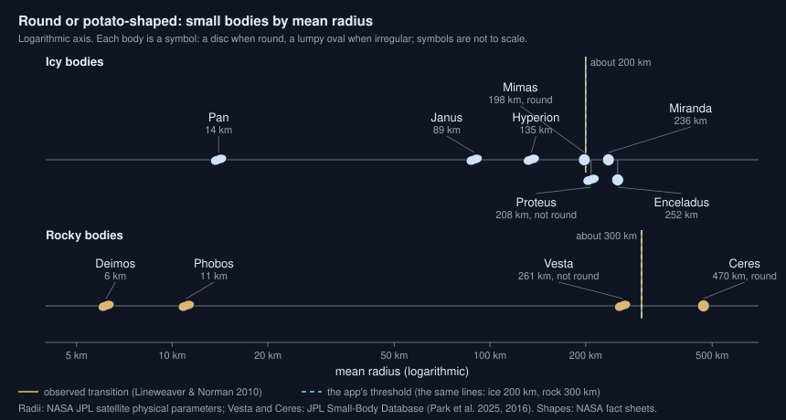

# Why are small moons shaped like potatoes?

Seen from: the planet view of a small moon, whose globe is drawn with its
lumpy shape, and its card, whose **Size** row gives its mean radius and,
for an irregular moon or one stretched by its planet's tides, its three
diameters.

## Short answer

Gravity pulls every part of a body towards its centre, and the weight of
the outer layers presses on the inner ones. In a large body that pressure
is stronger than rock or ice can bear: the material slowly gives way, and
the body settles into a round shape, the one a liquid would take. In a
small body the pressure stays below the strength of its material, so it
keeps whatever shape impacts and its history gave it. The change comes at
a mean radius of about 200 km for icy bodies and about 300 km for rocky
ones, which are stronger. Round bodies are not perfect spheres either:
spin flattens them and a planet's tides stretch them.

## The science



### Round means in hydrostatic equilibrium

A body is in *hydrostatic equilibrium* when its material has flowed until
its surface lies on a level of equal gravity, as the surface of a still
liquid does. The definition of a planet adopted by the International
Astronomical Union in 2006 asks that a body have "sufficient mass for its
self-gravity to overcome rigid body forces so that it assumes a
hydrostatic equilibrium (nearly round) shape" (as quoted by Lineweaver &
Norman 2010). The question is how much mass is enough.

### The pressure inside a body

In a body of radius $R$ and uniform density $\rho$, the weight of the
layers above presses with a pressure $P(r)$ at a distance $r$ from the
centre, and $P_c$ at the centre itself; $G$ is the gravitational constant
(Lineweaver & Norman 2010, eq. 2, after Ryan & Melosh 1998):

```math
P(r) = \frac{2\pi}{3}\,G\rho^2\left(R^2 - r^2\right),
\qquad
P_c = \frac{2\pi}{3}\,G\rho^2 R^2
```

**In words.** The pressure inside grows with the square of the body's
size and the square of its density. Twice the radius, four times the
pressure. A body ten times smaller has a hundred times less pressure at
its heart.

**Orders of magnitude.** With the mean radii and densities measured by
NASA's Jet Propulsion Laboratory (JPL), the pressure at the centre is:

| Body | Mean radius | Density (g/cm³) | $P_c$ |
| --- | --- | --- | --- |
| Deimos | 6.2 km | 1.47 | 0.01 MPa |
| Phobos | 11.1 km | 1.87 | 0.06 MPa |
| Mimas | 198 km | 1.15 | 7 MPa |
| Enceladus | 252 km | 1.61 | 23 MPa |
| Vesta | 261 km | 3.46 | 114 MPa |
| Ceres | 470 km | 2.16 | 144 MPa |

A megapascal is the weight of a hundred tonnes on a square metre. At the
centre of Phobos the load is that of a few metres of rock on Earth.

### The potato radius

For a body to turn round, the pressure must make its material flow:
stresses inside must exceed its *yield strength* $\sigma_y$. Lineweaver &
Norman (2010) ask that the pressure difference under a bump standing 10 %
above the mean radius exceed it, and find the radius $R_\text{pot}$ at
which bodies of density $\rho$ turn from potatoes into spheres (their
eq. 10):

```math
R_\text{pot} \approx 240\ \text{km}
\left(\frac{\sigma_y}{10\ \text{MPa}}\right)^{1/2}
\left(\frac{\rho}{2.5\ \text{g/cm}^3}\right)^{-1}
```

**In words.** A stronger material resists longer, so the body must grow
larger before it rounds. A denser body weighs more for its size, so it
rounds sooner. Ice is much weaker than rock, which more than makes up for
its lower density.

**Orders of magnitude.** Among the bodies whose shapes have been
resolved, Lineweaver & Norman (2010) find the change at a mean radius of
about 200 km for icy moons and about 300 km for rocky asteroids. Fitting
their equation to these, they infer the strengths the bodies had when
their shapes set, young and warm: 0.4 to 3 MPa for ice, 4 to 30 MPa for
rock.

- **Ice.** Hyperion (135 km in mean radius, JPL) is irregular. Mimas
  (198 km) is round, the smallest round body of their sample. Miranda
  (236 km) and Enceladus (252 km) are round: NASA gives their three axes
  within 4 % of each other. Yet Proteus, 208 km and larger than
  Mimas, is not: NASA describes "an odd box-like shape", and adds that
  "if it had just a little more mass it would be able to transform into
  a sphere".
- **Rock.** Vesta, 261 km in mean radius (Park et al. 2025), is 569 by
  554 by 453 km across. Lineweaver & Norman (2010) note: "It is possible
  that originally, Vesta was large enough to reach hydrostatic
  equilibrium but that a collision undid its sphericity." Ceres, 470 km
  in radius, a rocky core under an icy, volatile-rich shell, is in
  hydrostatic equilibrium (Park et al. 2016).

So the threshold is a band, not a line. History matters: a body can round
while young and warm, and a large impact can undo it.

### Phobos and Deimos

Mars's two moons are far below the threshold. Phobos is a lumpy body of
13.0 by 11.4 by 9.1 km in semi-axes (Willner, Shi & Oberst 2014), 11.1 km
in mean radius; Deimos is 6.2 km in mean radius (JPL). The pressure at
their centres, 0.06 and 0.01 MPa, is under 2 % of the weakest rock
strength above (4 MPa). In this regime a body's shape is held by the
strength of its material, not set by gravity (Lineweaver & Norman 2010):
the moons keep the shapes they formed with, worn by impacts since.

### Round is not spherical: spin and tides

A body in hydrostatic equilibrium takes the shape of a level of equal
gravity, and spin and tides bend those levels (Murray & Dermott 1999,
chapter 4). Spin flattens a body at its poles. Ceres, which turns in 9.07
hours, is 964 km across its equator and 892 km from pole to pole (Park et
al. 2016, as listed by JPL). Saturn's flattening, one minus its polar
over its equatorial radius, is 0.098 (NASA).

A moon locked to its planet is also stretched by the planet's tides along
the line to it. It becomes a three-axis ellipsoid: $a$ towards the
planet, $b$ along its orbit and $c$ along its spin axis. For a body in
equilibrium (Noyelles 2017, eq. 4, after Matsuyama & Nimmo 2009 and
others), to first order:

```math
\frac{b-c}{a-c} \approx \frac{1}{4}
```

the correction growing with $q = n^2R^3/(GM)$, the ratio of the spin's
pull to the moon's own gravity, where $n$ is its orbital rate and $M$ its
mass.

For the simplest body, a homogeneous fluid whose surface follows the
equal-gravity levels (a Love number $h_2 = 5/2$), the planet's tide
raises $\tfrac{5}{2}\,qR$ along the line to it and lowers the surface by
$\tfrac{5}{4}\,qR$ across it, and the synchronous spin flattens the
poles. Adding the three, to first order in $q$ (this article's
derivation, which gives the 1/4 above):

```math
a = R\left(1 + \tfrac{35}{12}\,q\right), \qquad
b = R\left(1 - \tfrac{5}{6}\,q\right), \qquad
c = R\left(1 - \tfrac{25}{12}\,q\right)
```

so that $a - c = 5\,qR$.

**In words.** The stretch towards the planet is three times the
flattening across the orbit: seen from the planet, the moon is nearly
round; seen from the side, it is an egg pointing at the planet.

**Orders of magnitude.** Mimas, close to Saturn, has $q = 0.0185$ and
semi-axes of 207.8, 196.7 and 190.6 km (Thomas 2010, as tabulated by
Noyelles, Karatekin & Rambaux 2011): its long axis is 9 % longer than
its short one. Its ratio $(b-c)/(a-c)$ is 0.35, above the 1/4 of
equilibrium: Mimas is round, but not quite in equilibrium. The fluid
formulas give $a - c = 5\,qR$, 18 km for Mimas's 198 km mean radius
(this article's evaluation), against 17.2 km measured: a homogeneous fluid
is a fair first guess, and an upper bound for a moon with a denser core.

### What we do not know

- **Why Proteus is not round while Mimas is.** Their sizes are close.
  Proteus's density is unknown (JPL gives 1.0 ± 1.0 g/cm³), and so are
  the warmth and impacts each went through; the threshold depends on
  all three.
- **What shaped Mimas.** Noyelles (2017) lists, for the departures of
  Saturn's moons from equilibrium, origins "such as a fossil shape,
  internal processes, or impacts".

## In the app

### What you see

Every moon is a body of its system, generated as a world of its own. A
moon too small to be round gets a lumpy shape, the more lumpy the smaller
it is; the planet view draws its globe with that shape, lit by its
slopes, its long axis towards its planet. A larger moon is a sphere,
unless its planet's tides stretch it: a moon locked to its planet, of the
size of Mimas, is drawn a little longer towards the planet. The card's
**Size** row then gives the mean radius and, in brackets, the three
diameters, longest first ("… across", with a tooltip: "Its three
diameters, the longest towards its planet when it is locked to it: an
irregular moon, or a round one stretched by its planet's tides"). Moons
drawn by the system are of three kinds: a rocky planet's moons
(giant-impact moons, debris moonlets, captured moons), a giant's regular
moons, and a giant's ring moons.

### How it computes them

[`MoonSystem`](../../crates/mapgen/src/moons.rs) decides from the mean
radius and the composition whether a moon is round, for a rocky planet's
moons and for a giant's regular moons alike (one function, `moon_axes`):

1. **The threshold** is a diameter of 400 km for ice and 600 km for rock,
   so a mean radius of 200 and 300 km: where Lineweaver & Norman (2010)
   observe the change.
2. **Below it, the irregularity** is `1 − d / limit`, between 0 and 1: 1
   for a moonlet, 0 at the threshold, so that the axes are equal there and
   the shape changes continuously.
3. **The axes** follow from two draws: the middle axis is shortened by 5
   to 30 % of the irregularity, the short one by as much again, then the
   three are scaled so that their product is the mean radius cubed (the
   volume is kept). A tiny moon's short axis is 0.40 to 0.90 of its long
   one; one just under the threshold is nearly round.
4. **The tides** stretch a locked moon (one whose planet's tides have
   despun it within the age, see
   [Why does a world always show the same face to its
   host?](tidal-locking.md)) into the fluid ellipsoid above, with
   $q = n^2R^3/(Gm)$ from its orbit, in full from the threshold up and
   weighted by `1 − irregularity` below it: none for a moonlet, whose
   strength holds its shape. $q$ is capped at 0.05, where a moon would be
   near its Roche limit.
5. **The surface** is the ellipsoid with low-frequency bumps: a noise of
   order one times 12 % of the radius times `1 − c/a`
   ([`shape_at`](../../crates/mapgen/src/moons.rs)), written as
   `raw_data/shape.png` for every irregular or stretched moon, with the
   long axis at longitude 180°, facing the planet. The three axes are
   stored in `world.json` and in the system (`axes_km`).

The axes, trimmed (from `crates/mapgen/src/moons.rs`):

```rust
/// Diameter below which a body is not round, km, for rock and ice.
const ROUND_ROCK_KM: f64 = 600.0;
const ROUND_ICE_KM: f64 = 400.0;

fn moon_axes(composition, radius_km, draws: [f64; 2], locked) -> [f64; 3] {
    let limit = round_limit_km(composition);
    let irregular = (1.0 - 2.0 * radius_km / limit).clamp(0.0, 1.0);
    let b = 1.0 - irregular * (0.05 + 0.25 * draws[0]);
    let c = b - irregular * (0.05 + 0.25 * draws[1]);
    let mut axes = [1.0, b, c];
    if let Some((mass_kg, host_kg, a_km)) = locked {
        let n2 = G * (host_kg + mass_kg) / a_km.powi(3);
        let q = (n2 * radius_km.powi(3) / (G * mass_kg)).min(MAX_HYDROSTATIC_Q)
            * (1.0 - irregular);
        axes[0] *= 1.0 + 35.0 / 12.0 * q;
        axes[1] *= 1.0 - 5.0 / 6.0 * q;
        axes[2] *= 1.0 - 25.0 / 12.0 * q;
    }
    let scale = radius_km / (axes[0] * axes[1] * axes[2]).cbrt();
    axes.map(|x| x * scale)
}
```

Ring moons have their own copy of the rule with the ice limit
(`irregular` and `ROUND_ICE_KM` in
[`rings.rs`](../../crates/mapgen/src/rings.rs)). The viewer reads
`shape.png` and moves each vertex of the globe out to that radius, tilting
its normal by the shape's slopes (`setShape` in
[`PlanetView.ts`](../../web/src/lib/viewer/PlanetView.ts), `shapeAt` in
[`shaders.ts`](../../web/src/lib/viewer/shaders.ts)).

### Where it departs from the science

- **Composition, not density or strength.** The threshold depends only
  on ice or rock. The equation above makes it fall as density rises and
  depend on strength and history; the app ignores both.
- **A line drawn through a band.** The app rounds a moon at 200 km (ice)
  or 300 km (rock) in mean radius, from the observed change (Lineweaver &
  Norman 2010). Real bodies round off gradually: Proteus, above the line
  at 208 km, stays lumpy, and Vesta, a rock of 261 km, was perhaps round
  once. The continuous irregularity softens the jump; its form
  (`1 − d / limit`) and the axis draws are calibrations with no source.
- **A homogeneous fluid.** The tidal shape is that of a homogeneous fluid
  body ($h_2 = 5/2$), to first order in $q$: an upper bound for a
  differentiated moon, whose core makes it deform less. Mimas comes out 18
  km longer than wide against 17.2 measured; $q$ is capped at 0.05, a
  calibration; and the weight `1 − irregularity` between a moonlet and
  the round limit is a calibration too. The bumps scale with `1 − c/a`
  (about 1 % on Mimas), a choice, not a measurement.
- **Round moons are spheres except for the tides.** Real round moons are
  also flattened by their own spin. The app flattens giant planets
  (`0.7 q`, Saturn 0.098), but a moon only gets the tidal ellipsoid, and
  one that is not locked, being a sphere, is not flattened at all.
- **The ring moons keep a step.** A ring moon is irregular under 200 km in
  mean radius and a perfect sphere above, with an irregularity of 0.2 at
  least just under the limit: its short axis is 2 to 12 % shorter than
  its long one there, against nearly equal for a moon of a system. A
  resonant ring moon of 150 to 250 km is not stretched by its giant's
  tides either (the rings' rule, not this article's).

## Sources

1. Lineweaver, C. H. & Norman, M. 2010, "The potato radius: a lower
   minimum size for dwarf planets", *Proceedings of the 9th Australian
   Space Science Conference*, National Space Society of Australia,
   preprint [arXiv:1004.1091](https://arxiv.org/abs/1004.1091).
   Pressure inside a body (eq. 2), potato radius (eq. 10), the observed
   transition (Fig. 2), formative strengths (eq. 15 and 16), Vesta.
2. Ryan, E. V. & Melosh, H. J. 1998, "Impact fragmentation: from the
   laboratory to asteroids", *Icarus* 133, 1–24,
   [doi:10.1006/icar.1998.5915](https://doi.org/10.1006/icar.1998.5915)
   (cited by source 1 for the pressure; not read).
3. NASA Jet Propulsion Laboratory, Solar System Dynamics, [Planetary
   satellite physical parameters](https://ssd.jpl.nasa.gov/sats/phys_par/)
   (mean radii and densities of Deimos, Phobos, Pan, Janus, Hyperion,
   Mimas, Proteus, Miranda, Enceladus) and the [Small-Body
   Database](https://ssd.jpl.nasa.gov/tools/sbdb_lookup.html) (Vesta,
   Ceres).
4. NASA Science, [Proteus](https://science.nasa.gov/neptune/moons/proteus/).
5. Park, R. S. et al. 2016, "A partially differentiated interior for (1)
   Ceres deduced from its gravity field and shape", *Nature* 537,
   515–517,
   [doi:10.1038/nature18955](https://doi.org/10.1038/nature18955).
6. Park, R. S. et al. 2025, "A small core in Vesta inferred from Dawn's
   observations", *Nature Astronomy* 9, 824–834,
   [doi:10.1038/s41550-025-02533-7](https://doi.org/10.1038/s41550-025-02533-7)
   (size and extent, as listed by JPL).
7. Willner, K., Shi, X. & Oberst, J. 2014, "Phobos' shape and topography
   models", *Planetary and Space Science* 102, 51–59,
   [doi:10.1016/j.pss.2013.12.006](https://doi.org/10.1016/j.pss.2013.12.006).
8. Murray, C. D. & Dermott, S. F. 1999, *Solar System Dynamics*, Cambridge
   University Press,
   [doi:10.1017/CBO9781139174817](https://doi.org/10.1017/CBO9781139174817),
   chapter 4 (tides, rotation and shape).
9. Noyelles, B. 2017, "Interpreting the librations of a synchronous
   satellite – How their phase assesses Mimas' global ocean", *Icarus*
   282, 276–289,
   [doi:10.1016/j.icarus.2016.10.001](https://doi.org/10.1016/j.icarus.2016.10.001),
   preprint [arXiv:1605.05919](https://arxiv.org/abs/1605.05919).
10. Noyelles, B., Karatekin, Ö. & Rambaux, N. 2011, "The rotation of
    Mimas", *Astronomy & Astrophysics* 536, A61,
    [doi:10.1051/0004-6361/201117558](https://doi.org/10.1051/0004-6361/201117558),
    preprint [arXiv:1109.4867](https://arxiv.org/abs/1109.4867).
11. Thomas, P. C. 2010, "Sizes, shapes, and derived properties of the
    saturnian satellites after the Cassini nominal mission", *Icarus*
    208, 395–401,
    [doi:10.1016/j.icarus.2010.01.025](https://doi.org/10.1016/j.icarus.2010.01.025)
    (Mimas's axes, as tabulated by source 10).
12. NASA Space Science Data Coordinated Archive, [Saturn fact
    sheet](https://nssdc.gsfc.nasa.gov/planetary/factsheet/saturnfact.html)
    (flattening).

## See also

- [docs/analysis/11-moons.md](../analysis/11-moons.md), section 5 "Round
  or misshapen": the study behind the app's moon shapes.
- [Why are ring moons so small?](ring-moons.md): ring moons, whose shapes
  follow the same rule.
- The README's paragraph on moons as worlds, for the `shape.png` layer.
