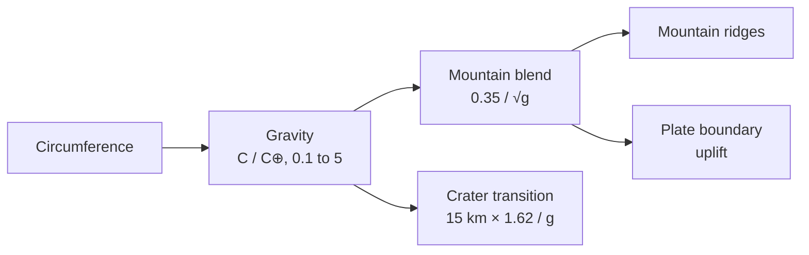

# Why are mountains lower on heavier planets?

Seen from: the planet view of a rocky world, its relief on the globe and the
map (and the **Relief** slider of the **Map** panel), and the **Gravity**
row of its **Info** panel; the form sets it through **Circumference (km)**.

## Short answer

A mountain presses on the rock beneath it with its own weight. The heavier
the planet, the more each kilometre of mountain weighs, and rock can only
bear so much before it flows or breaks. So the tallest mountain a planet can
hold is roughly inversely proportional to its surface gravity: on Mars,
with 38 % of Earth's gravity, volcanoes stand two and a half times as high
as Everest. On Earth, glaciers often wear the highest ranges down before
they reach that limit, and on small bodies the limit is set by the size of
the body itself.

## The science


### The weight of a mountain

Take a column of rock of height $h$ and density $\rho$ on a planet of
surface gravity $g$. At its base it presses down with the pressure
$\rho g h$. Rock holds only up to a certain stress, its strength $\sigma$;
beyond it, it breaks and slides, or creeps and flows. The tallest column it
can hold is therefore about

```math
h_\text{max} \approx \frac{\sigma}{\rho\,g}
```

**In words.** The same rock holds a mountain twice as high under half the
gravity. Nothing else in the estimate depends on the planet: strength and
density are properties of the rock. Weisskopf (1975) made this kind of
estimate of the height of mountains a classic example of "qualitative
physics".

**Orders of magnitude.** Everest stands 8,848.86 m above sea level (the
joint survey of China and Nepal, 2020). Under its summit, taking a rock
density of 2.7 g/cm³ (an assumption for this example, typical of continental
rock), the pressure at sea level is
$2700 \times 9.82 \times 8849 \approx 2.3 \times 10^8$ Pa, 230 MPa. The
same pressure under Mars's gravity, 3.73 m/s² against Earth's 9.82 (NASA
fact sheets), holds a column 2.6 times as high: 23 km. Mars's highest
volcano, Olympus Mons, rises 21.1 km above the Martian datum, with almost
22 km of relief over its surroundings (Plescia 2004). Venus, with 8.87 m/s²,
should hold about 10 km; its highest point, in Maxwell Montes, lies at a
radius of 6,062 km (Pettengill et al. 1991), about 10 km above the planet's
mean radius of 6,051.84 km (Ford & Pettengill 1992).

The whole range of heights, from the deepest point to the highest, follows
gravity only loosely: it spans 30 km on Mars, 20.4 km on Earth (sea floors
included), 13 km on Venus and the Moon, and only 7 km on Mercury, whose
gravity equals Mars's (NASA fact sheets). Gravity sets a ceiling; whether a
world comes near it depends on what builds its relief.

### Isostasy: mountains float

A mountain range is not a column on a rigid table. The crust floats on a
denser mantle, and a range sinks a root into it until the root's buoyancy
balances the range's weight (Airy 1855). For a range of height $h$ above
crust of density $\rho_c$ over a mantle of density $\rho_m$, the root's
depth $r$ follows from equal weights of the two columns:

```math
\rho_c\, g\, h = (\rho_m - \rho_c)\, g\, r
\quad\Rightarrow\quad
r = h\,\frac{\rho_c}{\rho_m - \rho_c}
```

**In words.** Gravity cancels out: isostasy says how deep the root goes,
not how high the range can be. Its height is still limited by what the
crust can bear, which still scales as $1/g$.

**Orders of magnitude.** With densities of 2.8 g/cm³ for the crust and
3.3 g/cm³ for the mantle (typical values, assumed for this example), the
root reaches 5.6 times the height of the range: a range 5 km high stands on
a root 28 km deep.

### Erosion: often the real limit on Earth

Strength gives an upper bound. On Earth, the height of many ranges is set
by the climate instead: glaciers erode the ground above the snowline, and
the unloading lifts the land beneath. Egholm et al. (2009) found that the
maximum heights of many high ranges follow the snowline altitude, so that
"differences in the height of mountain ranges generally reflect variations
in local climate" rather than tectonics. A world whose ranges are not worn
by ice and water could keep them closer to the strength limit.

### Small bodies: the limit outgrows the body

At low gravity the estimate gives mountains larger than the body itself. On
Vesta, whose surface gravity is about 0.25 m/s² (its mass and mean radius,
NASA asteroid fact sheet), $1/g$ scaled from Everest gives 340 km: more than
Vesta's radius of about 262 km. Its tallest feature, the central mound of
the Rheasilvia impact basin, is about 22 km high and 180 km wide (Yingst et
al. 2012): small in absolute terms, but a twelfth of the body's radius.
There the shape of the whole body, not a mountain on it, is what gravity
struggles to hold round: see [Why are small moons shaped like
potatoes?](moon-shapes.md).

### What we do not know

- **Which limit binds.** Rock strength, erosion, the supply of magma for a
  volcano and the thickness of the lithosphere all set limits. Which one
  stops a given range is a question for each range.
- **Io's mountains** stand well under the $1/g$ curve. They average 6.3 km,
  the highest, Boösaule Montes, 17.5 ± 3 km (Schenk et al. 2001), and they
  look like tilted crustal blocks thrust up by compression rather than
  volcanoes: how they form may set their height more than their weight.
- **Strength is not one number.** The estimate takes one strength for all
  rock, but rock is hot or cold, dry or wet, loaded briefly or for ages.
  Venus's surface averages 737 K (NASA), yet the south-west face of Maxwell
  Montes has kilometre-scale slopes above 30° (Ford & Pettengill 1992).

## In the app

### What you see

A rocky world's relief is drawn on the globe and the flat map, shaded by
its slopes; the **Relief** slider exaggerates it for the eye. The **Info**
panel gives the world's **Gravity**, in Earth's. A world of small
circumference (the form's **Circumference (km)**; drawn worlds run from
20,000 to 80,000 km) has low gravity and taller, more jagged mountains; a
large one, flatter and rounder relief.

### How it computes them



1. **Gravity.** `WorldParams::gravity_modifier` in
   [`world.rs`](../../crates/mapgen/src/world.rs) assumes every rocky world
   has Earth's density. Then the mass grows as the radius cubed, and the
   surface gravity as the radius: $g/g_\oplus = C / C_\oplus$, with
   $C_\oplus = 40{,}075$ km, kept between 0.1 and 5.
2. **Mountains.** The elevation before erosion is
   `continent + plates + mountain × mountain_weight × mountain_blend`
   ([`generation.rs`](../../crates/mapgen/src/generation.rs)). The blend
   is $0.35/\sqrt{g}$: 0.35 at Earth's gravity, about 0.49 at half of it,
   0.25 at twice.
3. **Plate boundaries.** The ranges, trenches and ridges that
   [`plates.rs`](../../crates/mapgen/src/plates.rs) raises at plate
   boundaries are given "at Earth's gravity" and scaled by the same
   blend.
4. **Craters.** The size above which a crater gets a flat floor and a
   central peak is $15\,\text{km} \times 1.62 / g$ (g in m/s²), the Moon's
   15 km scaled as $1/g$
   ([`craters.rs`](../../crates/mapgen/src/craters.rs)).
5. **Small bodies.** Below about 2,100 km in radius, a moon's relief is
   flattened towards its sea level to about 0.6 % of its radius
   (`relief_share` in `generation.rs`).

The gravity and the mountain blend, trimmed (from
`crates/mapgen/src/world.rs` and `crates/mapgen/src/generation.rs`):

```rust
/// Assumes constant density, so gravity scales linearly with radius (and
/// thus circumference). Clamped to a plausible range for rocky planets.
pub fn gravity_modifier(&self) -> f32 {
    (self.circumference_km / EARTH_CIRCUMFERENCE_KM).clamp(0.1, 5.0)
}

// Stronger gravity suppresses mountain relief; sqrt dampens the effect
// for extreme values. Baseline 0.35 at Earth gravity.
mountain_blend: 0.35 / p.gravity_modifier().sqrt(),

// Relief scales with gravity as the mountains do.
let tectonic_uplift = plates.uplift * self.mountain_blend / 0.35;
```

### Where it departs from the science

- **$1/\sqrt{g}$, not $1/g$.** The README says so: "The square-root
  softens the curve so extreme planets remain visually interesting". At
  twice Earth's gravity, mountains keep 71 % of Earth's height instead of
  50 %; at half, they get 141 % instead of 200 %. A Mars-sized world gets
  ranges 1.4 times Earth's, not 2.6 times.
- **Only mountains and plate relief scale.** The continents' noise, the
  depth of the sea floor and the volcanic cones (0.25 elevation units above
  the terrain, 0.4 for arc volcanoes) keep the same height at any gravity.
  The tallest volcanoes, which on Mars are the tallest mountains of all,
  do not grow on light worlds.
- **Heights in kilometres do not change.** One elevation unit is 25 km on
  every world (`ELEVATION_KM`, calibrated on Earth-like worlds), so a
  world's elevation range in kilometres changes only through the mountain
  blend.
- **Gravity from Earth's density.** Real rocky bodies differ in density:
  Mars has 0.53 of Earth's radius but 0.38 of its gravity (NASA). The app
  would give a Mars-sized world 0.53 g. The same rule applies to moons
  generated as worlds: a Moon-sized moon gets 0.27 g instead of the Moon's
  0.165 g, and an icy moon, far less dense than rock, gets two to three
  times its true gravity. Its mountains and its crater transition follow
  that gravity.
- **Erosion ignores gravity.** The droplets of the hydraulic erosion run
  with a fixed `gravity` of 4 (a constant of the droplet method, not the
  planet's); a heavier world is not worn faster or slower. There is no
  glacial erosion capping ranges at a snowline.
- **No isostasy.** Mountains are heights added to a surface; no root,
  no flexure of the crust under a volcano.
- **Small bodies get flatter, not taller.** Real small bodies carry
  relief that is a larger share of their radius the smaller they are
  (Vesta's mound is a twelfth of its radius). The app flattens bodies under
  2,100 km in radius to about 0.6 % of their radius, the opposite trend.
  It shows on the moons of a system: the noise relief of a Vesta-sized moon
  is cut to about 1.6 km, where Vesta has a mound of 22 km.

## Sources

1. Weisskopf, V. F. 1975, "Of atoms, mountains, and stars: a study in
   qualitative physics", *Science* 187, 605–612,
   [doi:10.1126/science.187.4177.605](https://doi.org/10.1126/science.187.4177.605).
2. Airy, G. B. 1855, "On the computation of the effect of the attraction
   of mountain-masses, as disturbing the apparent astronomical latitude of
   stations in geodetic surveys", *Philosophical Transactions of the Royal
   Society of London* 145, 101–104,
   [doi:10.1098/rstl.1855.0003](https://doi.org/10.1098/rstl.1855.0003).
3. Plescia, J. B. 2004, "Morphometric properties of Martian volcanoes",
   *Journal of Geophysical Research: Planets* 109, E03003,
   [doi:10.1029/2002JE002031](https://doi.org/10.1029/2002JE002031).
4. Pettengill, G. H., Ford, P. G., Johnson, W. T. K. et al. 1991,
   "Magellan: radar performance and data products", *Science* 252,
   260–265,
   [doi:10.1126/science.252.5003.260](https://doi.org/10.1126/science.252.5003.260).
5. Ford, P. G. & Pettengill, G. H. 1992, "Venus topography and
   kilometer-scale slopes", *Journal of Geophysical Research* 97,
   13103–13114,
   [doi:10.1029/92JE01085](https://doi.org/10.1029/92JE01085).
6. Schenk, P., Hargitai, H., Wilson, R. et al. 2001, "The mountains of Io:
   global and geological perspectives from Voyager and Galileo", *Journal
   of Geophysical Research* 106, 33201–33222,
   [doi:10.1029/2000JE001408](https://doi.org/10.1029/2000JE001408).
7. Egholm, D. L., Nielsen, S. B., Pedersen, V. K. & Lesemann, J.-E. 2009,
   "Glacial effects limiting mountain height", *Nature* 460, 884–887,
   [doi:10.1038/nature08263](https://doi.org/10.1038/nature08263).
8. Yingst, R. A. et al. 2012, "Geologic mapping of the Av-15 Rheasilvia
   quadrangle of asteroid 4 Vesta", EGU General Assembly 2012, conference
   abstract, [DLR elib](https://elib.dlr.de/80581/). Not peer-reviewed;
   the mound's height is approximate.
9. NASA Space Science Data Coordinated Archive, [planetary fact
   sheets](https://nssdc.gsfc.nasa.gov/planetary/factsheet/) (gravity,
   radii, topographic ranges, Venus's temperature), [Jovian satellite fact
   sheet](https://nssdc.gsfc.nasa.gov/planetary/factsheet/joviansatfact.html)
   (Io's mass and radius) and [asteroid fact
   sheet](https://nssdc.gsfc.nasa.gov/planetary/factsheet/asteroidfact.html)
   (Vesta's mass and size).
10. The height of Everest, 8,848.86 m, announced jointly by China and Nepal
    on 8 December 2020, as reported by
    [Al Jazeera](https://www.aljazeera.com/news/2020/12/8/mt-everest-nepal-china-announce-revised-height-at-8848-metres).

## See also

- [docs/analysis/05-relief.md](../analysis/05-relief.md): the study of the
  relief, its noise and erosion.
- [docs/analysis/08-geology.md](../analysis/08-geology.md): the geology
  study, with the craters' gravity scaling.
- The README's **Gravity modifier — landscape relief** (under
  Calculations) and **Elevation — continents, coasts and mountains**.
- [How do impact craters form and fade?](impact-craters.md),
  [Do all rocky planets have plate tectonics?](plate-tectonics.md) and
  [Why are small moons shaped like potatoes?](moon-shapes.md)
