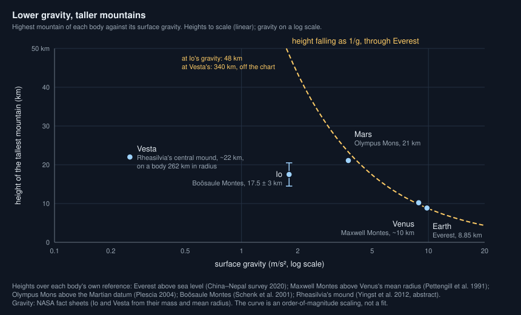
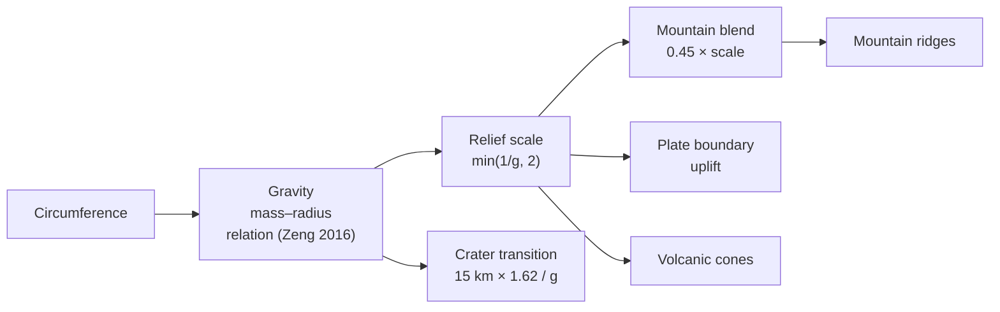

# Why are mountains lower on heavier planets?

Seen from: the planet view of a rocky world, its relief on the globe and the
map (and the **Relief** slider of the **Map** panel), and the **Gravity**
row of its **Info** panel; the form sets it through **Circumference (km)**.

## Short answer

A mountain presses on the rock beneath it with its own weight. The heavier
the planet, the more each kilometre of mountain weighs, and rock can only
bear so much before it flows or breaks. So the tallest mountain a planet can
hold is roughly inversely proportional to its surface gravity: on Mars,
with 38 % of Earth's gravity, volcanoes stand two and a half times as high
as Everest. On Earth, glaciers often wear the highest ranges down before
they reach that limit, and on small bodies the limit is set by the size of
the body itself.

## The science



### The weight of a mountain

Take a column of rock of height $h$ and density $\rho$ on a planet of
surface gravity $g$. At its base it presses down with the pressure
$\rho g h$. Rock holds only up to a certain stress, its strength $\sigma$;
beyond it, it breaks and slides, or creeps and flows. The tallest column it
can hold is therefore about

```math
h_\text{max} \approx \frac{\sigma}{\rho\,g}
```

**In words.** The same rock holds a mountain twice as high under half the
gravity. Nothing else in the estimate depends on the planet: strength and
density are properties of the rock. Weisskopf (1975) made this kind of
estimate of the height of mountains a classic example of "qualitative
physics".

**Orders of magnitude.** Everest stands 8,848.86 m above sea level (the
joint survey of China and Nepal, 2020). Under its summit, taking a rock
density of 2.7 g/cm³ (an assumption for this example, typical of continental
rock), the pressure at sea level is
$2700 \times 9.82 \times 8849 \approx 2.3 \times 10^8$ Pa, 230 MPa. The
same pressure under Mars's gravity, 3.73 m/s² against Earth's 9.82 (NASA
fact sheets), holds a column 2.6 times as high: 23 km. Mars's highest
volcano, Olympus Mons, rises 21.1 km above the Martian datum, with almost
22 km of relief over its surroundings (Plescia 2004). Venus, with 8.87 m/s²,
should hold about 10 km; its highest point, in Maxwell Montes, lies at a
radius of 6,062 km (Pettengill et al. 1991), about 10 km above the planet's
mean radius of 6,051.84 km (Ford & Pettengill 1992).

The whole range of heights, from the deepest point to the highest, follows
gravity only loosely: it spans 30 km on Mars, 20.4 km on Earth (sea floors
included), 13 km on Venus and the Moon, and only 7 km on Mercury, whose
gravity equals Mars's (NASA fact sheets). Gravity sets a ceiling; whether a
world comes near it depends on what builds its relief.

### Isostasy: mountains float

A mountain range is not a column on a rigid table. The crust floats on a
denser mantle, and a range sinks a root into it until the root's buoyancy
balances the range's weight (Airy 1855). For a range of height $h$ above
crust of density $\rho_c$ over a mantle of density $\rho_m$, the root's
depth $r$ follows from equal weights of the two columns:

```math
\rho_c\, g\, h = (\rho_m - \rho_c)\, g\, r
\quad\Rightarrow\quad
r = h\,\frac{\rho_c}{\rho_m - \rho_c}
```

**In words.** Gravity cancels out: isostasy says how deep the root goes,
not how high the range can be. Its height is still limited by what the
crust can bear, which still scales as $1/g$.

**Orders of magnitude.** With densities of 2.8 g/cm³ for the crust and
3.3 g/cm³ for the mantle (typical values, assumed for this example), the
root reaches 5.6 times the height of the range: a range 5 km high stands on
a root 28 km deep.

### Erosion: often the real limit on Earth

Strength gives an upper bound. On Earth, the height of many ranges is set
by the climate instead: glaciers erode the ground above the snowline, and
the unloading lifts the land beneath. Egholm et al. (2009) found that the
maximum heights of many high ranges follow the snowline altitude, so that
"differences in the height of mountain ranges generally reflect variations
in local climate" rather than tectonics. A world whose ranges are not worn
by ice and water could keep them closer to the strength limit.

### Small bodies: the limit outgrows the body

At low gravity the estimate gives mountains larger than the body itself. On
Vesta, whose surface gravity is about 0.25 m/s² (its mass and mean radius,
NASA asteroid fact sheet), $1/g$ scaled from Everest gives 340 km: more than
Vesta's radius of about 262 km. Its tallest feature, the central mound of
the Rheasilvia impact basin, is about 22 km high and 180 km wide (Yingst et
al. 2012): small in absolute terms, but a twelfth of the body's radius.
There the shape of the whole body, not a mountain on it, is what gravity
struggles to hold round: see [Why are small moons shaped like
potatoes?](moon-shapes.md).

### What we do not know

- **Which limit binds.** Rock strength, erosion, the supply of magma for a
  volcano and the thickness of the lithosphere all set limits. Which one
  stops a given range is a question for each range.
- **Io's mountains** stand well under the $1/g$ curve. They average 6.3 km,
  the highest, Boösaule Montes, 17.5 ± 3 km (Schenk et al. 2001), and they
  look like tilted crustal blocks thrust up by compression rather than
  volcanoes: how they form may set their height more than their weight.
- **Strength is not one number.** The estimate takes one strength for all
  rock, but rock is hot or cold, dry or wet, loaded briefly or for ages.
  Venus's surface averages 737 K (NASA), yet the south-west face of Maxwell
  Montes has kilometre-scale slopes above 30° (Ford & Pettengill 1992).

## In the app

### What you see

A rocky world's relief is drawn on the globe and the flat map, shaded by
its slopes; the **Relief** slider exaggerates it for the eye. The **Info**
panel gives the world's **Gravity**, in Earth's. A world of small
circumference (the form's **Circumference (km)**; drawn worlds run from
20,000 to 80,000 km) has low gravity and taller, more jagged ranges and
volcanoes, up to twice Earth's; a large one, lower and rounder relief. The
continents themselves and the sea floor look alike at any gravity.

### How it computes them



1. **Gravity.** `rocky_gravity` in
   [`world.rs`](../../crates/mapgen/src/world.rs) takes the mass of a rocky
   world from the mass–radius relation $M \propto R^{3.7}$ (Zeng, Sasselov &
   Jacobsen 2016, fitted from 1 to 8 Earth masses; its coefficient, 1.002 at
   Earth's core, is taken as 1). With $r = C / C_\oplus$ and
   $C_\oplus = 40{,}075$ km, the surface gravity is
   $g/g_\oplus = \max(r^{1.7},\, 0.607\,r)$: the floor is the density of
   uncompressed rock, the Moon's 3.344 g/cm³ over Earth's 5.513 (NASA fact
   sheets), reached at 0.48 Earth radii. It is capped at 5 g (from 2.6 Earth
   radii, far beyond the fit). A moon has the gravity of its card, from its
   density (`WorldParams::gravity`), and a reloaded world keeps the gravity
   it was generated with.
2. **Mountains.** The elevation before erosion is the floating crust, plus
   the plates' uplift, plus
   `mountain × mountain_weight × mountain_blend`, plus the volcanoes
   ([`generation.rs`](../../crates/mapgen/src/generation.rs)). The blend is
   $0.45 \times \min(1/g,\ 2)$: 0.45 at Earth's gravity, 0.9 at the cap,
   0.14 at 3.2 g (twice Earth's size). The 0.45 is a calibration on
   Earth's hypsometry, with the platform below. Worlds with plates keep
   half the mountain weight (their other ranges follow the plate
   boundaries). Worlds without keep it whole, but only in a few highland
   provinces (`HIGHLANDS`): without plates to stack crust into ranges, a
   world is plains with its craters, basins and volcanoes. A low-frequency
   noise ramps the mountains in past its middle on about 9 % of the
   sphere, Venus's share: tesserae cover about 7–8 % of it (Ivanov & Head
   2011), highlands with them about a tenth, plains 70–80 %. Venus's
   hypsometry is unimodal, more than 80 % of it within 1 km of the mean
   radius (Pettengill et al. 1980; Ford & Pettengill 1992): with the
   rolling plains of a dry world (3 km of relief per unit of the
   continents' noise at Earth's gravity, `DRY_PLAINS_KM`, scaled as
   `1/g`), the `venus-like` archetype gets 79 % within ±1 km of its
   median.
3. **Plate boundaries.** The ranges, arcs and trenches that
   [`plates.rs`](../../crates/mapgen/src/plates.rs) raises at plate
   boundaries are given "at Earth's gravity" and multiplied by the same
   `relief_scale`. The swell of mid-ocean ridges is not: it comes from the
   heat of young floor, not from weight (see [Do all rocky planets have
   plate tectonics?](plate-tectonics.md)).
4. **Volcanoes.** The height of cones, provincial and arc, is multiplied by
   `relief_scale` as well.
5. **Floating crust.** The continents and the sea floor are not scaled.
   `floating` maps the continents' noise to a platform rising to 0.5 km
   above the waterline on land, and at sea to a shelf (0.2 km), a slope down
   to the generator's old floor (4 km) and an abyss levelling off towards
   6.4 km (Parsons & Sclater 1977). Crust floats at the same height under
   any $g$ (Airy), so none of it depends on gravity. The values are
   calibrations on Earth's hypsometry (ETOPO 2022, NOAA NCEI,
   doi:10.25921/fd45-gt74): about 0.42 km median land height, a tenth of the
   land above 2 km, 2 % above 4 km.
6. **Range.** Elevations beyond ±0.85 units are compressed with `tanh` into
   $[-1, 1]$ (`within_range`), not clipped, so the tall relief of light
   worlds keeps its summits.
7. **Small bodies.** `relief_share` keeps the noise relief whole until its
   span, from the old floor to the highest mountains, would pass 8 % of the
   body's radius: a body of about 230 km in radius or more at Earth's
   gravity, 370 km at the cap, keeps it all. Smaller ones have their relief
   cut to 8 % of their radius. On an airless
   body without plates whose lid is stagnant or episodic (a moon, a dead
   world, an airless world that overturns now and then) the span is also
   capped at 9 km (`IMPACT_RELIEF_KM`), and at 0.4 of that on an icy one
   (bulk density under 2.5 g/cm³). A heat-pipe body (Io) is not: lava
   resurfaces it, and its sinking crust breaks into blocks up to 17 km
   high (Schenk et al. 2001).
8. **Craters.** The size above which a crater gets a flat floor and a
   central peak is $15\,\text{km} \times 1.62 / g$ (g in m/s²), the Moon's
   15 km scaled as $1/g$
   ([`craters.rs`](../../crates/mapgen/src/craters.rs)).

The gravity and the relief scale, trimmed (from
`crates/mapgen/src/world.rs` and `crates/mapgen/src/generation.rs`):

```rust
pub fn rocky_gravity(radius: f32) -> f32 {
    let radius = radius.max(0.0);
    let density = radius
        .powf(ROCKY_MASS_RADIUS_EXPONENT - 3.0)
        .max(UNCOMPRESSED_ROCK_DENSITY);
    (density * radius).min(MAX_ROCKY_GRAVITY)
}

pub(crate) fn relief_scale(gravity: f32) -> f32 {
    (1.0 / gravity.max(1e-3)).min(MAX_RELIEF_SCALE)
}

// Sampler::new
mountain_blend: MOUNTAIN_BLEND * relief_scale(p.gravity_modifier()),
// Sampler::sample
let tectonic_uplift = plates.uplift * self.relief_scale + plates.swell;
let cone_height = cone_height * self.relief_scale;
```

Examples: Mars's size gives 0.34 g (Mars: 0.38), Venus's 0.92 (0.90), the
Moon's 0.165 (0.165), twice Earth's size 3.2 g, which keeps 31 % of Earth's
relief. A Mars-sized world and a Moon-sized moon both reach the cap and get
ranges twice Earth's. Measured on a Mars-sized `terran` world at 29 % land:
median land height 0.33 km, 6.7 % of the land above 2 km, 1.3 % above 4 km.

### Where it departs from the science

- **The relief scale stops at 2.** Mars's size would give 2.9 by $1/g$, and
  Olympus Mons stands 2.5 times as high as Everest (Plescia 2004). The cap
  keeps the summits of light worlds inside the elevation range (one unit is
  25 km). The Moon, Io and Vesta are far under their $1/g$ ceiling anyway.
- **Mercury's gravity.** Mercury's size gives 0.23 g, where Mercury has
  0.38: its iron core is large, and the relation is fitted on Earth-like
  interiors. The relation is also extrapolated below one Earth mass, and
  past 8 Earth masses.
- **Heights in kilometres are a fixed unit.** One elevation unit is 25 km on
  every world (`ELEVATION_KM`, calibrated on Earth-like worlds). Relief
  scales with gravity; the unit does not.
- **Isostasy is a calibration, not a balance.** The platform's height and
  the shelf, slope and abyss of the sea floor are fitted on Earth's
  hypsometry. There is no field of crustal thickness, so no root under a
  range and no densities in the code; there is no flexure of the crust
  under a volcano; and since the platform floats at the waterline, a world
  with a lower sea level shows platform, not old basins. Sea floor older
  than about 18 Ma lies between 4 and 6.4 km by the noise, not by its age.
- **Erosion ignores gravity.** The droplets of the hydraulic erosion run
  with a fixed `gravity` of 4 (a constant of the droplet method, not the
  planet's); a heavier world is not worn faster or slower. There is no
  glacial erosion capping ranges at a snowline.
- **Small bodies rest on weak numbers.** The 8 % comes from one figure,
  Vesta's mound, in an EGU abstract that is not peer-reviewed. The 9 km cap
  of airless bodies without plates is a calibration on the Moon's 13 km
  span (it gives a Moon-sized moon 15.7 km with its craters), and the 0.4 of ice
  extrapolates one crater depth ratio to all relief (1.1 km on Ganymede
  against 2.8 km on the Moon at 26 km across; Schenk 2002, see [How do
  impact craters form and fade?](impact-craters.md)).
  A Vesta-sized airless moon is therefore capped at 9 km where Vesta's mound
  alone is 22 km. An icy moon's simple craters are still rock's bowls under
  rock's transition, so its span is 0.75 of rock's, not 0.4. Dead planets
  (`mercury-like`, airless `barren`) have the 9 km cap too, whatever their
  gravity.
- **Worlds without plates: provinces from noise.** Their highland
  provinces are noise blobs: real ones are tesserae and volcanic rises on
  Venus, the cratered southern highlands and Tharsis on Mars (two thirds
  of the planet, not a tenth), impact-shaped terrain on Mercury and the
  Moon; the same share serves them all. A dry world's rolling plains come
  from the continents' noise, not from mantle flow. `mars-like` spans
  30 km (Mars: about 30 km, Smith et al. 1999); `mercury-like` 18 km, about
  twice Mercury's 9.9 km (Becker et al. 2016): its craters reach 7.7 km
  below its median and its highlands 10 km above it, under an impact cap
  calibrated on the Moon, whose relief (about 20 km) is twice Mercury's.

## Sources

1. Weisskopf, V. F. 1975, "Of atoms, mountains, and stars: a study in
   qualitative physics", *Science* 187, 605–612,
   [doi:10.1126/science.187.4177.605](https://doi.org/10.1126/science.187.4177.605).
2. Airy, G. B. 1855, "On the computation of the effect of the attraction
   of mountain-masses, as disturbing the apparent astronomical latitude of
   stations in geodetic surveys", *Philosophical Transactions of the Royal
   Society of London* 145, 101–104,
   [doi:10.1098/rstl.1855.0003](https://doi.org/10.1098/rstl.1855.0003).
3. Plescia, J. B. 2004, "Morphometric properties of Martian volcanoes",
   *Journal of Geophysical Research: Planets* 109, E03003,
   [doi:10.1029/2002JE002031](https://doi.org/10.1029/2002JE002031).
4. Pettengill, G. H., Ford, P. G., Johnson, W. T. K. et al. 1991,
   "Magellan: radar performance and data products", *Science* 252,
   260–265,
   [doi:10.1126/science.252.5003.260](https://doi.org/10.1126/science.252.5003.260).
5. Ford, P. G. & Pettengill, G. H. 1992, "Venus topography and
   kilometer-scale slopes", *Journal of Geophysical Research* 97,
   13103–13114,
   [doi:10.1029/92JE01085](https://doi.org/10.1029/92JE01085).
6. Schenk, P., Hargitai, H., Wilson, R. et al. 2001, "The mountains of Io:
   global and geological perspectives from Voyager and Galileo", *Journal
   of Geophysical Research* 106, 33201–33222,
   [doi:10.1029/2000JE001408](https://doi.org/10.1029/2000JE001408).
7. Egholm, D. L., Nielsen, S. B., Pedersen, V. K. & Lesemann, J.-E. 2009,
   "Glacial effects limiting mountain height", *Nature* 460, 884–887,
   [doi:10.1038/nature08263](https://doi.org/10.1038/nature08263).
8. Yingst, R. A. et al. 2012, "Geologic mapping of the Av-15 Rheasilvia
   quadrangle of asteroid 4 Vesta", EGU General Assembly 2012, conference
   abstract, [DLR elib](https://elib.dlr.de/80581/). Not peer-reviewed;
   the mound's height is approximate.
9. NASA Space Science Data Coordinated Archive, [planetary fact
   sheets](https://nssdc.gsfc.nasa.gov/planetary/factsheet/) (gravity,
   radii, topographic ranges, Venus's temperature), [Jovian satellite fact
   sheet](https://nssdc.gsfc.nasa.gov/planetary/factsheet/joviansatfact.html)
   (Io's mass and radius) and [asteroid fact
   sheet](https://nssdc.gsfc.nasa.gov/planetary/factsheet/asteroidfact.html)
   (Vesta's mass and size).
10. The height of Everest, 8,848.86 m, announced jointly by China and Nepal
    on 8 December 2020, as reported by
    [Al Jazeera](https://www.aljazeera.com/news/2020/12/8/mt-everest-nepal-china-announce-revised-height-at-8848-metres).
11. Pettengill, G. H., Eliason, E., Ford, P. G. et al. 1980, "Pioneer
    Venus radar results: altimetry and surface properties", *Journal of
    Geophysical Research* 85, 8261–8270,
    [doi:10.1029/JA085iA13p08261](https://doi.org/10.1029/JA085iA13p08261).
12. Smith, D. E., Zuber, M. T., Solomon, S. C. et al. 1999, "The global
    topography of Mars and implications for surface evolution", *Science*
    284, 1495–1503,
    [doi:10.1126/science.284.5419.1495](https://doi.org/10.1126/science.284.5419.1495).
13. Becker, K. J., Robinson, M. S., Becker, T. L. et al. 2016, "First
    global digital elevation model of Mercury", 47th Lunar and Planetary
    Science Conference, abstract 2959: highest point 4.48 km above the
    mean radius, lowest 5.38 km below.
14. Ivanov, M. A. & Head, J. W. 2011, "Global geological map of Venus",
    *Planetary and Space Science* 59, 1559–1600,
    [doi:10.1016/j.pss.2011.07.008](https://doi.org/10.1016/j.pss.2011.07.008).

## See also

- [docs/analysis/05-relief.md](../analysis/05-relief.md): the study of the
  relief, its noise and erosion.
- [docs/analysis/08-geology.md](../analysis/08-geology.md): the geology
  study, with the craters' gravity scaling.
- The README's **Gravity modifier — landscape relief** (under
  Calculations) and **Elevation — continents, coasts and mountains**.
- [How do impact craters form and fade?](impact-craters.md),
  [Do all rocky planets have plate tectonics?](plate-tectonics.md) and
  [Why are small moons shaped like potatoes?](moon-shapes.md)
