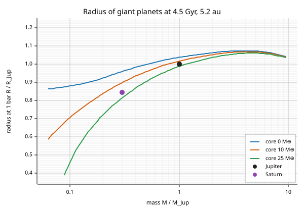

# What are planets made of, and how big does that make them?

Seen from: the planet model of the generator. Its interior and heat are
computed by the system engine (`crates/system/src/planet/`) with the laws
of `crates/science/` (equations of state, hydrostatic structure, heat);
it shows them nowhere yet. The moons, ice shell and
map of the earlier crate (`crates/mapgen/src/planet/`, tag
`legacy-final`) are described where they have not been rewritten.

## Short answer

A planet is a stack of layers: an iron core, a rock mantle, a shell of
water and ices, and sometimes a hydrogen and helium envelope. How much of
each depends on where the planet formed (inside or beyond the ice line),
and how massive it grew (a heavy core
captures gas). Given the layers, the radius follows from how much each
material is squeezed by the planet's own weight, plus the thickness of the
envelope. The model then adds the heat made inside (radioactive decay and
tides), the ice shell a frozen water layer keeps over an ocean, and reads
a class off the result: rocky, super-Earth, ice world,
mini-Neptune, ice giant, hot Neptune, gas giant or hot Jupiter. No class name
goes into
the calculation; it only comes out.

## The science

### What a planet starts with

**The ice line.** Beyond a certain distance from the star, water freezes
in the protoplanetary disc and solid planets form with a large share of
ice. The model reads the system's ice line (see
[How do asteroid belts form?](asteroid-belts.md) and
[giant planet placement](giant-planet-placement.md)): beyond it, ices make
10 to 67 % of the mass of the planets that formed there (Marboeuf et al.
2014; Zeng et al. 2019); the icy moons of the Solar System hold less,
Ganymede and Titan about 40 to 50 %. Inside it, the water share is
between 0.001 % and 1 % of the mass, Earth's bulk (0.27 %, Marty 2012)
inside that range. One planet in ten inside the line is drawn as if it
had formed beyond it and migrated in.

**Iron.** The core's share of the iron and rock mass is drawn between 0
and 0.8, with no dependence on the star's `[Fe/H]`, though Adibekyan et
al. (2021) find the iron fraction of rocky planets rising with their
star's. The earlier model's slope of 0.15 per dex and its Mercury-like
planets with a stripped mantle are not in the new draw.

**Core accretion.** A solid core that grows in the gas disc captures
hydrogen and helium. Below 0.1 Earth masses a body is taken to keep
none. Between 0.1 and 5 Earth masses the share captured rises steeply
with the mass: at most $10^{-4}$ of the mass at 0.1 Earth masses, at most
0.35 at 5 (Lammer et al. 2014). From about 10 Earth masses the core
accretes gas faster than solids and runs away into a giant (Pollack et
al. 1996): Uranus and Neptune hold 10 to 20 % of their mass in gas,
Jupiter and Saturn 85 to 95 % (Guillot 2005, Helled et al. 2011).

#### The draws and their bounds

Every composition draw is uniform between the published bounds of the
plausible physical range, log-uniform where the quantity spans decades,
as the star's mass and metallicity are. The bounds are not the 68 %
interval of an observed distribution: a generator that builds worlds
wants the whole range a planet can take, not the middle of the planets
seen so far, and a mixture of observed and uniform would need a share
that no source gives. One uniform number per value, each from its own
sub-seed, so changing one draw moves no other.

| Draw | Shape | Bounds | Where they come from |
| --- | --- | --- | --- |
| Core mass fraction | uniform | 0 to 0.8 | 0: a planet may form without a metallic core (Elkins-Tanton & Seager 2008); 0.8: "what seems to be the maximum iron enrichment" (Plotnykov & Valencia 2020, abstract and Fig. 8) |
| Water inside the ice line | log-uniform | $10^{-5}$ to $10^{-2}$ of the mass | Mercury's $10^{-5}$ is the driest of the Solar System's planets (Raymond et al. 2007, Table 1); less than 1 wt % expected inside the snow line (Izidoro & Piani 2022, p. 7) |
| Water beyond the line, or migrated | uniform | 0.1 to 0.67 | 0.67: the ice fraction of icy planets is at most 2/3 (Zeng et al. 2019); 0.1: ices are 10 to 60 % of the planetesimals beyond the snow line (Marboeuf et al. 2014, p. 11-12) |
| Migration chance | n/a | 0.1 | calibration, below |
| Radiogenic abundance | uniform in dex | $-0.5$ to $+0.5$ of Earth's | 1 to 99 % range of [Eu/Mg] in the Hypatia catalogue, "conservative" (Nimmo et al. 2020, p. 5 and appendix p. 13) |

**What the bounds do not say.** The lower core fraction of 0 is a
theoretical floor, not an observation, though the fits of measured planets
reach it within their error bars (Brinkman et al. 2024, Table 2); the
upper 0.8 is an inference from a sample of about 60 planets, and the
"super-Mercuries" have iron fractions of 59 to 71 % (Adibekyan et al.
2021, Table S4) but 0.31 to 0.56 when the same planets are fitted again
(Brinkman et al. 2024, Table 3, which finds no distinct population).
Marboeuf's 0.1 counts all ices,
not only water, so it is an upper estimate of the least water share. The
radiogenic range is a percentile range of a stellar catalogue, not an
absolute extreme; narrower samples give narrower ranges (Unterborn et al.
2015: 59 to 251 % of the Sun's thorium in solar twins). The
population-level cap of about 3 % water for super-Earths (Rogers et al.
2024) is below the icy range; the draw does not apply it, since the
bounds describe what one planet can be, not the population.

**Observed distributions, kept for the galactic-map mode.** The earlier
draws were these distributions; the code no longer holds them, and a
future galactic-map mode that wants the planets seen so far would
start from these parameters:

- iron share: split normal, median 0.32 (−0.12, +0.14 at 68 %), inferred
  from the composition of stars (Plotnykov & Valencia 2020; Earth's is
  0.325); the abstract's fit of the planets themselves is 0.24 (+0.33,
  −0.18);
- water inside the ice line: log-normal around 0.27 % of the mass,
  Earth's bulk (Marty 2012, 2700 ± 1350 ppm, read as one sigma of 0.5 in
  the logarithm);
- water of a planet formed beyond the line: 0.5 to 0.67 (Zeng et al.
  2019), where the earlier model drew 0.2 to 0.5;
- radiogenic abundance: 0.23 dex, derived from Nimmo et al. 2020;
- envelope of a mini-Neptune: about 1 % of the mass with an intrinsic
  scatter of 0.5 dex (Wolfgang & Lopez 2015).

**Where the study is.** The bounds, with the page of every number and
what was searched and not found, are in the
[draw bounds study](https://github.com/cyboooooorg/map-generator/blob/main/docs/superpowers/studies/2026-11-21-planet-model-2a/draw-bounds.md).

#### The envelope draw

A planet's hydrogen and helium envelope is its mass fraction `f`, drawn
for every planet from its own sub-seed, with one uniform number in every
regime (so a planet's stream never depends on its mass). It is the
primordial envelope: what the planet captured before the disc dispersed,
before the loss of gas of the later pull requests. The bounds depend on
the mass:

| Mass | Draw | Bounds | Source |
| --- | --- | --- | --- |
| Under 0.1 $M_\oplus$ | none | n/a | calibration, below |
| 0.1 to 5 $M_\oplus$ | log-uniform | the minimum and maximum of Lammer et al. 2014, at the mass; the maximum is capped at 0.20 | Lammer et al. 2014, Tables 1 to 3 |
| 5 to 10 $M_\oplus$ | log-uniform | $8.7 \times 10^{-4}$ to 0.20 | the 5 $M_\oplus$ minimum; the cap |
| 10 to 20 $M_\oplus$ (ice giants) | uniform | 0.09 to 0.20 | Helled et al. 2011, p. 8; the cap |
| From 20 $M_\oplus$ (gas giants) | the heavy-element mass is log-uniform; $f = 1 - M_z/M$ | $M_z$ within a factor $1.82^2$ of $57.9\,(M/M_J)^{0.61}\,M_\oplus$, inside the cores of the giant tables | Thorngren et al. 2016, Sect. V.1; calibration, below |

Lammer et al. (2014) model a rocky core of 0.1 to 5 $M_\oplus$ in a
nebula at 1 au round a Sun-like star, over 12 cases each (dust depletion
0.001 to 0.1, accretion rate $10^{-5}$ to $10^{-8}$ of the planet's mass
per year). Their minimum and maximum envelope share, which the draw
interpolates log-linearly in mass between the grid masses:

| Core mass ($M_\oplus$) | Minimum | Maximum |
| --- | --- | --- |
| 0.1 | $4.4 \times 10^{-8}$ | $1.0 \times 10^{-4}$ |
| 0.5 | $1.5 \times 10^{-6}$ | $5.9 \times 10^{-3}$ |
| 1 | $8.1 \times 10^{-6}$ | $2.5 \times 10^{-2}$ |
| 2 | $6.1 \times 10^{-5}$ | 0.11 |
| 3 | $2.0 \times 10^{-4}$ | 0.33 |
| 5 | $8.7 \times 10^{-4}$ | 0.35 |

The grid is by core mass, and the draw reads it at the planet's total
mass: the two differ by the envelope's share, at most 35 % (the 0.35
maximum at 5 $M_\oplus$; 20 % under the cap below). No grid by total
mass was found.

The cap of 0.20 is the edge of the Lopez & Fortney (2014) tables, which
size the envelope's radius (below): a larger share would have no
radius. It truncates the maxima of 3 and 5 $M_\oplus$ (0.33 and 0.35)
and replaces the 0.35 held up to 10 $M_\oplus$ and the 0.25 of Helled
et al. for the ice giants. The 5 to 10 $M_\oplus$ range has no model
above 5 $M_\oplus$ to bound it, only observed envelopes (Lopez & Fortney
2014: 0.14 % to 37.5 % over their Table 1) and the change of regime they
find near 10 $M_\oplus$.

**Known jumps.** The ranges meet at the regime edges without matching.
They are stated, not smoothed:

- at 10 $M_\oplus$ the lowest drawn envelope goes from $8.7 \times
  10^{-4}$ to 0.09, a jump in the draw, not in the radius;
- at 20 $M_\oplus$ the draw goes from at most 0.20 to a gas giant's
  $1 - M_z/M$. The fit's band at 20 $M_\oplus$ is 3.2 to 35.5
  $M_\oplus$ of heavy elements, but the giant tables cover cores of 0 to
  10 $M_\oplus$ at that mass, so the band is cut to 3.2 to 10 and the
  envelope is 0.5 to 0.84. The jump is the user's decision (2026-11-21);
- the radius jumps at 20 $M_\oplus$ too, where the model changes (20 mbar
  against 1 bar, different cores): see "Mini-Neptunes and their
  envelopes" and "Giants and the metallic hydrogen boundary".

The radius is continuous at 1 $M_\oplus$ (below).

**Calibrations of the draw.**

- **No envelope under 0.1 $M_\oplus$.** The lowest mass that Lammer et
  al. (2014) model with a captured envelope is 0.1 $M_\oplus$ (abstract).
  A measured or modelled mass below which no hydrogen is captured was
  searched: none; only Stoekl et al. (2015) say that around Mars's mass
  the atmosphere changes fast and over short timescales. The earlier
  model's cut at 0.5 $M_\oplus$ has no source either.
- **Two sigma on the heavy-element mass.** Thorngren et al. (2016) give
  the fit and its one-sigma scatter, the factor $10^\sigma = 1.82$
  (Sect. V.1: $M_z = 57.9\,(\pm 7.03)\,M^{0.61 (\pm 0.08)}$, 47 planets of
  20 $M_\oplus$ to 20 $M_J$), and no extreme. A published range of
  heavy-element masses per planet mass was searched: none. For Jupiter
  alone, 10 to 40 $M_\oplus$ is quoted (Guillot 1999, in Thorngren et al.
  Table 1). The unit of $M$ is not stated in the sentence of the fit; it
  is Jupiter masses, the only reading under which $M_z < M$ and the one
  that matches their $Z_{pl}/Z_\star = 10\,(M_p/M_J)^{-0.5}$.
- **Why uniform in $f$ for the ice giants.** Helled et al. (2011) give
  heavy-element masses of 10.9 to 13.2 $M_\oplus$ (Uranus, 14.5 $M_\oplus$)
  and 12.9 to 15.4 (Neptune, 17.1 $M_\oplus$), so 9 to 25 % of hydrogen
  and helium (derived); nothing else bounds them, so the draw is uniform
  between the lowest, 0.09, and the cap.
- **The heavy-element mass stops at the highest tabulated core.** From
  about 17.4 $M_J$ (5 545 $M_\oplus$), the low end of the two-sigma band,
  $57.9\,(M/M_J)^{0.61} / 1.82^2$, exceeds 100 $M_\oplus$, the highest
  core of the giant tables (Fortney et al. 2007). There the heavy-element
  mass is 100 $M_\oplus$, both ends of the draw, so the draw never fails
  inside the fit's range (up to 20 $M_J$): at 6 000 $M_\oplus$ the band
  starts at 104.9 $M_\oplus$ and the envelope is $1 - 100/6000$. The
  study's survey of giant tables (its Sect. 1.5) found no other with a
  free core mass, so none with a core above 100 $M_\oplus$.

### From layers to radius

The solid part of a planet (iron core, rock mantle, water and ices) is
built by integrating its hydrostatic equilibrium, not by a fit of radius
against mass. Each layer has a mass and a material; a material is a law
of density against pressure. The code is `science::structure` (the
integrator), `science::eos` and `science::water` (the materials).

**The equations.** At radius $r$ inside a planet of mass $M$, with $m(r)$
the mass inside, $P$ the pressure and $\rho(P)$ the density of the
material at that pressure:

$$
\frac{dm}{dr} = 4\pi r^2 \rho, \qquad
\frac{dP}{dr} = -\frac{G\,m\,\rho}{r^2}, \qquad
C = \int_0^M \tfrac{2}{3}\, r^2\, dm
$$

The model integrates outward from the centre with fourth-order
Runge-Kutta, using $t = (m/M)^{1/3}$ as the variable, so that the centre
is not a singularity. The central pressure is not known: Brent's method
searches it until the pressure at mass $M$ equals the surface pressure
(1 bar in the tests, 0 in the system engine until the climate sets
one). A pressure that crosses the boundary between two phases of a
material ends the step exactly there, so a phase change is a shell
boundary and the error stays fourth order. Twenty steps per layer keep
the radius and $C/MR^2$ within $10^{-4}$ of the converged answer for
Earth and for 20 Earth masses (`STEPS_PER_LAYER`, a calibration,
measured when the integrator was written against a 1280-step reference;
the
[prototype](https://github.com/cyboooooorg/map-generator/blob/main/docs/superpowers/studies/2026-11-21-planet-interior/prototype-report.md),
which did not end steps at the phase changes, needed 160).

**In words.** Squeeze the planet under its own weight, layer by layer,
until the pressure at the top is the surface's. The radius, the
pressure and density at every depth and the moment of inertia come out
together.

**Orders of magnitude.** An Earth integrates in about 12 ms. It comes
out 6352 km (6371 measured), with a core 3480 km across (PREM: 3480 km)
and a central pressure of 367 GPa (PREM: 364 GPa).

**The materials.** Each density law is an equation of state, a pressure
$P(\rho)$ that the code inverts. Vinet and third-order Birch-Murnaghan
(BM3) laws are fitted to experiments or to ab initio models near a
reference density $\rho_0$, bulk modulus $K_0$ and its pressure
derivative $K_0'$. A mix of minerals adds the volumes of its parts at
equal pressure (Amagat's law), by mass share. The values are in
`science::eos` and `science::water`, each with its source; the studies
([equations of state](https://github.com/cyboooooorg/map-generator/blob/main/docs/superpowers/studies/2026-11-21-planet-interior/equations-of-state.md),
[core and dynamo](https://github.com/cyboooooorg/map-generator/blob/main/docs/superpowers/studies/2026-11-21-planet-interior/core-and-dynamo.md))
give the search behind them.

| Layer | Material and law | $\rho_0$ (kg/m³), $K_0$ (GPa), $K_0'$ | Source |
| --- | --- | --- | --- |
| Outer core, below 328.851 GPa | Fe alloy, BM3, liquid | 6800, 165, 4.2 | Valencia et al. 2006, Table 1, fitted to PREM |
| Inner core, above | Fe alloy, BM3, solid | 7990, 200, 5.2 | same |
| Upper mantle, below 23.83 GPa | 50 % forsterite, 50 % enstatite, BM3 | 3230, 128, 4.2 and 3200, 107, 7.0 | Stixrude & Lithgow-Bertelloni 2005, as in Unterborn et al. 2016, Table 1 |
| Lower mantle, above | 90 % (Mg0.88 Fe0.12) SiO3 bridgmanite, 10 % periclase, BM3 | 4110, 251, 4.1 and 5180, 272, 4.1 (Mg and Fe ends); 3590, 161, 3.8 | same; the mix after Seager et al. 2007 |
| Liquid water | IAPWS-95, 56-term Helmholtz function | none (full equation) | IAPWS R6-95 (2018) |
| Ice Ih | IAPWS Gibbs function | none (full equation) | IAPWS R10-06 (2009), Feistel & Wagner 2006 |
| Ices III, V, VI | BM3 on the 0 K curve | 1163.5, 9.9, 6; 1244.6, 13.2, 6; 1322.4, 15.2, 6.5 | Journaux et al. 2020, Table 3 |
| Ice VII | Vinet | 1460, 14.3771, 6.57972 | Seager et al. 2007, section 3.3 |

The boundaries between phases of water are the melting curves of ices
Ih and VI and the triple points of the liquid (208.566 MPa at 251.165 K,
350.1 MPa at 256.164 K, 632.4 MPa at 273.31 K, 2216 MPa at 355 K), from the IAPWS
release R14-08 (2011) of Wagner et al., and the ice VI to ice VII
boundary of the AQUA model (Haldemann et al. 2020, eq. 22). The surface
liquid also reads the melting curves of ices III and V (IAPWS R14-08,
eqs. 2 and 3; study 25 of the Wiki and
[the surface liquid](planet-atmospheres.md#climate-and-surface-liquid)).
A water
layer follows one of two paths, chosen by its temperature $T$:

- **273.31 K ≤ $T$ < 355 K:** the isotherm at $T$. Liquid water up to
  the melting pressure of ice VI, ice VI up to the VI to VII boundary,
  ice VII above. At 355 K the ice VI interval closes, so nothing hotter
  has a law yet.
- **Colder:** the melting curve (Zeng & Sasselov 2013): ice Ih, then
  III, V, VI and VII at the triple points. There is no liquid on it.

**Fitted ranges.** The core alloy is fitted to PREM, up to 364 GPa. A 20
Earth-mass planet takes the core alloy to 7.85 TPa at its
centre and the mantle to 2.83 TPa at its base. The laws stay monotone
there, but no source says they are right: that is an extrapolation of
20 times the fitted range for the core, with no high-pressure branch yet
(a Holzapfel iron law, Hakim et al. 2018, and a high-pressure silicate
are the candidates, proposed as a backlog issue).

**Validation.** The measured values come from the sources named in the
tests (`structure.rs`); the computed ones from the integrator, with the
core mass fraction of each body from the cited source. Of the laws, the
liquid and ice Ih are checked against the IAPWS verification tables;
ice VII against Seager et al.'s (2007, Table 3) polytrope at 3 GPa,
within the 5 % they state below 5 GPa. No published density at pressure
was found for ices III, V and VI beyond Journaux et al.'s parameters.

| Body | Measured (source) | Computed | Error |
| --- | --- | --- | --- |
| Earth, radius | 6371.0 km (IUGG mean radius) | 6352.4 km | −0.29 % |
| Earth, $C/MR^2$ | 0.3307 (Williams 1994, via Margot et al. 2018) | 0.3299 | −0.24 % |
| Earth, central pressure | 363.852 GPa (PREM) | 367.45 GPa | +0.99 % |
| Earth, core radius | 3480 km (PREM) | 3479.9 km | 0.0 % |
| Venus, radius | 6051.8 km (NASA NSSDC) | 6028.6 km | −0.38 % |
| Venus, $C/MR^2$ | 0.337 ± 0.024 (Margot et al. 2021) | 0.3333 | −1.11 % |
| Mars, radius | 3389.5 km (NASA NSSDC) | 3412.3 km | +0.67 % |
| Mars, $C/MR^2$ | 0.3638 (Konopliv et al. 2016) | 0.3590 | −1.31 % |
| Mercury, radius | 2439.7 km (NASA NSSDC) | 2435.2 km | −0.19 % |
| Mercury, $C/MR^2$ | 0.346 ± 0.009 (Margot et al. 2018) | 0.3413 | −1.36 % |
| Moon, radius | 1737.4 km (NASA NSSDC) | 1746.4 km | +0.52 % |
| Moon, $C/MR^2$ | 0.392728 (Williams et al. 2014) | 0.3949 | +0.56 % |
| Ganymede, radius | 2634.1 km (NASA NSSDC; Gao & Stevenson 2013) | 2631.7 km | −0.09 % |
| Ganymede, $C/MR^2$ | 0.3115 ± 0.003 (Schubert et al. 2004, via Rodriguez-Mozos & Moya 2022) | 0.3067 | −1.53 % |
| Titan, radius | 2574.7 km | 2579.8 km | +0.20 % |
| Titan, $C/MR^2$ | 0.3414 (Iess et al. 2010) | 0.3187 | −6.66 %, not reproduced |
| 5 $M_\oplus$ rocky, radius | 9860 km (Zeng et al. 2016 fit) | 9840.6 km | −0.20 % |
| 5 $M_\oplus$, 50 % water, 300 K | 12 175 km (1.911 $R_\oplus$, Zeng et al. 2019) | 12 059.9 km | −0.95 % |

The Earth, Venus, Mars, Mercury and Moon rows use the core mass
fractions 0.325 (PREM), 0.30 (Skinner et al. 2026, citing Shah et al.
2022), 0.21 (Khan et al. 2023), 0.7136 (Genova et al. 2019) and 0.0168
(Viswanathan et al. 2019). Ganymede takes the split 0.085 core, 0.46
rock and 0.455 ice of Rodriguez-Mozos & Moya (2022), along the melting
curve. The two super-Earth rows are checked against fits of other
models, not measurements; the second assumes the prototype's split of
0.1625, 0.3375 and 0.5 (an assumption, as is Titan's 54.5 % rock and
45.5 % ice). The prototype came within 1.1 % of both super-Earth curves;
the tests allow 2 % on every body, the super-Earths included. At 20 Earth
masses the integration is only checked to converge: no published curve is
compared there (issue #616).

**Titan.** The model is fully differentiated: iron, rock, then water.
Titan's measured 0.3414 (Iess et al. 2010) is that of a partly
differentiated body, whose rock and ice are mixed to some depth. No
water law changes that (every path tried gave −6.5 to −7.1 %); the model
reproduces Titan's radius only. Ganymede, which is fully differentiated,
comes out right. Partial differentiation is the moons' track (T2).

**Limits, in short.**

- **Cold structure.** The laws are at the reference temperature, with
  no thermal pressure. Seager et al. (2007), Grasset et al. (2009) and
  Hakim et al. (2018) put the effect at 1.5 % of the radius or less
  below a 1500 K surface. A hotter surface (a lava world) comes out too
  small by more, to be revisited in the second pull request.
- **No transition-zone phases.** The mantle recipe is two mineral sets
  split at 23.83 GPa. It has no olivine to wadsleyite or ringwoodite
  transition, no post-perovskite, no temperature. Against PREM at
  23.83 GPa the upper side comes out 7.5 % too light (3693 against
  3992 kg/m³) and the lower side 3.5 % too dense (4533 against 4381).
  The two errors partly offset: Earth's radius and $C/MR^2$ are still
  within 0.3 %.
- **Water.** Liquid, VI and VII only between 273.31 and 355 K. Colder
  bodies follow the melting curve. Nothing above 355 K (steam, a
  supercritical fluid) exists yet. Within about 0.1 mK below 355 K the
  IAPWS melting pressure of ice VI already passes the AQUA ice VI / ice
  VII boundary (the two fits reach the triple point a hair apart), so the
  isotherm is refused there too. Ices III, V and VI are 0 K curves,
  1 to 4 % denser than at their real temperature (the comparison with
  Acuña et al. 2021 is in the study); ice VII and the rock are
  300 K fits. The solid-solid boundaries between ices III, V and VI away
  from the melting curve were not found in an open source (Choukroun &
  Grasset 2007 and 2010 and Dunaeva 2010 are paywalled), which is why a
  warm layer skips them.
- **The water layer's temperature** is the planet's equilibrium
  temperature until the climate of the second pull request sets the
  surface temperature. A water world at 355 K or more keeps its water
  outside the structure (see "How it computes them").
- **States by pressure.** The core's liquid outer and solid inner parts
  are the two phases of its equation of state, switched at PREM's
  inner-core boundary pressure (328.851 GPa, the Valencia et al. 2006
  fit): for any body but Earth that is a pressure, not a melting state.
  The water's liquid and ices are the phases of its law at its
  temperature; at the zero surface pressure of this slice liquid water
  would boil, and the vapour belongs to the atmosphere of the second pull
  request. The thermal states come with the temperatures of a later pull
  request.

The partly differentiated moons below are still the earlier model's (tag
`legacy-final`); they are rewritten as the tracks port them. The envelope
and the giants are rewritten, in the two sections that follow.

#### Mini-Neptunes and their envelopes

The code is `science::envelope` (the law, over the tables of
`crates/science/data/`) and `system::planet::enveloped` (the layers). A
planet with an envelope below 20 $M_\oplus$ is a rocky or icy core under
a hydrogen-helium layer, and its radius is the core's plus the layer's
thickness:

- **The core** holds $(1 - f)\,M$, with its water a share of that mass,
  and is built by the structure of the sections above, integrated at
  zero surface pressure (see "Where it departs from the science"). A core
  whose water is beyond the law of water is the condensed planet, as for
  a planet without an envelope.
- **The thickness** is read in Lopez & Fortney (2014), Tables 2 to 4:
  the radius at 20 mbar of a planet over a rock and iron core, for the
  solar-metallicity atmospheres at 100 Myr, 1 Gyr and 10 Gyr, at 0.1, 10
  and 1000 times Earth's light, for masses of 1 to 20 $M_\oplus$ in eight
  steps and envelopes of 0.01 % to 20 % in eleven. The model subtracts
  from each table radius that model's core, $((1 - f)\,M)^{0.25}\,R_\oplus$
  (their Eq. 1, good to about 2 % for an Earth-like core), and
  interpolates the thickness linearly in the decimal logarithm of age,
  light, mass and envelope share. Age and light are clamped to the grid.
  The 100 Myr table is not monotone in the envelope share at its low
  end: at 0.1 and 10 times Earth's light and 1 to 8.5 $M_\oplus$, the
  radius at 0.01 % is larger than at 0.02 % (1.22 against 1.16
  $R_\oplus$ at 1 $M_\oplus$ and 0.1 times Earth's light), as printed in
  the source; the model keeps the printed values.
  The light is the total of every star's, and the record of the thickness
  cites each star's flux.
- **The layer** is one gas layer of mass $f M$, the thickness above the
  core. The tables' 20 mbar is the level that the radius refers to; the
  radiative atmosphere above the convective envelope is not a layer of
  its own.

**Why the tables and not the fit.** Lopez & Fortney's own power law for
the envelope's thickness (their Eq. 3) matches their full models to about
0.1 dex and they say it is "not to be used in place of the full models":
against their own tables it is off by 4 to 7 % on average and by up to
35 % (study, Sect. 2.2). The fit of Chen & Rogers (2016) is tighter
inside its range, but its range, 4 to 400 times Earth's light, excludes
the planets of the habitable zone and beyond, and at Neptune's 0.0011
times Earth's light it gives 18.8 $R_\oplus$ for Neptune.

**Orders of magnitude.** A Neptune-mass planet with 15 % gas comes out
27 475 km, 10.9 % above Neptune's 24 764 km (NASA fact sheet); the tables
alone give +9 to +15 % at that gas share for solar metallicity (study,
Sect. 4). The radius is continuous at 1 $M_\oplus$: 1.7799 to
1.7837 $R_\oplus$ between 0.99 and 1.01 $M_\oplus$ (+0.2 %).

**Calibrations of the envelope's thickness.**

- **A planet under 1 $M_\oplus$ is read at 1 $M_\oplus$** (a plan call).
  No model of Lopez & Fortney goes below 1 $M_\oplus$, and neither does
  Chen & Rogers (2016), whose range is 1 to 20 $M_\oplus$ and
  $10^{-4}$ to 0.2 of gas: no table or model below 1 $M_\oplus$ was found
  in the study. The rule keeps the radius continuous at 1 $M_\oplus$ and
  underestimates a light planet's envelope, whose thickness falls with
  the mass (as $M^{-0.21}$ in their fit).
- **Under $10^{-4}$ of gas the thickness at $10^{-4}$ is scaled by
  $f/10^{-4}$**, linearly to zero without gas. The tables stop at
  0.01 %; no model of a thinner envelope was found. The rule is
  continuous at $10^{-4}$ and gives no thickness without gas. It never
  gives a negative thickness: every node's radius exceeds its own core's
  (the least margin is 0.0053 $R_\oplus$, at 20 $M_\oplus$, 0.01 %, 0.1
  times Earth's light), and $M^{0.25}$ is convex in the logarithm of the
  mass; along the envelope share the core's radius is concave in its
  logarithm, and the gap that opens between two nodes stays under that
  margin.

#### Giants and the metallic hydrogen boundary

The code is `science::giants` (the table), `science::hydrogen` (the
boundary) and `system::planet::enveloped` (the layers). From 20 $M_\oplus$
a planet is a giant (the lower edge of the Thorngren et al. 2016 sample,
not a physical threshold: the earlier model's 30 $M_\oplus$ has no
source).

**The radius.** Fortney, Marley & Barnes (2007) give the radius, at 1 bar,
of hydrogen-helium planets over a core of 50/50 ice and rock, at ages of
1 Myr to 10 Gyr (nine, half a decade apart), at 0.02, 0.045, 0.1, 1 and
9.5 au from a star of the Sun's luminosity, for cores of 0, 10, 25, 50
and 100 $M_\oplus$ and masses of 10 to 3 594 $M_\oplus$. The model reads
the 25 files of the authors' page (4 550 rows; provenance and checks in
[GIANTS.md](https://github.com/cyboooooorg/map-generator/blob/main/crates/science/data/GIANTS.md)),
not the three printed tables, since one printed value is a misprint
(Table 4, 9.5 au, 25 $M_\oplus$ core, 464 $M_\oplus$: 1.037 against 1.013 at
3.16 Gyr and 0.985 at 10 Gyr in the file).

- A star of another luminosity is read at the flux-equivalent distance
  $d_\mathrm{eq} = 1/\sqrt{F}$ au, $F$ the light received in Earth's. The
  paper gives the idea (its Eq. 11); the exact use is a choice here.
- The radius and the decimal logarithm of the luminosity are interpolated
  linearly in the logarithms of mass, age and $d_\mathrm{eq}$ and linearly
  in the core mass. Age and $d_\mathrm{eq}$ are clamped to the table's
  axes; nothing is extrapolated.
- The tables leave out some young, light, strongly irradiated models. A
  corner of the interpolation without a row at the mass reads the nearest
  older age that has one; with none, `giant` returns a typed error, never
  a guess. The age actually read is part of the result.
- The heavy-element mass of the draw is bounded to the cores that the
  tables cover at the mass, at every distance and age after 0.1 Gyr
  (`core_bounds`): 0 to 10 $M_\oplus$ from 12.92 to 21, 0 to 25 at 30 to
  40, 0 to 50 at 60 to 100, 0 to 100 at 130 to 2 154, and 10 to 100 from
  2 200 to 3 594 (the coreless file at 0.02 au stops at 2 154). This
  makes the draw and the radius agree, so a drawn giant always has a
  radius. From about 17.4 $M_J$ the fit's band lies above 100
  $M_\oplus$ and the heavy-element mass is that highest core (see "The
  envelope draw").
- No inflation. The tables are the uninflated radius, and hot Jupiters
  stay near 1 $R_J$ until the integrated structure of issue #621 (the
  heating efficiency of Thorngren & Fortney 2018 is not a radius).



*Radius at 1 bar, in units of Jupiter's equatorial radius, of giants of 20
to 3 000 $M_\oplus$ at 4.5 Gyr and 5.2 au from a star of the Sun's
luminosity, for cores of 0, 10 and 25 $M_\oplus$. Drawn by
`tools/figures` from `giants::giant` (Fortney, Marley & Barnes 2007, see
[GIANTS.md](https://github.com/cyboooooorg/map-generator/blob/main/crates/science/data/GIANTS.md)),
and regenerated by `mise run docs:figures`. The 25 $M_\oplus$ core starts
near 28 $M_\oplus$, where the tables have a row for it. Jupiter and
Saturn are the NASA planetary fact sheets' masses and equatorial radii at
the 1 bar level (71 492 and 60 268 km; entries 116 and 117), the
convention of Fortney et al.
The curves are at Jupiter's distance; Saturn sits at 9.6 au, where a
planet of its mass is slightly smaller.*

**The core's radius** is Fortney et al.'s Eq. 7 (their coefficients as
corrected in v4 of the paper) at an ice mass fraction of 0.5, the tables'
own core, so that the radius, the core and the layers come from one
model. It reproduces their Table 1: 2.462, 3.172 and 3.985 $R_\oplus$
at 10, 31.6 and 100 $M_\oplus$ against 2.48, 3.23 and 4.03 (the paper
gives 2.5 % on average, over 0.01 to 100 $M_\oplus$). The structure of
the sections above is not used: giant cores of 10 to 100 $M_\oplus$ are
beyond the pressures it is fitted to (issue #616).

**Against Jupiter and Saturn** (tests of `science::giants`): Jupiter's
mass with a 10 $M_\oplus$ core at 9.5 au and 4.5 Gyr gives 71 524 km,
+0.04 % of 71 492 km (NASA fact sheet); Saturn's with cores of 10 and
25 $M_\oplus$ gives 62 504 and 56 715 km, either side of its 60 268 km
(the core that fits lies between); a hot Jupiter with no core at
0.045 au gives 1.1077 $R_J$ against 1.107 in the paper's Table 4. A
drawn Jupiter of the engine's tests comes out 72 635 km (+1.6 %).

**The metallic hydrogen boundary.** Hydrogen turns metallic over a range
of pressures that the published work does not agree on: onset at 50 GPa
(Wahl et al. 2017), critical point near 120 GPa (Morales et al. 2010),
the "ionization boundary" near 100 GPa (1 Mbar) in the Juno-era models of
Jupiter (Debras & Chabrier 2019), visible absorption near 150 GPa and
metallic reflectivity near 200 GPa (Celliers et al. 2018). The two
laboratory measurements differ by up to 95 GPa. The model takes one
pressure, 100 GPa, and no temperature, as the boundary between a
molecular layer and a metallic one.

The pressure is located by an index-one polytrope of the whole giant,
$P = K\rho^2$, with Hubbard's (2013) Eqs. 61 and 62:

$$
\rho(r) = \rho_c\,\frac{\sin\xi}{\xi},\quad \xi = \frac{\pi r}{R},\quad
\rho_c = \frac{\pi^2}{3}\,\bar\rho,\quad K = \frac{2 G R^2}{\pi}
$$

Pressure falls with $r$, so the radius of 100 GPa is found by bisection,
and the mass inside it is $M(\sin\xi - \xi\cos\xi)/\pi$ (the same
solution). The constants follow from the Lane-Emden solution, not from a
printed value. For Jupiter's mass and radius the polytrope puts 0.1 and
2 Mbar at 0.95 and 0.80 of the radius and 1 Mbar at 0.853, inside the
0.80 to 0.93 that Debras & Chabrier give for their region of 0.1 to 2
Mbar (the test checks that range).

A giant has this boundary only above 50 $M_\oplus$ and with a core under
a quarter of its mass; every other planet with an envelope has one gas
layer. The layers of a giant are then the core of the heavy-element mass,
a metallic layer from the core to the boundary (its mass is the
polytrope's mass inside the boundary minus the core's) and a molecular
layer to the surface. A drawn Jupiter has a 10 $M_\oplus$ core to
15 705 km, a metallic layer to 61 648 km (0.849 of the radius,
276.3 $M_\oplus$) and a molecular one to 72 635 km (31.7 $M_\oplus$).

The polytrope is checked against Jupiter only. For Saturn (95.1
$M_\oplus$) and Neptune the same formulas put 1 Mbar at 0.68 and 0.70 of
the radius, and no published pressure profile was found to check them;
"a planet with a large core is not an n = 1 body", hence the 25 % rule.
For a mini-Neptune the thin-shell estimate $P = G M_c M_e/(4\pi
R_c^4)$ gives 0.3 Mbar at the base of a 5 % envelope on 5 $M_\oplus$ and
1.3 Mbar at 10 % on 10 $M_\oplus$ (study, Sect. 5.2; unsourced beyond the
hydrostatic relation): that estimate gives a base pressure, not a
radius, so the model places no boundary there.

**The internal heat of a giant** is its table's internal luminosity $L$,
interpolated like the radius, as the secular heat; the radiogenic heat is
zero, since $L$ is the total the model carries (a `Definition:`); the tide
is the usual one (see "The heat inside"), over the radius of the whole
planet. One computation gives the radius and the heat. A drawn Jupiter
loses $4.43 \times 10^{17}$ W. A giant whose radius leaves no thickness
over its core (a table radius at or below the core's) is a typed error,
not a clipped radius.

**Calibrations of the giants.**

- **A giant heavier than 3 593.81 $M_\oplus$ is read at that mass.**
  Giants are drawn up to about 13 $M_J$ (4 130 $M_\oplus$) and no table of
  Fortney et al. goes beyond 11.3 $M_J$. The radius is nearly flat there:
  1.055 to 1.023 $R_J$ from 2 154 to 3 594 $M_\oplus$ (their Table 4, 9.5
  au, no core, 4.5 Gyr). A table of heavier giants was searched: none
  (the study's Sect. 1.5 lists the newer and alternative tables).
- **A giant's core is solid.** A placeholder: the state of a dilute
  ice-rock core at tens of Mbar is not modelled until the temperature
  profile of the later pull requests arrives, the same convention as the
  imposed solid mantle of a rocky planet. A state of a giant's core
  usable without a temperature profile was searched: none (Jupiter's may
  be diluted over a large share of its radius, Wahl et al. 2017).
- **The cores are bounded from the ages after 0.1 Gyr.** `core_bounds`
  asks every distance to bracket the mass at every tabulated age after
  0.1 Gyr, a modelling choice: the 0.1 Gyr block leaves out some light
  irradiated models (at 0.02 au a 10 $M_\oplus$ core starts at 21.54
  $M_\oplus$ there), and a corner without its row falls back to the next
  age. Fortney et al. (2007) give no age from which their grid is
  complete.
- **The boundary at 100 GPa.** A single measured value was searched:
  none; the published range is 50 to 200 GPa (above), the boundary has no
  temperature, and 100 GPa is the one that the Jupiter models use.
- **The boundary only above 50 $M_\oplus$.** The polytrope matches
  Jupiter and is unvalidated for Saturn and Neptune; a published mass
  above which a giant has a metallic layer was searched: none found.
- **The boundary only under a quarter of the mass in the core.** A
  published core share up to which an index-one polytrope holds was
  searched: none found; the 25 % is the study's own proposal.

**Partly differentiated moons.** A planet is fully differentiated: iron
core, rock mantle, water on top. An icy moon may not be. Callisto's
moment of inertia, 0.355 (Anderson et al. 2001), and Titan's, 0.34
(Iess et al. 2010), are too high for a rock core under clean ice;
Ganymede's, 0.311 (Schubert et al. 2004), is that of a fully
differentiated body. Only a share $s$ of a moon's ice has separated from
its rock: the iron and rock layers keep the share $s$ of their mass, the
water layer the share $s$ of its own, and the rest, rock and ice in the
proportions of the whole, is a mixed rock-and-ice layer between them.
Each part keeps its volume, so the radius, the density and the gravity
do not change, and neither does the radiogenic heat, which comes from
the rock wherever it lies.

Two heats set $s$, after Barr & Canup. While it grew, a moon kept a
share $h$ of its accretion energy, $\tfrac{3}{5} G M / R$ per unit mass,
which melted that much ice (Barr & Canup 2008 find that Callisto and
Titan stayed partly differentiated only if they grew slowly enough to
radiate most of it):

$$
s = \min\left(1,\ \frac{h\,\tfrac{3}{5}\,G M / R}{L_\mathrm{ice}}\right)
$$

with $L_\mathrm{ice}$ = 333.6 kJ/kg the latent heat of ice (Feistel &
Wagner 2006) and $h$ = 0.057, a calibration on Callisto and Titan.
Then the impacts of the late bombardment: a moon that received enough
impact energy per unit of its mass differentiates completely, since the
melt lets the rock sink and the rock's gravitational energy melts the
rest (Barr & Canup 2010, who explain the Ganymede–Callisto dichotomy
this way). That energy is counted against the Moon's: the impact flux at
the moon's orbit against the Moon's (the comets its giant focuses, as
for its craters, Zahnle et al. 2003), times its area over its mass
against the Moon's, times the share of the bombardment its system has
had at its age (the lunar chronology of Neukum et al. 2001, read from
the system's formation). From 2.26 times the Moon's, a calibration
between Callisto and Ganymede, $s$ = 1. A planet, and a body without
water, keeps $s$ = 1.

**In words.** A large moon kept more of the heat it grew with, so
more of its ice melted and let its rock sink; a moon deep in its giant's
well, or a small one, took enough impacts per kilogram to finish the
job.

**Orders of magnitude.** The asked moons of seeds 1 to 10: Callisto
takes 1.8 to 2.05 times the Moon's impact energy per kilogram, Ganymede
2.5 to 2.9, Europa 3.6 to 4.4, Enceladus over 40, Titan about 1.1.
Ganymede, Europa and Enceladus differentiate fully; Callisto keeps
$s \approx 0.3$ and comes out at a moment of inertia of 0.343 to 0.357
(seeds 1 to 20), Titan $s \approx 0.37$ and 0.346 to 0.353.

**A moon's core and water.** A moon's layers differ from a planet's in
three ways (`differentiation::moon_core`, for a body heated by the tides
of a host other than its star). Its iron core is the Fe–FeS eutectic, of
5.15 g/cm³, as the Galileo gravity models take Io's (Anderson et al.
2001: a core of about 20 % of the mass and 950 km under a 3.27 g/cm³
mantle) and Europa's (Anderson et al. 1998): segregated at low pressure,
the core keeps its sulfur, where a planet's takes the denser 7.0 its
radii are calibrated on. A small icy moon whose centre stays under
300 MPa (the threshold that keeps its core unconsolidated, see "The ice
shell and the ocean beneath") separates no iron at all: its rock never
compacts nor reaches the Fe–FeS eutectic, and the water that reaches it
hydrates it into a porous core of 2.4 g/cm³ (Iess et al. 2014; Choblet
et al. 2017). And a water layer whose base stays under the 350 MPa of
ice V holds no high-pressure ice: it takes the density of liquid water,
1.0 g/cm³, over its shell of ice Ih, 0.92 (Feistel & Wagner 2006), not
the 1.25 of a large moon's mix of ices. Each other layer keeps its mass
and volume, so the radius follows: Io comes out 1763 to 1811 km (1821.6
observed), Enceladus 247 to 261 km (252.1), with its archetype's ice
share set by mass balance to 32 to 37 % (its 1.61 g/cm³ over a 2.4 g/cm³
core under water of 0.95 to 1).

**The moment of inertia, earlier model.** The earlier model stored the factor
$C / (M R^2)$ of
its layers, each of uniform density:

$$
\frac{C}{M R^2}
  = \frac{2}{5\,M R^2} \sum_i m_i \frac{r_i^5 - r_{i-1}^5}{r_i^3 - r_{i-1}^3}
$$

0.4 for a uniform sphere, less the more the mass sits at the centre.
Over the asked moons of seeds 1 to 20: Io 0.370 to 0.376 (0.378
measured, Anderson et al. 2001), Europa 0.321 to 0.343 (0.346, Anderson
et al. 1998; a Europa drawn with 10 % water comes out lowest),
Enceladus 0.334 to 0.337 (0.335, Iess et al. 2014), Ganymede 0.306 to
0.315 (0.311). Within each layer the compression was left out, so a large
planet came out high (Earth 0.354 against 0.3307 measured); the
integrated structure above gives Earth 0.3299 and replaces it for the
solid layers.

### The heat inside

The code is `science::heat` (the laws) and `system::planet::heat` (which
body gets which law).

**Radiogenic.** Uranium-238 and -235, thorium-232 and potassium-40 decay
and heat the rock. Each isotope's power per kilogram of silicate today is
the abundance of its element in Earth's silicate part, times the heat
per kilogram of the element (Dye 2012, Table 3: U 98.5, Th 26.3 and K
$3.33 \times 10^{-3}$ µW/kg), times the isotope's share of the element
(U-238: 0.958, derived in the heat study). The abundances are 20 ng/g
for uranium and 80 ng/g for thorium, calibrations inside the published
models (see "Where it departs from the science"), and 280 µg/g for potassium (Arevalo
et al. 2009, a K/U ratio, read in its abstract). Each isotope is carried
to the planet's age by its half-life (Dye 2012, Table 2: 4.468, 0.704,
14.05 and 1.277 Gyr; the earlier model used 1.248 Gyr for potassium-40):

$$
H = \sum_i p_i\, m_\mathrm{sil}\, a\, e^{\lambda_i (4.5673 - t)}
$$

where $p_i$ is the isotope's power per kilogram today, $m_\mathrm{sil}$
the silicate mass, $a$ the planet's abundance relative to Earth's,
$\lambda_i = \ln 2 / t_{1/2,i}$, $t$ the age in Gyr and 4.5673 Gyr Earth's
age (Connelly et al. 2012, read in its abstract). Earth's silicate mass
is $4.03 \times 10^{24}$ kg (Dye 2012, Table 7).

**In words.** The younger the planet, the more heat; the isotopes with
short half-lives dominate early.

**Orders of magnitude.** Earth makes 20.2 TW today: uranium-238 38 %,
thorium-232 42 %, potassium-40 19 %, uranium-235 2 %. The published
models span 11 to 38 TW (Dye 2012). The abundance $a$ is drawn around 1
with a spread of 0.23 dex (Nimmo et al. 2020, derived in the heat
study); the earlier model drew 0.15 dex.

**Secular cooling.** A planet also loses the heat it was born with: its
mantle and core cool. Earth loses 46.7 TW through its surface (Davies &
Davies 2010), so 26.5 TW beyond its radiogenic 20.2 (the model's 46.7 TW
total is that split, by construction). The model scales that by the
silicate mass, which holds the heat, and lets it decay with
age over a cooling time that grows as the area of the body, $R^2$ with
$R^3 \propto M$:

$$
S = S_\oplus\, \frac{m_\mathrm{sil}}{m_{\mathrm{sil},\oplus}}\,
  e^{4.5673/\tau_\oplus - t/\tau},
\qquad \tau = \tau_\oplus \left(\frac{m_\mathrm{sil}}{m_{\mathrm{sil},\oplus}}\right)^{2/3}
$$

with $S_\oplus$ = 26.5 TW and $\tau_\oplus$ = 10 Gyr. Both the
10 Gyr and the exponent 2/3 are calibrations: no source gives a cooling
time or its scaling with mass (see "Where it departs from the science").

**In words.** Every body holds the same heat per kilogram when it forms;
a small one loses it sooner, so an old Mars or Moon keeps little and a
super-Earth keeps more than its share.

**Giants and mini-Neptunes.** A giant's secular heat is the internal
luminosity of the table that gives its radius (see "Giants and the
metallic hydrogen boundary"); its radiogenic heat is zero, since that
luminosity is the total the model carries. A mini-Neptune keeps the heat
of its core's rock. Both have a tide over the radius of the whole planet,
with the response of an enveloped body.

**Tidal.** A host raises tides in a planet on an eccentric orbit, and
friction turns them into heat (Peale, Cassen & Reynolds 1979):

$$
\dot E = \frac{21}{2}\,\frac{k_2}{Q}\,\frac{G M_h^2 R^5 n\, e^2}{a^6}
$$

with $M_h$ the host's mass, $R$ the planet's radius, $a$ and $e$ its orbit's
semi-major axis and eccentricity, $n$ its mean motion, and $k_2/Q$ the
tidal response. The host is the star for a planet; for a moon it is its
planet, on the moon's orbit around it, while the star's light still
arrives at the planet's orbit.

The tidal response $k_2/Q$ depends on what the planet is made of, read
from its composition, never from a class or a type name:

| Body | Rule | $k_2/Q$ | Source |
| --- | --- | --- | --- |
| Enveloped | at least 0.1 % of the mass in gas | $1.102 \times 10^{-5}$ | Jupiter's, measured (Lainey et al. 2009; Lainey 2016, Table 1) |
| Icy | otherwise, at least 5 % water and ices | $2.5 \times 10^{-3}$ | calibration, as the earlier model |
| Rocky | the rest | $6 \times 10^{-3}$ | calibration: $k_2$ 0.3, $Q$ 50 (Henning et al. 2009) |

The two thresholds are calibrations as well, kept from the earlier model.
A mini-Neptune or a giant is enveloped, over the radius of the whole
planet. A gas envelope dissipates little: Jupiter's $k_2/Q$ is about 1400 times
smaller than Io's. The rocky value is a model baseline for a cold
planet, not a measurement: Io's measured 0.015 ± 0.003 is that of a
partly molten body, and Earth's and Mars's, derived from Lainey (2016,
Table 1), are $1.08 \times 10^{-3}$ and $1.74 \times 10^{-3}$. No icy
moon has a measured $k_2/Q$; Enceladus's assumed value is $9 \times
10^{-5}$ (Meyer & Wisdom 2007).

**Orders of magnitude.** The test of the law takes Io round Jupiter with
Io's measured $k_2/Q$ = 0.015 ± 0.003 (Lainey et al. 2009), $e$ = 0.004
and $a$ = 421 800 km (JPL satellite mean elements): over that $k_2/Q$
range it gets $7.1$ to $10.6 \times 10^{13}$ W, which overlaps the
$1.3 \pm 0.4 \times 10^{14}$ W that Veeder et al. (2004) observe. The
test asserts that overlap, so it does not hang on the third digit of $e$
(0.0041 in secondary sources raises the heat by 5 %). Io's radius and
Jupiter's mass are the NASA fact sheets'. The Veeder range was read in
the abstract through a search result, not in the paper.

**Moons in resonance.** Neighbouring moons locked in a 2:1 resonance
form a chain, as Io, Europa and Ganymede, or Enceladus and Dione
(`planet::resonance`). A locked pair sits at the commensurability, off
it only by the precession of the pericentres the resonance forces and
by its libration (Io–Europa 2.007, Europa–Ganymede 2.015,
Enceladus–Dione 1.997): the chains are the runs of neighbours whose
period ratio lies within 1 % of 2. A pair merely near it is not locked:
Dione and Rhea, at 1.67, are not. The host's tides push each moon
outward with a torque

$$
T_i = \frac{3}{2}\,\frac{k_2}{Q}\bigg|_h\,\frac{G m_i^2 R_h^5}{a_i^6}
$$

and the resonance locks each pair of neighbours together: they migrate
as one, at the mean motion $\bar n = \sum n_i L_i / \sum L_i$ weighted by
their orbits' angular momenta $L_i = m_i n_i a_i^2$. What the torques
pump into the two orbits and the orbits do not keep is dissipated by the
eccentricity the resonance forces (Meyer & Wisdom 2007):

$$
\dot E = \sum_{i \in \text{pair}} n_i T_i -
  \bar n \sum_{i \in \text{pair}} T_i \;\ge 0
$$

Each pair's heat goes to its inner moon, as Meyer & Wisdom put all of
the Enceladus–Dione pair's heat in Enceladus: the inner moon, closer to
the host, carries the larger forced tide (Io over Europa). The pair, not
the whole chain, so that a moon's heat depends on its own orbit and its
outer neighbour's, not on the drawn moons further out or on any drawn
eccentricity. The outermost moon of a chain, and a moon whose pair pumps
nothing (the outer moon pushed out faster than the inner one), get none.

A moon's heat today is the larger of that equilibrium and its own tide
at its drawn eccentricity: the eccentricity is drawn, not evolved, and a
moon dissipating more than the equilibrium is caught on its way down,
as Io dissipates faster than its resonance resupplies (Lainey et al.
2009), while one dissipating less would have its eccentricity pumped up
until it reaches the equilibrium.

The host's $k_2/Q$ is not one value per planet but follows from
resonance locking (Fuller, Luan & Quataert 2016): the host dissipates so
that its innermost round moon migrates outward over the system's age,
$a/\dot a = t$, which gives

$$
\frac{k_2}{Q}\bigg|_h = \frac{n a^8}{3\,t\,G m R_h^5}
$$

for that moon's $m$, $a$ and $n$, at most the $3 \times 10^{-3}$ measured
for Saturn at Titan's frequency (Lainey et al. 2020). One value per host,
taken at its innermost round moon's frequency as the measured ones are
(Jupiter's at Io's, Lainey et al. 2009; Saturn's from its inner moons,
Lainey et al. 2012), so that a moon of the chain does not set the
dissipation that heats it. The round moons of a drawn planet that grew
in its disk, on prograde orbits, form chains among themselves (the moons
too small to be round take no part, nor do captured or retrograde ones,
which keep the heat of their own tide and do not set the host's `k₂/Q`); the
world a request asks around a giant forms one with the giant's round
regular moons, spaced 1:2 around it. A moon asked by archetype brings
its partners at 2:1 (see the archetypes' `[moon.resonance]`), and an
asked moon near another's partner orbit is placed on it (Io, Europa and
Ganymede asked together make the Laplace chain).

**Which drawn moons are locked.** A giant draws its regular moons near
a 2:1 chain, each orbit 5 % either way of its step; that scatter is not
a resonance. The draw decides which neighbours the host's tides drove
into one (`resonance::capture`): each moon migrates out at
$\dot a / a = 2T/L$, which goes as $m\,a^{-13/2}$, so a pair converges
when the inner moon migrates faster than the outer one. A convergent
pair meeting a first-order resonance slowly, at the small eccentricities
of regular moons, is captured (Goldreich 1965; Peale 1976; Murray &
Dermott 1999, §8.12); a divergent one never is. Its period ratio falls
by $\tfrac{3}{2}\,\Delta(\dot a/a)$ times the age: a pair formed wide of
2 by less than that reaches it and locks; one formed inside 2 moves away
from it. The locked moons then migrate together, at $2\sum T / \sum L$,
and may catch the next one out, as Io drove Europa and the two Ganymede
into the Laplace resonance (Yoder 1979). A captured moon is moved onto
the commensurability (period exactly twice its inner neighbour's), one
left free just out of the 1 % band, so that the stored orbits say which
pairs are locked. A moon asked by archetype is never moved, and is
locked only on the sides its archetype names a partner on
(`[moon.resonance]`, `resonance::Placement`): the drawn moons keep out
of the 2:1 band on its other sides instead, a drawn moon left
uncaptured where its capture would put it there and moved just out of
it when it lies in it (a drawn innermost moon always outward, to a
period ratio of 1.970, so that it never comes nearer the Roche limit or
the rings than it was drawn). Ganymede, which names Europa and Io inside it,
locks with no drawn moon outside it, and Callisto, which names none,
with no neighbour, as the real Callisto turns 2.33 times Ganymede's
period. The share of the age since a drawn moon's capture is kept
(`Captures::age_share`): a moon of a chain of three or more, not its
innermost, went through Laplace-like resonances, whose tidal episode it
dates (see [impact-craters.md](impact-craters.md), "A past tidal
episode renews part of a resonant moon"). Over 300 drawn systems, 227 of the
353 neighbouring
pairs of round disk-born moons are locked (64 %; 322, 91 %, when any
pair 1.8 to 2.2 apart counted): inner pairs converge fast and lock in
cascade, outer ones too slowly to close a gap of a few percent. The
heavy neighbour drawn just outside a Dione-mass partner is captured all
the same (the partner, locked with its Enceladus, still migrates fast
enough); a chain drawn near 2:1 at every step locks more often than the
Solar System's moons, most of whose neighbours are not near a 2:1.

**Orders of magnitude.** At 4.57 Gyr, locking gives Jupiter (with Io)
$8.5 \times 10^{-6}$, against the $1.1 \times 10^{-5}$ measured (Lainey et
al. 2009), and Saturn (with Enceladus) $2.2 \times 10^{-4}$, against the
$2.3 \times 10^{-4}$ measured (Lainey et al. 2012): Saturn's 20-fold
stronger dissipation comes out of its moon's closer orbit and smaller
mass, with no value of its own. Enceladus and Dione under Saturn's
measured $k_2/Q$ dissipate 14 GW, all of it in Enceladus, of the
15.8 GW it radiates (Howett et al. 2011); an asked Enceladus gets 11 to
16 GW over ten seeds. In the Laplace chain the Io–Europa pair gives Io
$1.8 \times 10^{13}$ W, under its own tide's $9 \times 10^{13}$, which
stands (an asked Io: 62 to 143 TW, a heat-pipe world); Europa keeps its
own tide (an asked Europa: 27 to 52 mW/m²).

### The ice shell and the ocean beneath

A body with a water layer whose surface is frozen (no liquid water on it,
a mean surface temperature under 273 K) carries its internal heat out
through an ice shell. The conductivity of ice rises as it gets colder,
$k = 651/T$ W m⁻¹ K⁻¹ (Petrenko & Whitworth 1999; Klinger 1980 gives
$567/T$), so Fourier's law integrates to a shell of plane thickness
$d_0$, which the sphere thins to $d$ (its base is smaller than its
surface; Turcotte & Schubert 2014):

$$
d_0 = \frac{651\,\ln(T_b / T_s)}{q}, \qquad d = \frac{R\,d_0}{R + d_0}
$$

with $T_s$ the surface temperature, $q$ the internal heat flux (radiogenic,
tidal and secular), $R$ the radius and $T_b$ the melting point at the base
(Hussmann, Sohl & Spohn 2006). Ice melts colder under pressure: the base
follows the IAPWS melting curve of ice Ih (Wagner et al. 2011),

$$
\frac{p}{p_t} = 1 + \sum_{i=1}^{3} a_i \left(1 - \theta^{b_i}\right),
\qquad \theta = \frac{T}{273.16\ \mathrm{K}}
$$

with $p_t$ = 611.657 Pa, $a_i$ = 1 195 393.37, 80 818.3159, 3338.2686 and
$b_i$ = 3, 25.75, 103.75, from 273.16 K at no pressure through about
263 K at 100 MPa to 251.165 K at the ice Ih–III–liquid triple point
(208.566 MPa); deeper, the curve of ice III,
$p/p_t = 1 - 0.299948\,(1 - \theta^{60})$ from that point, rises to
256.164 K at 350.1 MPa. The pressure at the base is the weight of the
shell's ice. A deeper base is colder, which thins the shell: Ganymede's
base, near 200 MPa, melts some 20 K below 273 K. Below the shell the
water stays liquid: an ocean, down to the floor of the water layer or
to the depth where the hydrostatic pressure reaches 350.1 MPa,
whichever comes first. That
pressure is the ice III, ice V and liquid triple point of the IAPWS
melting curves (Wagner et al. 2011): deeper, water near its melting point
freezes into ice V. The pressure integrates $\rho\,g(r)$ from the surface,
with ice Ih at 917 kg/m³ in the shell (Feistel & Wagner 2006) and water at
1000 kg/m³ below it (rounded; a calibration), and $g(r) = G M(<r) / r^2$
from the model's layers. When the shell would be thicker than the water
layer, the whole layer is ice; when its base already lies beyond
350.1 MPa, the water below it is high-pressure ice. Either way there is
no ocean.

The shell and its ocean sit on the water layer only: under a partly
differentiated moon's, the mixed rock-and-ice layer is the floor.

**Thinner at the poles.** The shell is in equilibrium with all the heat
that leaves through it, from below and from the tides alike. The
radiogenic and secular heat is spread evenly; the tidal heat follows the
pattern of where it is made, solved latitude by latitude for the flux
$q_\mathrm{even} + q_\mathrm{tidal}\,w$, the shell's thickness being
the mean over the surface and its polar thickness the shell at the pole.

- **In the shell.** The eccentricity tide of a thin shell over an ocean
  dissipates, in the membrane limit, as $\Psi_A + \tfrac{9}{2}\Psi_C$
  (Beuthe 2013), averaged over longitude:

  $$w(\mu) = 1 + \frac{-\tfrac{7}{2}\,a_{20} P_2(\mu) + \tfrac{7}{4}\,a_{40} P_4(\mu)}{\tfrac{11}{2}\,a_{00}}$$

  with $\mu$ the cosine of the colatitude and $a_{00} = 21/5$,
  $a_{20} = -33/7$, $a_{40} = 387/140$ (Beuthe 2013, table 1): 1.92
  times the mean at the poles, 0.72 times at the equator, in 32 bands of
  equal area.
- **In an unconsolidated core.** A small moon's rock core stays a porous
  pile of fragments, which water flows through and its tides heat
  (Roberts 2015; Choblet et al. 2017): Beuthe (2019) finds that
  Enceladus's shell, with standard ice rheology, dissipates too little,
  and its core the rest. Choblet et al. find the heated water rising in
  plumes chiefly at the poles, thinning the ice above. A body whose
  centre is under 300 MPa keeps such a core (a calibration: an asked
  Enceladus's centre is at 92 to 108 MPa in the model, Europa's,
  Ganymede's, Titan's and Callisto's at 6 to 13 GPa). Its plumes carry
  14 % of the tidal heat into polar caps 16° in radius, about the size
  of Enceladus's tiger-stripe region (four fractures 130 km long and
  35 km apart, Porco et al. 2006), the rest reaching the shell evenly.
  Both numbers are calibrated on Enceladus: the share so that its polar
  shell is a quarter of its mean or less, as Čadek et al. (2016) find
  under 5 km at the south pole over a mean of 18 to 22 km.

A body heated by its rock alone keeps an even shell; a body without an
ocean too.

**Ammonia.** Ammonia dissolved in the ocean lowers the temperature at
which it freezes, along the liquidus of the water–ammonia phase diagram
at low pressure (Leliwa-Kopystyński et al. 2002), a fit in the ammonia
mass fraction $X$ of the liquid:

$$
T_\mathrm{liq} = 273 - 53.07\,X - 1651.4\,X^2 + 11842\,X^3 - 46269\,X^4 + 56695\,X^5
$$

from 273 K for pure water through about 259 K at 10 % to about 175 K at
the eutectic, a third of ammonia (176 K measured), below which no liquid
is left. The ice carries 1 % of ammonia when the moon kept its
hypervolatiles, none when a warm disk stripped them. Ice excludes the
ammonia as it freezes, so all the water layer's ammonia is in the ocean
left (Grasset & Sotin 1996): a thicker shell leaves a smaller, richer
ocean, whose colder liquidus thins the shell. The ammonia lowers the
melting point under pressure by as much as at none,
$T_b = T_\mathrm{melt}(p) - (273 - T_\mathrm{liq}(X))$ (adding the two
lowerings is an approximation, no source). The shell and the ocean are
solved together, by bisection on the shell's thickness. A body whose
shell would fill its water layer without ammonia keeps a thin, cold
ocean with it.

**Convection.** A thick shell convects under a stagnant lid. The ice
creeps by diffusion, a Newtonian viscosity (Goldsby & Kohlstedt 2001):

$$
\eta = \frac{R\,T\,d^2}{84\,V_m\,D_0\,e^{-Q/RT}}
$$

with $D_0$ = 9.1 × 10⁻⁴ m²/s, $Q$ = 59.4 kJ/mol, $V_m$ = 1.97 × 10⁻⁵
m³/mol and a grain size $d$ of 30 mm, the low end of the 30 to 80 mm
that dynamic recrystallisation brings a convecting shell's grains to
(Barr & McKinnon 2007): about 3 × 10¹⁷ Pa s at 273 K (the factor 84
takes the viscosity as $\sigma / 2\dot\varepsilon$, a calibration). The
shell convects when its Rayleigh number with the viscosity at its base
reaches the stagnant-lid onset (Solomatov 1995):

$$
Ra = \frac{\rho\,g\,\alpha\,\Delta T\,D^3}{\kappa\,\eta(T_b)} \ge 20.9\,\theta^4,
\qquad \theta = \frac{Q\,\Delta T}{R\,T_b^2}
$$

with $\alpha$ = 1.6 × 10⁻⁴ K⁻¹ and $\kappa = k / \rho c_p$, $c_p$ =
2097 J kg⁻¹ K⁻¹ (Feistel & Wagner 2006). It then carries up into its lid
a flux that does not depend on its thickness (Solomatov & Moresi 2000):

$$
q_c = 0.53\,k\left(\frac{R\,T_b^2}{Q}\right)^{4/3}\left(\frac{\rho\,g\,\alpha}{\kappa\,\eta(T_b)}\right)^{1/3}
$$

taken at the base's temperature, which overestimates it a little. If
$q_c$ is more than the internal heat supplies, the ocean freezes: down to
where its concentrated ammonia lowers the liquidus enough for $q_c$ to
match the supply, or entirely when there is no ammonia (or not enough),
the shell then reaching the ocean's floor. The lid conducts the heat down
to $T_b - 2\,R T_b^2 / Q$ ("estimates typically give" 2, Foley &
Bercovici 2014 after Solomatov & Moresi 2000). A convecting shell is
not thinned at the poles. With 30 mm grains and its base colder under
pressure, no asked moon's shell convects; with 1 mm grains (about
10¹⁴ Pa s, the value of many Europa models), a Ganymede's would convect
from some 30 km and freeze its ocean.

**In words.** The more heat comes up from inside, the thinner the ice and
the deeper the ocean; a colder surface thickens the ice, but only through
the logarithm. Where the tides make the heat, the poles get more of it
and thinner ice. Ammonia keeps a thin ocean under a shell that would
otherwise freeze through; a shell thick enough to convect sheds its heat
faster than it comes and freezes its ocean, unless ammonia stops it.

**Orders of magnitude** (asked moons, seeds 1 to 40, under the surface
temperatures their icy albedos give, `albedo::icy_unit_albedo`). Europa
(8 % water, its tides from its resonances) gets a shell of 12 to 34 km,
6 to 19 km at the poles, over an ocean of 80 to 158 km. Enceladus, 11 to
17 GW from its resonance with Dione, under a surface at 60 to 64 K, gets
44.6 to 53.8 km of ice, 10.5 to 13.3 km at the poles, over 3 to 20 km of
ocean. Ganymede, heated mostly by its rock, gets 131 to 189 km of ice
and 75 to 126 km of ocean above ice V; Titan, with its ammonia, 125 to
177 km over 63 to 120 km; Callisto, whose water layer above its mixed
rock and ice is thin, and whose dark surface is at 111 to 119 K, gets
155 to 240 km of ice over 0 to 99 km of ocean. The Solar System's moon
archetypes carry
the chondritic radiogenic abundance of the solar nebula, 0.9 to 1.1
times the Earth's (Lodders 2003), not the 0.15 dex drawn across stellar
systems.

**Geysers.** A shell over an ocean cracks through where it is thin
enough: Rudolph & Manga (2009) model cracks opened by 1 to 3 MPa of
tension against the weight of the ice that closes them, and find that
they cross Europa's shell only when it is under about 2.5 km, and
Enceladus's under about 25 km. The weight at the base of both limits,
$\rho\,g\,h$, is about the same, 3.0 and 2.6 MPa: a body vents when the
shell at a pole is under 2.6 MPa of ice (a calibration on the lower of
the two). The tension itself, from the ocean pressurised as it freezes
(Manga & Wang 2007) or from the tides, is not computed. The body must
also have an ocean, a shell that does not convect, and tides that make
at least half of its heat and thin the shell at the poles. The tides
thin both poles alike; Enceladus vents from its south pole alone, so the
body's seed picks one. Its fractures fill the cap round that pole where
the shell still passes, up to 30° from it, as Enceladus's four "tiger
stripes", about 130 km long and 35 km apart (Porco et al. 2006), and
the body's seed lays them out so that no two moons vent alike: a mean
spacing drawn once per body from 25 to 45 km (35 km on average), each
gap within 20 % of it and in that range, across a common strike, each
fracture turned by up to 15° off it, 60 to 100 % of its edge-to-edge
chord long and shifted along it by up to 15 % of the chord, and on a
third of the bodies a short branch, a third to a half of its parent's
length, splaying off at 20 to 40° near one end. A layout whose drawn
lines (with their meanders) come within 10 km of each other is drawn
again with less turn, so the fractures never cross; at most 12 are
stored, spaced wider to fill a larger cap. They
are stored on the model (`PlanetModel.geysers`: the pole, and each
fracture's centre, strike and length) so that the surface map and the
viewer draw them at the same place, and the innermost moon with geysers
close to its giant feeds its plume ring (see
[ring-extent.md](ring-extent.md)).

The surface map cuts each fracture into the ice (`stripes.rs`): a
trough about 500 m deep and 2 km wide between two ridges about 100 m
high, as the tiger stripes' profile (Porco et al. 2006), tapering to
nothing over the last tenth of its length at each end and darker than
the plains (an albedo shift of −0.25, a look constant: the stripes read
darker than the plains in Cassini's clear-filter images). Narrower than
1.5 pixels of the base map, the trough is drawn that wide and
shallower, keeping the area of its cross-section, so that the map
keeps it. The fractures resurface the cap round their pole, twice as
far from it as their farthest end and at most 40° (Enceladus's young
south polar terrain, bounded near 55° S, reaches about 35° from its
pole): no crater centred there is kept, on the base map, the detail
tiles and at every epoch.

Over seeds 1 to 20, every asked Enceladus vents (a polar shell of 7 to
10 km, at most 1 MPa of ice under its 0.11 m/s², over a cap of 16°:
three to six fractures, four or five on most seeds); Europa's polar shell, 6 to
16 km under 1.3 m/s², never
cracks through, nor do Ganymede's, Titan's or Callisto's. Across 300
drawn systems, 11 % of the icy moons and 3 % of the icy planets vent;
the moons among them are close-in, most of them in a 2:1 chain (some
vent on their own tide).

**Cryovolcanism.** The regime is the rock's, read off the heat flux
alone: a moon whose tides push out more than Io's 1 W/m² is a heat pipe
whether or not ice and water lie over its rock. But silicate magma,
2,700 to 3,000 kg/m³, is about three times as dense as ice and cannot
rise through a water layer and its shell; what erupts on an icy body is
water, brine or an ammonia–water melt from the ocean or from melt in the
shell, which freezes at the surface (Kargel 1995; Fagents 2003). Liquid
water is denser than the ice it crosses, so it does not build cones as
lava does: it floods the lows into smooth plains, as the smooth lanes of
Ganymede's bright terrain, troughs flooded by water-ice lavas (Schenk et
al. 2001), Europa's smooth plains (Fagents 2003) and Triton's walled
plains (Croft et al. 1995); fresh flows and vents stand out where it
erupts most, as Enceladus's south polar terrain, the youngest and
brightest ground of the moon (Porco et al. 2006; its Bond albedo is
0.81, Howett et al. 2010). So a body whose crust is an ice shell (an ice
world's share of water, no liquid water at its surface, and a shell the
model derives) has no lava, ash or magma sea on its map in any regime:
its volcanic zones are fresh ice. Where the zone is strongest it draws
`FreshIceFlow`, the brightest ground of the palette; in the lows around
it `CryovolcanicPlain`, smooth and a little greyer; its highland keeps
its ridges. A heat-pipe one does not take the `volcanic` look: its
volcanic zones spread over its lowlands as an Io's do and its flows
cover the cores of its provinces, about 15 % of the surface, the plains
most of the rest, under an Io's young surface. The tides stated in issue #550
(a Titan-sized moon of 55 % ices, 5.0e14 W, 5.6 W/m²) give such a
body: before, its map was the `volcanic` look throughout (magma seas,
scorched waste, lava); now, at 256 × 128, about 15 % flows, 71 % plains
and none of the silicate biomes. A frozen sea over a rocky crust (a
snowball Earth) is no ice shell crust: its volcanoes stand on rock and
stay lava.

### Classes

The class is read off the result, in this order; the first rule that holds
wins.

| Class | Rule | Source of the threshold |
| --- | --- | --- |
| Giant: gas giant | at least 10 Earth masses and 5 % gas; at least 50 % of the mass in gas | calibration (parts Jupiter and Saturn from Uranus and Neptune) |
| Giant: hot Jupiter | a gas giant with a period of 10 days or less | Wright et al. 2012 |
| Giant: hot Neptune | an ice giant with a period of 10 days or less (the sparse "Neptune desert") | Wright et al. 2012; Mazeh, Holczer & Faigler 2016, doi:10.1051/0004-6361/201528065 |
| Giant: ice giant | a giant with less than 50 % gas | same calibration |
| Mini-Neptune | at least 0.1 % gas and 1.6 $R_\oplus$ or more | Rogers 2015; the gas share is a calibration |
| Ice world | at least 5 % water and ices | calibration (Europa about 8 %, Earth 0.02 %) |
| Super-Earth | 1.25 $R_\oplus$ or more | Borucki et al. 2011 |
| Rocky | the rest | |

## In the app

### What you see

Nothing yet. The system engine computes the interior and the heat of
every planet it draws and records them in the timeline's trace, but no
card shows the layers or the heat. The sections "Measuring it" and "From
the model to the map" below, and the envelope, giants and moons above,
describe the earlier crate (tag `legacy-final`), which the tracks of the
roadmap replace.

### How it computes them

`system::planet` draws a composition and builds the interior and the
heat of a trial from it (`draws`, `interior`, `heat`; the trace codes are
in `codes`). The draw takes the seed from its caller: the planet model
will pass the body's seed, so each body depends on no other, and the
class trial of the backward search the trial's seed.

- **Iron.** The core's share of the refractory mass is uniform from 0 to
  0.8 (see [the draws and their bounds](#the-draws-and-their-bounds):
  Elkins-Tanton & Seager 2008; Plotnykov & Valencia 2020). The earlier
  model's slope of 0.15 per dex of `[Fe/H]` is gone: the new draw has
  none.
- **Water inside the ice line.** Log-uniform from $10^{-5}$ to
  $10^{-2}$ of the mass, the bulk water (see [the draws and their
  bounds](#the-draws-and-their-bounds)); Earth's is 2700 ppm (Marty
  2012), the reference the surface share is calibrated on. A planet
  beyond the ice line, or one in ten that migrated in (Calibration, as
  the earlier model), is a water world and draws a uniform share between
  0.1 and 0.67 instead (Marboeuf et al. 2014; Zeng et al. 2019). The
  trace says why: a flag that the planet
  formed beyond the ice line (from its orbit and the ice line) and a drawn
  migration flag, from which the water fraction derives.
- **Radiogenic abundance.** Normal around Earth's, 0.23 dex.
- **Layers.** Core alloy $c (1 - w) M$ and mantle $(1 - c)(1 - w) M$,
  integrated at zero surface pressure (the system has no atmosphere
  before the climate of the second pull request). The drawn $w$ is the
  bulk water. A dry planet's stays in its mantle, which weighs
  $(1 - c)(1 - w) M + w M$: hydrated silicate, whose ocean comes from
  outgassing (Marty's 2700 ppm is the bulk Earth's water, not its
  oceans'). The planet model's water step (`system::planet::water`)
  keeps a share of it at the surface, its ocean,
  `science::habitable::SURFACE_WATER_SHARE` (0.085, Earth's ocean over
  Marty's bulk water, a calibration; #663 and [surface
  water](planet-atmospheres.md#surface-water)); the rest stays in the
  mantle. A water world's water is not shared out: its layer, or its
  water beyond the laws, is all at its surface. A water world adds a water layer
  $w M$ on the isotherm of its equilibrium temperature, which stands for
  the surface temperature until then: the isotherm from 273.31 to 355 K,
  the melting curve colder. From 355 K, past the water laws, its water
  is kept as an inventory without a layer, outside the structure, until
  the climate gives it a steam envelope (`interior::steam_interior`,
  after Turbet et al. 2020; #659); its surface gravity
  and mean density are those of the condensed planet under it. Its
  escape and the steam it loses read its whole mass, water included
  (`Body::whole_mass`).
- **Outputs.** Radius, surface gravity, mean density, the core, mantle
  and water masses, each shell's outer radius, mass, material and state,
  and the three heats. The structure node is the central pressure the
  integration finds, derived from the mass, the two fractions and the
  water temperature when a layer uses it; the radius and every shell
  derive from it, each shell also from its layer's mass. The heats scale
  with the recorded mantle mass.

**Orders of magnitude.** An Earth trial (1 $M_\oplus$ at 1 au, iron share
0.325, water 0.27 % in the mantle) comes out 6354 km, 0.27 % below the
mean radius 6371.0087 km, and gravity 9.874 m/s², 0.69 % above
9.80665. Its mantle weighs $4.04 \times 10^{24}$ kg, near Dye's
$4.03 \times 10^{24}$ kg silicate Earth.

### Measuring it

```bash
cargo run --release -p mapgen --example planet_census -- 500
```

draws 500 whole systems (seeds 1 to 500, nothing written) and prints the
base preset each world renders with (`planet::interim::base_of`; the
`body_type` is the class itself), the share of planets per
radius bin of Fulton et al. (2017), and the median age, iron share, water
and envelope per class
([planet_census.rs](https://github.com/cyboooooorg/map-generator/blob/legacy-final/crates/mapgen/examples/planet_census.rs)).

### From the model to the map

A drawn planet's world is generated from its model, not from a type name
(`planet::interim`, a transitional layer that issue #424 replaces with
archetypes):

- `base_of` picks the built-in preset whose rules, palette and remap
  render the model, the first rule that holds: a giant class renders as
  `gas-giant`, `hot-jupiter` or `ice-giant` (a hot Neptune as a hot
  Jupiter, its methane gone; a mini-Neptune as an ice giant); a lava
  world or a heat-pipe regime as `volcanic`, unless its crust is an ice
  shell (see **Cryovolcanism** above: it takes the rules that follow, and
  its volcanic zones are drawn as fresh ice); a runaway
  greenhouse as `caustic`; a body whose envelope hides its surface as
  `frozen` for an ice world, `barren` otherwise; liquid hydrocarbons as
  `frozen`; liquid water
  as `terran`; no liquid, under 273 K and at least 5 % water, or at
  least 0.01 Earth oceans kept at the surface, as `frozen`; otherwise
  `barren`. The thresholds are the ones of the classes, so the look
  follows the class (Earth is `terran`, Venus `caustic`, Mars and
  Mercury `barren`, Titan `frozen`), except for a cold rock whose bulk is
  dry but whose surface keeps water: its sea level is calibrated on that
  water, which the barren look would draw as rock, so it renders
  `frozen`, a frozen sea in its basins (the 0.01 oceans: a little over
  twice Mars's 0.004, its polar deposits and ground ice of about 34 m of
  global layer, Carr & Head 2015, doi:10.1002/2014GL062464).
- A body that is no giant whose envelope hides its surface (the model
  derives none under it; about 0.3 % of drawn planets) keeps its
  class's preset at the model's radius and gravity, with no ocean, and
  its world aims at a bare surface's temperature, its equilibrium plus
  its internal heat (`calibrate_enveloped`). Part 3b of #423 derives the
  surface under the envelope.
- A giant, and a mini-Neptune rendered as one, takes the giant radius for
  its model's composition (iron, water and gas shares) and light: the
  interior's radius, at the model's mass, which its map and its moons
  take too, however light (issue #446). A giant world without a model
  takes the radius of a giant whose composition is not known.
- The gravity and the tectonic regime are the model's, and the radius is
  the interior's. The world is resolved at that gravity, so the star's
  tides, the moons it draws, the tilt they leave it and its tidal flats
  read the model's mass, not the one the rocky relation gives its size. The
  relief parameters follow: volcanism from the heat
  flux (Earth's 0.087 W/m2 gives the preset's value), halved when
  stagnant, full under a heat pipe; the age of the surface from the
  regime.
- The grid offset: the temperature shift of the world is found when the
  world is generated, so that the grid's mean matches the model's surface
  temperature (`generation::warming_for`). The sea level is found the
  same way, where the oceans the model keeps fill the relief
  (`sea_level_for_water`), none for a runaway whose water is steam, and
  none for a body whose water lies under its ice shell: a crust of ice
  (an ice world's share of water, no liquid water at its surface) with a
  shell over its water layer (Europa, Ganymede, Callisto, Enceladus) has
  that shell for its surface, land with its regime's relief and craters,
  not a frozen sea over a rocky floor. A frozen sea on a rocky planet (a
  snowball Earth, a cold Mars that kept its water) still fills its
  basins. A world with no water at its surface is dry: no open water anywhere, its
  sea level only the datum of its relief (`DRY_SEA_LEVEL`, see
  [mountains and gravity](mountains-and-gravity.md)). Both
  pass over a coarse grid of the relief (about a second in release), so a
  system's draw leaves them to the generation of the world: the
  parameters stored with the body keep the drawn values, and the
  calibrated ones are in the world's `world.json`.
- Calibrations, no source: the share of water that makes a body frozen
  (5 %) and the water at its surface that does (0.01 oceans), the
  hydrocarbon world's land share (Titan's 99 %), the erosion of methane
  (half of water's).

### Where it departs from the science

**The integrated interior and the heat.** What the new interior and heat
leave out or fit, and what changed from the earlier model. The first
four are explained in "From layers to radius".

- **Cold structure.** No thermal pressure: up to 1.5 % of the radius
  below a 1500 K surface. A hotter surface (a lava world) is a known
  limit for the second pull request to revisit.
- **No transition-zone phases.** The mantle comes out 7.5 % too light
  above 23.83 GPa and 3.5 % too dense below it, against PREM; Earth's
  radius and $C/MR^2$ stay within 0.3 %.
- **Extrapolated pressures.** The core alloy is fitted to PREM, up to
  364 GPa, and used up to 7.85 TPa at 20 $M_\oplus$ (the mantle to
  2.83 TPa, past the post-perovskite transition the model does not
  have). Super-Earth radii above about 5 $M_\oplus$ carry that extra
  error; a high-pressure branch is proposed, not built.
- **Water.** Liquid, ice VI and ice VII between 273.31 and 355 K, the
  melting curve for colder bodies, nothing above 355 K. Ices III, V and
  VI are 0 K curves, 1 to 4 % too dense. The layer's temperature is the
  equilibrium temperature until the climate of the second pull request.
  The triple points are IAPWS 2011's (208.566, 350.1 and 632.4 MPa), not
  the 209.5, 355.0 and 618.4 MPa Zeng & Sasselov (2013) took from
  Choukroun & Grasset (2007). The ice VI to VII fit is quoted by Haldemann
  et al. (2020) up to the triple point; its lower limit in temperature is
  not stated, and the model uses it from 273.31 K.
- **Titan.** Its $C/MR^2$ is 6.7 % too low (partial differentiation,
  moons track T2); the radius is within 0.2 %. The Titan split of the
  test (no core, 45.5 % ice) is the prototype's assumption: no sourced
  split was found. Ganymede is reproduced.
- **Mixing shares.** The 90 % bridgmanite and 10 % periclase of the lower
  mantle are taken as mass shares (the sources do not say). The iron mole
  fraction 0.12 becomes a mass share through molar masses computed from
  the table's $\rho_0$ and molar volumes, about 0.1 % off.
- **Not modelled.** No partial differentiation, no dynamo, no ice shell
  over an ocean in the new interior; the earlier model's versions of
  these are described above and below.

The envelopes, the giants and the draws of the planet model's second
pull request add these:

- **Mini-Neptune core at zero surface pressure.** The core is integrated
  as a planet without an envelope, at zero pressure at its surface. Under
  its gas the core's surface is at 0.3 to 2.9 Mbar by the thin-shell
  estimate (5 % on 5 $M_\oplus$ to 20 % on 10 $M_\oplus$, study Sect. 5.2),
  so it is built less compressed than it is, and the table's thickness
  is taken over a core of $M^{0.25}$, a different model of the same
  core. The sum mixes the two; its size was not computed.
- **A water-rich core under a thickness computed for a dry core.**
  Lopez & Fortney's cores are rock and iron. A planet whose core holds
  water gets the thickness of a dry core of the same mass, and no
  published rule for the effect was found: the earlier model thinned
  the envelope by the water share, a rule fitted on Neptune alone, and
  is not carried over. A Neptune-mass planet at 30 au lies beyond the
  test system's ice line, so its water is a thin ice layer, not water
  bound in the mantle, and it still lands at +10.9 %.
- **One floor, 1 $M_\oplus$, for the tables.** A lighter planet with an
  envelope reads the 1 $M_\oplus$ row (see the calibration above), and an
  envelope under $10^{-4}$ is scaled down linearly. The draw reaches both
  (under 1 $M_\oplus$ for the mass, under 3 for the share).
- **A planet under 20 $M_\oplus$ with more than 20 % gas is refused**,
  with a typed error, and `science::envelope` refuses a mass over 20
  $M_\oplus$. No table covers 12 to 28 $M_\oplus$ with 20 to
  60 % gas (study, Sect. 4): the draw does not go there, and the model
  does not fill the gap with a fit. A third route, an integrated
  structure, is issue #621.
- **Two radius levels.** A mini-Neptune's radius is at 20 mbar (Lopez &
  Fortney), a giant's at 1 bar (Fortney et al.), about nine scale heights
  apart. At 20 $M_\oplus$ the radius changes model, the core changes
  (rock and iron against 50/50 ice and rock) and the radius jumps; the
  draw's envelope jumps there too (see "The envelope draw").
- **No hot-Jupiter inflation.** The tables are the uninflated radius (1.1077
  $R_J$ at 0.045 au, 4.5 Gyr, no core). Inflation waits for the
  integrated structure (issue #621; user's decision, 2026-11-21).
- **A giant's layers are a polytrope's.** The metallic boundary is found
  by an index-one polytrope of the whole planet, validated against
  Jupiter alone, and the layer masses mix its enclosed mass with the
  tabulated core's. The core is compact; Jupiter's may be diluted over a
  large share of the radius (7 to 25 $M_\oplus$, Wahl et al. 2017) and
  Saturn's reaches 0.6 of its radius (Mankovich & Fuller 2021, 55.1
  $M_\oplus$, of which 17.4 of ice and rock). No temperature enters the
  boundary. The core's state, a gas layer's state when there is no
  metallic layer, and an envelope's are imposed values, not computed.
- **Steam worlds.** `interior::steam_interior` (decision B3) puts the
  envelope of a steam world on the iron and rock shells of its rock; a
  dry body's rock shells give up the steam's mass (each scaled by `1 -
  steam / rock`), so the shells add up to the whole. Water beyond the
  range of `science::water` (above 355 K, which is the ice VI-VII-liquid
  triple point, not a steam criterion) is recorded as such: the planet
  that has a bulk is the condensed one (dry mass, dry radius, its
  gravity and density), the water mass kept apart, and no radius of
  steam or supercritical water is computed. The published criteria
  (Turbet et al. 2020, Eqs. 2 and 3 up to a few percent of water;
  Aguichine et al. 2021 from 10 %) need the climate of the 2d pull
  request. A mini-Neptune with such water in its core is the condensed
  planet's bulk plus its envelope, at the radius of core plus
  envelope. Study 26
  ([Wiki](https://github.com/cyboooooorg/map-generator/wiki/26-boiling-and-steam-audit),
  for PR 2d-3b) read both: Turbet et al.'s Eq. 3 is stated valid to
  27 kbar of steam (its structures reach 270 kbar), and their
  `R_core + z` holds while the steam's base stays well under about
  1e10 Pa, where MgSiO₃ starts to compress (their Appendix A);
  Aguichine et al.'s fits cover water shares of 0.1 to 1 at irradiation
  temperatures of 400 to 1300 K, about 4.3 S⊕ and more round a
  Sun-like star. Neither covers a water-rich planet near the runaway
  limit, such as the 4.78 M⊕ body of #492 (12 % water, 5.6e5 bar of
  steam near 1 S⊕). PR 2d-3b keeps Turbet's equations with their
  inputs clamped to the fit's grid, the core uncompressed by its steam:
  a documented departure ([planet
  atmospheres](planet-atmospheres.md#boiling-and-the-steam-envelope-of-the-rewrite-study-26)).
  Decided with the user (2026-11-24): only a steam world (a runaway
  whose steam weighs at least water's critical pressure) gets the
  envelope and its radius;
  its steam loss and cosmic shoreline read that radius in one pass, the
  envelope computed on the water handed to the loss, a deliberate upper
  bound of the loss.
  Inside Turbet's grid the steam world is larger than its condensed twin
  (a test on 5 M⊕ with 3 % water at 1 S⊕). The #492 body is outside it
  and comes out at 1.643 R⊕ against its condensed twin's 1.655 R⊕: only
  its radius above the dry core (1.454 R⊕) holds (Refs #684).
- **The envelope is the primordial one.** The loss of gas after the disc
  is the job of the escape pull request (2c), so an old, close-in
  planet's drawn envelope is more than it keeps.
- **The core of a light giant is bounded by the tables.** The
  heavy-element mass is cut to the cores the tables cover (0 to 10
  $M_\oplus$ at 20 $M_\oplus$), narrower than Thorngren's fit there.

| What | Earlier model | Now | Source |
| --- | --- | --- | --- |
| Radius | Zeng et al. 2016 fit, uniform layers | integrated structure | prototype report |
| Earth $C/MR^2$ | 0.354 | 0.330 | Williams 1994: 0.3307 |
| Potassium-40 half-life | 1.248 Gyr | 1.277 Gyr | Dye 2012, Table 2 |
| Iron share | normal, 0.325 + 0.15 per dex of `[Fe/H]`, σ 0.05 | uniform 0 to 0.8, no slope | Elkins-Tanton & Seager 2008; Plotnykov & Valencia 2020 |
| Water inside the ice line | log-normal around 0.27 % | log-uniform $10^{-5}$ to $10^{-2}$ | Raymond et al. 2007; Izidoro & Piani 2022 |
| Water beyond the ice line | uniform 0.2 to 0.5 | uniform 0.1 to 0.67 | Marboeuf et al. 2014; Zeng et al. 2019 |
| Radiogenic spread | 0.15 dex | uniform ±0.5 dex | Nimmo et al. 2020 |
| Envelope, under 0.5 $M_\oplus$ | none | none under 0.1 $M_\oplus$, then Lammer et al.'s bounds | Lammer et al. 2014 |
| Envelope, 0.5 to 10 $M_\oplus$ | chance (M − 0.5)/4.5, median 0.02 M/5, 0.5 dex, cap 0.3 | log-uniform between bounds, cap 0.20 | Lammer et al. 2014; Lopez & Fortney 2014 |
| Envelope, 10 to 30 $M_\oplus$ | uniform 0.05 to 0.3 | uniform 0.09 to 0.20 up to 20 $M_\oplus$ | Helled et al. 2011 |
| Giants | from 30 $M_\oplus$, core uniform 5 to 20, cap 0.1 M | from 20 $M_\oplus$, heavy-element mass log-uniform around the fit | Thorngren et al. 2016 |
| Envelope thickness | power-law fit, thinned by the water share | Lopez & Fortney tables | Lopez & Fortney 2014 |
| Giant radius | law through Neptune, Saturn and Jupiter, inflated when hot | Fortney et al. tables, uninflated | Fortney et al. 2007 |
| Rocky tidal $k_2/Q$ | 0.015 (Io's) | $6 \times 10^{-3}$ | Henning et al. 2009 |
| Earth radiogenic heat | 20 TW | 20.2 TW from abundances | Dye 2012 |

**Calibrations of the interior and the heat.** Each is a choice, not a
measurement; this is what was searched and not found.

- **Uranium 20 ng/g and thorium 80 ng/g** of Earth's silicate part.
  Inside the published models (Dye 2012, Table 7: uranium 12 to 22
  ng/g cosmochemical, 20 to 35 geophysical; thorium 45 to 83 and 77 to
  135). A single abundance set that all sources agree on was searched:
  none, the models span 11 to 38 TW. Potassium, 280 µg/g, is a source
  (Arevalo et al. 2009), read in the abstract.
- **Cooling time 10 Gyr.** A sourced cooling time or law of cooling
  against mass: none found. Arevalo et al. (2009) give 70 to 130 K/Gyr,
  which on a 1600 to 1700 K mantle makes an e-folding time of 10 to
  20 Gyr (derived here). Herzberg et al. (2010) and Plesa et al. (2018)
  were not read for this.
- **Cooling-time exponent 2/3.** A sourced scaling of secular cooling
  with mass: none found. Valencia et al. (2007) call it difficult; Van
  Heck & Tackley (2011) and arXiv:2110.03295 were not opened.
- **Rocky $k_2/Q$ 6e-3.** A model baseline (Henning et al. 2009: $k_2$
  0.3, $Q$ 50), not a measurement of a body.
- **Icy $k_2/Q$ 2.5e-3.** A measured icy-moon value was searched: none.
  The legacy citations (Wahr et al. 2006, Howett et al. 2011) were not
  reached. Earth, the Moon and Mars at $6 \times 10^{-4}$ to
  $1.7 \times 10^{-3}$ (Lainey 2016, Table 1) and Enceladus's assumed
  $9 \times 10^{-5}$ bracket it.
- **Icy threshold 5 % water and envelope threshold 0.1 % gas** for the
  tidal kind. A published threshold of the tidal response against
  composition was searched (heat study, section A4): none. They come from
  the earlier model: Europa (about 8 % water) is icy, Io and Earth
  (0.02 %) are rocky, and from 0.1 % an envelope lifts a 5 $M_\oplus$
  core by about 0.15 $R_\oplus$ (Lopez & Fortney 2014).
- **Migrated water-rich planets, one in ten.** A published fraction of
  water-rich planets that formed beyond the ice line and migrated in was
  searched: none found (Luque & Pallé 2022 say they exist, with no
  fraction in the main text; heat study, section B7).
- **Twenty steps per layer.** Fitted on a $10^{-4}$ accuracy goal; ten
  steps give $1.03 \times 10^{-4}$ against a 1280-step reference.
- **Test tolerances against PREM.** 1 % for the core (the study gives no
  fit quality for Valencia et al. 2006; 1 % is Zeng et al.'s for theirs),
  8 % for the upper mantle and 4 % for the lower one: the measured gaps
  of the recipe, not fits.

**Calibrations of the draws, envelopes and giants.** Each is a choice, not
a measurement. What was searched and not found is in the section of each:

- **Migrated water-rich planets, one in ten:** above, with the
  calibrations of the heat.
- **No envelope under 0.1 $M_\oplus$** and **two sigma on the
  heavy-element mass:** "The envelope draw".
- **Planets under 1 $M_\oplus$ read at 1 $M_\oplus$** and **thickness
  scaled linearly under $10^{-4}$ of gas:** "Mini-Neptunes and their
  envelopes".
- **Giants over 3 593.81 $M_\oplus$ read at that mass**, **the boundary of
  metallic hydrogen at 100 GPa**, **only above 50 $M_\oplus$** and **only
  with a core under 25 % of the mass:** "Giants and the metallic hydrogen
  boundary".
- **The envelope and icy thresholds of the tide** (0.1 % gas, 5 % water):
  above, with the calibrations of the heat.

**Secondary and partial reads.** Some values were read at second hand, to
be replaced by a primary source when one is reached.

- Earth's mean radius, 6 371 008.7714 m, is read on the Wikipedia GRS80
  page, which cites Moritz (2000); the IAG-hosted copy did not open and
  the paper was not read.
- The Veeder et al. (2004) heat range for Io was read in its abstract,
  through a search result.
- Potassium's abundance is from the abstract of Arevalo et al. (2009),
  Earth's age (4.5673 Gyr) from the abstract of Connelly et al. (2012).
- Venus's, Mars's, Mercury's and the Moon's core mass fractions are read
  through Skinner et al. (2026) and the prototype report; the planets'
  masses and radii through the NASA fact sheets as read there.

**The earlier model, still described above.** The departures that follow are
those of the envelope, giants, moons, ice shell and map of the earlier crate.

- **Calibrations.** Every constant marked "Calibration, no source" in the
  code is a choice, not a measurement: the iron and water densities of the
  earlier model, its $k^{1.5}$ compression
  of water, and the class thresholds that the table marks. The
  calibrations of the new interior and heat are listed above. Each names the
  bodies it reproduces.
- **Mini-Neptunes and the radius valley.** Photoevaporation now strips
  close-in envelopes (see [planet-atmospheres.md](planet-atmospheres.md)),
  and mini-Neptunes make 18.7 % of the planets (16.3 % of those within
  100 days; the census of 500 systems). The census still shows
  no dip between 1.5 and 2 $R_\oplus$ (Fulton et al. 2017), because the
  generator draws few planets that large; the doc reports it as measured.
- **Round moons of drawn systems** go through `derive_moon_model` (see
  [planet-atmospheres.md](planet-atmospheres.md) and
  `docs/system-spec.md`, "Moons"); a moon too small to be round has no
  model. Their craters keep the lunar law and the Moon's rate (see
  [impact-craters.md](impact-craters.md)).
- **The ice shell** leaves out salts in the melting point (only
  ammonia and pressure lower it, their lowerings added). Its surface
  temperature is the body's mean, without the colder poles that would
  thicken the polar shell; its ice does not flow sideways to even out
  its thickness, and the shell's own dissipation is not concentrated
  where it is thinner (Beuthe 2019), two effects that work against each
  other. Convection uses one grain size and the viscosity at the base;
  with 30 mm grains and a base colder under pressure, it starts in no
  asked moon and no drawn body of the census, so every shell the model
  makes is conductive. Drawn icy moons and planets, whose radiogenic
  abundance keeps its 0.15 dex scatter, have shells and oceans that
  follow that draw.
- **Polar plumes heat both poles.** An unconsolidated core's plumes thin
  the shell at both poles alike, where Enceladus's south pole is thinner
  than its north. Their share and caps are calibrated on Enceladus
  alone, and the threshold of 300 MPa that keeps a core unconsolidated
  has no source. Enceladus's mean shell, 44.6 to 53.8 km over seeds 1 to
  40 (10.5 to 13.3 km at the poles), is more than twice the 18 to 22 km
  observed (Čadek et al. 2016): the model's heat for it (11 to 17 GW)
  over its true radius gives a conductive mean shell thicker than the
  observed one, and its surface at about 62 K (its observed Bond albedo,
  0.81, as the fallout of its plume gives it) thickens it further than
  the 86 K its regolith albedo gave it before (35.8 to 44.6 km).
- **Geysers crack by weight alone.** Whether a shell cracks through is
  read from the weight of the ice at its base against a threshold
  calibrated on the two limits of Rudolph & Manga (2009); the tension
  that opens the cracks, and the fractures' own spacing, are not
  computed: their gaps, turns, lengths and branches are drawn in ranges
  set around Enceladus's. A drawn moon or planet whose shell is under a
  kilometre everywhere (heated by its tides near melting) vents over the
  whole 30° cap. The model stores at most 12 fractures, spaced wider
  than 35 km when the cap would hold more: a storage and rendering limit
  (the map and the viewer draw each one), not physics.
- **Young terrain without craters.** The cap the fractures resurface
  keeps no crater at all, where Enceladus's south polar terrain keeps a
  few small ones (Porco et al. 2006); its size, twice the fractures'
  reach, is a calibration on that one body. The stripes' profile is the
  same on every body, whatever its gravity or shell.
- **Resonances are captured on today's migration rates.** Whether a
  drawn pair locks is judged from the rates its tides give today over
  the whole age, a rough measure of a history the model does not
  evolve, and only 2:1 resonances are looked for (not Mimas–Tethys's
  4:2 or Titan–Hyperion's 4:3). A drawn chain sits near 2:1 at every
  step, closer than the Solar System's spacing, so its neighbours lock
  more often than real moons'. Each pair's heat goes wholly to its
  inner moon, and a moon dissipates the larger of that and its own
  tide at its drawn eccentricity, rather than an eccentricity evolved
  to equilibrium.
  The host's $k_2/Q$ comes from its innermost round moon alone, with a
  migration time of exactly the system's age, capped at
  $3 \times 10^{-3}$, the strongest dissipation measured in a giant
  (Saturn's at Titan's frequency, Lainey et al. 2020): a light or
  distant innermost moon gives its host a strong dissipation, and a
  moon that is itself the innermost sets the dissipation that heats it
  (an asked Europa brings Io inside it for that reason). The heat
  grows with the moons' masses: round a ten-Jupiter giant, a lone
  world's chain dissipates up to about $10^{15}$ W. The giant's regular
  moons beside the world of a request take their pair's heat with the
  $k_2/Q$ of their composition (icy or rocky) and their drawn radius,
  not their model's.
- **Differentiation** follows the two arguments of Barr & Canup in
  their simplest form, not their models: the accretion heat kept is one
  share for every moon, and the impacts count their number, not their
  speed, which is higher deep in a giant's well (Barr & Canup find
  Ganymede receives about 3.5 times Callisto's impact energy; the model
  gives about 1.3). Titan comes out more differentiated than Callisto
  through its mass alone. Fully differentiated into uniform layers, a
  Ganymede with little ice comes out at a moment of inertia as low as
  0.295.
- **Tides** use one $k_2/Q$ per kind of body, not one per planet: a cold
  rocky planet takes $6 \times 10^{-3}$, a model baseline (Mars's is
  about $1.7 \times 10^{-3}$, Lainey 2016), and every enveloped planet
  takes Jupiter's, from a mini-Neptune to a hot Jupiter. They neglect the
  planet's own mass.
- **Cryovolcanism** is drawn on the volcanic zones of the silicate
  volcanism, their noise, provinces and cones, with fresh ice in place of
  lava: no eruption rate, reservoir or cryomagma composition is computed,
  and where it erupts is not tied to where the shell is thinnest or to
  the geysers' fractures. The cones still raise the relief, as
  cryovolcanic domes do (Ahuna Mons on Ceres, about 4 km high, Ruesch et
  al. 2016), but water would more often fill lows than build them. The
  vent threshold of a heat-pipe icy body (0.55, flows over about 15 % of
  the surface) and the colours of the two biomes are calibrations, no
  source, on Enceladus's active south polar terrain (about a tenth of the
  moon) and its brightness. A shell frozen to its floor, with no ocean,
  is drawn as cryovolcanic too, from melt in the shell.

## Sources

1. Adibekyan, V. et al. 2021, "A compositional link between rocky exoplanets
   and their host stars", *Science* 374, 330–332,
   [doi:10.1126/science.abg8794](https://doi.org/10.1126/science.abg8794).
2. Anderson, J. D., Jacobson, R. A., Lau, E. L., Moore, W. B. & Schubert,
   G. 2001, "Io's gravity field and interior structure", *Journal of
   Geophysical Research: Planets* 106, 32963–32969,
   [doi:10.1029/2000JE001367](https://doi.org/10.1029/2000JE001367).
3. Anderson, J. D., Jacobson, R. A., McElrath, T. P., Moore, W. B.,
   Schubert, G. & Thomas, P. C. 2001, "Shape, mean radius, gravity field,
   and interior structure of Callisto", *Icarus* 153, 157–161,
   [doi:10.1006/icar.2001.6664](https://doi.org/10.1006/icar.2001.6664).
4. Anderson, J. D., Schubert, G., Jacobson, R. A., Lau, E. L., Moore, W. B.
   & Sjogren, W. L. 1998, "Europa's differentiated internal structure:
   inferences from four Galileo encounters", *Science* 281, 2019–2022,
   [doi:10.1126/science.281.5385.2019](https://doi.org/10.1126/science.281.5385.2019).
5. Arevalo, R., McDonough, W. F. & Luong, M. 2009, "The K/U ratio of the
   silicate Earth", *Earth and Planetary Science Letters* 278, 361–369,
   [doi:10.1016/j.epsl.2008.12.023](https://doi.org/10.1016/j.epsl.2008.12.023).
6. Barr, A. C. & Canup, R. M. 2008, "Constraints on gas giant satellite
   formation from the interior states of partially differentiated
   satellites", *Icarus* 198, 163–177,
   [doi:10.1016/j.icarus.2008.07.004](https://doi.org/10.1016/j.icarus.2008.07.004).
7. Barr, A. C. & Canup, R. M. 2010, "Origin of the Ganymede–Callisto
   dichotomy by impacts during the late heavy bombardment", *Nature
   Geoscience* 3, 164–167,
   [doi:10.1038/ngeo746](https://doi.org/10.1038/ngeo746).
8. Barr, A. C. & McKinnon, W. B. 2007, "Convection in ice I shells and
   mantles with self-consistent grain size", *Journal of Geophysical
   Research: Planets* 112, E02012,
   [doi:10.1029/2006JE002781](https://doi.org/10.1029/2006JE002781).
9. Beuthe, M. 2013, "Spatial patterns of tidal heating", *Icarus* 223,
   308–329,
   [doi:10.1016/j.icarus.2012.11.020](https://doi.org/10.1016/j.icarus.2012.11.020).
10. Beuthe, M. 2019, "Enceladus's crust as a non-uniform thin shell: II
    tidal dissipation", *Icarus* 332, 66–91,
    [doi:10.1016/j.icarus.2019.05.035](https://doi.org/10.1016/j.icarus.2019.05.035).
11. Borucki, W. J. et al. 2011, *The Astrophysical Journal* 736, 19,
    [doi:10.1088/0004-637X/736/1/19](https://doi.org/10.1088/0004-637X/736/1/19).
12. Goldreich, P. 1965, "An explanation of the frequent occurrence of
    commensurable mean motions in the Solar System", *Monthly Notices of the
    Royal Astronomical Society* 130, 159–181,
    [doi:10.1093/mnras/130.3.159](https://doi.org/10.1093/mnras/130.3.159).
13. Murray, C. D. & Dermott, S. F. 1999, *Solar System Dynamics*, Cambridge
    University Press (ch. 8, resonant capture; not checked).
14. Peale, S. J. 1976, "Orbital resonances in the Solar System", *Annual
    Review of Astronomy and Astrophysics* 14, 215–246,
    [doi:10.1146/annurev.aa.14.090176.001243](https://doi.org/10.1146/annurev.aa.14.090176.001243).
15. Yoder, C. F. 1979, "How tidal heating in Io drives the Galilean orbital
    resonance locks", *Nature* 279, 767–770,
    [doi:10.1038/279767a0](https://doi.org/10.1038/279767a0).
16. Čadek, O. et al. 2016, "Enceladus's internal ocean and ice shell
    constrained from Cassini gravity, shape, and libration data",
    *Geophysical Research Letters* 43, 5653–5660,
    [doi:10.1002/2016GL068634](https://doi.org/10.1002/2016GL068634).
17. Chen, J. & Kipping, D. 2017, "Probabilistic forecasting of the masses and
    radii of other worlds", *The Astrophysical Journal* 834, 17,
    [doi:10.3847/1538-4357/834/1/17](https://doi.org/10.3847/1538-4357/834/1/17).
18. Choblet, G. et al. 2017, "Powering prolonged hydrothermal activity
    inside Enceladus", *Nature Astronomy* 1, 841–847,
    [doi:10.1038/s41550-017-0289-8](https://doi.org/10.1038/s41550-017-0289-8).
19. Croft, S. K., Kargel, J. S., Kirk, R. L., Moore, J. M., Schenk, P. M.
    & Strom, R. G. 1995, "The geology of Triton", in *Neptune and Triton*,
    ed. D. P. Cruikshank, University of Arizona Press, 879–947 (not
    checked beyond its title).
20. Davies, J. H. & Davies, D. R. 2010, "Earth's surface heat flux",
    *Solid Earth* 1, 5–24,
    [doi:10.5194/se-1-5-2010](https://doi.org/10.5194/se-1-5-2010).
21. Fagents, S. A. 2003, "Considerations for effusive cryovolcanism on
    Europa: the post-Galileo perspective", *Journal of Geophysical
    Research: Planets* 108, 5139,
    [doi:10.1029/2003JE002128](https://doi.org/10.1029/2003JE002128).
22. Feistel, R. & Wagner, W. 2006, "A new equation of state for H₂O ice
    Ih", *Journal of Physical and Chemical Reference Data* 35, 1021–1047,
    [doi:10.1063/1.2183324](https://doi.org/10.1063/1.2183324).
23. Foley, B. J. & Bercovici, D. 2014, "Scaling laws for convection with
    temperature-dependent viscosity and grain-damage",
    [arXiv:1410.7652](https://arxiv.org/abs/1410.7652).
24. Fuller, J., Luan, J. & Quataert, E. 2016, "Resonance locking as the
    source of rapid tidal migration in the Jupiter and Saturn moon
    systems", *Monthly Notices of the Royal Astronomical Society* 458,
    3867–3879,
    [doi:10.1093/mnras/stw609](https://doi.org/10.1093/mnras/stw609).
25. Fulton, B. J. et al. 2017, "The California-Kepler Survey. III. A gap in
    the radius distribution of small planets", *The Astronomical Journal*
    154, 109,
    [doi:10.3847/1538-3881/aa80eb](https://doi.org/10.3847/1538-3881/aa80eb).
26. Goldsby, D. L. & Kohlstedt, D. L. 2001, "Superplastic deformation of
    ice: experimental observations", *Journal of Geophysical Research*
    106, 11017–11030,
    [doi:10.1029/2000JB900336](https://doi.org/10.1029/2000JB900336).
27. Grasset, O. & Sotin, C. 1996, "The cooling rate of a liquid shell in
    Titan's interior", *Icarus* 123, 101–112,
    [doi:10.1006/icar.1996.0144](https://doi.org/10.1006/icar.1996.0144).
28. Guillot, T. 2005, "The interiors of giant planets: models and
    outstanding questions", *Annual Review of Earth and Planetary
    Sciences* 33, 493–530,
    [doi:10.1146/annurev.earth.33.092203.122639](https://doi.org/10.1146/annurev.earth.33.092203.122639).
29. Helled, R. et al. 2011, *The Astrophysical Journal* 726, 15,
    [doi:10.1088/0004-637X/726/1/15](https://doi.org/10.1088/0004-637X/726/1/15).
30. Herzberg, C., Condie, K. & Korenaga, J. 2010, "Thermal history of the
    Earth and its petrological expression", *Earth and Planetary Science
    Letters* 292, 79–88,
    [doi:10.1016/j.epsl.2010.01.022](https://doi.org/10.1016/j.epsl.2010.01.022).
31. Howett, C. J. A., Spencer, J. R., Pearl, J. & Segura, M. 2010, "Thermal
    inertia and bolometric Bond albedo values for Mimas, Enceladus, Tethys,
    Dione, Rhea and Iapetus as derived from Cassini/CIRS measurements",
    *Icarus* 206, 573–593,
    [doi:10.1016/j.icarus.2009.07.016](https://doi.org/10.1016/j.icarus.2009.07.016).
32. Howett, C. J. A., Spencer, J. R., Pearl, J. & Segura, M. 2011, "High
    heat flow from Enceladus' south polar region measured using 10–600
    cm⁻¹ Cassini/CIRS data", *Journal of Geophysical Research* 116, E03003,
    [doi:10.1029/2010JE003718](https://doi.org/10.1029/2010JE003718).
33. Hussmann, H., Sohl, F. & Spohn, T. 2006, "Subsurface oceans and deep
    interiors of medium-sized outer planet satellites and large
    trans-neptunian objects", *Icarus* 185, 258–273,
    [doi:10.1016/j.icarus.2006.06.005](https://doi.org/10.1016/j.icarus.2006.06.005).
34. Iess, L. et al. 2010, "Gravity field, shape, and moment of inertia of
    Titan", *Science* 327, 1367–1369,
    [doi:10.1126/science.1182583](https://doi.org/10.1126/science.1182583).
35. Iess, L. et al. 2014, "The gravity field and interior structure of
    Enceladus", *Science* 344, 78–80,
    [doi:10.1126/science.1250551](https://doi.org/10.1126/science.1250551).
36. Jackson, B., Greenberg, R. & Barnes, R. 2008, "Tidal evolution of
    close-in extrasolar planets", *The Astrophysical Journal* 678,
    1396–1406, [doi:10.1086/529187](https://doi.org/10.1086/529187).
37. Kargel, J. S. 1995, "Cryovolcanism on the icy satellites", *Earth, Moon,
    and Planets* 67, 101–113,
    [doi:10.1007/BF00613296](https://doi.org/10.1007/BF00613296).
38. Kimura, J. 2024, "Europa's structural conditions for the existence of
    subsurface ocean and the absence of metallic core-driven magnetic
    field", arXiv:2403.01336,
    [arxiv.org/abs/2403.01336](https://arxiv.org/abs/2403.01336).
39. Korenaga, J. 2008, "Urey ratio and the structure and evolution of
    Earth's mantle", *Reviews of Geophysics* 46, RG2007,
    [doi:10.1029/2007RG000241](https://doi.org/10.1029/2007RG000241).
40. Lainey, V. 2016, "Quantification of tidal parameters from Solar System
    data", *Celestial Mechanics and Dynamical Astronomy* 126, 145–156
    (table 1),
    [doi:10.1007/s10569-016-9695-y](https://doi.org/10.1007/s10569-016-9695-y).
41. Lainey, V. et al. 2012, "Strong tidal dissipation in Saturn and
    constraints on Enceladus' thermal state from astrometry", *The
    Astrophysical Journal* 752, 14,
    [doi:10.1088/0004-637X/752/1/14](https://doi.org/10.1088/0004-637X/752/1/14).
42. Lainey, V. et al. 2020, "Resonance locking in giant planets indicated
    by the rapid orbital expansion of Titan", *Nature Astronomy* 4,
    1053–1058,
    [doi:10.1038/s41550-020-1120-5](https://doi.org/10.1038/s41550-020-1120-5).
43. Lainey, V., Arlot, J.-E., Karatekin, Ö. & Van Hoolst, T. 2009, "Strong
    tidal dissipation in Io and Jupiter from astrometric observations",
    *Nature* 459, 957–959,
    [doi:10.1038/nature08108](https://doi.org/10.1038/nature08108).
44. Lee, E. J. & Chiang, E. 2016, *The Astrophysical Journal* 817, 90,
    [doi:10.3847/0004-637X/817/2/90](https://doi.org/10.3847/0004-637X/817/2/90).
45. Leliwa-Kopystyński, J., Maruyama, M. & Nakajima, T. 2002, "The
    water–ammonia phase diagram up to 300 MPa: application to icy
    satellites", *Icarus* 159, 518–528,
    [doi:10.1006/icar.2002.6932](https://doi.org/10.1006/icar.2002.6932).
46. Lodders, K. 2003, "Solar System abundances and condensation
    temperatures of the elements", *The Astrophysical Journal* 591,
    1220–1247,
    [doi:10.1086/375492](https://doi.org/10.1086/375492).
47. Lopez, E. D. & Fortney, J. J. 2014, "Understanding the mass-radius
    relation for sub-Neptunes: radius as a proxy for composition", *The
    Astrophysical Journal* 792, 1,
    [doi:10.1088/0004-637X/792/1/1](https://doi.org/10.1088/0004-637X/792/1/1).
48. Manga, M. & Wang, C.-Y. 2007, "Pressurized oceans and the eruption of
    liquid water on Europa and Enceladus", *Geophysical Research Letters*
    34, L07202,
    [doi:10.1029/2007GL029297](https://doi.org/10.1029/2007GL029297).
49. Marty, B. 2012, "The origins and concentrations of water, carbon,
    nitrogen and noble gases on Earth", *Earth and Planetary Science
    Letters* 313–314, 56–66,
    [doi:10.1016/j.epsl.2011.10.040](https://doi.org/10.1016/j.epsl.2011.10.040).
50. McDonough, W. F. & Sun, S.-s. 1995, "The composition of the Earth",
    *Chemical Geology* 120, 223–253,
    [doi:10.1016/0009-2541(94)00140-4](https://doi.org/10.1016/0009-2541(94)00140-4).
51. Meyer, J. & Wisdom, J. 2007, "Tidal heating in Enceladus", *Icarus*
    188, 535–539,
    [doi:10.1016/j.icarus.2007.03.001](https://doi.org/10.1016/j.icarus.2007.03.001).
52. Nettelmann, N., Helled, R., Fortney, J. J. & Redmer, R. 2013, "New
    indication for a dichotomy in the interior structure of Uranus and
    Neptune from the application of modified shape and rotation data",
    *Planetary and Space Science* 77, 143–151,
    [doi:10.1016/j.pss.2012.06.019](https://doi.org/10.1016/j.pss.2012.06.019).
53. Neukum, G., Ivanov, B. A. & Hartmann, W. K. 2001, "Cratering records in
    the inner solar system in relation to the lunar reference system",
    *Space Science Reviews* 96, 55–86,
    [doi:10.1023/A:1011989004263](https://doi.org/10.1023/A:1011989004263).
54. Peale, S. J., Cassen, P. & Reynolds, R. T. 1979, "Melting of Io by tidal
    dissipation", *Science* 203, 892–894,
    [doi:10.1126/science.203.4383.892](https://doi.org/10.1126/science.203.4383.892).
55. Petrenko, V. F. & Whitworth, R. W. 1999, *Physics of Ice*, Oxford
    University Press, ISBN 978-0-19-851894-6 (thermal conductivity of ice
    Ih, $k = 651/T$ W m⁻¹ K⁻¹; Klinger 1980, *Science* 209, 271–272,
    gives $567/T$).
56. Plesa, A.-C. et al. 2018, "The thermal state and interior structure of
    Mars", *Geophysical Research Letters* 45, 12198–12209,
    [doi:10.1029/2018GL080728](https://doi.org/10.1029/2018GL080728).
57. Pollack, J. B. et al. 1996, "Formation of the giant planets by
    concurrent accretion of solids and gas", *Icarus* 124, 62–85,
    [doi:10.1006/icar.1996.0190](https://doi.org/10.1006/icar.1996.0190).
58. Porco, C. C. et al. 2006, "Cassini observes the active south pole of
    Enceladus", *Science* 311, 1393–1401,
    [doi:10.1126/science.1123013](https://doi.org/10.1126/science.1123013).
59. Roberts, J. H. 2015, "The fluffy core of Enceladus", *Icarus* 258,
    54–66,
    [doi:10.1016/j.icarus.2015.05.033](https://doi.org/10.1016/j.icarus.2015.05.033).
60. Rudolph, M. L. & Manga, M. 2009, "Fracture penetration in planetary
    ice shells", *Icarus* 199, 536–541,
    [doi:10.1016/j.icarus.2008.10.010](https://doi.org/10.1016/j.icarus.2008.10.010).
61. Rogers, L. A. 2015, "Most 1.6 Earth-radius planets are not rocky", *The
    Astrophysical Journal* 801, 41,
    [doi:10.1088/0004-637X/801/1/41](https://doi.org/10.1088/0004-637X/801/1/41).
62. Ruesch, O. et al. 2016, "Cryovolcanism on Ceres", *Science* 353,
    aaf4286,
    [doi:10.1126/science.aaf4286](https://doi.org/10.1126/science.aaf4286).
63. Schenk, P. M., McKinnon, W. B., Gwynn, D. & Moore, J. M. 2001, "Flooding
    of Ganymede's bright terrains by low-viscosity water-ice lavas",
    *Nature* 410, 57–60,
    [doi:10.1038/35059018](https://doi.org/10.1038/35059018).
64. Schubert, G., Anderson, J. D., Spohn, T. & McKinnon, W. B. 2004,
    "Interior composition, structure and dynamics of the Galilean
    satellites", in *Jupiter: The Planet, Satellites and Magnetosphere*,
    Cambridge University Press, 281–306.
65. Solomatov, V. S. & Moresi, L.-N. 2000, "Scaling of time-dependent
    stagnant lid convection: application to small-scale convection on
    Earth and other terrestrial planets", *Journal of Geophysical
    Research* 105, 21795–21817,
    [doi:10.1029/2000JB900197](https://doi.org/10.1029/2000JB900197).
66. Solomatov, V. S. 1995, "Scaling of temperature- and stress-dependent
    viscosity convection", *Physics of Fluids* 7, 266–274,
    [doi:10.1063/1.868624](https://doi.org/10.1063/1.868624).
67. Thorngren, D. & Fortney, J. J. 2018, "Bayesian analysis of hot-Jupiter
    radius anomalies", *The Astronomical Journal* 155, 214,
    [doi:10.3847/1538-3881/aaba13](https://doi.org/10.3847/1538-3881/aaba13).
68. Turcotte, D. L. & Schubert, G. 2014, *Geodynamics*, 3rd ed., Cambridge
    University Press (table 4.2).
69. Wagner, W., Riethmann, T., Feistel, R. & Harvey, A. H. 2011, "New
    equations for the sublimation pressure and melting pressure of H₂O ice
    Ih", *Journal of Physical and Chemical Reference Data* 40, 043103,
    [doi:10.1063/1.3657937](https://doi.org/10.1063/1.3657937).
70. Wahr, J. M., Zuber, M. T., Smith, D. E. & Lunine, J. I. 2006, "Tides on
    Europa, and the thickness of Europa's icy shell", *Journal of
    Geophysical Research* 111, E12005,
    [doi:10.1029/2006JE002729](https://doi.org/10.1029/2006JE002729).
71. Wright, J. T. et al. 2012, *The Astrophysical Journal* 753, 160,
    [doi:10.1088/0004-637X/753/2/160](https://doi.org/10.1088/0004-637X/753/2/160).
72. Zahnle, K., Schenk, P., Levison, H. & Dones, L. 2003, "Cratering rates
    in the outer Solar System", *Icarus* 163, 263–289,
    [doi:10.1016/S0019-1035(03)00048-4](https://doi.org/10.1016/S0019-1035(03)00048-4).
73. Zeng, L. et al. 2019, "Growth model interpretation of planet size
    distribution", *Proceedings of the National Academy of Sciences* 116,
    9723–9728,
    [doi:10.1073/pnas.1812905116](https://doi.org/10.1073/pnas.1812905116).

    The three DOIs above were checked against the publishers' pages; the
    DOIs of the tidal sources (Howett, Jackson, Kimura, Lainey, Wahr) and of
    the ice shell's (Hussmann, and the IAPWS ice papers Feistel &
    Wagner 2006 and Wagner et al. 2011) against their Crossref records; the
    $651/T$ conductivity is quoted as the ice-shell literature cites Petrenko
    & Whitworth, not checked in the book itself. Of the tidal figures,
    Jupiter's and Io's $k_2/Q$,
    Saturn's $1.59 \times 10^{-4}$ and Mars's $k_2$ and $Q$ match table 1 of
    Lainey 2016; Saturn's $2.3 \times 10^{-4}$, the planetary $Q$ of
    $10^{6.5}$ of Jackson et al. and Kimura's 10 to 50 mW/m² match their
    abstracts; Howett's 15.8 GW and Wahr's $k_2$ of 0.25 were not checked in
    the papers themselves. The resonance sources (Fuller, Luan & Quataert
    2016; Meyer & Wisdom 2007; Lainey et al. 2020) are cited for their method,
    from their
    abstracts; their DOIs and page ranges were not checked. Rudolph &
    Manga's limits (2.5 km for Europa, 25 km for Enceladus, under 1 to
    3 MPa of tension) match their abstract; Manga & Wang 2007 is cited for
    its mechanism, its DOI and pages not checked. Of the
    figures quoted from papers, Marty's 1000 to 3000 ppm of water and up to
    500 ppm of carbon match the abstract; his 2 ppm of nitrogen (the abstract
    only says nitrogen is depleted by about an order of magnitude) and the
    "5 of 22 rocky planets" of Adibekyan et al. 2021 (22 comes from press
    reports of the paper) were not checked in the papers themselves. The
    DOIs of Goldreich 1965, Peale 1976, Yoder 1979, Anderson et al. 1998
    and 2001 (Io) and Iess et al. 2014 were checked against their
    Crossref records; their figures (Io's 20 % core of 5.15 g/cm³,
    Enceladus's 2.4 g/cm³ core) are quoted as the literature cites them.
74. Zeng, L., Sasselov, D. D. & Jacobsen, S. B. 2016, "Mass-radius
    relation for rocky planets based on PREM", *The Astrophysical Journal*
    819, 127,
    [doi:10.3847/0004-637X/819/2/127](https://doi.org/10.3847/0004-637X/819/2/127).

75. Acuña, L. et al. 2021, ice phases for interior models,
    [arXiv:2101.08172](https://arxiv.org/abs/2101.08172) (cross-check only).
76. Connelly, J. N. et al. 2012, *Science* 338, 651,
    [doi:10.1126/science.1226919](https://doi.org/10.1126/science.1226919)
    (abstract only).
77. Dye, S. T. 2012, "Geo-neutrinos and the radioactive power of the
    Earth", *Reviews of Geophysics* 50, RG3007,
    [arXiv:1111.6099](https://arxiv.org/abs/1111.6099).
78. Gao, P. & Stevenson, D. J. 2013, *Icarus* 226, 1185,
    [doi:10.1016/j.icarus.2013.07.034](https://doi.org/10.1016/j.icarus.2013.07.034).
79. Grasset, O., Schneider, J. & Sotin, C. 2009, *The Astrophysical
    Journal* 693, 722.
80. Haldemann, J. et al. 2020, "AQUA", water equation of state for
    planetary interiors, [arXiv:2009.10098](https://arxiv.org/abs/2009.10098).
81. Hakim, K. et al. 2018, *Icarus* 313, 61,
    [doi:10.1016/j.icarus.2018.05.005](https://doi.org/10.1016/j.icarus.2018.05.005).
82. Henning, W. G., O'Connell, R. J. & Sasselov, D. D. 2009, *The
    Astrophysical Journal* 707, 1000.
83. IAPWS R6-95(2018), R10-06(2009) and R14-08(2011): the IAPWS-95
    formulation for ordinary water, the Gibbs energy of ice Ih (Feistel &
    Wagner 2006) and the melting pressure curves (Wagner et al. 2011).
84. Journaux, B. et al. 2020, *Journal of Geophysical Research: Planets*
    125, e2019JE006176,
    [doi:10.1029/2019JE006176](https://doi.org/10.1029/2019JE006176).
85. Luque, R. & Pallé, E. 2022, *Science* 377, 1211,
    [doi:10.1126/science.abl7164](https://doi.org/10.1126/science.abl7164).
86. Margot, J.-L. et al. 2018, Mercury's moment of inertia,
    [arXiv:1806.02024](https://arxiv.org/abs/1806.02024); Margot, J.-L. et
    al. 2021, Venus's moment of inertia, *Nature Astronomy* 5, 676.
87. Moritz, H. 2000, "Geodetic Reference System 1980", *Journal of
    Geodesy* 74, 128 (read at second hand, see "Secondary and partial
    reads").
88. Nimmo, F., Primack, J., Faber, S. M., Ramirez-Ruiz, E. & Rieke, G.
    2020, radiogenic heating and planetary habitability,
    [arXiv:2011.04791](https://arxiv.org/abs/2011.04791).
89. Plotnykov, M. & Valencia, D. 2020, *Monthly Notices of the Royal
    Astronomical Society* 499, 932,
    [doi:10.1093/mnras/staa2615](https://doi.org/10.1093/mnras/staa2615).
90. Rodriguez-Mozos, J. M. & Moya, A. 2022, interior models of the
    Solar System bodies (PREM tables, Ganymede),
    [arXiv:2203.01065](https://arxiv.org/abs/2203.01065).
91. Seager, S., Kuchner, M., Hier-Majumder, C. A. & Militzer, B. 2007,
    *The Astrophysical Journal* 669, 1279.
92. Skinner, Pudritz & Cloutier 2026, core mass fractions of the
    terrestrial planets,
    [arXiv:2604.15304](https://arxiv.org/abs/2604.15304).
93. Unterborn, C. T. et al. 2016, *The Astrophysical Journal* 819, 32.
94. Valencia, D., O'Connell, R. J. & Sasselov, D. D. 2006, "Internal
    structure of massive terrestrial planets", *Icarus* 181, 545,
    [doi:10.1016/j.icarus.2005.11.021](https://doi.org/10.1016/j.icarus.2005.11.021).
95. Veeder, G. J. et al. 2004, *Icarus* 169, 264 (abstract only, via a
    search result).
96. Zeng, L. & Sasselov, D. 2013, "A detailed model grid for solid planets
    from 0.1 through 100 Earth masses",
    [arXiv:1301.0818](https://arxiv.org/abs/1301.0818).
97. Stixrude, L. & Lithgow-Bertelloni, C. 2005, thermodynamics of mantle
    minerals, as tabulated by Unterborn et al. (2016), Table 1.
98. Also, as named in the text and listed in the studies: Dziewonski &
    Anderson 1981 (PREM, through Rodriguez-Mozos & Moya 2022, Table 1),
    Williams 1994 and Williams et al. 2014, Konopliv et al. 2016
    (through Dehant et al. 2020, arXiv:1910.03899), Genova et al. 2019,
    Khan et al. 2023, Viswanathan et al. 2019, Shah et al. 2022, Lopes
    et al. 2023, and the NASA NSSDC and JPL fact sheets.

99. Brinkman, C. et al. 2024, re-fit of the core mass fractions of rocky
    planets, [arXiv:2409.08361](https://arxiv.org/abs/2409.08361), Tables 2
    and 3.
100. Celliers, P. M. et al. 2018, deuterium to 600 GPa, *Science* 361, 677,
     [doi:10.1126/science.aat0970](https://doi.org/10.1126/science.aat0970)
     (abstract).
101. Debras, F. & Chabrier, G. 2019, models of Jupiter's interior, *The
     Astrophysical Journal* 872,
     [arXiv:1901.05697](https://arxiv.org/abs/1901.05697).
102. Elkins-Tanton, L. T. & Seager, S. 2008, "Coreless terrestrial
     exoplanets", [arXiv:0808.1908](https://arxiv.org/abs/0808.1908).
103. Fortney, J. J., Marley, M. S. & Barnes, J. W. 2007, "Planetary radii
     across five orders of magnitude in mass and stellar insolation:
     application to transits", *The Astrophysical Journal* 659, 1661,
     [doi:10.1086/512120](https://doi.org/10.1086/512120)
     ([arXiv:astro-ph/0612671](https://arxiv.org/abs/astro-ph/0612671),
     v4), and the 25 tables of the author's page, as kept in
     [GIANTS.md](https://github.com/cyboooooorg/map-generator/blob/main/crates/science/data/GIANTS.md).
104. Hubbard, W. B. 2013, index-one polytrope of Jupiter, *The
     Astrophysical Journal* 768, 43,
     [doi:10.1088/0004-637X/768/1/43](https://doi.org/10.1088/0004-637X/768/1/43),
     Sect. III.3, Eqs. 61 and 62.
105. Izidoro, A. & Piani, L. 2022, "Origin of water in the terrestrial
     planets", [arXiv:2302.02674](https://arxiv.org/abs/2302.02674).
106. Lammer, H. et al. 2014, "Origin and loss of nebula-captured hydrogen
     envelopes from sub- to super-Earths in the habitable zone of Sun-like
     stars", *Monthly Notices of the Royal Astronomical Society*,
     [arXiv:1401.2765](https://arxiv.org/abs/1401.2765), Tables 1 to 3.
107. Marboeuf, U. et al. 2014, "From stellar nebula to planetesimals",
     *Astronomy & Astrophysics* 570, A35,
     [arXiv:1407.7271](https://arxiv.org/abs/1407.7271).
108. Morales, M. A. et al. 2010, liquid-liquid transition in hydrogen,
     *Proceedings of the National Academy of Sciences* 107, 12799,
     [doi:10.1073/pnas.1007309107](https://doi.org/10.1073/pnas.1007309107)
     (abstract).
109. Raymond, S. N., Quinn, T. & Lunine, J. I. 2007, *Astrobiology* 7,
     [arXiv:astro-ph/0510285](https://arxiv.org/abs/astro-ph/0510285),
     Table 1.
110. Rogers, J. G., Dorn, C., Raj, A., Schlichting, H. E. & Young, E. D.
     2024, "Most super-Earths have less than 3 % water",
     [arXiv:2409.17394](https://arxiv.org/abs/2409.17394) (abstract).
111. Stoekl, A. et al. 2015, atmospheres of Mars-mass planets,
     [arXiv:1505.06859](https://arxiv.org/abs/1505.06859) (abstract).
112. Thorngren, D. P., Fortney, J. J., Murray-Clay, R. A. & Lopez, E. D.
     2016, "The mass-metallicity relation for giant planets", *The
     Astrophysical Journal* 831, 64,
     [arXiv:1511.07854](https://arxiv.org/abs/1511.07854), Sect. V.1.
113. Wahl, S. M. et al. 2017, Jupiter's interior models, *Geophysical
     Research Letters* 44, 4649,
     [arXiv:1707.01997](https://arxiv.org/abs/1707.01997).
114. Wolfgang, A. & Lopez, E. 2015, envelope fractions of sub-Neptunes,
     [arXiv:1409.2982](https://arxiv.org/abs/1409.2982) (abstract).
115. Also, as named in the text and listed in the studies: Chen & Rogers
     2016 (arXiv:1603.06596), Helled et al. 2011 (arXiv:1010.5546), Lopez &
     Fortney 2014 (arXiv:1311.0329), Mankovich & Fuller 2021
     (arXiv:2104.13385), Turbet et al. 2020 and Aguichine et al. 2021 (steam
     worlds; entries 118 and 119), Guillot 1999, Unterborn et al. 2015
     (arXiv:1505.00280).
116. NASA Space Science Data Coordinated Archive, Jupiter Fact Sheet: mass
     1,898.13 x 10^24 kg and equatorial radius at 1 bar 71,492 km,
     <https://nssdc.gsfc.nasa.gov/planetary/factsheet/jupiterfact.html>,
     read 2026-11-23.
117. NASA Space Science Data Coordinated Archive, Saturn Fact Sheet: mass
     568.32 x 10^24 kg and equatorial radius at 1 bar 60,268 km,
     <https://nssdc.gsfc.nasa.gov/planetary/factsheet/saturnfact.html>,
     read 2026-11-23.
118. Turbet, M., Bolmont, E., Ehrenreich, D. et al. 2020, "Revised
     mass-radius relationships for water-rich rocky planets more
     irradiated than the runaway greenhouse limit", *A&A* 638, A41,
     [doi:10.1051/0004-6361/201937151](https://doi.org/10.1051/0004-6361/201937151),
     [arXiv:1911.08878](https://arxiv.org/abs/1911.08878) (v3 read in
     full, study 26).
119. Aguichine, A., Mousis, O., Deleuil, M. & Marcq, E. 2021,
     "Mass-radius relationships for irradiated ocean planets", *ApJ*
     914, 84,
     [doi:10.3847/1538-4357/abfa99](https://doi.org/10.3847/1538-4357/abfa99),
     [arXiv:2105.01102](https://arxiv.org/abs/2105.01102) (read, study
     26).

The values, tables and pages read for entries 99 to 115 are in the
[draw bounds](https://github.com/cyboooooorg/map-generator/blob/main/docs/superpowers/studies/2026-11-21-planet-model-2a/draw-bounds.md)
and
[giants and envelopes](https://github.com/cyboooooorg/map-generator/blob/main/docs/superpowers/studies/2026-11-21-planet-model-2a/giants-and-envelopes.md)
studies, which say, for each number, whether it was read in the paper or
computed from what was read.

The values, tables and pages read for each source of the integrated
interior and heat (entries 75 to 98) are in the studies
([equations of state](https://github.com/cyboooooorg/map-generator/blob/main/docs/superpowers/studies/2026-11-21-planet-interior/equations-of-state.md),
[core and dynamo](https://github.com/cyboooooorg/map-generator/blob/main/docs/superpowers/studies/2026-11-21-planet-interior/core-and-dynamo.md),
[heat and composition](https://github.com/cyboooooorg/map-generator/blob/main/docs/superpowers/studies/2026-11-21-planet-interior/heat-and-composition.md))
and the
[prototype report](https://github.com/cyboooooorg/map-generator/blob/main/docs/superpowers/studies/2026-11-21-planet-interior/prototype-report.md);
their source tables say how much of each paper was read.

## See also

- [What is the habitable zone?](habitable-zone.md): the zone whose planets
  this model sizes.
- [Why does a world always show the same face to its
  host?](tidal-locking.md): the system's age, now drawn, sets how far
  locking has gone.
- [docs/superpowers/specs/2026-11-11-physical-planet-model-design.md](https://github.com/cyboooooorg/map-generator/blob/main/docs/superpowers/specs/2026-11-11-physical-planet-model-design.md):
  the design of the model.

For the atmosphere, climate and XUV history of a planet see
[planet-atmospheres.md](planet-atmospheres.md).
