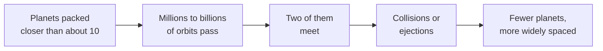

# How close can two planets orbit?

Seen from: the star view of a planetary system, where the planets sit at
their distances from the star, and its "Hill spheres" layer.

## Short answer

Each planet controls a small region round itself, its Hill sphere, which
grows with its mass and its distance from the star. Two planets on
circular orbits can never meet if their orbits are more than about 3.5
"mutual" Hill radii apart. With three planets or more there is no such
safe distance: their pulls add up, and the system only waits longer
before two of them meet. About 10 mutual Hill radii buy a billion years
or more. Kepler's packed systems sit just beyond that limit. The app keeps
Earth-mass planets at least 10 mutual Hill radii apart, heavier ones a
little less: 6.4 for a Jupiter and a Saturn.

## The science

### Each planet's sphere of control

Close to a planet, its own gravity beats the star's tide. The size of
that region is measured by its Hill radius: for a planet of mass $m$ at
distance $a$ from a star of mass $M$ (Obertas et al. 2017),

```math
r_H = a\left(\frac{m}{3M}\right)^{1/3}
```

**In words.** The region a planet controls grows in proportion to its
distance from the star, but only as the cube root of its mass: a planet a
thousand times heavier controls a region ten times wider.

**Orders of magnitude.** From NASA's masses and distances: the Earth's
Hill radius is 0.010 AU, 1.5 million km; Jupiter's 0.36 AU; Neptune's,
far out, 0.78 AU.

### The mutual Hill radius: a ruler for two planets

To measure the gap between two neighbours, of masses $m_1$ and $m_2$ at
distances $a_1 < a_2$, astronomers use their mutual Hill radius and count
the gap in that unit, $K$ (Pu & Wu 2015, eq. 1 and 2):

```math
R_H = \frac{a_1 + a_2}{2}\left(\frac{m_1 + m_2}{3M}\right)^{1/3},
\qquad
K = \frac{a_2 - a_1}{R_H}
```

**In words.** $R_H$ is the Hill radius of a planet as heavy as the two
together, halfway between them. $K$ says how many of those fit between the
two orbits.

**Orders of magnitude.** The Solar System's neighbours, from NASA's
masses and distances:

| Pair | $K$ | Period ratio |
| --- | --- | --- |
| Mercury–Venus | 63 | 2.55 |
| Venus–Earth | 26 | 1.63 |
| Earth–Mars | 40 | 1.88 |
| Mars–Jupiter | 16 | 6.3 |
| Jupiter–Saturn | 7.9 | 2.49 |
| Saturn–Uranus | 14 | 2.83 |
| Uranus–Neptune | 14 | 1.98 |

The rocky planets are spread wide. The giants are much closer, in this
unit, because their Hill radii are large.

### Two planets: Gladman's 2√3

For two planets on circular orbits in the same plane, the conservation of
energy and angular momentum forbids any close encounter, for ever, if the
outer orbit is far enough out (Gladman 1993, in the form given by Obertas
et al. 2017):

```math
a_2 > a_1\left(1 + 2\cdot 3^{1/6}\,(\mu_1 + \mu_2)^{1/3}\right)
\quad\Longleftrightarrow\quad
K > 2\sqrt{3} \approx 3.46
```

where $\mu_i = m_i / M$, to lowest order in the planets' masses.

**In words.** Beyond about three and a half mutual Hill radii, two planets
cannot get close to each other however long one waits. Such a pair is
called Hill stable.

**Orders of magnitude.** Two Earths near 1 AU need only 0.044 AU between
their orbits, 6.5 million km. Two Jupiters near 5.2 AU need 1.5 AU.

### Three planets or more: no safe distance, only a long wait

With a third planet, no such proof exists, and simulations take over
(Pu & Wu 2015). Chambers, Wetherill & Boss (1996) set planets of equal
mass at equal spacings and timed the first close encounter. Its logarithm
grows in step with the spacing (as reviewed by Obertas et al. 2017):

```math
\log_{10}\frac{t_c}{t_0} = b\,\Delta + c
```

Here $t_c$ is the time to the first close encounter, $t_0$ the inner
planet's orbital period, $\Delta$ the spacing in mutual Hill radii, and
$b$ and $c$ numbers fitted to the simulations.

**In words.** Each extra mutual Hill radius between the planets multiplies
the time they last by a fixed factor, about ten for Earth-mass planets.
A wider spacing does not make the system safe for ever: it only delays
the first close encounter.

**Orders of magnitude.** For five Earth-mass planets round a Sun-like
star, Obertas et al. (2017) fit $b$ = 0.95 to 1.09 and $c$ = −1.2 to
−1.9. At a spacing of 8, that gives a few million orbits. Beyond about
8.4 the times jump: many systems pass 10 billion orbits, the length of
their runs. Of the systems spaced 11.8 to 13 apart, 89 % lasted that
long; of those spaced 8.4 to 8.8, 3 %. Spacings near resonances between
neighbours, where the periods make simple ratios, last less.



Pu & Wu (2015) ran systems of planets of 3 to 9 Earth masses for longer,
with spacings drawn at random:

- To survive a billion years, such systems need about 10 mutual Hill
  radii if their orbits are circular and in one plane, and about 12 if
  their eccentricities are about 0.02.
- An eccentric system behaves like a circular one with the same closest
  approach, measured from the inner planet's apoapsis to the outer one's
  periapsis.
- A single pair packed tighter than the rest weakens the whole system
  more than a wider pair helps it.

Heavier planets need fewer Hill radii. Chambers et al. (1996) found that
their runs at different masses agreed once the spacing was divided by
the mass share to the power ¼ rather than ⅓ (as reported by Obertas et
al. 2017). Counted in Hill radii, the needed spacing then falls slowly as
the mass grows, as $\mu^{-1/12}$: our own reading of that scaling.

### What Kepler saw

The Kepler mission found over 400 systems of several planets, many with
neighbours closer together than any in the Solar System (Obertas et al.
2017).

- **Packed to the limit.** In systems with four or more transiting
  planets, the spacings cluster tightly round 12 mutual Hill radii, close
  to the stability limit above (Pu & Wu 2015). The authors propose that
  systems formed even tighter, and that those packed too close went
  unstable and lost planets: many systems with one or two planets would
  be their remains.
- **Peas in a pod.** In 909 planets of 355 Kepler systems, 93 % of
  neighbouring pairs are at least 10 mutual Hill radii apart, and about 20
  is the most common spacing. Almost no pair has a period ratio below 1.2,
  and planets of one system tend to be alike in size and regularly spaced
  (Weiss et al. 2018).

### What we do not know

- **Why the times grow this way.** For three planets or more, there is no
  theory yet for the origin of the instability: the rules are fits to
  simulations (Pu & Wu 2015).
- **Where single planets come from.** Whether Kepler's systems of one or
  two planets are the wreckage of packed systems is a hypothesis (Pu & Wu
  2015).

## In the app

### What you see

In the star view, the planets of a drawn system sit at their distances
from the star, never closer than the spacing below. The "Hill spheres"
layer draws a circle round each planet: its Hill radius at periapsis,
to scale when it is larger than the planet's marker, otherwise just
outside the marker and its moons.

A request for more planets of a type than fit in its band fails with
`zone_full` and the number that fit.

### How it computes them

When it draws a whole system,
[`system.rs`](../../crates/mapgen/src/system.rs) places the planets from
the star outwards:

1. **Each type in its band**: temperate planets in the habitable zone,
   gas giants beyond half the ice line, hot Jupiters within 0.1 AU, and
   so on. A planet asked for starts at a distance drawn in its type's
   preferred band; one left to the draw, where the occurrence rates put
   it.
2. **The spacing.** A planet is pushed out by 2 % at a time until it is
   clear of every planet already placed: at least `hill_spacing` mutual
   Hill radii, from the inner planet's apoapsis to the outer one's
   periapsis, so eccentric orbits need more room.
3. **Fewer Hill radii for heavier pairs.** `hill_spacing` asks 10 of two
   Earth masses, and falls as $\mu^{-1/12}$, the scaling of Chambers et
   al. (1996) above, with $\mu$ the pair's mean mass share of the star:
   6.6 for an Earth and a Jupiter, 6.4 for a Jupiter and a Saturn. It
   never goes below Gladman's $2\sqrt{3}$, which only a pair about as
   heavy as its star would reach.
4. **Hot Jupiters** keep other planets beyond four times their period.
5. **The belt zone.** Rocky planets also jump past the first cold giant's
   belt zone (see [How do asteroid belts form?](asteroid-belts.md)). A
   drawn small planet of 10 Earth masses or more is a giant here: the
   planet model gives it an ice giant's envelope and classes it one, so it
   may be that first cold giant.
6. **Failure.** When a planet is pushed out of its band, the planets asked
   for are drawn again, up to 24 tries, before the request fails with
   `zone_full`. A system left wholly to the draw drops planets of the
   failing type until the others fit.

The spacing, trimmed (from `crates/mapgen/src/giants.rs`):

```rust
/// Gap kept between two Earth-mass neighbours, in mutual Hill radii.
const EARTH_HILL_SPACING: f64 = 10.0;

/// Least gap kept between two neighbouring orbits, apoapsis to periapsis,
/// in mutual Hill radii, for a pair whose mean mass share of the star is
/// `mass_share` (`(m₁ + m₂) / 2M`).
pub fn hill_spacing(mass_share: f64) -> f64 {
    const EARTH_SHARE: f64 = 1.0 / 332_946.0;
    (EARTH_HILL_SPACING * (mass_share / EARTH_SHARE).powf(-1.0 / 12.0))
        .max(2.0 * 3f64.sqrt())
}
```

The test, trimmed (from `crates/mapgen/src/system.rs`):

```rust
fn clear(a: &Slot, b: &Slot, star_mass: f64) -> bool {
    let (inner, outer) =
        if a.orbit_au < b.orbit_au { (a, b) } else { (b, a) };
    let sun = 332_946.0; // Earth masses in a Sun
    // Mutual Hill radius.
    let hill = ((inner.mass_earth + outer.mass_earth)
        / (3.0 * star_mass * sun))
        .cbrt()
        * 0.5
        * (inner.orbit_au + outer.orbit_au);
    // From the inner planet's apoapsis to the outer one's periapsis.
    let gap = outer.orbit_au * (1.0 - outer.eccentricity)
        - inner.orbit_au * (1.0 + inner.eccentricity);
    let hot = inner.body_type == "hot-jupiter"
        || outer.body_type == "hot-jupiter";
    let share = 0.5 * (inner.mass_earth + outer.mass_earth)
        / (star_mass * sun);
    gap >= hill_spacing(share) * hill
        // A hot Jupiter: four times the period, by Kepler's third law.
        && (!hot || outer.orbit_au / inner.orbit_au >= 4f64.powf(2.0 / 3.0))
}
```

A single world drawn on its own, outside a system, gets its giant planets
from [`giants.rs`](../../crates/mapgen/src/giants.rs) instead. There, a
giant must keep the same `hill_spacing` from the world and from every
other giant, apoapsis to periapsis. A giant that fails is drawn again up
to 6 times, then dropped.

With the Solar System's planets, every neighbouring pair passes. The
closest is Jupiter–Saturn: 6.5 mutual Hill radii from apoapsis to
periapsis, against the 6.4 asked. Two Earths that close would fail (a
test in `system.rs`).

### Where it departs from the science

- **The mass scaling is our reading.** Chambers et al. (1996) found the
  $\mu^{1/4}$ scaling for planets of equal mass. The app turns it into
  $\mu^{-1/12}$ Hill radii, applies it to pairs of unequal mass through
  their mean, and sets it to 10 at one Earth mass. Pu & Wu (2015) found
  about 10 for planets of 3 to 9 Earth masses; the same scaling would
  then ask 11 to 12 of Earth-mass planets. The app's calibration is
  checked against the Solar System, which it lets through, not against
  simulations of unequal planets.
- **Many-planet rule for two planets.** A system of two planets would be
  Hill stable at 3.5 mutual Hill radii; the app still asks 10 of two
  Earths. Round a single world, its giants keep the same rule, though a
  world and one giant are only two planets.
- **Eccentric orbits.** Measuring the gap from apoapsis to periapsis
  follows Pu & Wu's finding that eccentric systems behave like circular
  ones with the same closest approach.
- **No resonances, no evolution.** The app neither seeks nor avoids
  resonances, whose effect on stability goes both ways. Planets never
  move after they are placed: no system goes unstable, loses a planet or
  is pared down, as Pu & Wu propose real ones were.
- **Flat.** The spacing ignores mutual inclinations.

## Sources

1. Obertas, A., Van Laerhoven, C. & Tamayo, D. 2017, "The stability of
   tightly-packed, evenly-spaced systems of Earth-mass planets orbiting a
   Sun-like star", *Icarus* 293, 52–58,
   [doi:10.1016/j.icarus.2017.04.010](https://doi.org/10.1016/j.icarus.2017.04.010),
   preprint [arXiv:1703.08426](https://arxiv.org/abs/1703.08426). The
   Hill radius, Gladman's criterion (eq. 1–5), the fits and survival
   fractions (Tables 1 and 2), Chambers et al.'s results.
2. Pu, B. & Wu, Y. 2015, "Spacing of Kepler Planets: Sculpting by
   Dynamical Instability", *The Astrophysical Journal* 807, 44,
   [doi:10.1088/0004-637X/807/1/44](https://doi.org/10.1088/0004-637X/807/1/44),
   preprint [arXiv:1502.05449](https://arxiv.org/abs/1502.05449).
3. Gladman, B. 1993, "Dynamics of Systems of Two Close Planets", *Icarus*
   106, 247–263,
   [doi:10.1006/icar.1993.1169](https://doi.org/10.1006/icar.1993.1169).
   Not read directly: its result is cited as given by Obertas et al.
   (2017) and Pu & Wu (2015).
4. Chambers, J. E., Wetherill, G. W. & Boss, A. P. 1996, "The Stability
   of Multi-Planet Systems", *Icarus* 119, 261–268,
   [doi:10.1006/icar.1996.0019](https://doi.org/10.1006/icar.1996.0019).
   Not read directly: its results are cited as reviewed by Obertas et al.
   (2017).
5. Weiss, L. M. et al. 2018, "The California-Kepler Survey. V. Peas in a
   Pod: Planets in a Kepler Multi-planet System Are Similar in Size and
   Regularly Spaced", *The Astronomical Journal* 155, 48,
   [doi:10.3847/1538-3881/aa9ff6](https://doi.org/10.3847/1538-3881/aa9ff6),
   preprint [arXiv:1706.06204](https://arxiv.org/abs/1706.06204).
6. NASA Space Science Data Coordinated Archive, [Planetary fact
   sheet](https://nssdc.gsfc.nasa.gov/planetary/factsheet/) (masses,
   distances and eccentricities of the planets).

## See also

- [docs/system-spec.md](../system-spec.md): spacing and order of the
  planets in a system.
- [docs/analysis/12-gas-giants.md](../analysis/12-gas-giants.md): the
  study behind the giants, their Hill spheres and their spacing.
- [What are Lagrange points and trojans?](lagrange-points.md): the Hill
  radius as the distance to L1 and L2.
- [How do asteroid belts form?](asteroid-belts.md): the room the planets
  leave for a belt.
