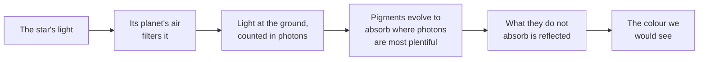

# What colour would plants be under another star?

Seen from: the planet view with **Star light** on, on the forests,
jungles, grasslands and tundra of a world round a star other than a G
dwarf.

## Short answer

Earth's plants are green because their pigments absorb blue and red light
and use less of the green. The red they favour is where sunlight, after
crossing our air, brings the most photons. Under another star the light
that reaches the ground is different, so the pigments that evolve there
would likely absorb elsewhere, and leaves would look another colour.
Models predict pigments tuned to blue light round F stars, to red-orange
light round K stars, and to the near-infrared round red dwarfs. What
colour that makes the leaves is a guess: nobody has seen a plant from
another world.

## The science

### Why Earth's plants are green

Plants harvest light with chlorophylls. Chlorophyll a absorbs most
strongly at about 430 and 662 nm, chlorophyll b at about 453 and 642 nm
(both measured in a solvent, diethyl ether; Seager et al. 2005). Between
the blue and the red peaks, green light is absorbed less and more of it
is reflected. "Photosynthetic plants look green because their antenna
complexes absorb light across the visible spectrum including the blue and
red portions yet reflect green wavelengths" (Arp et al. 2020).

Just past the visible, leaves change abruptly. Their reflectivity rises
"at around 700 nm by a factor of five or more", and a leaf "is strongly
reflective between 700 nm and 1000 nm" (Seager et al. 2005). This is the
**red edge**. It is invisible to our eyes, but it "is often used in
remote sensing studies of Earth's vegetation" (Seager et al. 2005).

### Light counted in photons

For a plant, what matters is the number of photons, not the power:
"photosynthesis counts photons, not total energy" (Kiang et al. 2007a).
A photon of wavelength $\lambda$ carries the energy $E$, with $h$ Planck's
constant and $c$ the speed of light:

```math
E = \frac{hc}{\lambda},
\qquad
hc \approx 1240\ \text{eV nm}
```

**In words.** For the same power, red light brings more photons than
blue, because each red photon carries less energy.

**Orders of magnitude.** A 440 nm blue photon carries 2.8 electronvolts,
a 680 nm red one 1.8. A watt of red light holds about 1.5 times as many
photons as a watt of blue. The Sun's light, measured in power, peaks at
450 nm at the top of our atmosphere; counted in photons, it peaks at 572
to 584 nm (Kiang et al. 2007b). At the ground, after the air has filtered
it, "the solar flux at the Earth's surface peaks in the red at about
685 nm" (Kiang et al. 2007b): close to chlorophyll's red peak.

### Three rules for pigments

From the pigments of Earth's plants, algae and bacteria, Kiang et al.
(2007a) propose where photosynthetic pigments peak in absorbance: "a) the
wavelength of peak incident photon flux; b) the longest available
wavelength for core antenna or reaction center pigments; and c) the
shortest wavelengths within an atmospheric window for accessory
pigments." The reaction centre is where the light's energy is turned into
chemistry; the antenna pigments gather light and pass it on.



**In words.** Pigments go where the photons are, and toward the red end of
each window of clear air, so that the energy can flow downhill from the
accessory pigments to the reaction centre (Kiang et al. 2007a).

### What each star would give

Kiang et al. (2007b) computed the light reaching the ground of Earth-like
planets round real and modelled stars, with Earth's air or with little
oxygen, and found where its photons peak (numbers from their preprint):

| Star | Peak of photons at the ground | Their prediction |
| --- | --- | --- |
| F2V | 451 nm, violet | absorbance peaks in the blue |
| G2V (the Sun) | about 685 nm, red | Earth's plants |
| K2V | 667 nm, red | "very similar to the Earth" |
| M1V, 3,650 K | 754 nm, at the red edge | the near-infrared |
| M5V, 3,100 K | about 1,045 nm, infrared | the near-infrared |

In their abstract: "photosynthetic pigments on planets around F2V stars
may peak in absorbance in the blue, K2V in the red-orange, and M stars in
the near-infrared". Planets round F2V stars "might have a 'blue edge' or
at least be darker in the blue", and "K2V planets would look very similar
to the Earth" (Kiang et al. 2007b).

**What that would look like.** If pigments absorb the blue, the light
left to reflect is the green, yellow and red: such leaves would lean to
yellow or orange. Kiang et al. (2007b) do not name these colours; this is
a reading of their prediction, not a result of it.

### Red dwarfs

M dwarfs are "the most abundant stars in our galaxy", and they give little
visible light: they are "strongly non-blackbody emitters, with little flux
of visible radiation and instead peaking in the NIR" (Kiang et al. 2007b).
Their planets' photosynthesis "would most likely harvest light over
0.4-1.1 µm, with potential but unlikely extensions to 1.4 and 2.5 µm"
(Kiang et al. 2007b). On Earth, purple bacteria already absorb at
1.020 µm, in the infrared (Kiang et al. 2007b).

Such a plant would take in the whole visible range and more, the little
there is of it. To an eye like ours it would look dark, perhaps near
black. That too is a reading: Kiang et al. (2007b) give absorption bands,
not colours.

**Orders of magnitude.** M-star planets "could be a half to a tenth as
productive as Earth in the visible, but exceed Earth if useful photons
extend to 1.1 µm for anoxygenic photosynthesis" (Kiang et al. 2007b).
Under water, organisms "will be restricted to wavelengths shorter than
1.4 µm and more likely below 1.1 µm", but they could survive the young
star's ultraviolet flares there.

### What we do not know

- **Why green, after all.** Arp et al. (2020) offer another reason: the
  pigments "do not absorb at the maximum solar power", but in pairs of
  close peaks where the spectrum changes steeply, which keeps the energy
  flowing in steadily despite the light's ups and downs. Which rule holds
  matters for guessing pigments under other stars.
- **The leaves themselves.** "We do not know enough yet to predict full
  reflectance spectra" (Kiang et al. 2007b).
- **Whether plants would exist at all.** Under a red dwarf, oxygen-making
  photosynthesis may have too little visible light, or need more photons
  per oxygen molecule (Kiang et al. 2007b).

## In the app

### What you see

**Star light** lights the planet with the colour of its star's light.
With it on, the app also recolours vegetation: under a star cooler than
the Sun, forests and grasslands turn towards a dark purple-black; under a
hotter one, towards gold. Sun-like stars leave them green. The study's
example: under an M4 dwarf, the green continents of a locked planet turn
dark brown in the orange light. With **Star light** off, and in every
exported map, plants keep Earth's colours.

### How it computes them

Three pieces, all in the viewer:

1. **How much of a biome is plants**
   ([`vegetation.ts`](../../web/src/lib/vegetation.ts)): forest and
   jungle 1, taiga 0.9, wetland 0.8, savanna, shrubland and plain 0.6,
   tundra 0.35, every other biome 0.
2. **How far to recolour**, from the star's temperature
   ([`PlanetView.ts`](../../web/src/lib/viewer/PlanetView.ts)): a "cool"
   share rising from 0 at 5,772 K to 1 at about 3,300 K, and a "hot"
   share rising from 0 at 5,772 K to 1 at about 7,300 K.
3. **The recolouring** in the surface shader
   ([`shaders.ts`](../../web/src/lib/viewer/shaders.ts)): the biome's
   colour is pulled towards a dark purple, about a third as bright, and
   then towards a gold as bright as the original, in proportion to its
   share of plants. It applies to the biome map and the detail tiles
   only.

Trimmed, from `web/src/lib/viewer/PlanetView.ts`:

```ts
/**
 * How far vegetation is recoloured under a star: towards dark
 * purple-black below the Sun's temperature (fully at 3 300 K), towards
 * gold above it (fully at 7 300 K); none for a Sun-like star.
 */
export function vegetationShift(teffK: number): [number, number] {
  const clamp = (x: number) => Math.min(1, Math.max(0, x));
  return [clamp((5772 - teffK) / 2500), clamp((teffK - 5772) / 1500)];
}
```

And from the surface shader in `web/src/lib/viewer/shaders.ts`:

```glsl
float plants = uVegetation[int(min(id, 63.0))];
if (plants > 0.0) {
  float lum = dot(colour, vec3(0.2126, 0.7152, 0.0722));
  vec3 dark = vec3(0.55, 0.28, 0.42) * lum;
  vec3 gold = vec3(1.35, 1.05, 0.3) * lum;
  vec3 adapted = mix(mix(colour, dark, uVegShift.x), gold, uVegShift.y);
  colour = mix(colour, adapted, plants);
}
```

What it gives for a few stars (the share recoloured for a forest):

| Star | Teff (K) | Towards dark | Towards gold |
| --- | --- | --- | --- |
| F0V | 7,220 | 0 | 0.97 |
| F5V | 6,550 | 0 | 0.52 |
| G2V | 5,770 | 0 | 0 |
| K2V | 5,100 | 0.27 | 0 |
| K5V | 4,440 | 0.53 | 0 |
| M0V | 3,850 | 0.77 | 0 |
| M4V and cooler | 3,210 | 1 | 0 |

The light itself is then tinted by the star's colour, as for every other
surface (see [What does a G-type star mean?](star-types.md)).

### Where it departs from the science

- **A straight line in temperature.** The app recolours by the star's
  temperature alone. Kiang et al. (2007b) work from the light that reaches
  the ground, which depends on the planet's air as much as on the star.
- **K stars turn dark too early.** Kiang et al. (2007b) expect K2V planets
  to look "very similar to the Earth". The app already pulls a K2V
  planet's forests 27 % of the way to dark purple, a K5V's 53 %.
- **The colours are readings, not predictions.** Gold under F stars and
  near-black under M dwarfs follow from where the pigments would absorb,
  not from a computed reflectance, which Kiang et al. (2007b) say cannot
  be predicted yet. The purple hue of the dark tint is the app's choice.
- **Only the colour changes.** The biomes stay the same: a red dwarf's
  planet keeps forests as dense as Earth's, though its plants may be a
  half to a tenth as productive in the visible.
- **No red edge.** Leaves in the app reflect nothing beyond red; the
  infrared is not drawn at all, so the red edge, the strongest sign of
  plants, has no part in the picture.

## Sources

1. Kiang, N. Y., Siefert, J., Govindjee & Blankenship, R. E. 2007a,
   "Spectral signatures of photosynthesis. I. Review of Earth organisms",
   *Astrobiology* 7, 222–251,
   [doi:10.1089/ast.2006.0105](https://doi.org/10.1089/ast.2006.0105),
   preprint [arXiv:astro-ph/0701382](https://arxiv.org/abs/astro-ph/0701382).
   The three rules for pigments.
2. Kiang, N. Y., Segura, A., Tinetti, G., Govindjee, Blankenship, R. E.,
   Cohen, M., Siefert, J., Crisp, D. & Meadows, V. S. 2007b, "Spectral
   signatures of photosynthesis. II. Coevolution with other stars and the
   atmosphere on extrasolar worlds", *Astrobiology* 7, 252–274,
   [doi:10.1089/ast.2006.0108](https://doi.org/10.1089/ast.2006.0108),
   preprint [arXiv:astro-ph/0701391](https://arxiv.org/abs/astro-ph/0701391).
   The light at the ground per star, the predicted bands, productivity.
3. Seager, S., Turner, E. L., Schafer, J. & Ford, E. B. 2005,
   "Vegetation's red edge: a possible spectroscopic biosignature of
   extraterrestrial plants", *Astrobiology* 5, 372–390,
   [doi:10.1089/ast.2005.5.372](https://doi.org/10.1089/ast.2005.5.372),
   preprint [arXiv:astro-ph/0503302](https://arxiv.org/abs/astro-ph/0503302).
   Chlorophyll's absorption peaks, the red edge.
4. Arp, T. B., Kistner-Morris, J., Aji, V., Cogdell, R. J., van Grondelle,
   R. & Gabor, N. M. 2020, "Quieting a noisy antenna reproduces
   photosynthetic light-harvesting spectra", *Science* 368, 1490–1495,
   [doi:10.1126/science.aba6630](https://doi.org/10.1126/science.aba6630),
   preprint [arXiv:1912.12281](https://arxiv.org/abs/1912.12281).

## See also

- [docs/analysis/10-stars.md](../analysis/10-stars.md): the study behind
  the app's stars, its step 6 for vegetation.
- [What does a G-type star mean?](star-types.md): the colour of a star's
  light.
- [What is the habitable zone?](habitable-zone.md): where such plants
  could grow.
