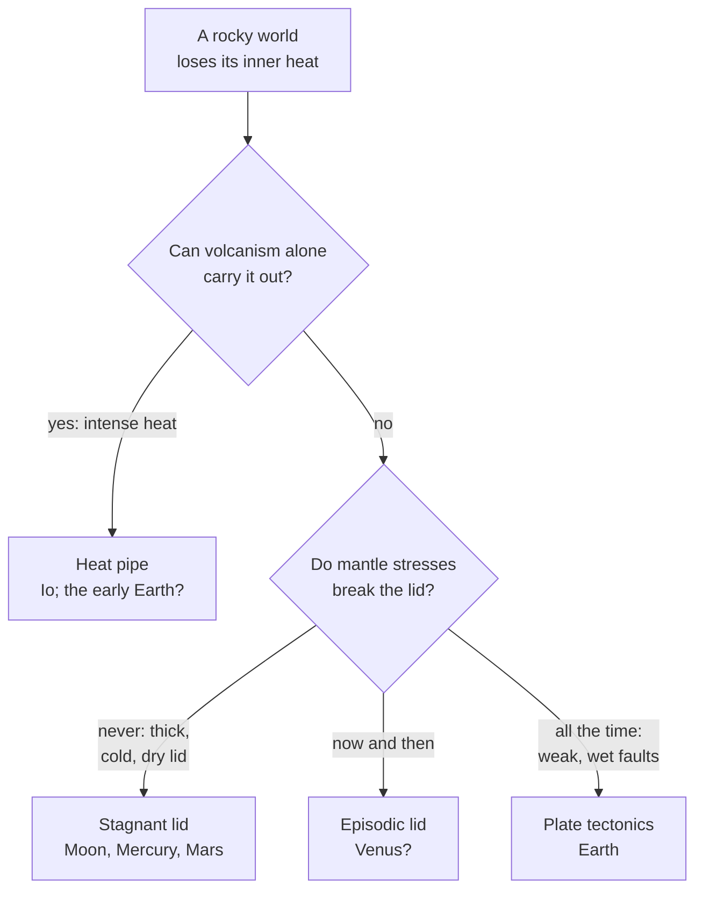

# Do all rocky planets have plate tectonics?

Seen from: the planet view, the *Geology* line of the world card in the
*Info* panel ("plate tectonics, surface 400 Ma", "stagnant lid, surface
4 Ga"), and the relief of the globe and map: mountain ranges, trenches,
island arcs and mid-ocean ridges along plate boundaries.

## Short answer

No. Of all the rocky bodies of the Solar System, only Earth is known to have
plate tectonics: a shell broken into plates that slide, part and sink back
into the mantle. The others are covered by a single rigid shell, a
*stagnant lid*, through which heat leaks by conduction and volcanoes. Plates
need a lithosphere weak enough for the mantle's forces to break it, and
water is the weakening agent cited most often. Small bodies cooled too fast,
Venus is too dry and too hot, and Io is so hot that lava does the work.
Whether larger rocky planets, super-Earths, have plates is still debated.

## The science

### What plate tectonics is

Earth's outer shell, the *lithosphere*, is cold and rigid. It is broken into
plates: Bird (2003) maps "14 large plates" and 38 small ones, "for a total
of 52 plates". They part at mid-ocean ridges, where new sea floor forms, and
sink back into the mantle at subduction zones. The Mid-Atlantic Ridge
spreads at "about 2.5 centimeters per year (cm/yr), or 25 km in a million
years" (USGS). What drives them is mostly the sinking slab itself: Forsyth &
Uyeda (1975) find that "the forces acting on the downgoing slab control the
velocity of the oceanic plates and are an order of magnitude stronger than
any other force".

New sea floor is hot and stands high; it cools, contracts and sinks as it
moves away from the ridge. Parsons & Sclater (1977) fit its depth $d$ (in
metres) against its age $t$ (in Ma):

```math
d(t) = 2500 + 350\,\sqrt{t} \qquad (0 \le t \le 70\ \text{Ma})
```

and for older floor a depth that levels off towards 6 400 m.

**In words.** The ocean floor is a cooling plate: young floor makes the
ridges, old floor the abyssal plains.

**Orders of magnitude.** A ridge crest lies 2.5 km deep, 25 Ma old floor
4.3 km, 64 Ma old floor 5.3 km. The plate that cools this way is
125 ± 10 km thick (Parsons & Sclater 1977).

### Tectonic regimes

Rock flows more easily the hotter it is. A planet's cold surface layer is
therefore far stiffer than the mantle beneath it, and on its own it would
form one rigid shell over a convecting mantle (Foley 2018). That is the
**stagnant lid**: "the surface exists as a single plate with mantle
convection taking place beneath this plate, and there is no global network
of subduction zones and mid-ocean ridges" (Foley 2018).

For plates, the mantle's stresses must break the lid into narrow weak
zones, the plate boundaries. Moresi & Solomatov (1998) model the lid as rock
that fails by friction ("Byerlee's law"). In its simplest form, rock of
density $\rho$ under a gravity $g$, with a friction coefficient $\mu$,
breaks at a stress growing with depth $z$:

```math
\tau_y = \mu\,\rho\,g\,z
```

**In words.** The deeper, the more the rock is pressed together and the
harder it is to break. "When the yield stress is high, convection is
confined below a thick, stagnant lithosphere"; when it is low, the lid
becomes part of the convection: plates. In between, there is "a cycling
between these two states: thick lithosphere episodically mobilizes and
collapses into the interior before reforming" (Moresi & Solomatov 1998).

**Orders of magnitude.** For Earth's lithosphere to move, they need $\mu$
"less than 0.03–0.13—lower than laboratory values but consistent with
seismic field studies". Taking rock of 3 000 kg/m³ for illustration, the
weight of 30 km of rock is about 900 MPa: even at $\mu = 0.1$ the lid would
hold 90 MPa there. Plates need faults far weaker than dry rock.

Planetary scientists sort bodies by how their lid behaves:

| Regime | What happens | Bodies |
| --- | --- | --- |
| Plate tectonics | Lid broken into plates, recycled by subduction | Earth |
| Stagnant lid | One rigid plate; conduction and volcanoes | Moon, Mars |
| Episodic lid | Stagnant for long spans, then overturned | Venus? |
| Squishy lid | Small plates between weak, intruded zones | Venus? |
| Heat pipe | Lava erupts so much it carries the heat out | Io |
| Ice tectonics | Plates of ice over an ocean | Europa? |

The question marks are proposals, not settled cases. The *plutonic-squishy
lid* comes from simulations with much intrusive magma: "a set of small,
strong plates separated by warm and weak regions generated by plutonism",
which "has the potential to be applicable to the Early Archean Earth and
present-day Venus" (Lourenço et al. 2020).



Plate tectonics is the rare case. Surveying the 26 largest rocky and icy
bodies, Stern, Gerya & Tackley (2018) "conclude that some type of stagnant
lid tectonics is the dominant mode of heat loss and that plate tectonics is
unusual". Earth "is the only rocky planet or moon known to operate in a
plate-tectonic regime; the other rocky bodies in the solar system are
thought to operate in some form of stagnant lid regime" (Foley 2018).

### Why Earth has plates

- **Water.** Hydrated rock is weaker: "hydration of old lithosphere could
  weaken it, and make the effective strength low enough for yielding at
  subduction zones" (Foley 2018). On Venus, "the friction coefficient may
  be high as a result of the dry conditions, and brittle mobilization of
  the lithosphere would then be episodic and catastrophic" (Moresi &
  Solomatov 1998).
- **Heat.** Stern, Gerya & Tackley (2018) find that the tectonic activity
  of rocky bodies "positively correlates with their inferred Rayleigh
  number", a measure of how vigorously their mantle convects.
- **Size and a cool surface.** In models where the lithosphere is weakened
  by damage (its mineral grains shrinking where it deforms), "plate
  tectonics being favored for larger, cooler planets" (Foley, Bercovici &
  Landuyt 2012). The authors suggest this explains why Earth has plates and
  Venus and Mars do not.

Plates matter for the climate too. Plate tectonics "facilitates carbon
cycling between the surface and interior, which helps to maintain temperate
surface temperatures on Earth"; stagnant-lid planets "may also be capable of
establishing a carbon cycle that regulates climate", though plates remain
"the more favorable tectonic state for long-term climate stability" (Foley
2018).

### Our neighbours

- **The Moon, Mercury and Mars** have stagnant lids, yet "can still display
  volcanism and active tectonics" (Foley 2018). Mercury shrank as it
  cooled: Byrne et al. (2014) find from its folds and faults a radius "as
  much as 7 km" smaller, well above earlier estimates of 0.8 to 3 km.
- **Venus** is almost Earth's size (95 % of its radius) under 92 bar of hot
  air (NASA). Its craters, 842 of them mapped on 89 % of the surface, are
  spread uniformly and give an average age of "only about 0.5 Ga" (Schaber
  et al. 1992); Strom, Schaber & Dawson (1994) date a global resurfacing to
  about 300 million years ago. It "shows evidence for limited subduction
  in some regions" (Foley 2018) but no global plates. It may not always
  have been so: its atmosphere suggests "an early phase of active lid
  tectonics that lasted for at least 1 Gyr, followed by the current
  stagnant lid-like mode" (Weller et al. 2023).
- **Io** erupts so much that it resurfaces itself "faster than comets and
  asteroids can mark it with large craters" (NASA). Moore & Webb (2013)
  describe it as a *heat-pipe* body and propose that the young Earth cooled
  the same way before plates began.
- **Europa** may have plates of ice: Kattenhorn & Prockter (2014) report
  evidence for subduction in its ice shell.

### What we do not know

- **Super-Earths.** Two papers of 2007 drew opposite conclusions. Valencia,
  O'Connell & Sasselov (2007): "super-Earths, even if dry, will exhibit plate
  tectonic behavior", since a larger planet has stronger driving stresses
  and thinner plates. O'Neill & Lenardic (2007): "super‐sized Earths are
  likely to be in an episodic or stagnant lid regime", since fault strength
  grows faster with size than the driving forces. Korenaga (2010) found
  "that the planetary size plays a rather minor role and that the likelihood
  of plate tectonics is controlled largely by the presence of surface
  water". Foley, Bercovici & Landuyt (2012) favour larger, cooler planets.
- **When Earth's plates began.** Estimates from the rock record "span from
  > 4.0 Ga [...] to < 1.0 Ga" (Foley 2018).
- **Venus today.** Episodic overturns, a squishy lid, or a stagnant lid with
  limited subduction: the data do not yet decide.
- **Exoplanets.** "Earth is the only known planet with active plate
  tectonics" (Meier et al. 2021). On a planet locked to its star, models of
  the hot super-Earth LHS 3844b find convection organised by hemisphere,
  with upwelling under one side and downwelling under the other ("hemispheric
  tectonics", Meier et al. 2021). Observations of that planet reveal only "a
  solid surface and lack of a substantial atmosphere".

## In the app

### What you see

Each planet type records a regime in its preset (`[geology] regime`), shown
on the world card's *Geology* line with the surface age:

| Preset | Regime | Surface age (Ga) |
| --- | --- | --- |
| `terran`, `earth-like`, `frozen` | plate tectonics | 0.2–2.0 |
| `barren`, `mars-like`, `mercury-like` | stagnant lid | 3.0–4.2 |
| `caustic`, `venus-like` | episodic lid | 0.3–0.8 |
| `volcanic` | heat pipe | 0.001–0.05 |

Only the plate regime shapes the relief. A `terran` world has 10 to 15
plates; along their boundaries rise collision ranges, coastal ranges with a
chain of volcanoes behind them, island arcs beside deep trenches, and broad
mid-ocean ridges on the sea floor (best seen on the *Elevation* layer, with
the depth contours). Ranges follow the boundaries rather than falling at
random. On the other regimes, the regime only sets how old the surface is,
through the craters (see [How do impact craters form and
fade?](impact-craters.md)): a stagnant-lid world keeps a 4 Ga surface
covered in craters, a heat-pipe world almost none.

The generator can also show a plate world as its plates carried it, up to
300 million years in the past or the future (`--drift <Ma>` on the command
line, `drift_ma` in a request). Each epoch is a world of its own, under an
id that names it (`terran-past250ma-42`).

### How it computes them

[`plates.rs`](../../crates/mapgen/src/plates.rs) builds the plates, and
[`generation.rs`](../../crates/mapgen/src/generation.rs) adds their relief
when the preset says `regime = "plates"`:

1. **Plates.** About 300 jagged subplates (the cells of a jittered lattice,
   looked up at a position displaced by noise) each join the nearest of 10
   to 15 weighted plate centres.
2. **Motion.** Each plate turns about a random Euler pole at 20 to 100 km
   per Ma at its equator, 2 to 10 cm per year.
3. **Boundaries.** On a cube-sphere grid of six faces of 256 × 256 cells
   (about 40 km each on an Earth-sized planet), a cell next to another plate
   is on a boundary. Its convergence is the two plates' relative speed
   across it. Every cell gets the distance to its nearest boundary.
4. **Crust.** Each side is continental if the continents' noise stands above
   the edge of the shelf there, oceanic otherwise.
5. **Relief.** From the convergence and the crust on each side, a profile
   across the boundary, interpolated between cells. It grows from nothing at
   0.5 cm/yr to full height at 5 cm/yr (arcs at 2 cm/yr), and scales with
   gravity like the noise's mountains, whose weight is halved.

The relief of one boundary cell, trimmed (from
`crates/mapgen/src/plates.rs`, `relief_of`; `d` is the distance to the
boundary in km, `bump(d, mu, sigma)` a bell `sigma` km wide at `mu` km):

```rust
let closing = smooth(RELIEF_SPEED.0, RELIEF_SPEED.1, b.convergence);
let parting = smooth(RELIEF_SPEED.0, RELIEF_SPEED.1, -b.convergence);
let trench = || -0.16 * closing * bump(d, 40.0, 45.0);
if closing > 0.0 {
    match (mine, theirs) {
        (true, true) => {
            // Continent against continent: a collision range.
            r.orogeny = closing * bump(d, 0.0, 350.0);
            r.uplift = 0.12 * r.orogeny;
        }
        (true, false) => {
            // Continent over ocean: a coastal range and a volcanic arc.
            r.orogeny = closing * bump(d, 150.0, 150.0);
            r.uplift = 0.08 * closing * bump(d, 150.0, 120.0);
            r.arc = arcing * bump(d, 220.0, 80.0);
        }
        (false, true) => r.uplift = trench(),
        // Ocean against ocean: the lower index rides over, an island arc.
        (false, false) if own < other => {
            r.uplift = 0.12 * closing * bump(d, 120.0, 60.0);
            r.arc = arcing * bump(d, 120.0, 60.0);
        }
        (false, false) => r.uplift = trench(),
    }
} else if parting > 0.0 {
    match (mine, theirs) {
        // A mid-ocean ridge, or a rift valley between continents.
        (false, false) => r.uplift = 0.1 * parting * bump(d, 0.0, 450.0),
        (true, true) => {
            r.uplift = parting * (0.02 * bump(d, 120.0, 60.0)
                - 0.06 * bump(d, 0.0, 60.0));
        }
        _ => {}
    }
}
```

Elevations are in the generator's units; the app reads one unit as 25 km
(`ELEVATION_KM`), so a ridge stands about 2.5 km above the floor around it
and a trench reaches about 4 km below it.

**Drift.** `PlateMap::at_epoch` gives every plate a new pole and speed each
50 Ma stage and integrates the rotations in 1 Ma steps. A point at the epoch
takes the relief of the crust that lies there, read where that crust is
today; where no plate covers a point, the plates have parted and it becomes
new ocean floor, 0.3 units below the waterline, with a ridge along the new
boundary.

**Climate.** A world with plate tectonics and liquid water (0.01 bar or
more) gets a carbon cycle that steadies its temperature against its star's
light (`regulated` in `generation.rs`); the other regimes do not.

### Where it departs from the science

- **The regime is chosen, not derived.** It comes from the preset alone.
  A `terran` world keeps plates at any size it is drawn with (20 000 to
  80 000 km round, half to twice Earth's) and whatever its pressure, while
  the models above tie plates to size, water and surface temperature. A
  Mars-sized `terran` world has plates; Mars has a stagnant lid.
- **Only plates have landforms.** Stagnant-lid worlds have no giant
  volcanic bulge like Mars's Tharsis and no contraction scarps like
  Mercury's; episodic and heat-pipe worlds have nothing of their own either.
  Their regime shows only through their surface age and craters.
- **No ice tectonics.** `frozen` worlds are rocky worlds with plates under
  their ice, not Europa-like ice shells.
- **Plates are not driven.** Poles and speeds are drawn at random, so plates
  with long subducting edges are no faster than others (on Earth slab pull
  sets their speed, Forsyth & Uyeda 1975), and the plate count does not
  depend on the planet's size.
- **Continents come before plates.** The continents are noise; the plates
  are laid over them. A boundary can run through the middle of a continent,
  and the crust on each side is read from the height of the noise, not from
  a history of what formed where.
- **No age of the sea floor.** Real ocean floor deepens with age, from
  2.5 km at the ridge to about 6.4 km. In the app the sea floor's depth is
  noise, with a ridge profile on the boundaries; under drift, new crust is
  laid flat at 0.3 units below the waterline (about 7.5 km on the app's
  scale), deeper than real old floor, with a ridge on top.
- **Drift carries today's continents.** Going back, they tear along plate
  boundaries instead of gathering into an older supercontinent;
  overlapping crust is hidden rather than piled into ranges. Volcanic
  provinces ride with their plate: no plume stays fixed beneath a moving
  plate to leave a chain of volcanoes.
- **No carbon cycle without plates.** A stagnant-lid world with water gets
  no climate regulation at all, where Foley (2018) leaves it possible,
  though less favourable.
- **Locked planets are not hemispheric.** Poles are random on a planet
  locked to its star too; the hemispheric tectonics of Meier et al. (2021)
  is not modelled.
- **A comment out of date.** In `geology.rs`, the `regime` field still says
  "Recorded for now: it does not shape the relief yet", though the plate
  regime has shaped the relief since the plates were added.

## Sources

1. Bird, P. 2003, "An updated digital model of plate boundaries",
   *Geochemistry, Geophysics, Geosystems* 4, 1027,
   [doi:10.1029/2001GC000252](https://doi.org/10.1029/2001GC000252).
2. USGS, *This Dynamic Earth*, [Understanding plate
   motions](https://pubs.usgs.gov/gip/dynamic/understanding.html).
3. Forsyth, D. & Uyeda, S. 1975, "On the relative importance of the driving
   forces of plate motion", *Geophysical Journal International* 43,
   163–200,
   [doi:10.1111/j.1365-246X.1975.tb00631.x](https://doi.org/10.1111/j.1365-246X.1975.tb00631.x).
4. Parsons, B. & Sclater, J. G. 1977, "An analysis of the variation of
   ocean floor bathymetry and heat flow with age", *Journal of Geophysical
   Research* 82, 803–827,
   [doi:10.1029/JB082i005p00803](https://doi.org/10.1029/JB082i005p00803).
5. Foley, B. J. 2018, "The dependence of planetary tectonics on mantle
   thermal state: applications to early Earth evolution", *Philosophical
   Transactions of the Royal Society A* 376, 20170409,
   [doi:10.1098/rsta.2017.0409](https://doi.org/10.1098/rsta.2017.0409).
6. Moresi, L. & Solomatov, V. 1998, "Mantle convection with a brittle
   lithosphere: thoughts on the global tectonic styles of the Earth and
   Venus", *Geophysical Journal International* 133, 669–682,
   [doi:10.1046/j.1365-246X.1998.00521.x](https://doi.org/10.1046/j.1365-246X.1998.00521.x).
7. Lourenço, D. L., Rozel, A. B., Ballmer, M. D. & Tackley, P. J. 2020,
   "Plutonic-squishy lid: a new global tectonic regime generated by
   intrusive magmatism on Earth-like planets", *Geochemistry, Geophysics,
   Geosystems* 21, e2019GC008756,
   [doi:10.1029/2019GC008756](https://doi.org/10.1029/2019GC008756).
8. Stern, R. J., Gerya, T. & Tackley, P. J. 2018, "Stagnant lid tectonics:
   perspectives from silicate planets, dwarf planets, large moons, and large
   asteroids", *Geoscience Frontiers* 9, 103–119,
   [doi:10.1016/j.gsf.2017.06.004](https://doi.org/10.1016/j.gsf.2017.06.004).
9. Foley, B. J., Bercovici, D. & Landuyt, W. 2012, "The conditions for
   plate tectonics on super-Earths: inferences from convection models with
   damage", *Earth and Planetary Science Letters* 331–332, 281–290,
   [doi:10.1016/j.epsl.2012.03.028](https://doi.org/10.1016/j.epsl.2012.03.028).
10. Byrne, P. K. et al. 2014, "Mercury's global contraction much greater
    than earlier estimates", *Nature Geoscience* 7, 301–307,
    [doi:10.1038/ngeo2097](https://doi.org/10.1038/ngeo2097).
11. Schaber, G. G. et al. 1992, "Geology and distribution of impact craters
    on Venus: what are they telling us?", *JGR Planets* 97, 13257–13301,
    [doi:10.1029/92JE01246](https://doi.org/10.1029/92JE01246).
12. Strom, R. G., Schaber, G. G. & Dawson, D. D. 1994, "The global
    resurfacing of Venus", *JGR Planets* 99, 10899–10926,
    [doi:10.1029/94JE00388](https://doi.org/10.1029/94JE00388).
13. Weller, M. B., Evans, A. J., Ibarra, D. E. & Johnson, A. V. 2023,
    "Venus's atmospheric nitrogen explained by ancient plate tectonics",
    *Nature Astronomy* 7, 1436–1444,
    [doi:10.1038/s41550-023-02102-w](https://doi.org/10.1038/s41550-023-02102-w).
14. NASA, [Io](https://science.nasa.gov/jupiter/jupiter-moons/io/), and
    NASA Space Science Data Coordinated Archive, [Venus fact
    sheet](https://nssdc.gsfc.nasa.gov/planetary/factsheet/venusfact.html).
15. Moore, W. B. & Webb, A. A. G. 2013, "Heat-pipe Earth", *Nature* 501,
    501–505, [doi:10.1038/nature12473](https://doi.org/10.1038/nature12473).
16. Kattenhorn, S. A. & Prockter, L. M. 2014, "Evidence for subduction in
    the ice shell of Europa", *Nature Geoscience* 7, 762–767,
    [doi:10.1038/ngeo2245](https://doi.org/10.1038/ngeo2245).
17. Valencia, D., O'Connell, R. J. & Sasselov, D. D. 2007, "Inevitability of
    plate tectonics on super-Earths", *Astrophysical Journal* 670, L45–L48,
    [doi:10.1086/524012](https://doi.org/10.1086/524012), preprint
    [arXiv:0710.0699](https://arxiv.org/abs/0710.0699).
18. O'Neill, C. & Lenardic, A. 2007, "Geological consequences of
    super-sized Earths", *Geophysical Research Letters* 34, L19204,
    [doi:10.1029/2007GL030598](https://doi.org/10.1029/2007GL030598).
19. Korenaga, J. 2010, "On the likelihood of plate tectonics on
    super-Earths: does size matter?", *Astrophysical Journal Letters* 725,
    L43–L46,
    [doi:10.1088/2041-8205/725/1/L43](https://doi.org/10.1088/2041-8205/725/1/L43).
20. Meier, T. G., Bower, D. J., Lichtenberg, T., Tackley, P. J. & Demory,
    B.-O. 2021, "Hemispheric tectonics on super-Earth LHS 3844b",
    *Astrophysical Journal Letters* 908, L48,
    [doi:10.3847/2041-8213/abe400](https://doi.org/10.3847/2041-8213/abe400),
    preprint [arXiv:2103.02374](https://arxiv.org/abs/2103.02374).

## See also

- [docs/analysis/08-geology.md](../analysis/08-geology.md): the study behind
  the app's regimes, plates and drift, sections 1, 2, 4 and 8.
- [How do impact craters form and fade?](impact-craters.md): how the regime
  shows on worlds without plates.
- [Why are mountains lower on heavier planets?](mountains-and-gravity.md):
  the gravity scaling of the boundary relief.
- The README's [Elevation](../../README.md#elevation--continents-coasts-and-mountains)
  section and the `[geology]` table of its [planet
  presets](../../README.md#planet-presets).
