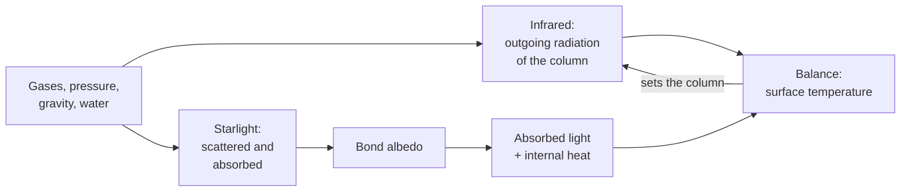

# How does a planet's air set its outgoing heat and its albedo?

Seen from: the planet card (the mean surface temperature, the Bond albedo
and the cause trees that explain them), and every body whose temperature
depends on its air.

## Short answer

A planet warms until it sends out as much infrared as it absorbs of its
star's light. Its air decides both halves. In the infrared, gases such as
water vapour and carbon dioxide are opaque in some colours and clear in
others, so the heat leaves from high, cold layers instead of from the warm
ground: that is the greenhouse effect. In starlight, the air scatters part
of the light back to space (the Rayleigh scattering of the gas, the
clouds, a haze or an acid deck) and absorbs another part (mostly near
infrared), which fixes how much the planet absorbs: its Bond albedo. The
app computes both halves colour by colour, from the gases a planet holds.
Water adds a limit of its own: a wet planet cannot radiate more than about
280 W/m², however hot it gets.

## The science

### A planet is a balance

A planet at the distance where its star gives the flux $S$ (W/m²) reflects
the share $A$ of it, its Bond albedo, and has an internal heat flux $q$
(W/m²). It settles at the surface temperature for which the outgoing
longwave radiation (OLR) of its column of air matches what it absorbs.
With $\sigma$ the Stefan–Boltzmann constant:

$$
\text{OLR}(T_s) = \frac{S\,(1-A)}{4} + q
$$

The 4 is the ratio of the planet's surface to the disc it shows its star.
The equilibrium temperature $T_\text{eq}$ is the one a black body would
have for the same right-hand side, $\sigma T_\text{eq}^4 = S(1-A)/4$. The
article on the [habitable zone](habitable-zone.md) uses $T_\text{eq}$ and
the albedo as given. Here they come from the air.

**In words.** Without air, the OLR is $\sigma T_s^4$ and the surface sits
at $T_\text{eq}$. Air changes the OLR function (the greenhouse effect,
which pushes $T_s$ above $T_\text{eq}$) and the albedo (which moves
$T_\text{eq}$).

**Orders of magnitude.** Earth absorbs about 240 W/m² and radiates it at
$T_\text{eq}$ = 254 K, but its surface is at 288 K. Its Bond albedo is
0.293 from CERES: 99.7 W/m² reflected of 340.2 (Stephens et al. 2015),
or 99.1 of 340.0 (0.2915; Kato et al. 2018).

### The outgoing infrared of a column

Take a column of air, from the surface up. In one narrow band of
wavenumbers, a layer of optical depth $\tau$ lets through the share
$e^{-D\tau}$ of the radiation that crosses it, where $D$ = 1.66 is the
diffusivity factor: light crosses the layer along slanted paths, not
straight up, and 1.66 (the inverse of a mean cosine of 3/5) stands for the
average of them (Elsasser 1942; Koll et al. 2023, who take the same 3/5).
Each layer sends out its own Planck flux, and the layers above it dim that
flux. Summed over the layers and over all the bands, this is the OLR.

$$
\text{OLR} = \sum_\text{bands} \left[\pi B_\nu(T_s)\,\mathcal{T}_{s} +
  \sum_\text{layers}\pi B_\nu(T_i)\,\left(\mathcal{T}_{i-1}-\mathcal{T}_{i}\right)
  \right]
$$

Here $B_\nu(T)$ is the Planck function, $\mathcal{T}_i$ the transmission
to space from the top of layer $i$ (and $\mathcal{T}_s$ from the ground),
so $\mathcal{T}_{i-1}-\mathcal{T}_i$ is the share of the radiation that
layer $i$ lets out.

**In words.** In a band where the air is clear, the ground's heat goes
straight to space. In a band where it is opaque, the heat that escapes
comes from a layer high enough to be clear above it, which is colder, so
less of it escapes. A greenhouse gas lowers the OLR for a given surface
temperature.

**Orders of magnitude.** Earth's clear-sky OLR is 264 W/m² in the CERES
EBAF Ed2.8 technical note and 267.9 W/m² in Ed4, July 2005 to June 2015
(Kato et al. 2018, Table 5; 265.4 in Ed2.8 over the same years). The
Ed4.0 data quality summary gives 268.1 W/m² clear-sky, 240.1 W/m²
all-sky and a longwave cloud effect of 28.0 W/m² over the same years
(its Table 6-1), with a calibration uncertainty of 0.75 % (1σ), about
2 W/m², and about 2.75 W/m² more from thin cirrus that the imager takes
for clear sky (§4.4). That clear sky is the one of cloud-free scenes. A
column model's clear sky is the same air with its clouds removed, which
Loeb et al. (2020, Table 3) put at 265.9 W/m², 2.2 W/m² lower, because
cloudy scenes hold moister upper air; the cloud effect is then
25.7 W/m². The observed air also holds ozone, methane, nitrous oxide
and halocarbons, which the app's column does not: see *Earth's outgoing
longwave against CERES (study 32)* below.

### The temperature of the column

The temperature of the layers is not free: the lower air is mixed by
convection, so it follows an adiabat. Without condensation, a parcel
that rises cools along the dry adiabat of its gas mixture, set by the heat
capacities of its gases (NIST/JANAF values, Chase 1998). When the water
vapour of the parcel saturates, it condenses and releases its latent heat,
and the parcel follows the moist adiabat instead
(Pierrehumbert 2010, §2.7). With $r$ the vapour's mass mixing ratio, $L$
its latent heat, $R_a$ and $c_{pa}$ the gas constant and the heat capacity
of the dry air, and $R_v$ the vapour's gas constant, the slope of
temperature against the dry air's pressure $p_a$ is:

$$
\frac{d\ln T}{d\ln p_a} = \frac{R_a}{c_{pa}}\,
  \frac{1 + \dfrac{L\,r}{R_a T}}
       {1 + \left(\dfrac{c_{pv}}{c_{pa}} +
          \left(\dfrac{L}{R_v T} - 1\right)\dfrac{L}{c_{pa}T}\right) r}
$$

Pierrehumbert's equation number for it (2.33) is quoted from a secondary
source: the book itself was not opened for this article. The app writes the
slope per mole, so that it holds down to pure steam, where the column
follows the saturation curve $dT/d\ln p = R_v T^2/L$. Carbon dioxide does
the same in a cold, thick CO₂ air: where it reaches its own saturation (its
frost below its triple point, its liquid above), it condenses and the air
follows CO₂'s pseudo-adiabat (Kasting 1991, Appendix B, which
Kopparapu et al. 2013 follow "in the upper troposphere": the Appendix
itself is paywalled and was not read, only Kopparapu's statement of it).

A monatomic gas stores no heat in rotation: argon's heat capacity is
20.786 J/(mol·K) from 298 to 6000 K (the Shomate fit of Chase 1998 through
the NIST WebBook, whose other terms are under 1e-6 of it), $\tfrac52 R$,
where N₂'s is 29.12. With the slope written per mole, $d\ln T/d\ln p =
R/c_p$ is 2/5 for pure argon against 0.286 for N₂; Earth's argon, 0.93 %
of the moles, lowers the dry air's heat capacity from 29.18 to 29.09
J/(mol·K) and steepens the dry slope by 0.3 % (derived from the same NIST
values of N₂, O₂ and Ar at their volume shares). The column's dry air
counts it so (`AR_HEAT_CAPACITY`), with the other gases' heat capacities
at their partial pressures.

**In words.** Condensation warms the rising air, so a moist air cools more
slowly with height than a dry one. Where the vapour is a large share of
the air, it cools hardly faster than the saturation curve itself.

Far above, the air stops cooling. A thin atmosphere that absorbs in the
infrared is, high enough, at the skin temperature, where it radiates as
much as it receives:

$$
T_\text{skin} = T_\text{eq}\,2^{-1/4} \approx 0.84\,T_\text{eq}
$$

(Pierrehumbert 2010, §3.6). On Earth, the real tropopause sits at about
0.1 bar, the pressure where the air turns transparent to the heat that
the ground sends up; the same 0.1 bar is found on Titan and on the giant
planets (Robinson & Catling 2014).

### Water: saturation, humidity and the limit

The partial pressure of the vapour above liquid water cannot exceed the
saturation pressure $e_s(T)$. It follows the Clausius–Clapeyron law
(Pierrehumbert 2010, §2.6) at moderate temperatures, and the exact
saturation curve of IAPWS (Wagner & Pruß 1993, IAPWS SR1-86(1992)) over
the whole range up to the critical point, 647.096 K and 220.64 bar (IAPWS
SR1-86(1992)); below the triple point, the sublimation curve of ice Ih (Wagner
et al. 2011, IAPWS R14-08(2011)).

The moist adiabat takes its latent heat from the slope of the same curve,
$L = R T^2\,d\ln e_s/dT$ (Clausius–Clapeyron for an ideal vapour over a
condensate of negligible volume), so that the two always agree, as the
legacy single latent heat made them. Against the tables it is within
0.2 %: 43.99 kJ/mol at 300 K against 43.91 from IAPWS-95, and 51.14 kJ/mol
at 250 K against 51.13 for ice (Murphy & Koop 2005, *Q. J. R. Meteorol.
Soc.* 131, 1539, doi:10.1256/qj.04.94, their eq. 5). The ideal-vapour form
does not fall to zero at the critical point as the real latent heat does:
it holds 42.3 kJ/mol there and above.

A real troposphere is not saturated up to its top. Manabe & Wetherald
(1967) set the relative humidity to fall with the pressure $p$, from
its surface value $RH_s$, with $Q = p/p_s$ (their eq. 2):

$$
RH = RH_s\,\frac{Q - 0.02}{1 - 0.02}
$$

They chose the line to fit observed hemispheric means of relative
humidity, Telegadas & London (1954) in the upper troposphere and
Murgatroyd (1960) in the lower one, with Mastenbrook's (1963)
stratospheric soundings (their Fig. 3), and took $RH_s$ = 0.77, "the
relative humidity at the earth's surface". Below $Q$ = 0.02 the line
turns negative; they floor the mixing ratio at 3 × 10⁻⁶ g/g, the dry
stratosphere of Mastenbrook (1963) and Houghton (1963) (their eq. 3).
Their troposphere follows a critical lapse rate of 6.5 K/km, and their
$e_s(T)$ is "the saturation vapor pressure of water vapor", with no word
on ice. (Read in the scan GFDL hosts, `sm6701.pdf`, by optical character
recognition, study 33; earlier pages quoted the formula from `climlab`
and arXiv:2006.03098.) The app's column keeps the line but ends it at
its cold trap instead of the 3 × 10⁻⁶ floor and follows the moist
adiabat instead of 6.5 K/km.

Kluft et al. (2019, §2b) give the same profile as Manabe & Wetherald's
"Eq. (3)", a numbering the page followed for a while after study 32
(the paper's eq. 3 is the floor above), and note that it "differs from
the observed mean state of humidity mostly through the lack of a
secondary peak in the upper troposphere".

Below 0 °C the relative humidity needs a saturation curve, and the
implementations of the profile do not take the same one: `climlab`
takes Bolton's formula over liquid water at every temperature
(`climlab/utils/thermo.py`, `clausius_clapeyron`); konrad takes water
above 0 °C, ice below −23 °C and a mix between (Kluft et al. 2019, §2b,
after the IFS, with Murphy & Koop 2005's curves); the AIRS climatology
takes water above 273 K, ice below 253 K and a mix between (Gettelman
et al. 2006, §2). The app takes ice below the triple point (IAPWS), the
driest of the three. Which one the 1967 profile was fitted with was not
found.

**Orders of magnitude.** Water's saturation pressure is about 1.7 kPa at
288 K, so Earth's surface air at 77 % relative humidity holds 1.3e-2 bar
of vapour (the legacy value, derived here; it is not a measured mean).

The key result for a wet planet is the **radiation limit**. In a saturated
column, the layers that radiate to space sit on the saturation curve, so
their temperature, and the heat they send out, hardly depend on how hot
the ground is. The OLR climbs with the surface temperature, then flattens
at a plateau, the Simpson–Nakajima limit (Nakajima et al. 1992): 282 W/m²
in the line-by-line model of Goldblatt et al. (2013), 283 W/m² in
Boukrouche et al. (2021, §III.1) and 280 W/m² in Hamano et al. (2015). A
planet that absorbs more than the plateau cannot balance until its steam
has lifted the radiating level well above its surface: it enters a
runaway greenhouse (see the
[habitable zone](habitable-zone.md)). The plateau is flat "between 300 and
1800 K in the 260 bar case, and between 300 and 1050 K in the 10 bar
case", and rises again past about 1500 K through the 4 µm window
(Boukrouche et al. 2021; Goldblatt 2015).

**Orders of magnitude.** An Earth that absorbs 240 W/m² is about 40 W/m²
below the plateau. It would need to absorb about 282 W/m², 17 % more light than
Earth gets, to start running away.

### How much water one column holds

**The observed column.** Earth's precipitable water, the vapour of the
whole column (1 kg/m² is 1 mm), averaged over the globe and all skies:

| Data | Period | Global mean | Source |
| --- | --- | --- | --- |
| NVAP (heritage) | 1988-2001 | 24.5 mm | Forsythe et al. 2014 |
| NVAP-M Climate | 1988-2009 | 25.3 mm | Forsythe et al. 2014 |
| ERA-40 | 1979-2001 analyses | 24.9 mm (derived) | Trenberth & Smith 2005 |
| ERA-Interim, RFMIP's 100 profiles weighted to the globe | 2014 | 24.6 mm (derived) | Pincus et al. 2016 |

Trenberth & Smith give the mass of the vapour, 1.27 × 10¹⁶ kg, over a
globe of 5.10 × 10¹⁴ m² (derived: 24.9 kg/m²); its share of the surface
pressure runs from 2.33 hPa in December to 2.62 hPa in July. The RFMIP
value is the profiles' weighted mean, computed here from the files of
Pincus et al. 2016. The GEWEX water vapour assessment compares 28
records (Trent et al. 2024): those built on microwave sounders lie
within −2.8 % to +4.3 % of the ensemble mean, the infrared and
near-infrared ones are the driest. A record made only in clear skies
misses the moister air of cloudy scenes: a clear-sky bias of about 10 %
(Sohn & Bennartz 2008), −0.9 kg/m² on average from ERA5 (Falk et al.
2022; both as Trent et al. 2024, §5, summarise them). The observed all-sky
mean is 2.45 to 2.53 cm; a clear-sky mean about 0.1 to 0.25 cm less.

Kim & Ramanathan's (2008) 3.0 ± 0.3 cm is not an observed mean. It is a
line of their Table 2, the inputs of a sensitivity test on one standard
case (clear sky, ozone 300 DU, ground 0.15, aerosol depth 0.18); their
global runs read the NVAP-NG fields of 2000 and 2001 (§[25]), whose
mean they do not print.

**One column is not the mean of the columns.** The saturation pressure
grows exponentially with temperature, so the warm, wet tropics hold far
more water than a column at the mean temperature does. Measured on the
100 RFMIP profiles (study 33; the app's code for the radiation, H₂O and
CO₂ only, a ground of 0.122 and the app's one solar geometry):

| Column | Water | Clear-sky OLR | Sunlight the air absorbs |
| --- | --- | --- | --- |
| The 100 profiles, each radiated, weighted by area | 2.47 cm | 274.95 W/m² | 49.45 W/m² |
| The same, weighted by the sunlight each receives | 2.75 cm | | 52.19 W/m² |
| Mean temperature and mean vapour on $p/p_s$, radiated once | 2.43-2.46 cm | 268.91 | 52.50 |
| Mean temperature and mean relative humidity | 2.00-2.02 cm | 272.12 | 49.83 |
| Manabe & Wetherald's humidity on that mean temperature | 1.94 cm | | |

(The OLR at RFMIP's 397.5 ppm of CO₂, the absorption at 400 ppm; the
sunlight each profile receives is RFMIP's solar constant times the
cosine of its zenith angle, 335.2 W/m² on average.) Scaling the mean
column's vapour, one column gives the profiles' mean OLR at about
1.76 cm, and their sunlight-weighted absorption at about 2.38 cm
(interpolated between 0.6, 0.8 and 1.0 times its vapour). The outgoing
radiation is weighted by area and is convex in the water (the dry
subtropics send out the most, study 32); the absorbed sunlight is
concave in the water but weighted by the light, which falls mostly on
the wet tropics. **No single humidity carries both**: about 1.76 cm for
the longwave, about 2.4 cm for the absorbed sunlight. The app's Earth
column, 1.67 cm converged (1.735 cm on the shortwave's grid), sits on
the longwave's value. Applied to the observed field, the app's optics
absorb 52.19 W/m², 0.8 to 1.4 W/m² over Kim & Ramanathan's 50 W/m² of
water plus CO₂'s 1.0 to 1.6 (*Window of the H₂O and CO₂ absorption*,
below), inside its 48 to 54.

**What the profile does and does not set.** On the mean temperature
profile, Manabe & Wetherald's line and the observed mean humidity hold
nearly the same water (1.94 against 2.00 cm). They differ aloft: the
RFMIP mean relative humidity (over liquid above 273.16 K and over ice
below, on Murphy & Koop 2005's eqs. 10 and 7) is 0.75 to 0.79 from
$Q$ = 0.9 to 1, 0.52 at 0.75, 0.43 to 0.45
from 0.65 to 0.35, 0.45 to 0.48 at 0.25 to 0.3; the line gives 0.69 to
0.77, 0.57, 0.50 down to 0.26, then 0.22 to 0.18. The observed humidity
on the app's own column at 288 K holds 1.744 cm on the climate's grid
(20 levels per decade), 0.03 cm more than the line's 1.712 (1.814
against 1.735 on the shortwave's grid), and sends out 3.2 W/m² less in
clear skies (measured). The rest of the gap between 2.00 and 1.74 cm is
the temperature: the
moist adiabat from 288 K reaches 253.6 K at half the surface pressure,
the mean of the RFMIP profiles 257.9 K, which averages warm tropical
and cold polar columns. The water's scale height says the same: 2.1 to
2.5 km in the AFGL reference atmospheres but the sub-arctic winter's
3.51 km (Anderson et al. 1986; the
U.S. Standard holds 1.44 cm over 288.2 K), 2.2 km for the RFMIP
profiles, 1.7 km for the app's column (all derived: the column's water
over its surface vapour density).

**At other temperatures.** At fixed relative humidity the column's
water follows the saturation pressure, about 7 % per kelvin in the
lower troposphere; the global column water of the AR4 models rises
7.5 % per kelvin of surface warming (Held & Soden 2006, Fig. 2a), and
"climate models tend to maintain a fixed tropospheric relative humidity
as they warm". The app's column holds 0.35 cm at 270 K, 0.88 at 280 K,
1.71 at 288 K, 2.95 at 295 K and 4.32 at 300 K (measured): 8.3 % per
kelvin from 280 to 288 K and 7.8 % from 288 to 295 K (derived). The
convexity above was measured on today's Earth only: no source gives
how a single column's effective water departs from a field's mean in
another climate.

### Carbon dioxide and methane: saturation

CO₂ condenses in the column of a thick, cold CO₂ air (the moist adiabat
then follows CO₂, as water's does in a warm one) and on the ground of a
cold body; methane condenses in Titan's air and is cold-trapped at its
tropopause. Both follow the same construction as water
(`science::volatiles`):

- **From the triple to the critical point,** the vapour pressure
  $p = p_c \exp\big(\tfrac{T_c}{T}\sum_i n_i\,\theta^{t_i}\big)$,
  $\theta = 1 - T/T_c$, with the coefficients of CoolProp's saturation
  ancillaries (Bell et al. 2014, read in CoolProp v6.6.0's fluid files):
  six-term fits CoolProp made to the reference equations of state, Span &
  Wagner 1996 for CO₂ (triple point 216.592 K, critical point 304.1282 K
  and 73.773 bar) and Setzmann & Wagner 1991 for methane (triple point
  90.6941 K and 0.11696 bar, critical point 190.564 K and 45.992 bar),
  within 0.001 % and 0.004 % of them. They are not the papers' own
  four-term ancillaries. Against the NIST WebBook's tables, which use the
  same equations of state, the curves hold within 0.1 % (CO₂, 220 to
  300 K) and 0.5 % (methane, 100 to 180 K). Past the critical point the
  gas does not condense: the saturation is infinite.
- **Below the triple point, CO₂** follows the sublimation equation of
  Span & Wagner 1996 (their eq. 3.12),
  $\ln(p/p_t) = \tfrac{T_t}{T}\,(a_1 x + a_2 x^{1.9} + a_3 x^{2.9})$,
  $x = 1 - T/T_t$, $p_t$ = 0.51795 MPa, $a$ = −14.740846, 2.4327015,
  −5.3061778. The paper is paywalled; the equation was read in two open
  implementations that cite it, thermopack and MOOSE, which agree. It
  gives 1.01325 bar at 194.6855 K, CO₂'s sublimation at 1 atm.
- **Below the triple point, methane** follows Clausius–Clapeyron from its
  triple point with a constant sublimation enthalpy, 9.7 kJ/mol
  (Stephenson & Malanowski 1987 at 72 K, through the NIST WebBook):
  neither CoolProp nor Setzmann & Wagner give a sublimation curve.

The CO₂ moist adiabat takes its latent heat from the slope of the same
curve, $L = R T^2\,d\ln p/dT$, as water's does. Below the triple point
it is 26.13 kJ/mol at 207 K, against the 26.1 measured there
(Stephenson & Malanowski 1987). Above it, the ideal-vapour form is a
declared simplification (see below): 16.45 kJ/mol at 250 K, 29 % above
the real enthalpy of vaporisation, 12.73 kJ/mol (NIST WebBook, Span &
Wagner 1996).

**Orders of magnitude.** CO₂ frost holds 8.4e-3 bar at 150 K, 3.7e-5 bar
at 120 K and 1.3e-7 bar at 100 K. Methane ice at the 69 K skin of a body
in equilibrium at 82 K, Titan's, holds 2.0e-3 bar.

### Which gases absorb, and where

A grey gas, equally opaque in all colours, cannot hold Earth at 280 ppm,
the outer edge of the habitable zone, the moist plateau, Mars and Venus
together (three refits failed in the app's history). Real gases absorb in
bands:

- **Spectral lines.** Carbon dioxide and water vapour absorb in thousands
  of narrow lines, whose shape (Voigt: a Doppler core and Lorentz wings),
  strength and width depend on pressure and temperature. The line lists
  are those of HITRAN (Gordon et al. 2022; the app uses the HITRAN2024
  release). The opaque part of a CO₂ band widens only with the logarithm
  of the gas amount, which is why doubling CO₂ always adds about the same
  forcing (Romps et al. 2022).
- **Continua.** Far from the line centres, the lines' wings are weaker
  than a Lorentz profile ("sub-Lorentzian") and water vapour adds a
  continuum, whose self part grows with the square of the vapour's
  pressure and whose foreign part with the vapour times the other gases.
  The MT_CKD 4.3 model gives them (Mlawer et al. 2012), for lines cut off
  25 cm⁻¹ from their centre, as in the LBLRTM code. Without CO₂'s
  continuum, the app's column gave 94 W/m² instead of 73.5 for 8 bar of CO₂ at
  1.70 AU (Kopparapu et al. 2013: 67.4).
- **Collision-induced absorption (CIA).** Two molecules that collide form
  a brief dipole that absorbs where neither would alone. For CO₂ pairs,
  HITRAN's file `CO2-CO2_2024.cia` covers 1-4500 cm⁻¹ and belongs to
  HITRAN2024 (Terragni et al., in the HITRAN2024 CIA readme). It joins
  several sources: the roto-translational band, 1-750 cm⁻¹ (Gruszka &
  Borysow 1997), the dimer bands near 1150-1850 cm⁻¹ (Baranov et al. 2004;
  Terragni et al. 2025) and the overtone bands near 2500-4500 cm⁻¹
  (Baranov 2018; Tran et al. 2024). Its absorption goes with the square
  of the density.
- **Methane on Titan.** Methane and nitrogen make cold, thick air whose
  absorption is dominated by CIA over 0-650 cm⁻¹ (Courtin et al. 1995;
  McKay et al. 1991). The app has no spectral data for it: it uses a grey
  stand-in, described under the departures.
- **Gases that only broaden.** N₂, O₂ and argon absorb nothing the column
  counts, but their collisions widen the lines of CO₂ and water. HITRAN's
  "air" width is that of N₂ and O₂; argon is a weaker broadener. For CO₂,
  the band-averaged broadening of argon relative to N₂ is 0.78 in the
  15 µm band (Reichle 1969, § 6.7 and § 7.6.2, pp. 70-72 and 96-97, read
  in the NASA report) and 0.78 in the 4.3 µm band (Burch, Singleton,
  France & Williams 1962, as Reichle tabulates it); a single line measured
  at low pressure gave 1.10 (McCubbin & Mooney 1968, as Reichle quotes
  it, who leaves it unexplained). For water, the argon widths of 22 lines
  of the ν₂ band (Claveau & Valentin 2009, Table 3, soft-collision fit, at
  297.6 K, read in the HAL copy) are 0.29 to 0.51 of HITRAN's air widths of
  the same lines, 0.37 on average (derived; the air widths from HITRAN's
  line-by-line service, read 2026-11-25). Argon, 0.9 % of Earth's air by
  volume, is in the column since study 29 (see
  [planet atmospheres](planet-atmospheres.md#argon-study-29)): it counts
  as air in the broadening and in the water's foreign continuum (the
  level's pressure less its water), which overstates its broadening by
  about 0.2 of its share for CO₂ and 0.6 of it for water (see the
  departures).

### The correlated-k method

Summing millions of lines band by band is too slow. Inside a narrow band,
what matters for the transmission is not where the lines are, but how
many wavenumbers have each absorption coefficient $k$. Sort the
coefficients of the band from the weakest to the strongest: the sorted
curve $k(g)$, with $g$ the cumulative share of the band, is smooth, and
a few intervals of $g$ describe it. The transmission of an absorber
amount $u$ then becomes a short sum:

$$
\mathcal{T}(u) = \int_0^1 e^{-k(g)\,u}\,dg \approx \sum_{i=1}^{G} w_i\,e^{-k_i u}
$$

where $w_i$ is the weight (the width in $g$) of the $i$-th interval. When
the sorted spectra of two gases overlap in a band, the app combines their
$k$ sets as if the lines of one fell at random among those of the other:
the transmissions multiply, for each pair of $g$-points (Lacis & Oinas
1991, who describe the correlated-k method and the random overlap).

**In words.** Instead of a hundred thousand lines, each band keeps eight
numbers per pressure and temperature, and the transmission is eight
exponentials.

### Clouds in the infrared

A cloud layer radiates as a grey body from its top. For a share $f$ of the
sky covered by clouds whose top is at pressure $p_c$ and whose emissivity
is $\varepsilon$:

$$
\text{OLR} = (1-f)\,\text{OLR}_\text{clear} + f\,\text{OLR}_\text{cloudy}
$$

The clouds' top sits at 580 hPa, the global annual mean of the ISCCP
cloud-top pressure (Rossow & Schiffer 1999, §6a and Table 4), that is
0.589 of Earth's mean surface pressure, 985.50 hPa (Trenberth & Smith
2005). The emissivity $\varepsilon = 1 - e^{-1.66\,\tau_{ir}}$ comes from
the visible optical thickness 3.8 and the empirical $\tau_{ir} = \tau/2$
of the same paper (§5): $\varepsilon$ = 0.957.

The same Table 4 splits the 68.6 % of cloud of 1986 by type, each by
the topmost cloud a pixel shows, so the shares add up: cirrus and
cirrostratus 19.6 % (top 267 mb, 227.5 K, $\tau$ 2.2), deep convection
2.6 % (326 mb, 234.8 K, $\tau$ 35.6), middle clouds 19.0 % (557 mb,
262.8 K, $\tau$ 4.8) and low clouds 27.5 % (826 mb, 281.1 K, $\tau$ 4.7);
the mean top temperature is 261.5 K. CERES measures the longwave effect
of all of them: 28.0 W/m² against the cloud-free scenes, 25.7 W/m²
against the same air without its clouds (above).

### The shortwave half: the Bond albedo

Starlight is visible and near infrared. The air does three things to it:
Rayleigh scattering, absorption (by water vapour and CO₂, from 0.7 µm
redward) and the scattering of clouds, hazes and decks. A planet's Bond
albedo is the share of all the starlight it reflects, over all directions
and all phases. It is also the *spherical albedo* of the planet, the
reflectance under light that comes from every direction, which is the
disc-average of the plane reflectance weighted by the light received
(Sobolev 1975, eq. 1.87, as cited by Zuluaga et al. 2022; the book itself
was not opened).

**The two-stream solution.** In a homogeneous layer of optical depth
$\tau$ and single-scattering albedo $\omega$, the two-stream approximation
follows an upward and a downward diffuse flux. With the hemispheric-mean
coefficients (Toon et al. 1989), $\gamma_1 = D(1-\omega/2)$ and
$\gamma_2 = D\omega/2$, with $D = 1.66$ in place of 2, and with
$\lambda = \sqrt{\gamma_1^2 - \gamma_2^2}$, the layer's reflectance and
transmittance are (Meador & Weaver 1980, eqs. 25 and 26, quoted from the
ECMWF `ecRad` code that implements them):

$$
R = \frac{\gamma_2\sinh\lambda\tau}
         {\lambda\cosh\lambda\tau + \gamma_1\sinh\lambda\tau},\qquad
T = \frac{\lambda}
         {\lambda\cosh\lambda\tau + \gamma_1\sinh\lambda\tau}
$$

Stacking the layers, each with its own absorption and scattering, gives
the reflectance of the whole air over a surface of albedo $A_g$.

**In words.** A layer that only absorbs ($\omega = 0$) transmits
$e^{-D\tau}$ and reflects nothing; a layer that only scatters ($\omega = 1$)
reflects $(D/2)\tau/(1+(D/2)\tau)$ and absorbs nothing.

**Rayleigh scattering.** Molecules much smaller than the wavelength scatter
light with a cross-section that falls as $\lambda^{-4}$, so the blue is
scattered more than the red. For a gas of refractive index $n$, with $N$
the number density and $F_K$ the King factor that corrects for the
molecule's shape (Sneep & Ubachs 2005; He et al. 2021):

$$
\sigma(\lambda) = \frac{24\pi^3}{\lambda^4 N^2}
  \left(\frac{n^2-1}{n^2+2}\right)^2 F_K
$$

The optical depth of a column of pressure $p$ is then $\tau_R = \sigma\,p /
(\mu\,m_u\,g)$, with $\mu$ the mean molecular mass of the gas, $m_u$ the
atomic mass unit and $g$ the gravity. On Earth, at 550 nm, this optical
depth is 0.0972 at sea level in the 1962 U.S. Standard Atmosphere, 0.0969
to 0.0977 in the five other models (Bucholtz 1995, Table 4).

**Per-gas data.** $N$ is the number density at which $n$ was measured: the
ratio $(n^2-1)/N$ does not depend on it, so neither does $\sigma$. At
1013.25 hPa, $N = p/(k_B T)$ is $2.546\,899 \times 10^{19}$ cm⁻³ at
288.15 K (He et al. 2021, Table 1 note) and the Loschmidt constant
$2.686\,780 \times 10^{19}$ cm⁻³ at 273.15 K (CODATA 2018, exact). The
older papers reduce their refractivities to "the density of hydrogen at
0° C. and 76 cm." times the molecular-weight ratio (Cuthbertson &
Cuthbertson 1914, p. 5), that is, to the Loschmidt density of an ideal
gas. In the formulas, $\nu$ is the wavenumber in cm⁻¹, $s$ the wavenumber
in µm⁻¹ and $f = c/\lambda$ the frequency in s⁻¹; $\sigma(550)$ is
computed from each row with the formula above, in $10^{-27}$ cm² per
molecule. Eight gases enter the Rayleigh sum, H₂O included (legacy left
it out), and argon with its partial pressure since study 29 (the test
`the_columns_sum_scatters_with_its_argon` checks the column's own sum on
Bucholtz's 0.0972). Argon's molar mass, 39.95 g/mol, also weighs the
levels of the column; it is the CIAAW abridged standard atomic weight (2024,
after the IUPAC Atomic Weights 2021, read 2026-11-23). Bucholtz's 0.0972
is for an air with its argon: without it, Earth's column scatters about
0.8 % less (0.93 % of the molecules at 0.86 of N₂'s cross-section,
derived).

| Gas | Refractive index | Valid | Measured at | $F_K$ | Sources | $\sigma(550)$ |
| --- | --- | --- | --- | --- | --- | --- |
| N₂ | $10^8(n-1) = 6497.378 + 3\,073\,864.9/(144 - s^2)$ | 468-2059 nm | 15 °C, 760 Torr | $1.034 + 3.17\times10^{-12}\nu^2$ | $n$: Peck & Khanna 1966 (abstract); $F_K$: Bates 1984 in He et al. 2021, Table 1 | 4.633 |
| O₂ | $10^8(n-1) = 20\,564.8 + 2.480899\times10^{13}/(4.09\times10^9 - \nu^2)$ | 288-546 nm | 0 °C, 1013.25 hPa | $1.09 + 1.385\times10^{-11}\nu^2 + 1.448\times10^{-20}\nu^4$ | He et al. 2021, Table 1 (Bates 1984; Sneep & Ubachs 2005) | 4.049 |
| Ar | $10^7(n-1) = 643.2135 + 286\,060.21/(144 - s^2)$ | 468-2059 nm | 15 °C, 760 Torr | 1 (atom) | $n$: Peck & Fisher 1964 (abstract); $F_K$: He et al. 2021, §2.3 | 3.991 |
| CO₂ | $n-1 = 1.1427\times10^3\,[5799.25/(128\,908.9^2-\nu^2) + 120.05/(89\,223.8^2-\nu^2) + 5.3334/(75\,037.5^2-\nu^2) + 4.3244/(67\,837.7^2-\nu^2) + 1.218145\times10^{-5}/(2418.136^2-\nu^2)]$ | 181-254 nm as printed; measured 333-725 nm | 15 °C, 1013.25 hPa | $1.1364 + 2.53\times10^{-11}\nu^2$ | He et al. 2021, Table 1 (Bideau-Mehu et al. 1973; Alms et al. 1975) | 11.64 |
| CH₄ | $10^8(n-1) = 4869.8 + 4.1023\times10^{14}/(1.133\times10^{10} - \nu^2)$ | 250-650 nm | 15 °C, 1013.25 hPa | 1 | He et al. 2021, Table 1 (Sneep & Ubachs 2005; Wilmouth & Sayres 2020) | 9.905 |
| H₂O | IAPWS R9-97, eq. (1) and Table 1, low-density limit (below) | 200-1100 nm | any density | 1.0010 | $n$: IAPWS 1997; $F_K$: Murphy 1977 | 3.335 |
| NH₃ | $n-1 = 2.9658\times10^{27}/(8135.3\times10^{27} - f^2)$ | 480-671 nm | 0 °C, 760 mm, ideal | 1.0032 (ab initio) | $n$: Cuthbertson & Cuthbertson 1914, p. 22; $F_K$: Chong 2018, Table 4 | 7.191 |
| SO₂ | $n-1 = 5.728\times10^{27}/(8929\times10^{27} - f^2)$ | 500-670 nm | 0 °C, 760 mm, ideal | 1.062 (ab initio) | $n$: Cuthbertson & Cuthbertson 1910, p. 172; $F_K$: Chong 2018, Table 4 | 23.41 |

Notes on the rows:

- **N₂.** He et al. (2021) print the ultraviolet fit of Bates (1984),
  $10^8(n-1) = 5677.465 + 318.81874\times10^{12}/(1.44\times10^{10} -
  \nu^2)$, valid for 21 360-39 370 cm⁻¹ (254-468 nm). At 550 nm the
  visible fit of Peck & Khanna applies; the ultraviolet one, extrapolated,
  gives 4.631, 0.05 % lower. Peck & Khanna's abstract states 15 °C but
  not the pressure; 760 Torr is the refractiveindex.info transcription.
- **O₂.** 550 nm (18 182 cm⁻¹) lies 0.7 % below the printed range; He et
  al. use the same fit up to 725 nm, and it matches their measurement at
  660 nm within 1.3 % (below). The refractive index is at 273.15 K, so
  $N$ is the Loschmidt constant (He et al. 2021, Table 1 note).
- **CO₂.** He et al. print 39 417-55 340 cm⁻¹ as the range of the fit,
  but their measurements from 333 to 725 nm agree with it (below).
- **King factor from a depolarization ratio or an anisotropy.** With
  $\bar\alpha$ the mean polarizability and $\gamma$ its anisotropy
  ($\gamma = \alpha_\parallel - \alpha_\perp$ for a symmetric top; for
  any molecule $\gamma^2 = \tfrac12[(\alpha_{xx}-\alpha_{yy})^2 +
  (\alpha_{yy}-\alpha_{zz})^2 + (\alpha_{zz}-\alpha_{xx})^2]$, Chong
  2018, eq. 1), $\varepsilon = (\gamma/\bar\alpha)^2$. For unpolarized
  incident light the depolarization ratio at 90° is
  $\rho_n = 6\varepsilon/(45+7\varepsilon)$ (Chance 2012, §9), and
  $F_K = (6+3\rho_n)/(6-7\rho_n)$ (Bodhaine et al. 1999, eq. 2), that
  is $F_K = 1 + 2\varepsilon/9$. For vertically polarized incident light,
  the same table (Chance 2012, after Kattawar et al. 1981) gives the ratio
  of the horizontal to the vertical scattered intensity
  $\rho_l = 12\varepsilon/(180+16\varepsilon)$, so
  $F_K = (3+6\rho_l)/(3-4\rho_l)$. The two conventions differ by a
  factor of about 2 in $\rho$: a ratio must be converted with the
  formula of its own convention.
- **H₂O.** IAPWS gives the Lorentz–Lorenz function directly:
  $(n^2-1)/(n^2+2) = \bar\rho\,L(\bar\rho, \bar T, \bar\lambda)$, with
  $\bar\rho = \rho/(1000$ kg m⁻³$)$, $\bar T = T/273.15$ K,
  $\bar\lambda = \lambda/0.589$ µm and
  $L = a_0 + a_1\bar\rho + a_2\bar T + a_3\bar\lambda^2\bar T +
  a_4/\bar\lambda^2 + a_5/(\bar\lambda^2-\bar\lambda_{UV}^2) +
  a_6/(\bar\lambda^2-\bar\lambda_{IR}^2) + a_7\bar\rho^2$;
  $a_0 = 0.244\,257\,733$, $a_1 = 9.746\,344\,76\times10^{-3}$,
  $a_2 = -3.732\,349\,96\times10^{-3}$, $a_3 = 2.686\,784\,72\times10^{-4}$,
  $a_4 = 1.589\,205\,70\times10^{-3}$, $a_5 = 2.459\,342\,59\times10^{-3}$,
  $a_6 = 0.900\,704\,920$, $a_7 = -1.666\,262\,19\times10^{-2}$,
  $\bar\lambda_{UV} = 0.229\,202\,0$, $\bar\lambda_{IR} = 5.432\,937$
  (IAPWS 1997, Table 1; range −12 to 500 °C, 0 to 1060 kg/m³). In a
  vapour, $\bar\rho \to 0$ and $\bar\rho/N = m_{H_2O}/(1000$ kg m⁻³$)$,
  so $\sigma$ needs no density: 3.341 at 273.15 K, 3.335 at 288.15 K,
  3.330 at 300 K. IAPWS lists no vapour data at 0.4-0.7 µm below 100 °C
  (Table 2, "no supporting data"). Murphy (1977) measured a depolarization
  ratio of $(3.0 \pm 1.4)\times10^{-4}$ and gives the principal
  polarizabilities at 514.5 nm, 1.468, 1.415 and 1.528 ų (abstract).
  These give $\varepsilon = 0.00444$, hence $\rho_l = 2.96\times10^{-4}$
  and $\rho_n = 5.9\times10^{-4}$: Murphy's ratio is the polarized one,
  and $F_K = 1 + 2\varepsilon/9 = 1.0010$. Ranjan & Sasselov (2017,
  Appendix A.3) put it in the natural-light formula (1.0005), 0.05 % lower.
  Cuthbertson & Cuthbertson (1914, Table VIII), who
  measured steam at 480-671 nm, give $n-1 = 2.62707\times10^{27}/
  (10\,697\times10^{27} - f^2)$, that is $\sigma(550) = 3.198$, 4.1 %
  under IAPWS: $n-1$ at 546.1 nm and the Loschmidt density is
  $2.527\times10^{-4}$ against IAPWS's $2.583\times10^{-4}$.
- **NH₃ and SO₂.** No measured depolarization ratio of NH₃ was read
  (Bogaard et al. 1978 do not list it; Hohm 1994 is closed access), and
  none of SO₂ at first hand. Their $F_K$ come from the ab initio
  static polarizability tensors of Chong (2018, Table 4,
  CCSD(T)/daug-cc-pVTZ at the CCSD(T)/cc-pVQZ geometry, in bohr³): NH₃
  $\bar\alpha = 14.16$, $\gamma = 1.71$, so $\varepsilon = 0.0146$
  and $F_K = 1.0032$; SO₂ $\bar\alpha = 26.04$, $\gamma = 13.74$, so
  $\varepsilon = 0.278$ and $F_K = 1.062$. The same table's density
  functional (SAOP/et-QZ3P-3DIFFUSE) gives 1.0013 and 1.087. For H₂O,
  CCSD(T) gives 1.0007 against Murphy's measured 1.0010, so the method
  may underestimate $F_K - 1$; for SO₂ the spread between the two methods
  (2.4 % on $\sigma$) is the uncertainty to keep. Chong's values are
  static ($\omega = 0$), read in the submitted manuscript. A
  second-hand measured value agrees: Ranjan & Sasselov's code
  (`extract_cross_sections.py` in `sukritranjan/ranjansasselov2016b` on
  GitHub) quotes a depolarization ratio of 0.0185 for SO₂ at 514.5 nm
  "from Table 1 of Bogaard et al (1978)". Read as $\rho_l$ it gives
  $F_K = 1.063$; read as $\rho_n$, 1.032. Bogaard et al. (1978) is closed
  access and was not opened, so its convention is not confirmed.

**Checks.**

- He et al. (2021, Table 2) list, at 532 nm, their own values from these
  rows and their broadband cavity measurements (in $10^{-27}$ cm²): O₂
  4.642 computed (4.642 here) and 4.55 measured; CO₂ 13.32 (13.34 here)
  and 13.3; CH₄ 11.34 (11.36 here) and 11.3. At 660 nm: O₂ 1.924 and
  1.95, CO₂ 5.516 and 5.52, CH₄ 4.693 and 4.68. The 0.15 % gap for CO₂
  and CH₄ was not traced.
- Dry air of 78.08 % N₂, 20.95 % O₂, 9340 ppm Ar and 420 ppm CO₂ (NASA
  Earth fact sheet) gives $\sigma(550) = 4.508\times10^{-27}$ cm², against
  4.509 for standard air at 288.15 K and 1013.25 hPa (Bucholtz 1995,
  Table 2): −0.02 %. Its optical depth at 1013 hPa and $g = 9.80665$
  m/s² is 0.0968, against 0.0972 for the U.S. Standard Atmosphere
  (Bucholtz 1995, Table 4): −0.4 %.
- No measured cross-section of N₂, H₂O, NH₃ or SO₂ was read: Sneep &
  Ubachs (2005) and Thalman et al. (2014) are closed access.

**Orders of magnitude.** Per molecule, relative to N₂ at 550 nm: O₂ 0.874,
Ar 0.861, H₂O 0.720, NH₃ 1.55, CH₄ 2.14, CO₂ 2.51 (2.51 at 532 nm too),
SO₂ 5.05. A bar of pure gas at $g = 9.80665$ m/s² has a depth of 0.102
for N₂, 0.078 for O₂, 0.162 for CO₂, 0.379 for CH₄, 0.114 for H₂O, 0.259
for NH₃ and 0.224 for SO₂. Kopparapu et al. (2013, §2.2.1) write that CO₂ is "2.5
times better than air" (air scatters 2.7 % less than N₂ per molecule).
This makes a thick CO₂ air cool the planet by reflecting
its light, the cause of the maximum greenhouse.

**Absorption of the near infrared.** Past 0.7 µm, water vapour and CO₂
absorb in bands, with the same ingredients as in the infrared: a
correlated-k table of lines (in the app's case, built from the same HITRAN
lists), the MT_CKD continua and, for CO₂ pairs, CIA. The light that the air
absorbs is absorbed by the planet, so it counts as absorbed, not reflected.
This is why a red star's planet, whose light is mostly near infrared, has
a lower albedo: Kopparapu et al. (2013, §4.1) credit it to "the minimal
amount of Rayleigh scattering and the high near-IR absorption". Blue light
is only scattered here: ozone is not modelled.

**Orders of magnitude.** Earth's clear-sky air absorbs 72 ± 3 W/m² of the
340 that reach it, with its ozone and aerosols (Kim & Ramanathan 2008);
CERES gives 73.0 W/m² clear-sky and 77.1 all-sky (Kato et al. 2018).

**Clear-sky absorption by absorber.** The app's shortwave absorbs only
in water vapour and CO₂ (`shortwave.bin` holds no O₂, O₃ or aerosol),
so its Earth is checked against the share of those two, not against the
whole observed absorption. What the sources read give:

- Kim & Ramanathan (2008), global annual clear skies under 341.8 W/m²
  (S₀ = 1367, Fig. 8 caption): the air absorbs 72.1 W/m², the top of the
  atmosphere reflects 51.4 and the surface absorbs 218.3 (Table 3b, case
  `MACR_BL`; §[53]: 72.1 ± 3). The aerosols add 4.8 W/m² to the
  absorption and 5.9 to the reflection (Table 3b, ARF columns; §[53]:
  aerosol absorption "4 to 5 W m⁻²"; §[54]: 5.9 ± 1 at the top). Water
  vapour "accounts for about 50 W m⁻²" of the absorption, against 43 in
  IPCC (2001) (§[53]), the gap put down to the HITRAN 2000 lines and the
  continuum. The paper gives no separate value for ozone, O₂ or CO₂. Its
  gases are water vapour, ozone, oxygen and CO₂ from HITRAN 2000 (§[21]);
  its inputs, with their errors, are a total ozone of 300 ± 30 DU, a
  precipitable water of 3.0 ± 0.3 cm and a surface albedo of 0.15 ± 0.02
  (Table 2). Table 2 also gives what ±0.3 cm of water moves: 0.2 W/m² of
  the flux at the top, 1.3 of the net flux at the surface.
- Kiehl & Trenberth (1997, Table 4), under 342 W/m², the U.S. Standard
  Atmosphere 1976 and 353 ppmv of CO₂, with no aerosol in the shortwave
  (they put the aerosols' absorption at under 1 W/m²): clear sky, water
  vapour 43 W/m², CO₂ 1, ozone 14, O₂ 2, overlap 0, total 60 (cloudy: 38,
  0, 15, 2, 12 and 67).
- Hogan & Matricardi (2020, Table 4): line-by-line, clear and
  aerosol-free, 50 profiles from the ECMWF model, a surface albedo of
  0.15, 1361 W/m² at five zenith cosines from 0.1 to 0.9 (a daytime
  mean), present-day gases (415 ppmv of CO₂). Taking out CO₂ moves the
  shortwave by +0.57 W/m² at the top and −2.7 at the surface, so CO₂
  absorbs 3.27 W/m² of the 680.5 of the daytime mean (0.48 %); O₂, +1.25
  and −4.3, absorbs 5.55 (0.82 %). The authors warn that the profiles are
  "not necessarily globally representative".
- Collins et al. (2006, Table 9, case 2b-1a): doubling CO₂ from 287 to
  574 ppmv under the mid-latitude summer profile, 1360 W/m² at 53° and a
  ground albedo of 0.1 changes the shortwave by +0.12 W/m² at the top and
  −0.96 at the surface (line-by-line mean; signs from §[23]): the
  doubling adds about 1.1 W/m² of absorption. It is a forcing, not CO₂'s
  whole share.

Scaled to the app's 340.25 W/m² as shares of each source's insolation:

| Absorber | Kim & Ramanathan | Kiehl & Trenberth | Hogan & Matricardi |
| --- | --- | --- | --- |
| Water vapour | 49.8 | 42.8 | not given |
| CO₂ | not given | 1.0 | 1.6 |
| O₂ | not given | 2.0 | 2.8 |
| Ozone | not given | 13.9 | not given |
| Aerosols | 4.8 | none | none |
| Total | 71.8 | 59.7 | not given |

The two estimates of water vapour differ by their lines: Kim &
Ramanathan's HITRAN 2000 adds 3 to 4 W/m² over the earlier lists and the
continuum 1 to 2 (§[53]).

**The app's Earth column.** `EARTH_AIR` (0.78 bar of N₂, 0.21 of O₂,
400 ppm of CO₂) at 77 % relative humidity over 288 K, humidity falling as
in Manabe & Wetherald (1967), holds 1.67 cm of precipitable water
(converged on 300 levels per decade; 1.735 cm on the shortwave's own grid
of three levels per decade with the column's logarithmic layer mean).
Kim & Ramanathan's global run takes the NVAP field, 2.45 to 2.53 cm
(their 3.0 ± 0.3 cm of Table 2 is the input of their sensitivity case).
That field is not one column: a single column absorbs the field's
sunlight-weighted 52.19 W/m² at about 2.4 cm, and sends out its mean
OLR at about 1.76 cm (study 33, *How much water one column holds*).
The app's 1.735 cm absorbs 48.41 W/m² in clear skies (measured), 3.8
less than the field. Kiehl & Trenberth's U.S. Standard Atmosphere holds
1.44 cm in the AFGL file (derived; the paper does not give it).

**Window of the H₂O and CO₂ absorption** (decided by the user on
2026-11-23, retired on 2026-11-25 with issue #655). The window was 48 to
54 W/m² on 2.5 cm of water: Kim & Ramanathan's water vapour, "about" 50
of 341.8, is 49.8 W/m² at 340.25; CO₂ adds 1.0 (Kiehl & Trenberth) to 1.6
(Hogan & Matricardi); their ±3 W/m² on the total was the tolerance. It
rested on a rounded figure of one model, not on a line-by-line
reference. Under the table's Sun (#655) the column absorbs 55.63 W/m² at
2.5 cm, above it. Study 35 then searched a line-by-line reference on
water and CO₂ alone and found none that fits: RFMIP-IRF's (Pincus et al.
2016) experiments never remove water, ozone or O₂; CKDMIP (Hogan &
Matricardi 2020) gives each gas's spectra, not its absorbed flux; ICRCCM
(Fouquart et al. 1991) has water-only line-by-line cases, but with 1982
lines, at fixed zenith angles the column cannot take. So the total has
no test until the column holds ozone and O₂ (#653): then it is compared
with LBLRTM on RFMIP's field (#715). Meanwhile:

- Earth's Bond albedo test guards the shortwave budget, and the
  clear-sky albedo under the measured Sun (TSIS-1) holds the table's Sun;
- the column's responses to CO₂ and to water are tested on RFMIP's 51
  sunlit profiles against LBLRTM, differences of experiments that change
  only CO₂ or only water, so that the gases the column lacks cancel
  (`radiation::rfmip_tests`, profiles `crates/science/data/rfmip-profiles.tsv`,
  see `crates/science/data/RFMIP.md`; the references' six values are
  quoted, their files' licence keeping derived data out). From
  pre-industrial to present-day CO₂ the column gains 0.208 W/m², LBLRTM
  0.201 and RRTMGP 0.168: within RRTMGP's error (0.033, the tolerance).
  From 0.5 to 8 times present-day CO₂ it gains 2.154, LBLRTM 2.077 and
  RRTMGP 2.139: 0.076 off, worse than RRTMGP's 0.062. From +4 K to +4 K
  at constant relative humidity, the water alone, it gains 3.955, LBLRTM
  4.210 and RRTMGP 4.165: 6 % short, against RRTMGP's 1 %. Both
  tolerances are calibrations (below). The column takes its fixed slant,
  not each site's zenith angle.

Kim & Ramanathan's Table 2 stays a test for the light reflected at the
top: from 2.7 to 3.3 cm, −0.4 ± 0.2 W/m². Its absorbed half (+3.0 ± 1.0)
is no longer tested: the line-by-line response to water above replaces
it (decided by the user on 2026-11-25).

**Calibrations of the RFMIP tolerances** (study 35). The user's rule
is that the column does no worse than RRTMGP against LBLRTM. It holds
for present-day CO₂, whose tolerance is RRTMGP's error, a sourced value.
It does not hold for the two others, whose tolerances are calibrations:
the column's measured error plus RRTMGP's, so that the tests guard the
column against getting worse, at the scale of the best band model's own
error, without hiding its present departure:

- `CO2_RANGE_TOLERANCE_W_M2`, 0.14: 0.0763 + 0.0622 W/m², rounded up;
- `WATER_TOLERANCE_W_M2`, 0.30: 0.2550 + 0.0445 W/m², rounded up. The
  column's 6 % shortfall on water is a known departure with an issue of
  its own.

Searched and not found: a published bound on a band model's shortwave
error against line-by-line for a 16-fold change of CO₂, and a
line-by-line reference on water alone that the column can take (the
reasons above).

**Window of the aerosol-free clear-sky albedo** (the first reading, superseded
by the window the test took, below, now retired). The observed clear-sky albedo
holds the aerosols: CERES reflects 52.4 W/m² under clear skies, "an albedo of
0.149" (EBAF Ed2.7r; Stephens et al. 2015, §4, item 1), and 53.1 of 340.0, 0.156
(EBAF Ed4.0, July 2005 to June 2015; Kato et al. 2018, Table 5). Stephens et
al.'s own all-sky pair, 99.7 W/m² for 0.293, makes their 52.4 an albedo of
0.154, not 0.149: the paper does not say how its 0.149 is formed. The aerosols
reflect 5.9 ± 1 of 341.8 W/m² (Kim & Ramanathan, Table 3b and §[54]), 0.017 ±
0.003 of albedo. Taken off:

- 0.149 to 0.156 less 0.017 gives 0.132 to 0.139;
- 0.154 to 0.156 (the fluxes) less 0.017 gives 0.137 to 0.139;
- with the ±0.003 of the aerosols, 0.129 to 0.142.

Kim & Ramanathan's own sky without aerosols reflects 45.5 of 341.8 W/m²,
0.133. The 0.15 ± 0.02 of Table 2 is the surface albedo of their
sensitivity case, not the ground of that global run, which was not read.
The observed albedo also holds the light that ozone absorbs before it is reflected;
the app holds no ozone, and no source read gives that share of the
reflection.

**The window the clear-sky test took** (decided by the user on
2026-11-23, retired on 2026-11-25). The window was the observed albedo
less the aerosols plus what the port lacks, each term computed with its
source: observed 0.149 (Stephens et al. 2015) to 0.156 (Kato et al.
2018); less the aerosols' 0.017 ± 0.003; plus the missing ozone, +0.0145
± 0.0005, and O₂, +0.0018; less the two-stream closure, −0.0028; plus the
model Sun against the measured one. The user retired it with study 35:
two of its terms were the port's own measurements, and the one test
left on the clear sky compares the table's Sun with the measured one on
the same column (TSIS-1, within 0.003: 0.1579 against 0.1556), which
needs no window. The clear-sky total comes back with ozone and O₂
(#653), against LBLRTM on RFMIP's field (#715).

**Clouds, hazes and decks.** The clouds of water cover 0.67 of Earth's sky
by the MODIS cloud mask (King et al. 2013); the GEWEX assessment gives
0.68 ± 0.03 (Stubenrauch et al. 2013). Venus is wrapped in a sulphuric
acid deck, with a Bond albedo of 0.76 (Haus et al. 2016). Titan has an
organic haze and a Bond albedo of about 0.265 (Li et al. 2011); such a
haze forms from the photochemistry of methane, and is cut off when CO₂
takes over: Trainer et al. (2006) find it still produced at a CH₄/CO₂
ratio of 0.33, and ended at a carbon-to-oxygen ratio of 0.6, which is a
CH₄/CO₂ ratio of 0.2.

### What we do not know

- The exact shape of a **cloud cover** on another planet: no dataset ties
  the cover to the vapour in a form that fits other worlds, so the app's
  law is a form of its own, calibrated on Earth (see the departures).
- The **line wings and the continua** of CO₂ and H₂O at high pressure and
  temperature are measured only in part; they are models (MT_CKD).
- The **moist plateau** is a model result: 280 to 283 W/m² from three
  models, and the shape of its peak ("overshoot", Goldblatt et al. 2013)
  is not given as a number in the text read.
- The **Bond albedo of Titan and of Venus** depends on the source: Venus
  0.76 from Haus et al. (2016), 0.80 ± 0.02 from Pioneer Venus.
- **Ozone, O₂ absorption and aerosols** are not modelled in the
  shortwave (issue #653): together about 21 W/m² of Earth's clear-sky
  absorption (ozone 13.9 and O₂ 2.0 from Kiehl & Trenberth 1997,
  aerosols 4.8 from Kim & Ramanathan 2008, scaled to 340.25), and the
  aerosols' 0.017 of albedo.
- **CO₂'s share** of the clear-sky absorption was read in two sources
  only, 1.0 and 1.6 W/m², on different profiles and spectroscopy; no
  global-mean line-by-line split of the absorption by gas was found
  (Ramanathan & Vogelmann 1997, *Ambio* 26, 38, could not be opened).
  The share of the reflected light that ozone removes was not found.
- **Ozone, N₂O and the halocarbons are not modelled in the infrared
  either, and methane only as a stand-in.** The column's one methane
  opacity is the grey stand-in of Titan's collision-induced greenhouse
  (`radiation::methane`, a calibration on Titan), not methane's bands;
  Earth's test air holds no methane. Ozone's share of Earth's clear-sky
  outgoing radiation is 4 to 10 W/m² across the sources read (Schmidt
  et al. 2010, all sky; Kiehl & Trenberth 1997, clear sky, on one
  profile); no global-mean line-by-line value with ozone removed was
  found. Methane, N₂O and the halocarbons take 3.6 W/m² (Hogan &
  Matricardi 2020, line by line).
- **Which saturation Manabe & Wetherald's humidity refers to** below
  0 °C: the 1967 paper, read in study 33, names none ("the saturation
  vapor pressure of water vapor"), and its implementations differ
  (see *Water: saturation, humidity and the limit*). Over liquid water,
  Earth's column sends out 2.9 W/m² less.
- **Why the clouds' longwave effect is too large** in the column
  (33.4 W/m² at 288 K against CERES's 25.7 to 28.0): see study 32
  below.

## In the app

### What you see

The mean surface temperature of a rocky planet with an air, and the Bond
albedo that lights it, are the results of this page. Their cause trees
name the parts: the greenhouse of each gas, the clouds, the Rayleigh
scattering, the near-infrared absorption, a haze or a deck. A thicker CO₂
air warms a planet, up to the maximum greenhouse, then cools it; a wet
planet runs away when it absorbs more than the plateau.

### How it computes them

The `science` crate holds the laws of this page, ported from the legacy
generator (tag `legacy-final`) with their tests. The two engines that read
them are the system engine (the temperature) and the map generator (which
reads the forcings, never the central object's kind).

1. **The grid.** The column runs from the surface up a log-pressure grid,
   20 levels per decade, to a thousandth of the surface pressure and at
   least to $10^{-4}$ bar, with 80 levels per decade on the moist plateau.
   Its temperature follows the dry and moist adiabats above, down to the
   skin temperature $T_\text{eq}/2^{1/4}$.
2. **The infrared.** 250 bins of 20 cm⁻¹ from 0 to 5000 cm⁻¹ (a black
   body at 640 K emits 99.6 % of its light below 5000 cm⁻¹) and a tail
   past 5000 cm⁻¹ that takes the absorption of the last bin. In each bin,
   CO₂ and water lines (eight $g$-points each, overlapped at random), the
   water and CO₂ continua, CO₂ pairs and methane's stand-in set the
   transmission; the layers' mean Planck fluxes are summed with the
   diffusivity 1.66.
3. **The shortwave.** 240 bands, even in $\ln\lambda$, from 0.2 to 5 µm,
   weighted by the star's spectrum from the table of model spectra
   (`data/stellar-spectra.tsv`, by its effective temperature and
   metallicity; the Sun is 5772 K, IAU 2015 B3, Prša et al. 2016; see
   [Stellar spectra](stellar-spectra.md)). The column has 3
   levels per decade up to 1 % of the surface pressure, clear. Each layer
   takes its absorption and its Rayleigh depth together in the two-stream
   solution above; the clouds sit at their ISCCP tops inside the column, so
   the vapour below absorbs only what they let through. The light's paths
   through a given air (its haze, its Rayleigh depth, its column) do not
   depend on what lies under it, and are kept per air (see the cache
   below).
4. **The Bond albedo** takes what lies under the air as three input
   numbers (`Underneath`): the ground albedo, the share of the sky under
   water clouds and the share of the disc under a sulphuric deck. The
   albedo comes back with the share of the light the air absorbs
   (`ShortwaveBudget`). The surface cover (ice line, frost, ocean
   fraction, ice sheets) is `science::surface::cover`, and its
   `ground_albedo` (`science::surface::ground_albedo`) gives the first number
   ([planet-atmospheres.md](planet-atmospheres.md#climate-and-surface-liquid)).
   For Earth, the ground albedo is the clear-sky surface albedo of CERES
   EBAF Ed4: 29.8 / 243.8 = 0.122 (Kato et al. 2018, Table 5). The cover
   of the same Earth gives 0.1445 with the ice weighted by sunlight
   (0.165 counted by area, the old figure), 0.023 over it, and a Bond
   albedo of 0.304. The air's cloud, haze and deck terms then add to it.
5. **The balance** is solved for the surface temperature with the Bond
   albedo as a fixed point: the albedo reads the column (its humidity, its
   clouds), and the column reads the temperature.

Two tables hold the spectroscopy, built offline by
[`tools/opacity-table`](https://github.com/cyboooooorg/map-generator/blob/main/tools/opacity-table/README.md)
and never by the generator:

| Table | What it holds | Size |
| --- | --- | --- |
| `opacity.bin` | The infrared: CO₂ and water lines as 8 $g$-points in each 20 cm⁻¹ bin, on 15 pressures (1e-5 to 100 bar) and 16 temperatures (100 to 900 K), plus MT_CKD's CO₂ continuum | 3.8 MB |
| `shortwave.bin` (2b-2) | The same lines and sets on the 147 albedo bands from 0.7 to 5 µm (2000 to 14 364 cm⁻¹), plus MT_CKD's water and CO₂ continua | 1.8 MB |

Their inputs, versions, download dates and checksums, the regeneration
commands and the stale paths are in
[`crates/science/data/OPACITY.md`](https://github.com/cyboooooorg/map-generator/blob/main/crates/science/data/OPACITY.md),
which moves there with the port. The line lists are HITRAN2024 "as served"
(a later fetch may differ: the checksums of the inputs tell), the water
continuum is MT_CKD 4.3 (`absco-ref_wv-mt-ckd.nc`) and the CO₂ continuum is
LBLRTM's `contnm.f90` at commit `f66bb596` (MT_CKD 4.3). The CO₂ continuum
tail of `opacity.bin` was rebuilt independently from that file, with no
difference; the 101 water-continuum nodes of the infrared code agree with
the file to its four-digit rounding. The CIA table matches the legacy array
to 0.2 % on 111 of its 139 rows. Of the other 28, most differ by under
3 %, but an interior cell does too (1140 cm⁻¹, about 5 %), and the cells
at the bands' edges by more (2500 cm⁻¹ about 12 %, 2840 and 3240 cm⁻¹ a
third to a half). The
line part, 99.9 % of `opacity.bin`, cannot be rebuilt without the same
HITRAN fetch.

### Where the code lives

The longwave half is in `science` (change 2b-1); the shortwave half and
the Bond albedo are there too (change 2b-2).

- `crates/science/src/radiation/`: `column` (the grid, the adiabats, the
  skin temperature, the cloud greenhouse and `outgoing_longwave`),
  `spectrum` (the 250 bins, the lines, the water and CO₂ continua and the
  CO₂ pairs read from `co2-cia.tsv`), `ktable` (the reader of
  `opacity.bin`), `methane` (the grey stand-in), `clouds` (the cloud
  cover), `gases` (the partial pressures and the heat capacities) and
  `fast_math` (the single-precision exponential of the sum).
- The shortwave, in the same directory: `starlight` (the 240 bands and
  the star's weights from the table of spectra), `shortwave` (the reader of
  `data/shortwave.bin`, the two-stream layers, their stacks and `Paths`,
  the light's paths through an air), `rayleigh` (the per-gas refractive
  indices and King factors), `veils` (the sulphuric deck and the methane
  haze), `albedo` (`Underneath`, `ShortwaveBudget`, `ShortwaveCache` and
  `shortwave_budget`, with `CLOUD_ALBEDO`), and `methane`'s
  `stratospheric_share` (the anti-greenhouse of the methane haze).
- `crates/science/src/water.rs` (the IAPWS saturation curve and latent
  heat) and `crates/science/src/volatiles.rs` (the CO₂ and methane ones).
- **The cache belongs to the caller.** `ColumnCache` holds the memo of the
  last 1 024 columns solved and the single-precision workspace of the sum
  (some 100 kB), and `outgoing_longwave` takes it by `&mut`. It replaces
  the legacy thread-local memo and scratch: `science` keeps no global
  state, and a caller runs one cache per thread of work. A cache hit
  returns the bit-identical value of a fresh column. `ShortwaveCache`
  does the same for the shortwave: the paths of the last 32 airs, keyed on
  the exact bits of their inputs, and the last star's bands, taken by
  `&mut` in `shortwave_budget`. A hit returns the bits a fresh air gives.
- **What 2b-1 ships:** the outgoing longwave radiation of a column, over
  any surface from 1 K to above water's critical point, with the cloud
  greenhouse, the falling humidity and the moist plateau. `opacity.bin`
  and `co2-cia.tsv` come with it; `shortwave.bin` does not.
- **What 2b-2 ships:** the shortwave (the 240 bands, the two-stream
  solution), the Bond albedo of an air over a given ground, clouds and
  deck, the haze, the methane anti-greenhouse and `shortwave.bin`. The
  surface cover (the ground albedo) comes with the global climate.
- **Speed.** Against the legacy code, on 999 columns in a release build,
  the median of 5 runs is 1.008 times the legacy time.

### Where it departs from the science

**What the app simplifies.**

- **A single column.** One column, clear except for the cloud share, with
  a fixed stratosphere: no horizontal transport, no day-night or seasonal
  cycle, no three-dimensional effect. Leconte et al. (2013) find the
  runaway threshold at about 375 W/m² with a three-dimensional model,
  against 280 W/m² from the column.
- **The runaway convention.** A wet surface runs away when what it absorbs
  exceeds the most its *saturated* column sends out. Below that, its
  balance is solved on the falling-humidity column. This follows the
  practice of Kasting and Kopparapu: a saturated troposphere for the inner
  edge, Manabe & Wetherald's for temperate climates. Kopparapu et al.
  (2013, §3.1) use "a fully saturated troposphere that maximizes the
  greenhouse effect", and do not use the Manabe–Wetherald profile (it
  appears only in their reference list). The app attributes the falling
  humidity to Manabe & Wetherald only.
- **The ideal-vapour latent heat of CO₂.** The moist CO₂ adiabat takes
  $L = R T^2\,d\ln p/dT$ from the saturation curve, which treats the
  vapour as ideal. CO₂'s vapour is not ideal at its saturation pressures:
  at 250 K this latent heat is 16.45 kJ/mol, 29 % above the real
  enthalpy of vaporisation, 12.73 kJ/mol (NIST WebBook, Span & Wagner
  1996). It is kept because it agrees with the curve the same adiabat
  uses, as the legacy's single 16.6 kJ/mol did.
- **Methane's sublimation line.** Below its triple point methane's
  saturation follows a constant 9.7 kJ/mol (Stephenson & Malanowski
  1987), not a fitted curve: neither CoolProp nor Setzmann & Wagner give
  one. thermopack carries a sublimation equation credited to Lemmon 2002,
  not read at its source and not adopted.
- **Methane's grey stand-in.** Methane takes one grey optical depth over
  0-650 cm⁻¹, $\tau = k\,(uB)^{1/2}$, with $u$ its saturated amount, $B$
  the air it collides with and $k$ = 15.1. It was calibrated on Titan's
  surface, 93.65 ± 0.25 K at 1467 hPa (Fulchignoni et al. 2005), with 5.65 %
  of methane at the surface (Niemann et al. 2010) and the greenhouse of
  +21 K and anti-greenhouse of −9 K of McKay et al. (1991).
  What was searched: spectral CIA tables of N₂–N₂ and N₂–CH₄ exist in
  HITRAN, and would give the spectral Titan; they were not extracted. The
  saturated methane amount (0.01 bar), the share of methane's near-infrared
  layer and the cold-trap construction that fixes it (the saturation
  pressure at the skin temperature, over the tropopause pressure) are the
  app's own model: each ingredient is sourced, the combination is not.
  The legacy value, 13.4, was fitted with the legacy methane sublimation
  line (9.1 kJ/mol); with the port's (9.7 kJ/mol) methane's saturation is
  22 % lower at the 69 K skin of the tests' Titan column, which cooled to
  91.24 K. It was refitted to 15.1 on that column (#646; see
  `planet-atmospheres.md`, "Calibration of `CH4_OPACITY`").
- **The cloud's water, the deck and the haze.** These are calibrations,
  not laws. What was searched and not found:
  - *Cloud cover.* The cover is $RH^{0.25}\,(1 - e^{-p_{H_2O}/p_c})$ with
    $p_c$ = 0.01 bar. The $RH^{0.25}$ factor is Xu & Randall's (1996)
    cloudiness, as coded in NCEP's physics; their second factor, a
    condensate over a saturation deficit, is replaced by the exponential.
    No dataset ties cloud cover to the column vapour in a form usable for
    other planets. Earth's 1.26e-2 bar of vapour is 77 % relative humidity
    over the saturation pressure at 288 K, the rounded mean surface
    temperature the tests take as their Earth case. The 77 % is the surface
    relative humidity of Manabe & Wetherald 1967 (equation 2), the same
    figure as the column's test profile, which the paper takes from
    observed hemispheric means (read in study 33; *Water: saturation,
    humidity and the limit*).
  - *Cloud albedo.* The water clouds reflect 0.296 of the light falling
    on their share of the sky, fitted by bisection so that Earth's Bond
    albedo is 0.293 (Stephens et al. 2015), over a ground of 0.122, the
    77 % air over 288 K, the law's cloud cover of 0.682 and the Sun of the
    table of spectra. No observation gives a single cloud reflectance for
    one column. The fit absorbs what the port lacks: the clear-sky terms
    of ozone and O₂ (#653) and of the model Sun against the measured one,
    the aerosols' reflection, and the sunlight the column's 1.735 cm of
    water leaves unabsorbed against the 2.4 cm a single column needs for
    the observed field (#654, study 33): about 0.0025 of Bond albedo
    (interpolated between measured runs). It was 0.276 under the
    black-body Sun (#655); #705 refits it on the climate's own ground.
    The legacy fitted 0.252 on 0.30.
  - *Sulphuric deck.* The deck appears from 1e-3 bar of SO₂ in a surface
    above 273.15 K, over a share of the disc that grows over 40 K. The
    sourced route is the binary H₂SO₄–H₂O condensation (Zeleznik 1991;
    Dai et al. 2022), not done here. Venus's albedo, 0.76, is Haus et al.'s.
    The 40 K onset width is a solver-stability choice with no data behind it.
  - *Haze.* Titan's haze albedo (0.25) and absorption (0.55) are a
    fit to a Bond albedo of 0.265 (Li et al. 2011); the split between the
    two is a fit choice. The 0.01 bar of methane and the CH₄/CO₂ cut-off of
    0.2 (Trainer et al. 2006) set when it appears. A sourced route would be
    the Huygens DISR aerosol model (Tomasko et al. 2008) and the newer
    Bond albedo of Creecy et al. (2021).
- **What Earth's clear sky shows the port lacks.** The port's clear-sky
  Bond albedo for Earth's air over a ground of 0.122 was 0.1701 and its
  air absorbed 48.41 W/m² under the black-body Sun; under the table of
  spectra (issue #655) they are 0.1577 and 51.23 W/m². The diagnostic
  study of the port found four causes, each computed with the full model
  and a source:
  - *The Sun was a 5772 K black body* (`starlight::star_bands`, as in the
    legacy; since #655 the table of spectra, [Is a star's light a black
    body?](stellar-spectra.md), whose Sun gives 0.1577, 0.0023 above
    TSIS-1). A black body puts 12.3 % of the 0.2-5 µm light below 400 nm
    and 3.0 % below 300 nm, where the measured Sun (TSIS-1 HSRS,
    Coddington et al. 2021) puts 8.2 % and 1.0 %. Rayleigh scattering is
    strongest there. With TSIS-1 on the same 240 bands the clear-sky
    albedo is 0.1554 (−0.0147) and the air absorbs 51.06 W/m². TSIS-1
    ends at 2730 nm; the study continued it with a 5772 K black body
    scaled to the data at 2600-2730 nm, about 2 % of the light (a choice
    of the study, not a source). Study 35 re-measured these numbers and
    the error for other hosts.
  - *No ozone.* With 300 DU (Kim & Ramanathan 2008, Table 2) as a pure
    absorber above the column, with the cross-sections of Serdyuchenko et
    al. (2014) at 223 K and TSIS-1: 0.1409 (−0.0145), the ozone absorbing
    10.8 W/m² of 340.25 (Kiehl & Trenberth's 13.9, scaled, uses older
    cross-sections). ±30 DU moves the top of the atmosphere by ±0.17 W/m²
    in the study and by 0.2 in Kim & Ramanathan's Table 2. Ozone with the
    black-body Sun also reaches 0.1412, but the air then absorbs 67 W/m²:
    ozone alone fixes the albedo for the wrong reason, and the spectrum
    has to change with it. Issue #653.
  - *No O₂.* Hogan & Matricardi (2020, Table 4) give 1.25 W/m² at the top
    of the atmosphere over a daytime mean of 680.5, that is −0.0018.
    Their N₂ collision-induced absorption, 0.062 W/m², is negligible.
    Issue #653.
  - *The two-stream layer reflects too little.* For a thin layer it
    reflects 0.83 τ where the exact spherical albedo is about τ (the
    layer reflects $(D/2)\tau$ with $D$ = 1.66). At Earth's 550 nm depth
    (0.0965) it reflects 9 % too little; it reflects too much only above
    τ ≈ 0.7, below 330 nm. The exact column is the study's own scalar
    adding-doubling (12 Gauss streams per hemisphere, Rayleigh phase
    function, no polarization), which matches the DISORT fit of
    Kokhanovsky, Mayer & Rozanov (2005) within 0.5 % up to τ = 0.5. Over
    the bands, with TSIS-1 and ozone, the exact column adds +0.0028. The
    diffuse geometry is not the cause: it is the exact set-up for a Bond
    albedo, and a single direct beam at μ₀ = 2/3 (the insolation-weighted
    angle, Cronin 2014) falls 0.0075 below the exact value. The error of
    treating Rayleigh light as scalar was not quantified. Issue #727.
  - *Together:* 0.1701 − 0.0147 − 0.0145 − 0.0018 + 0.0028 ≈ 0.142, at the
    top of the aerosol-free window (0.129-0.142). The window the test
    took, now retired, is above.
- **Earth's water.** The climate puts 1.735 cm of precipitable water in
  Earth's column at 77 % (the shortwave grid; 1.67 cm converged), against
  2.45 to 2.53 cm observed (NVAP heritage 24.5 mm and NVAP-M 25.3 mm,
  Forsythe et al. 2014). Issue #654. Study 33 found the comparison is not
  like for like: one column carries the observed field's outgoing
  longwave at about 1.76 cm and its absorbed sunlight at about 2.4 cm
  (*How much water one column holds*). The app's column is right for the
  longwave and holds about 0.65 cm too little for the shortwave: its air
  absorbs 3.8 W/m² less than the field would (48.41 against 52.19,
  measured), but only about 0.0025 of it reaches the Bond albedo (the
  rest is light the ground would have absorbed), and the climate reads
  only the Bond albedo (`shortwave_budget`'s `absorbed_by_air` feeds no
  engine). Moistening the whole column to 2.5 cm would darken its
  clear-sky OLR by 6.9 W/m² at 288 K (measured), out of the like-for-like
  window of study 32. Decided with the user (2026-11-25): the column
  keeps Manabe & Wetherald's line and 77 % for both halves, with no
  separate shortwave water; the shortwave is tested on the RFMIP field against line-by-line
  (above, study 35). The absorption tests scale the saturated shortwave
  column's vapour level by level to a given water, which tests the
  optics:
  - At 2.5 cm the air absorbs 55.80 W/m² under the table's Sun, above
    the retired 48-54 window (above); the black-body Sun gave 52.70.
  - From 2.7 to 3.3 cm the absorption rises by 3.031 W/m² (Kim &
    Ramanathan's Table 2: 3.0, 1.3 + 0.2 per 0.3 cm; no longer tested)
    and the reflected light falls by 0.350 W/m² (0.4 ± 0.2, tested).
  - The 3.0 cm of Table 2 is the input of their sensitivity case, not the
    water of their global run (NVAP-NG, 2.45-2.53 cm, §[25]). The field
    average of a concave function lies below its value at the mean water:
    on RFMIP's profiles, by 3.05 W/m² weighted by area (49.45 against
    52.50 at the mean vapour), but the sunlight falls mostly on the wet
    tropics and weighting by it gives back 2.74 (52.19, study 33). Whether
    MT_CKD 4.3's continuum absorbs more than the Clough 1989 continuum and
    HITRAN 2000 of Kim & Ramanathan is still not quantified.
- **The Manabe–Wetherald water cap.** The falling humidity
  $RH(Q) = RH_s\,(Q - 0.02)/0.98$ (equation 2 of Manabe & Wetherald 1967,
  as `column.rs` cites it; Kluft et al. 2019 number it 3) stays below
  $RH_s$ at every level above the ground. On the model's moist adiabat
  at 288 K, $RH_s$ → 1 holds 2.47
  cm, 78 % of the saturated column's 3.165 cm. The jump from 2.47 to 3.165
  cm at $RH_s$ = 1 is the code's: `column::levels` builds any saturated
  surface as a fully saturated column (after Kopparapu et al. 2013 for
  moist and runaway airs), where the formula itself is continuous. A
  bisection on the falling profile cannot reach 3.0 cm for this reason
  (issue #654, closed by study 33). Earth needs no $RH_s$ near 1: the
  observed mean relative humidity near the ground, 0.79 at 0.95 of the
  surface pressure (RFMIP, study 33), is only a little wetter than the
  line's 0.73 there.
- **The methane anti-greenhouse.** The share of the star's light that the
  methane of the stratosphere absorbs, `methane::stratospheric_share`,
  takes its near-infrared half-saturation, `CH4_NEAR_IR_HALF_BAR`, from a
  calibration: 0.0013 bar, refitted from the legacy's 0.002 (a value
  anchored to the legacy sublimation line and a warmer Titan) so that the
  sourced Titan (1.467 bar, 5.65 % of methane, a 68.95 K skin) gives
  0.305 against 0.306 from McKay et al. (1991) ($1 - (94/103)^4$). It also
  lies within 15 % of the split of 0.2885 (0.5 × 1.5/2.6). Before the
  refit the sourced Titan gave 0.2516, −17.9 % on McKay's value. The
  saturated methane amount of that Titan, 2.03e-3 bar, is the cold-trap
  construction of the grey stand-in above.
- **Numerical choices with no source.** The $g$-split of eight intervals
  (edges 0, 0.3, 0.6, 0.8, 0.9, 0.96, 0.99, 0.998, 1, narrow where the line
  cores make $k(g)$ steep: Lacis & Oinas 1991 describe the method, not
  these edges), 20 levels per decade, the top share of the column
  ($10^{-3}$ of the surface pressure, at least $10^{-4}$ bar, which keeps
  water's emitting levels inside), 80 levels on the plateau, the opaque
  cut-off $e^{-40}$, the 0.2-5 µm range and 240 bands (they miss 4.5 % of
  the light of a 2600 K star, 0.7 % of the Sun's, which the code
  renormalises away), the 0.1 slant-depth threshold under which a
  $g$-point is merged, the 20 cm⁻¹ bin width and the sizes of the memos.
  Each has a convergence test: levels per decade against a grid 2.5 times
  finer (0.13-0.21 W/m²), the plateau grid against twice as many levels
  (under 0.5 W/m²; a heavy test, run with `mise run test:heavy` and not in
  CI), the shortwave levels against 16 per decade (albedo under
  1e-3, absorption under 1 W/m²), halving the bins (0.006 W/m² on the
  forcing). The tests compare the model with itself: they prove the
  numerics converge, not that the physics is right. No convergence test
  yet covers the column's top share. The 0.13-0.21 W/m² hold for the
  clear column. Under its clouds, Earth's column at 288 K moved by
  0.89 W/m² against 320 levels per decade before the phase step below
  was split; since, 20 levels per decade stand 0.11 to 0.13 W/m² above
  320 under a clear sky and 0.29 to 0.33 W/m² under the clouds, from
  284 to 290 K, and 50 levels within 0.05 W/m² (study 32, measured).
- **The phase step of the moist adiabat** (study 32, issues #680 and
  #681). The latent heat of the moist adiabat jumps from vaporisation
  to sublimation at 273.16 K (the slope of the IAPWS curve, above).
  Before study 32 the midpoint step that crossed 273.16 K took the phase
  of its midpoint for its whole span: when the surface warmed, the
  midpoint passed 273.16 K and the troposphere above jumped colder by up
  to 0.4 K. Earth's outgoing radiation ran as a sawtooth with a period
  of about 4 K of surface temperature, ±0.2 W/m² under a clear sky and
  up to 1.2 W/m² under the clouds, whose tops sit above the step; the
  jump fell between 288.00 and 288.25 K, at the thermostat's 288 K. The
  step that crosses 273.16 K is now split there (`saturated_step`, the
  triple point a `Source:`, IAPWS R10-06(2009)), as the step that first
  saturates is: over liquid up to where the liquid step alone reaches
  273.16 K, over ice above. The test
  `earths_column_is_smooth_in_its_surface` sweeps Earth's column from
  284 to 292 K by 0.25 K: every step rises, and the rise changes by at
  most 10 % from one step to the next. With the split reverted it
  fails: under a clear sky the rise falls from 0.609 to 0.414 W/m²
  between 288.00 and 288.25 K (a change of 32 %), and under the clouds
  the radiation falls, by 0.641 W/m² (192 %). With the split, the rise
  changes by 1.3 % clear and 1.4 % cloudy.

  Earth's column (Earth's measured air, 280 ppm, 77 % surface humidity,
  under the skin of CERES's all-sky 240.1 W/m², `2^-¼` of its 255.09 K:
  214.51 K), W/m², before the split and since:

  | Surface | Clear before | Clear since | Cloudy before | Cloudy since |
  | --- | --- | --- | --- | --- |
  | 285.82 K (the reference Earth in planet PR 2d-4) | 269.42 | 269.43 | 236.89 | 236.95 |
  | 288 K | 274.72 | 274.63 | 241.81 | 241.25 |

  The clouds' longwave effect at 288 K is 33.38 W/m² since the split,
  32.91 before (at 288.00 K the old step sat on the low side of the
  sawtooth). It does not explain issue #681 (see there).

  *Calibration of the test's 10 %* (`SMOOTH_RISE_CHANGE`). It bounds
  the model's own numerics: the source read for the physics (Koll &
  Cronin 2018) says only that the radiation rises with the surface, and
  no published tolerance on a column model's smoothness was found in
  the sources read; no dedicated search was made. The bound is placed
  between two measured ends: a smooth `T⁴` changes its rise by 0.26 %
  per 0.25 K at 288 K and the split column by 1.3 to 1.4 %, the unsplit
  column by 32 % (clear) and 192 % (cloudy); 10 % sits a factor 7 above
  the first and 3 under the second. It is not derived from the fusion
  share of the latent heat (6.01 on 45 kJ/mol, about 13 %): a
  mis-phased step shifts the column above by a jump that does not
  shrink with the sweep's step, while the rise does, so the change of
  the rise depends on the sweep's step as well.
- **Argon (study 29).** The column counts argon as air in the lines'
  widths and in the water's foreign continuum, where
  it broadens CO₂'s lines 0.78 times as much as N₂ and water's about 0.37
  times as much as air (*Which gases absorb, and where*). On Earth that
  overstates the foreign broadening by about 0.2 % for CO₂ and 0.6 % for
  water (derived from argon's 0.93 % of the moles), an effect too small to
  estimate from a source. An N₂-equivalent broadening pressure, `p − (1 −
  β) p_Ar` with `β` the ratio, would need the table read at a pressure
  other than the level's, which no test asks for yet. The column also
  treats the partials, weights, as shares of the moles (1.29 % by weight
  is 0.93 % by volume for Earth's argon).

**Changes from the legacy model.** The port changes these on purpose, after
a literature check of every number and citation (the full audit is in the
[Wiki study](https://github.com/cyboooooorg/map-generator/wiki/19-radiative-transfer-audit)):

- **Water saturation.** The legacy curve held the latent heat at
  2.4e6 J/kg. It overshot the real saturation pressure by 58 % at 600 K
  and gave 367 bar at the critical point instead of 220.64. The app now
  uses the IAPWS saturation curve (Wagner & Pruß 1993; sublimation of
  ice Ih after Wagner et al. 2011 below the triple point).
- **CO₂ and methane saturation.** The legacy drew both from values
  quoted from memory: CO₂ by Clausius–Clapeyron from 216.6 K and
  5.185 bar, with 26.1 kJ/mol below and a single 16.6 kJ/mol above;
  methane with 9.1 kJ/mol below 90.7 K and 0.117 bar. The app now uses
  the equations of state's vapour curves and CO₂'s sublimation equation
  (above). Against the equation, the legacy's constant CO₂ line was
  −1.3 % at 150 K, +19 % at 120 K and +77 % at 100 K; methane's new line
  is 22 % lower at Titan's 69 K skin.
- **Scope of the Bond albedo.** It takes one ground albedo. The cloud
  albedo is fitted on the all-sky Bond albedo, 0.293
  (Stephens et al. 2015; Kato et al. 2018: 0.2915). The legacy fitted 0.30,
  a pre-satellite value, 0.007 to 0.01 too high.
- **Rayleigh.** The cross-section of each gas comes from its refractive
  index and King factor (the per-gas table above), not from the square of
  a static polarizability. The old rule gave O₂ 6 % too low against N₂
  (0.82 against 0.874 per molecule); the new one gives CO₂/N₂ = 2.5 per
  molecule, as Kopparapu et al. (2013, §2.2.1) say. H₂O, which legacy
  left out, is in the sum; the King factors of NH₃ and SO₂ are ab initio
  (Chong 2018), not measured.
- **Methane's anti-greenhouse** is refitted: `CH4_NEAR_IR_HALF_BAR` is
  0.0013 where the legacy had 0.002, so that the sourced Titan gives
  McKay et al.'s 0.306 within 1 %.
- **Heat capacity of NH₃** is 35.65 J/(mol·K) (NIST Shomate), where the
  legacy had a transposed 35.06.
- **Clear-sky air absorption** of water vapour and CO₂ is no longer
  checked against a window (it was 48 to 54 W/m² on 2.5 cm of water,
  retired on 2026-11-25 with issue #655, until the total is compared with
  LBLRTM, #715): its responses to CO₂ and to water are checked against
  LBLRTM on RFMIP's field instead, not "about 70". The observed 72-73
  W/m² (Kim & Ramanathan; CERES 73.0) holds the ozone, O₂ and aerosols
  the shortwave does not.
- **The haze's reflection and absorption** (`HAZE_ALBEDO`,
  `HAZE_ABSORPTION`) are the legacy values, fitted on Titan's Bond albedo
  taken as 0.27 under the legacy Rayleigh law; they are not refitted in
  this port, which changed the Rayleigh law and the reference (0.265).
  The cover now exists (`science::surface::ground_albedo`), but
  no sourced broadband Titan ground albedo does (study 24, Wiki page
  `24-surface-cover-audit`; the Huygens spectra are local and
  spectral), so the refit stays open (issue #656).
- **Citations** are corrected where they were wrong: the DOIs of Meador &
  Weaver 1980, Haus et al. 2016 and Li et al. 2011; the sections of
  Pierrehumbert 2010 (the skin temperature is §3.6, phase change §2.6);
  Niemann et al. 2010 for Titan's 5.65 % of methane; the CO₂ CIA file
  documented by HITRAN2024; Kopparapu et al. no longer credited with the
  Manabe–Wetherald profile, nor with 34.9 bar at 273 K (they write 37.8
  and 35 bar).

**A check that is not like for like, and a known gap.** The test that
doubling CO₂ forces 3.7 ± 0.6 W/m² (Myhre et al. 1998) compares an
instantaneous, clear-sky change of the outgoing radiation at fixed
temperatures with a global-mean, cloudy-sky, stratosphere-adjusted
forcing at the tropopause, which is usually larger. It is a plausibility
band, checked on the legacy test profile (3.41 W/m² for 280 to 560 ppm).
On the AFGL mid-latitude summer profile (Anderson et al. 1986, read in
libRadtran's `data/atmmod/afglms.dat`, mirror
`https://github.com/ashiklom/libradtran` at commit `208f5465`, SHA-256
in the Sources), with RTMIP's 287 to 574 ppm and 294 K surface, the
like-for-like quantity is the instantaneous clear-sky forcing at the top
of the model of RTMIP's line-by-line codes: 2.80 W/m², standard
deviation 0.06 (Collins et al. 2006, Table 8, case 2b-1a). The column
gives 3.01 W/m², 3.4 standard deviations above it and the same on a
profile refined tenfold: outside both 2.80 ± 0.12 and the 3.7 ± 0.6
band. It departs from RTMIP's set-up: it holds no ozone (RTMIP keeps the
profile's O₃), N₂ stands in for the O₂ RTMIP removes as CO₂ grows, and
it sums 0-5000 cm⁻¹ where the line-by-line codes take 4-100 µm. The
candidate causes are untested: the missing ozone, the error of the
k-distribution against line-by-line, and the table's CO₂ line shape or
continuum. Issue #643 tracks it.

**Earth's outgoing longwave against CERES (study 32, issue #680).** The
climate's column for Earth (288 K, 280 ppm of CO₂, Earth's measured air,
77 % relative humidity at the surface, skin 214.51 K) sends out
274.63 W/m² under a clear sky and 241.25 W/m² under its clouds (274.72
and 241.81 W/m² before the phase step above was split). Against
CERES's 267.9 W/m² the clear sky looked 7 W/m² too bright. The
comparison is not like for like. The study (Wiki,
[32-longwave-against-ceres-audit](https://github.com/cyboooooorg/map-generator/wiki/32-longwave-against-ceres-audit))
read the sources below and measured the column with scratch runs of
its own code (diagnostics, nothing fitted on them):

| From CERES to the column | W/m² | From |
| --- | --- | --- |
| Clear sky of the cloud-free scenes, Ed4.0, 2005-2015 | 268.1 | CERES EBAF Ed4.0 data quality summary, Table 6-1 |
| The same air without its clouds (the column's clear sky) | −2.2, to 265.9 | Loeb et al. 2020, Table 3 |
| Ozone, absent from the column | +4 to +10 | Schmidt et al. 2010, Table 1 (all sky, removed: 2.7 % of 155) to Kiehl & Trenberth 1997, Table 3 (clear sky: 8 alone, 10 with its overlaps) |
| Methane, N₂O, halocarbons, N₂ and O₂ at present-day amounts | +3.6 | Hogan & Matricardi 2020, Table 4 (line by line, each removed) |
| CO₂ from about 389 ppm (July 2005 to June 2015, NOAA) to 280 ppm | +1.75 | the column |
| A black surface, where RFMIP's surfaces have an emissivity of 0.98 | at most +1.6 | 2 % of the clear-sky net surface flux, 81.0 W/m² (Loeb et al. 2020, Table 3) |

A column of water vapour and CO₂ alone should therefore send out 275.5
to 282.9 W/m² at 280 ppm (the sum of the table). The column's
274.63 W/m² (274.72 before the split) lies 0.85 W/m² under that range,
not above it: it falls inside only the window widened by CERES's
uncertainty, below.

The test `earths_clear_sky_column_is_ceres_like_for_like` (tier 1)
holds it there. It builds the window from the table: 268.1 − 2.2 +
3.64 (Hogan & Matricardi) + 1.76 (Myhre et al. 1998's
$5.35 \ln(389/280)$ for the CO₂ of CERES's years, NOAA), plus ozone from
4.2 to 10 and a black ground from 0 to 1.6, widened by CERES's
uncertainty (0.75 % of 268.1 and 2.75 W/m², the two terms of the data
quality summary, combined here in quadrature: 3.4 W/m²):
272.1 to 286.3 W/m². It runs the climate's own clear column
(`Profile::CLEAR`) on Earth's measured air (78.08 % N₂ and 20.95 % O₂ of
1.014 bar, NASA's fact sheet), 280 ppm, 77 % surface
humidity at 288 K, under the skin of CERES's all-sky 240.1 W/m²: the
column's `skin_temperature`, `2^-¼` of the effective temperature
$(240.1/\sigma)^{1/4} = 255.09$ K, 214.51 K. It gives 274.63 W/m² (274.72
before the split), inside the window but under its nominal part. It
replaces `earth_clear_sky_olr`, which ran a fixed 6.5 K/km profile with a
uniform 77 % humidity, 11 W/m² darker than the climate's, against
267.9 ± 10 W/m² (a calibrated tolerance). The window narrows when the
column gains ozone and methane.

Two direct checks agree:

- **On reanalysis profiles.** On the 100 RFMIP profiles (ERA-Interim,
  2014, weighted to the global mean; Pincus et al. 2016), RRTMGP's
  reference fluxes for RFMIP (the file read, in the Sources) give
  263.53 W/m² with all the gases, as study 32 takes them (LBLRTM gives
  263.20, Pincus et al. 2019, Table 1). The column's radiation code on
  the same profiles with water vapour and CO₂ only (397.5 ppm) gives
  274.95 to 275.85 W/m² (air or skin temperature at the ground), 11.4 to
  12.3 W/m² more: the gases and the surface of the table above. The
  climate's column at their mean surface temperature (288.52 K) and CO₂,
  under the 214.51 K skin, gives 273.99 W/m² (273.91 before the split;
  274.53 under a 216.65 K skin), 1.0 to 1.9 W/m² under the mean of the
  profiles: its wet profile carries the global mean of the outgoing
  radiation, slightly dark.
- **One mean profile is not the mean.** The profiles' mean temperature
  and mean vapour, radiated once, give 269.77 W/m², 6.1 W/m² under the
  mean of their outgoing radiation: the radiation is convex in the
  vapour, and dry subtropics send out far more than moist tropics. The
  mean relative humidity (with respect to ice) of these profiles is
  about 0.56 at 390 and 250 hPa, where the column's is 0.30 and 0.18; a
  column moistened to the mean humidity would be too dark. The dry upper
  air of Manabe & Wetherald's profile is what lets one column carry the
  mean. Kiehl & Trenberth (1997) met the same effect the other way: the
  U.S. Standard Atmosphere, with all the gases, gave them 262 W/m²
  against ERBE's 265, and they dried its troposphere by 12 %.

What moves the column (clear sky, then cloudy, W/m²), measured by
study 32 on Earth's column at 288 K before the phase step was split,
under a 214.4 K skin (the test's 214.51 K moves each by about
0.03 W/m² at most):

| Change | Clear | Cloudy |
| --- | --- | --- |
| Humidity referred to liquid water below 0 °C (`climlab`'s convention) | −2.93 | −2.56 |
| Humidity on legacy's constant-L curve (2.4e6 J/kg) | −4.60 | −4.14 |
| Manabe & Wetherald plus konrad's upper peak, 75 % at the column's tropopause (Kluft et al. 2019, eq. 7) | −4.12 | −4.07 |
| The U.S. Standard Atmosphere's vapour (AFGL) on the column's temperatures | −7.13 | −7.33 |
| 6.5 K/km to the skin instead of the moist adiabat | −0.28 | −2.58 |
| Skin 216.65 K (U.S. Standard) instead of 214.4 K | +0.53 | +0.54 |
| Stratospheric vapour 4 ppmv instead of the cold trap's 9 | +0.51 | +0.51 |
| CO₂ 389 ppm instead of 280 | −1.75 | −1.35 |

- **The saturation curve is right.** IAPWS's ice curve is the vapour
  pressure over the ice that forms aloft. Legacy's constant-L curve
  overstates it 2.3 times at 220 K; legacy's column was darker for that
  unphysical reason, which happened to offset the missing gases.
- **The spectroscopy.** On the mid-latitude summer profile with 350 ppm,
  Chou et al. (2001, Table 14, line by line on HITRAN 1996, with ozone)
  send out 192.05 W/m² in the bands ozone does not touch, the column's
  code 183.40 (−8.7): most of it in 340-540 cm⁻¹ (−3.2) and outside
  540-1380 cm⁻¹, where their reference has no water continuum and MT_CKD
  has one. In the ozone band, 980-1100 cm⁻¹, the column sends out
  7.7 W/m² more, the ozone it lacks. The CO₂ change from 397.5 to
  284.3 ppm on the RFMIP profiles is 1.45 W/m² in the column and
  1.35 W/m² in RRTMGP's reference fluxes for RFMIP (+7 %, as in #643's
  +7.5 %).
- **The clouds' longwave effect** is 33.38 W/m² in the column at 288 K
  and 280 ppm (emissivity 0.957, top at 0.589 of the surface pressure;
  32.91 before the phase step was split, at the low side of its
  sawtooth; 32.48 at 285.82 K), against 25.7 (CERES, the same air
  without its clouds) or 28.0 (cloud-free scenes): +5.4 to +7.7 W/m².
  Splitting the clouds into ISCCP's four types
  (Rossow & Schiffer 1999, Table 4) does not help: placed at their top pressures
  they give 42.9 W/m², at their top temperatures 36.3 W/m². Why ISCCP's
  clouds in a mean column take out more than CERES measures was not
  found; candidates are the emissivity of thin cirrus averaged over a
  spread of optical depths, and the moister air above real clouds (Loeb
  et al. 2020).
- **Earth's balance.** At 389 ppm and 288 K the cloudy column sends out
  239.90 W/m² (240.46 before the split), against CERES's 240.1. Two
  errors of opposite sign cancel in it. The gases the column lacks make
  it send out about 7.6 W/m² too much under clouds (Schmidt et al.
  2010's "all others" removed). Its clouds take out 32.98 W/m² at
  389 ppm against CERES's 25.7, 7.3 W/m² too much. The two leave
  +0.3 W/m², 240.4 W/m² expected; the column sends out 0.5 W/m² less
  than that and 0.2 W/m² less than CERES, well inside CERES's 3.4 W/m².
  The reference Earth's 285.82 K at 280 ppm (in planet PR 2d-4)
  therefore does not come from the column: at a Bond albedo of 0.304 to
  0.306 (above; issue #680) Earth absorbs 3.7 to 4.9 W/m² less than at
  the observed 0.2915 to 0.293, about 1.9 to 2.5 K at the column's own
  cloudy-sky slope, 2.0 W/m²/K (1.98 from 284 to 290 K; Koll & Cronin
  2018's clear-sky 2.2 W/m²/K gives 1.7 to 2.2 K); the 20-level grid
  adds about 0.3 W/m² (0.15 K) under the clouds.

**Sources the audit could not read.** Kasting 1991 (Appendix B),
Pierrehumbert 2010 (equation 2.33), the CRC polarizabilities and Sobolev
1975 are behind paywalls or out of print. For each but the CRC, the
audit found an indirect confirmation, named above (Kopparapu et al. 2013
for the first; a search result of arXiv:2210.05963 for the second;
Zuluaga et al. 2022 for the last), and the article says so where it
uses them. Manabe & Wetherald 1967, once in this list, was read in
study 33. The page no longer relies on the CRC polarizabilities. Bucholtz
1995's tables, missing from the audit, were read later on the
publisher's page (Tables 1 to 5).

## Sources

1. Anderson, G. P., Clough, S. A., Kneizys, F. X., Chetwynd, J. H.,
   Shettle, E. P. 1986, *AFGL Atmospheric Constituent Profiles (0-120
   km)*, Tech. Rep. AFGL-TR-86-0110, Air Force Geophys. Lab. (as cited by
   Collins et al. 2006; the mid-latitude summer profile read in
   libRadtran's `afglms.dat`, SHA-256
   `875ada621ca86fb24ed49bbca44e540e9bfe81e2a2af7760a8ce7de991652b14`).
2. Baranov, Y. I. 2018, *J. Mol. Spectrosc.* 345, 11,
   doi:10.1016/j.jms.2017.11.005.
3. Baranov, Y. I., Lafferty, W. J., Fraser, G. T. 2004, *J. Mol. Spectrosc.*
   228, 432, doi:10.1016/j.jms.2004.04.010.
4. Bates, D. R. 1984, *Planet. Space Sci.* 32, 785,
   doi:10.1016/0032-0633(84)90102-8 (not opened; its fits are read in He
   et al. 2021, Table 1).
5. Bell, I. H., Wronski, J., Quoilin, S., Lemort, V. 2014, *Ind. Eng.
   Chem. Res.* 53, 2498, doi:10.1021/ie4033999 (CoolProp; its fluid files
   `dev/fluids/CarbonDioxide.json` and `Methane.json` at v6.6.0 hold the
   vapour-pressure ancillaries).
6. Bodhaine, B. A., Wood, N. B., Dutton, E. G., Slusser, J. R. 1999, *J.
   Atmos. Oceanic Technol.* 16, 1854,
   doi:10.1175/1520-0426(1999)016<1854:ORODC>2.0.CO;2 (read in the copy at
   <https://web.gps.caltech.edu/~vijay/Papers/Rayleigh_Scattering/>).
7. Bogaard, M. P., Buckingham, A. D., Pierens, R. K., White, A. H. 1978,
   *J. Chem. Soc., Faraday Trans. 1* 74, 3008, doi:10.1039/F19787403008
   (abstract only; the paper is closed access).
8. Boukrouche, R., Lichtenberg, T., Pierrehumbert, R. T. 2021, *ApJ* 919,
   130, doi:10.3847/1538-4357/ac1345, arXiv:2107.14150.
9. Bucholtz, A. 1995, *Appl. Opt.* 34, 2765, doi:10.1364/AO.34.002765
   (Tables 1 to 5 read on the publisher's page,
   <https://opg.optica.org/ao/abstract.cfm?uri=ao-34-15-2765>).
10. Burch, D. E., Singleton, E. B., France, W. L., Williams, D. 1962,
    *Appl. Opt.* 1, 359, doi:10.1364/AO.1.000359 (as Reichle 1969
    tabulates its argon broadening of the 4.3 µm band).
11. CERES Science Team 2018, *CERES_EBAF_Ed4.0 Data Quality Summary*
    (1/17/2018), NASA Langley Research Center, Table 6-1 and §4.4,
    <https://ceres.larc.nasa.gov/documents/DQ_summaries/CERES_EBAF_Ed4.0_DQS.pdf>.
12. Chance, K. 2012, *EPS 238 class notes 7*, Harvard-Smithsonian Center
    for Astrophysics, §9 and its table after Kattawar, G. W. et al. 1981,
    *ApJ* 243, 1049,
    <https://lweb.cfa.harvard.edu/~kchance/EPS238-2012/class_notes/07-EPS-238-2012.pdf>.
13. Chase, M. W. 1998, *NIST-JANAF Thermochemical Tables*, 4th ed., *J.
    Phys. Chem. Ref. Data* Monograph 9, through the NIST WebBook
    (<https://webbook.nist.gov>).
14. Chong, D. P. 2018, *Can. J. Chem.* 96, 934, doi:10.1139/cjc-2018-0171
    (read in the submitted manuscript, Tables 4 and 5, from the University
    of Toronto repository).
15. Chou, M.-D., Suarez, M. J., Liang, X.-Z., Yan, M. M.-H. 2001, *A
    Thermal Infrared Radiation Parameterization for Atmospheric Studies*,
    NASA/TM-2001-104606, Vol. 19, NTRS 20010072848 (Table 14 read).
16. CIAAW, *Abridged standard atomic weights* 2024 (after the IUPAC Atomic
    Weights 2021), <https://ciaaw.org/abridged-atomic-weights.htm>, read
    2026-11-23 (argon, 39.95 g/mol).
17. Claveau, C., Valentin, A. 2009, *Mol. Phys.* 107, 1417,
    doi:10.1080/00268970902911404 (Tables 1 and 3 read in the HAL copy
    hal-00513288).
18. `climlab`, `climlab/utils/thermo.py` (`clausius_clapeyron`) and
    `climlab/radiation/water_vapor.py` (`ManabeWaterVapor`),
    <https://github.com/climlab/climlab>, commit `fcbde377`.
19. CODATA 2018: Tiesinga, E., Mohr, P. J., Newell, D. B., Taylor, B. N.
    2021, *Rev. Mod. Phys.* 93, 025010, doi:10.1103/RevModPhys.93.025010
    (Boltzmann and Loschmidt constants, exact; values read on
    <https://physics.nist.gov/cuu/Constants/>).
20. Coddington, O. M. et al. 2021, *Geophys. Res. Lett.* 48, e2020GL091709,
    doi:10.1029/2020GL091709 (TSIS-1 HSRS, through LISIRD
    `tsis1_hsrs_1nm.csv`).
21. Collins, W. D. et al. 2006, "Radiative forcing by well-mixed
    greenhouse gases: estimates from climate models in the IPCC AR4",
    *J. Geophys. Res.* 111, D14317, doi:10.1029/2005JD006713.
22. Courtin, R., Gautier, D., McKay, C. P. 1995, *Icarus* 114, 144 (cited
    for the position of Titan's collision-induced bands; not retrieved for
    this article).
23. Creecy, E. et al. 2021, *Geophys. Res. Lett.*,
    doi:10.1029/2021GL095356.
24. Cronin, T. W. 2014, *J. Atmos. Sci.* 71, 2994 (abstract only).
25. Cuthbertson, C., Cuthbertson, M. 1910, *Proc. R. Soc. Lond. A* 83, 171,
    doi:10.1098/rspa.1910.0003 (read in the Internet Archive scan
    `philtrans04293273`).
26. Cuthbertson, C., Cuthbertson, M. 1914, *Phil. Trans. R. Soc. Lond. A*
    213, 1, doi:10.1098/rsta.1914.0001 (read in the Internet Archive scan
    `philtrans08506476`).
27. Dai, L. et al. 2022, *J. Geophys. Res. Planets* 127, e2021JE007060,
    arXiv:2207.10238.
28. Elsasser, W. M. 1942, *Heat Transfer by Infrared Radiation in the
    Atmosphere*, Harvard Meteorological Studies 6 (no DOI).
29. Falk, U., Schröder, M. et al. 2022, *Climate Assessment Report*, ESA
    Water Vapour CCI, D5.1 v3.1 (the clear-sky bias from ERA5, as
    summarised by Trent et al. 2024, §5; not opened).
30. Forsythe, J. M., Vonder Haar, T. H., Cronk, H. Q. 2014, NOAA ESRL Global
    Monitoring Annual Conference slides on NVAP-M (global mean
    precipitable water 25.3 mm, heritage NVAP 24.5 mm).
31. Fouquart, Y., Bonnel, B., Ramaswamy, V. 1991, *J. Geophys. Res.* 96,
    8955, doi:10.1029/90JD00290 (ICRCCM shortwave, Tables 1, 3 and 4).
32. Fulchignoni, M. et al. 2005, *Nature* 438, 785 (no DOI checked).
33. Gettelman, A. et al. 2006, *J. Climate* 19, 6104,
    doi:10.1175/JCLI3956.1 (read in the copy at `opensky.ucar.edu`).
34. Goldblatt, C. 2015, *Astrobiology* 15, 362, doi:10.1089/ast.2014.1268,
    arXiv:1503.04835.
35. Goldblatt, C., Robinson, T. D., Zahnle, K. J., Crisp, D. 2013, *Nature
    Geosci.* 6, 661, doi:10.1038/ngeo1892.
36. Gordon, I. E. et al. 2022, *J. Quant. Spectrosc. Radiat. Transf.* 277,
    107949, doi:10.1016/j.jqsrt.2021.107949 (HITRAN2020), and Gordon, I. E.
    et al. 2026, *J. Quant. Spectrosc. Radiat. Transf.* 353, 109807,
    doi:10.1016/j.jqsrt.2026.109807 (HITRAN2024, the release the app
    reads).
37. Gruszka, M., Borysow, A. 1997, *Icarus* 129, 172,
    doi:10.1006/icar.1997.5773.
38. Hamano, K., Kawahara, H., Abe, Y., Onishi, M., Hashimoto, G. L. 2015,
    *ApJ* 806, 216, doi:10.1088/0004-637X/806/2/216, arXiv:1505.03552.
39. Haus, R. et al. 2016, *Icarus* 272, 178,
    doi:10.1016/j.icarus.2016.02.048.
40. He, Q. et al. 2021, *Atmos. Chem. Phys.* 21, 14927,
    doi:10.5194/acp-21-14927-2021.
41. Held, I. M., Soden, B. J. 2006, *J. Climate* 19, 5686,
    doi:10.1175/JCLI3990.1 (read in the copy at
    <https://www.image.ucar.edu/idag/Papers/Held_hydro.pdf>: eq. 1, §2,
    Fig. 2a).
42. Heng, K., Mendonça, J. M., Lee, J.-M. 2014, arXiv:1405.0026 (the table
    of two-stream closures).
43. HITRAN line-by-line service, <https://hitran.org/lbl/>, the water lines
    of 1190-1420 cm⁻¹ (main isotopologue), their air widths, read
    2026-11-25.
44. HITRAN collision-induced absorption, 2024 files:
    `CO2-CO2_2024.cia`, <https://hitran.org/cia/>, documented by Terragni,
    Gordon et al., "Collision Induced Absorption in HITRAN2024: Enhanced and
    Improved Data for Atmospheric and Astrophysical Applications", through
    <https://hitran.org/data/CIA/CIA_Readme_2024.pdf>.
45. Hogan, R. J., Matricardi, M. 2020, *Geosci. Model Dev.* 13, 6501,
    doi:10.5194/gmd-13-6501-2020.
46. Hohm, U. 1994, *Chem. Phys.* 179, 533,
    doi:10.1016/0301-0104(94)87028-4 (closed access; not opened).
47. IAPWS R6-95 (2016 revision), *Release on the IAPWS Formulation 1995
    for the Thermodynamic Properties of Ordinary Water Substance*,
    <https://iapws.org/documents/release/IAPWS-95.download>.
48. IAPWS R9-97, *Release on the Refractive Index of Ordinary Water
    Substance as a Function of Wavelength, Temperature and Pressure*, 1997,
    <https://iapws.org/technical-guidance/release/Rindex>.
49. IAU 2015 Resolution B3; Prša, A. et al. 2016, *Astron. J.* 152, 41,
    doi:10.3847/0004-6256/152/2/41, arXiv:1605.09788.
50. Kasting, J. F. 1991, *Icarus* 94, 1, doi:10.1016/0019-1035(91)90137-I.
51. Kato, S. et al. 2018, *J. Climate* 31, 4501,
    doi:10.1175/JCLI-D-17-0523.1.
52. Kiehl, J. T., Trenberth, K. E. 1997, *Bull. Am. Meteorol. Soc.* 78,
    197, doi:10.1175/1520-0477(1997)078<0197:EAGMEB>2.0.CO;2 (read on
    2026-11-23 in an archived course copy, web.archive.org snapshot
    20260623155323 of `www.geo.utexas.edu/courses/387H/PAPERS/kiehl.pdf`).
53. Kim, D., Ramanathan, V. 2008, *J. Geophys. Res.* 113, D02203,
    doi:10.1029/2007JD008434 (read on 2026-11-23 in the copy at
    `ramanathan.ucsd.edu/wp-content/uploads/sites/460/2017/10/pr157.pdf`).
54. King, M. D. et al. 2013, *IEEE Trans. Geosci. Remote Sens.* 51, 3826,
    doi:10.1109/TGRS.2012.2227333.
55. Kluft, L., Dacie, S., Buehler, S. A., Schmidt, H., Stevens, B. 2019,
    *J. Climate* 32, 8111, doi:10.1175/JCLI-D-18-0774.1 (read in the
    MPG.PuRe copy, item 3012704).
56. Kokhanovsky, A. A., Mayer, B., Rozanov, V. V. 2005, *Atmos. Res.* 73, 37,
    doi:10.1016/j.atmosres.2004.07.004.
57. Koll, D. D. B., Cronin, T. W. 2018, *Proc. Natl. Acad. Sci.* 115,
    10293, doi:10.1073/pnas.1809868115 (read on PMC, PMC6187190).
58. Koll, D. D. B., Jeevanjee, N., Lutsko, N. J. 2023, *J. Atmos. Sci.* 80,
    1923, doi:10.1175/JAS-D-22-0178.1.
59. Kopparapu, R. K. et al. 2013, *ApJ* 765, 131,
    doi:10.1088/0004-637X/765/2/131, arXiv:1301.6674.
60. Lacis, A. A., Oinas, V. 1991, *J. Geophys. Res.* 96, 9027,
    doi:10.1029/90JD01945.
61. Leconte, J. et al. 2013, "Increased insolation threshold for runaway
    greenhouse processes on Earth-like planets", *Nature* 504, 268,
    doi:10.1038/nature12827, arXiv:1312.3337.
62. Li, L. et al. 2011, *Geophys. Res. Lett.* 38, L23201,
    doi:10.1029/2011GL050053.
63. Loeb, N. G. et al. 2018, *J. Climate* 31, 895,
    doi:10.1175/JCLI-D-17-0208.1.
64. Loeb, N. G. et al. 2020, *J. Climate* 33, 61,
    doi:10.1175/JCLI-D-19-0381.1 (read in NTRS 20205002167; Table 3).
65. Manabe, S., Wetherald, R. T. 1967, *J. Atmos. Sci.* 24, 241,
    doi:10.1175/1520-0469(1967)024<0241:TEOTAW>2.0.CO;2 (read in the scan
    GFDL hosts, `sm6701.pdf`, by optical character recognition: eqs. 2
    and 3, Fig. 3, with its sources Telegadas & London 1954, Murgatroyd
    1960, Mastenbrook 1963 and Houghton 1963, which were not opened).
66. McCubbin, T. K., Mooney, T. R. 1968, *J. Quant. Spectrosc. Radiat.
    Transf.* 8, 1255 (as Reichle 1969 quotes it).
67. McKay, C. P., Pollack, J. B., Courtin, R. 1991, *Science* 253, 1118,
    doi:10.1126/science.11538492.
68. Meador, W. E., Weaver, W. R. 1980, *J. Atmos. Sci.* 37, 630,
    doi:10.1175/1520-0469(1980)037<0630:TSATRT>2.0.CO;2.
69. Mlawer, E. J. et al. 2012, *Phil. Trans. R. Soc. A* 370, 2520,
    doi:10.1098/rsta.2011.0295. Release MT_CKD_H2O 4.3:
    <https://github.com/AER-RC/MT_CKD_H2O/releases/tag/4.3>.
70. MOOSE, `modules/fluid_properties`, `CO2FluidProperties.C` and `.h`
    (Span & Wagner 1996's sublimation equation and triple point),
    `https://github.com/idaholab/moose`, commit `15eacf5e`.
71. Murphy, D. M., Koop, T. 2005, *Q. J. R. Meteorol. Soc.* 131, 1539,
    doi:10.1256/qj.04.94 (as Kluft et al. 2019 and Gettelman et al. 2006
    use it; the study's scratch runs took its eqs. 7 and 10, the
    saturation over ice and over liquid of the RFMIP relative humidity in
    study 33; eq. 5 for the latent heat).
72. Murphy, W. F. 1977, *J. Chem. Phys.* 67, 5877, doi:10.1063/1.434794
    (abstract, through Crossref).
73. Myhre, G., Highwood, E. J., Shine, K. P., Stordal, F. 1998, *Geophys.
    Res. Lett.* 25, 2715, doi:10.1029/98GL01908.
74. Nakajima, S., Hayashi, Y.-Y., Abe, Y. 1992, *J. Atmos. Sci.* 49, 2256,
    doi:10.1175/1520-0469(1992)049<2256:ASOTGE>2.0.CO;2.
75. NASA Goddard, *Earth Fact Sheet* (D. R. Williams),
    <https://nssdc.gsfc.nasa.gov/planetary/factsheet/earthfact.html>
    (mean surface pressure, 1.014 bar; dry-air composition, "Major:
    78.08% Nitrogen (N2), 20.95% Oxygen (O2)", "Argon (Ar) - 9340" ppm;
    read 2026-11-23).
76. Niemann, H. B. et al. 2010, *J. Geophys. Res. Planets* 115, E12006,
    doi:10.1029/2010JE003659.
77. NOAA Global Monitoring Laboratory, global annual mean CO₂ (X. Lan et
    al.), `co2_annmean_gl.txt`, <https://gml.noaa.gov/ccgg/trends/>, read
    2026-11-25 (378.98 ppm in 2005 to 399.65 ppm in 2015).
78. Peck, E. R., Fisher, D. J. 1964, *J. Opt. Soc. Am.* 54, 1362,
    doi:10.1364/JOSA.54.001362 (abstract).
79. Peck, E. R., Khanna, B. N. 1966, *J. Opt. Soc. Am.* 56, 1059,
    doi:10.1364/JOSA.56.001059 (abstract; pressure from the
    refractiveindex.info entry `main/N2/Peck-15C`).
80. Pierrehumbert, R. T. 2010, *Principles of Planetary Climate*,
    Cambridge University Press: §2.6 (phase change), §2.7 (the moist
    adiabat), §3.6 (the skin temperature).
81. Pincus, R., Forster, P. M., Stevens, B. 2016, *Geosci. Model Dev.* 9,
    3447, doi:10.5194/gmd-9-3447-2016 (the RFMIP profiles, read in
    `multiple_input4MIPs_radiation_RFMIP_UColorado-RFMIP-1-2_none.nc` of
    <https://github.com/earth-system-radiation/rrtmgp-data>, commit
    `dd983b15`, SHA-256
    `b8dc05d7cd2e0e6354b4a6198771ddf3bc09f18d72b49f20a41e2024e2fd51f4`,
    with the RRTMGP reference fluxes
    `rlu_Efx_RTE-RRTMGP-181204_rad-irf_r1i1p1f1_gn.nc`, SHA-256
    `254569d9bb0934fb510306c3e22e13ea826bd918727b477fc20600213923493c`).
82. Pincus, R., Mlawer, E. J., Delamere, J. S. 2019, *J. Adv. Model. Earth
    Syst.* 11, 3074, doi:10.1029/2019MS001621 (read on PMC, PMC6900118;
    Table 1).
83. Ranjan, S., Sasselov, D. D. 2017, *Astrobiology* 17, 169,
    doi:10.1089/ast.2016.1519, arXiv:1610.06223.
84. Reichle, H. G. 1969, *The Effect of Several Infrared Transparent
    Broadening Gases on the Absorption of Infrared Radiation in the 15 µm
    Band of Carbon Dioxide*, PhD thesis, University of Michigan, NASA
    contract NASr-54(03), NTRS 19690019487 (read).
85. Robinson, T. D., Catling, D. C. 2014, *Nature Geosci.* 7, 12,
    doi:10.1038/ngeo2020, arXiv:1312.6859.
86. Romps, D. M., Seeley, J. T., Edman, J. P. 2022, *J. Climate* 35, 4027,
    doi:10.1175/JCLI-D-21-0275.1.
87. Rossow, W. B., Schiffer, R. A. 1999, *Bull. Am. Meteorol. Soc.* 80,
    2261, doi:10.1175/1520-0477(1999)080<2261:AIUCFI>2.0.CO;2.
88. Schmidt, G. A., Ruedy, R. A., Miller, R. L., Lacis, A. A. 2010, *J.
    Geophys. Res.* 115, D20106, doi:10.1029/2010JD014287 (read in the NASA
    GISS copy; Table 1).
89. Serdyuchenko, A., Gorshelev, V., Weber, M., Chehade, W., Burrows, J. P.
    2014, *Atmos. Meas. Tech.* 7, 625, doi:10.5194/amt-7-625-2014.
90. Setzmann, U., Wagner, W. 1991, *J. Phys. Chem. Ref. Data* 20, 1061,
    doi:10.1063/1.555898.
91. Sneep, M., Ubachs, W. 2005, *J. Quant. Spectrosc. Radiat. Transf.* 92,
    293, doi:10.1016/j.jqsrt.2004.07.025.
92. Sobolev, V. V. 1975, *Light Scattering in Planetary Atmospheres*,
    Pergamon (no DOI). Equation 1.87, as cited by Zuluaga, Sucerquia,
    Alvarado-Montes 2022, arXiv:2207.08636.
93. Sohn, B.-J., Bennartz, R. 2008, *J. Geophys. Res.* 113, D20107,
    doi:10.1029/2008JD010053 (the clear-sky bias of about 10 %, as
    Trent et al. 2024 quote it; not opened).
94. Span, R., Wagner, W. 1996, *J. Phys. Chem. Ref. Data* 25, 1509,
    doi:10.1063/1.555991.
95. Stephens, G. L. et al. 2015, *Rev. Geophys.* 53, 141,
    doi:10.1002/2014RG000449.
96. Stephenson, R. M., Malanowski, S. 1987, *Handbook of the Thermodynamics
    of Organic Compounds*, Springer, doi:10.1007/978-94-009-3173-2 (as
    listed by the NIST Chemistry WebBook's phase-change data).
97. Stubenrauch, C. J. et al. 2013, *Bull. Am. Meteorol. Soc.* 94, 1031,
    doi:10.1175/BAMS-D-12-00117.1.
98. Terragni, J. et al. 2025, *J. Quant. Spectrosc. Radiat. Transf.* 346,
    109595, doi:10.1016/j.jqsrt.2025.109595.
99. Thalman, R., Zarzana, K. J., Tolbert, M. A., Volkamer, R. 2014, *J. Quant.
    Spectrosc. Radiat. Transf.* 147, 171, doi:10.1016/j.jqsrt.2014.05.030
    (closed access; not opened).
100. thermopack, `fluids/CarbonDioxide.json` and `Methane.json`
    (`sublimation_curve`), `https://github.com/thermotools/thermopack`,
    commit `d68c794c`.
101. Tomasko, M. G. et al. 2008, *Planet. Space Sci.* 56, 669.
102. Toon, O. B., McKay, C. P., Ackerman, T. P., Santhanam, K. 1989, *J.
     Geophys. Res.* 94, 16287, doi:10.1029/JD094iD13p16287.
103. Trainer, M. G. et al. 2006, *Proc. Natl. Acad. Sci.* 103, 18035,
     doi:10.1073/pnas.0608561103.
104. Tran, H., Hartmann, J.-M., Rambinison, Turbet, M. 2024, *Icarus* 422,
     116265, doi:10.1016/j.icarus.2024.116265.
105. Trenberth, K. E., Smith, L. 2005, *J. Climate* 18, 864,
     doi:10.1175/JCLI-3299.1.
106. Trent, T. et al. 2024, *Atmos. Chem. Phys.* 24, 9667,
     doi:10.5194/acp-24-9667-2024 (the GEWEX water vapour assessment,
     read: §§4-5).
107. Wagner, W., Pruß, A. 1993, *J. Phys. Chem. Ref. Data* 22, 783,
     doi:10.1063/1.555926 (the saturation equations of IAPWS
     SR1-86(1992)); Wagner, W., Riethmann, T., Feistel, R., Harvey, A. H.
     2011, *J. Phys. Chem. Ref. Data* 40, 043103, doi:10.1063/1.3657937
     (sublimation pressure of ice Ih, IAPWS R14-08(2011)).
108. Wild, M. et al. 2019, *Clim. Dyn.*, doi:10.1007/s00382-018-4413-y
     (cited for Kato et al.'s clear-sky OLR).
109. Xu, K.-M., Randall, D. A. 1996, *J. Atmos. Sci.* 53, 3084,
     doi:10.1175/1520-0469(1996)053<3084:ASCPFU>2.0.CO;2.
110. Zeleznik, F. J. 1991, *J. Phys. Chem. Ref. Data* 20, 1157,
     doi:10.1063/1.555899.
111. Zuluaga, J. I. et al. 2022, arXiv:2207.08636 (for Sobolev's relation).

## See also

- [What is the habitable zone?](habitable-zone.md): the edges that this
  page's plateau and maximum greenhouse produce.
- [What decides whether a world has an atmosphere?](atmospheres.md)
- [Planet atmospheres](planet-atmospheres.md): the legacy description of
  the same chain (climate column, absorbers, albedo, near-infrared
  absorption), kept until it is rewritten.
- The audit of every number and citation of this page, in the Wiki:
  [Study: radiative transfer audit](https://github.com/cyboooooorg/map-generator/wiki/19-radiative-transfer-audit).
- [`crates/science/data/OPACITY.md`](https://github.com/cyboooooorg/map-generator/blob/main/crates/science/data/OPACITY.md):
  provenance of `opacity.bin` and `shortwave.bin`.
