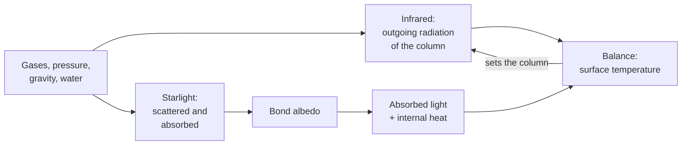

# How does a planet's air set its outgoing heat and its albedo?

Seen from: the planet card (the mean surface temperature, the Bond albedo
and the cause trees that explain them), and every body whose temperature
depends on its air.

## Short answer

A planet warms until it sends out as much infrared as it absorbs of its
star's light. Its air decides both halves. In the infrared, gases such as
water vapour and carbon dioxide are opaque in some colours and clear in
others, so the heat leaves from high, cold layers instead of from the warm
ground: that is the greenhouse effect. In starlight, the air scatters part
of the light back to space (the Rayleigh scattering of the gas, the
clouds, a haze or an acid deck) and absorbs another part (mostly near
infrared), which fixes how much the planet absorbs: its Bond albedo. The
app computes both halves colour by colour, from the gases a planet holds.
Water adds a limit of its own: a wet planet cannot radiate more than about
280 W/m², however hot it gets.

## The science

### A planet is a balance

A planet at the distance where its star gives the flux $S$ (W/m²) reflects
the share $A$ of it, its Bond albedo, and has an internal heat flux $q$
(W/m²). It settles at the surface temperature for which the outgoing
longwave radiation (OLR) of its column of air matches what it absorbs.
With $\sigma$ the Stefan–Boltzmann constant:

```math
\text{OLR}(T_s) = \frac{S\,(1-A)}{4} + q
```

The 4 is the ratio of the planet's surface to the disc it shows its star.
The equilibrium temperature $T_\text{eq}$ is the one a black body would
have for the same right-hand side, $\sigma T_\text{eq}^4 = S(1-A)/4$. The
article on the [habitable zone](habitable-zone.md) uses $T_\text{eq}$ and
the albedo as given. Here they come from the air.

**In words.** Without air, the OLR is $\sigma T_s^4$ and the surface sits
at $T_\text{eq}$. Air changes the OLR function (the greenhouse effect,
which pushes $T_s$ above $T_\text{eq}$) and the albedo (which moves
$T_\text{eq}$).

**Orders of magnitude.** Earth absorbs about 240 W/m² and radiates it at
$T_\text{eq}$ = 254 K, but its surface is at 288 K. Its Bond albedo is
0.293 from CERES: 99.7 W/m² reflected of 340.2 (Stephens et al. 2015),
or 99.1 of 340.0 (0.2915; Kato et al. 2018).



### The outgoing infrared of a column

Take a column of air, from the surface up. In one narrow band of
wavenumbers, a layer of optical depth $\tau$ lets through the share
$e^{-D\tau}$ of the radiation that crosses it, where $D$ = 1.66 is the
diffusivity factor: light crosses the layer along slanted paths, not
straight up, and 1.66 (the inverse of a mean cosine of 3/5) stands for the
average of them (Elsasser 1942; Koll et al. 2023, who take the same 3/5).
Each layer sends out its own Planck flux, and the layers above it dim that
flux. Summed over the layers and over all the bands, this is the OLR.

```math
\text{OLR} = \sum_\text{bands} \left[\pi B_\nu(T_s)\,\mathcal{T}_{s}
  + \sum_\text{layers}\pi B_\nu(T_i)\,\left(\mathcal{T}_{i-1}-\mathcal{T}_{i}\right)
  \right]
```

Here $B_\nu(T)$ is the Planck function, $\mathcal{T}_i$ the transmission
to space from the top of layer $i$ (and $\mathcal{T}_s$ from the ground),
so $\mathcal{T}_{i-1}-\mathcal{T}_i$ is the share of the radiation that
layer $i$ lets out.

**In words.** In a band where the air is clear, the ground's heat goes
straight to space. In a band where it is opaque, the heat that escapes
comes from a layer high enough to be clear above it, which is colder, so
less of it escapes. A greenhouse gas lowers the OLR for a given surface
temperature.

**Orders of magnitude.** Earth's clear-sky OLR is 264 W/m² in the CERES
EBAF Ed2.8 technical note and 267.9 W/m² in Ed4, July 2005 to June 2015
(Kato et al. 2018, Table 5; 265.4 in Ed2.8 over the same years).

### The temperature of the column

The temperature of the layers is not free: the lower air is mixed by
convection, so it follows an adiabat. Without condensation, a parcel
that rises cools along the dry adiabat of its gas mixture, set by the heat
capacities of its gases (NIST/JANAF values, Chase 1998). When the water
vapour of the parcel saturates, it condenses and releases its latent heat,
and the parcel follows the moist adiabat instead
(Pierrehumbert 2010, §2.7). With $r$ the vapour's mass mixing ratio, $L$
its latent heat, $R_a$ and $c_{pa}$ the gas constant and the heat capacity
of the dry air, and $R_v$ the vapour's gas constant, the slope of
temperature against the dry air's pressure $p_a$ is:

```math
\frac{d\ln T}{d\ln p_a} = \frac{R_a}{c_{pa}}\,
  \frac{1 + \dfrac{L\,r}{R_a T}}
       {1 + \left(\dfrac{c_{pv}}{c_{pa}}
          + \left(\dfrac{L}{R_v T} - 1\right)\dfrac{L}{c_{pa}T}\right) r}
```

Pierrehumbert's equation number for it (2.33) is quoted from a secondary
source: the book itself was not opened for this article. The app writes the
slope per mole, so that it holds down to pure steam, where the column
follows the saturation curve $dT/d\ln p = R_v T^2/L$. Carbon dioxide does
the same in a cold, thick CO₂ air: where it reaches its own saturation (its
frost below its triple point, its liquid above), it condenses and the air
follows CO₂'s pseudo-adiabat (Kasting 1991, Appendix B, which
Kopparapu et al. 2013 follow "in the upper troposphere": the Appendix
itself is paywalled and was not read, only Kopparapu's statement of it).

**In words.** Condensation warms the rising air, so a moist air cools more
slowly with height than a dry one. Where the vapour is a large share of
the air, it cools hardly faster than the saturation curve itself.

Far above, the air stops cooling. A thin atmosphere that absorbs in the
infrared is, high enough, at the skin temperature, where it radiates as
much as it receives:

```math
T_\text{skin} = T_\text{eq}\,2^{-1/4} \approx 0.84\,T_\text{eq}
```

(Pierrehumbert 2010, §3.6). On Earth, the real tropopause sits at about
0.1 bar, the pressure where the air turns transparent to the heat that
the ground sends up; the same 0.1 bar is found on Titan and on the giant
planets (Robinson & Catling 2014).

### Water: saturation, humidity and the limit

The partial pressure of the vapour above liquid water cannot exceed the
saturation pressure $e_s(T)$. It follows the Clausius–Clapeyron law
(Pierrehumbert 2010, §2.6) at moderate temperatures, and the exact
saturation curve of IAPWS (Wagner & Pruß 1993, IAPWS SR1-86(1992)) over
the whole range up to the critical point, 647.096 K and 220.64 bar (IAPWS
SR1-86(1992)); below the triple point, the sublimation curve of ice Ih (Wagner
et al. 2011, IAPWS R14-08(2011)).

The moist adiabat takes its latent heat from the slope of the same curve,
$L = R T^2\,d\ln e_s/dT$ (Clausius–Clapeyron for an ideal vapour over a
condensate of negligible volume), so that the two always agree, as the
legacy single latent heat made them. Against the tables it is within
0.2 %: 43.99 kJ/mol at 300 K against 43.91 from IAPWS-95, and 51.14 kJ/mol
at 250 K against 51.13 for ice (Murphy & Koop 2005, *Q. J. R. Meteorol.
Soc.* 131, 1539, doi:10.1256/qj.04.94, their eq. 5). The ideal-vapour form
does not fall to zero at the critical point as the real latent heat does:
it holds 42.3 kJ/mol there and above.

A real troposphere is not saturated up to its top. Manabe & Wetherald
(1967) set the relative humidity to fall with the pressure $p$, from
its surface value $RH_s$ (0.77, from their model), with $Q = p/p_s$:

```math
RH = RH_s\,\frac{Q - 0.02}{1 - 0.02}
```

The formula and the 0.77 are quoted from the climate model `climlab`, which
follows Manabe & Wetherald, and from arXiv:2006.03098: the 1967 paper is
not open, and its equation number was not checked.

**Orders of magnitude.** Water's saturation pressure is about 1.7 kPa at
288 K, so Earth's surface air at 77 % relative humidity holds 1.3e-2 bar
of vapour (the legacy value, derived here; it is not a measured mean).

The key result for a wet planet is the **radiation limit**. In a saturated
column, the layers that radiate to space sit on the saturation curve, so
their temperature, and the heat they send out, hardly depend on how hot
the ground is. The OLR climbs with the surface temperature, then flattens
at a plateau, the Simpson–Nakajima limit (Nakajima et al. 1992): 282 W/m²
in the line-by-line model of Goldblatt et al. (2013), 283 W/m² in
Boukrouche et al. (2021, §III.1) and 280 W/m² in Hamano et al. (2015). A
planet that absorbs more than the plateau cannot balance until its steam
has lifted the radiating level well above its surface: it enters a
runaway greenhouse (see the
[habitable zone](habitable-zone.md)). The plateau is flat "between 300 and
1800 K in the 260 bar case, and between 300 and 1050 K in the 10 bar
case", and rises again past about 1500 K through the 4 µm window
(Boukrouche et al. 2021; Goldblatt 2015).

**Orders of magnitude.** An Earth that absorbs 240 W/m² is about 40 W/m²
below the plateau. It would need to absorb about 282 W/m², 17 % more light than
Earth gets, to start running away.

### Which gases absorb, and where

A grey gas, equally opaque in all colours, cannot hold Earth at 280 ppm,
the outer edge of the habitable zone, the moist plateau, Mars and Venus
together (three refits failed in the app's history). Real gases absorb in
bands:

- **Spectral lines.** Carbon dioxide and water vapour absorb in thousands
  of narrow lines, whose shape (Voigt: a Doppler core and Lorentz wings),
  strength and width depend on pressure and temperature. The line lists
  are those of HITRAN (Gordon et al. 2022; the app uses the HITRAN2024
  release). The opaque part of a CO₂ band widens only with the logarithm
  of the gas amount, which is why doubling CO₂ always adds about the same
  forcing (Romps et al. 2022).
- **Continua.** Far from the line centres, the lines' wings are weaker
  than a Lorentz profile ("sub-Lorentzian") and water vapour adds a
  continuum, whose self part grows with the square of the vapour's
  pressure and whose foreign part with the vapour times the other gases.
  The MT_CKD 4.3 model gives them (Mlawer et al. 2012), for lines cut off
  25 cm⁻¹ from their centre, as in the LBLRTM code. Without CO₂'s
  continuum, the app's column gave 94 W/m² instead of 73.5 for 8 bar of CO₂ at
  1.70 AU (Kopparapu et al. 2013: 67.4).
- **Collision-induced absorption (CIA).** Two molecules that collide form
  a brief dipole that absorbs where neither would alone. For CO₂ pairs,
  HITRAN's file `CO2-CO2_2024.cia` covers 1-4500 cm⁻¹ and belongs to
  HITRAN2024 (Terragni et al., in the HITRAN2024 CIA readme). It joins
  several sources: the roto-translational band, 1-750 cm⁻¹ (Gruszka &
  Borysow 1997), the dimer bands near 1150-1850 cm⁻¹ (Baranov et al. 2004;
  Terragni et al. 2025) and the overtone bands near 2500-4500 cm⁻¹
  (Baranov 2018; Tran et al. 2024). Its absorption goes with the square
  of the density.
- **Methane on Titan.** Methane and nitrogen make cold, thick air whose
  absorption is dominated by CIA over 0-650 cm⁻¹ (Courtin et al. 1995;
  McKay et al. 1991). The app has no spectral data for it: it uses a grey
  stand-in, described under the departures.

### The correlated-k method

Summing millions of lines band by band is too slow. Inside a narrow band,
what matters for the transmission is not where the lines are, but how
many wavenumbers have each absorption coefficient $k$. Sort the
coefficients of the band from the weakest to the strongest: the sorted
curve $k(g)$, with $g$ the cumulative share of the band, is smooth, and
a few intervals of $g$ describe it. The transmission of an absorber
amount $u$ then becomes a short sum:

```math
\mathcal{T}(u) = \int_0^1 e^{-k(g)\,u}\,dg \approx \sum_{i=1}^{G} w_i\,e^{-k_i u}
```

where $w_i$ is the weight (the width in $g$) of the $i$-th interval. When
the sorted spectra of two gases overlap in a band, the app combines their
$k$ sets as if the lines of one fell at random among those of the other:
the transmissions multiply, for each pair of $g$-points (Lacis & Oinas
1991, who describe the correlated-k method and the random overlap).

**In words.** Instead of a hundred thousand lines, each band keeps eight
numbers per pressure and temperature, and the transmission is eight
exponentials.

### Clouds in the infrared

A cloud layer radiates as a grey body from its top. For a share $f$ of the
sky covered by clouds whose top is at pressure $p_c$ and whose emissivity
is $\varepsilon$:

```math
\text{OLR} = (1-f)\,\text{OLR}_\text{clear} + f\,\text{OLR}_\text{cloudy}
```

The clouds' top sits at 580 hPa, the global annual mean of the ISCCP
cloud-top pressure (Rossow & Schiffer 1999, §6a and Table 4), that is
0.589 of Earth's mean surface pressure, 985.50 hPa (Trenberth & Smith
2005). The emissivity $\varepsilon = 1 - e^{-1.66\,\tau_{ir}}$ comes from
the visible optical thickness 3.8 and the empirical $\tau_{ir} = \tau/2$
of the same paper (§5): $\varepsilon$ = 0.957.

### The shortwave half: the Bond albedo

Starlight is visible and near infrared. The air does three things to it:
Rayleigh scattering, absorption (by water vapour and CO₂, from 0.7 µm
redward) and the scattering of clouds, hazes and decks. A planet's Bond
albedo is the share of all the starlight it reflects, over all directions
and all phases. It is also the *spherical albedo* of the planet, the
reflectance under light that comes from every direction, which is the
disc-average of the plane reflectance weighted by the light received
(Sobolev 1975, eq. 1.87, as cited by Zuluaga et al. 2022; the book itself
was not opened).

**The two-stream solution.** In a homogeneous layer of optical depth
$\tau$ and single-scattering albedo $\omega$, the two-stream approximation
follows an upward and a downward diffuse flux. With the hemispheric-mean
coefficients (Toon et al. 1989), $\gamma_1 = D(1-\omega/2)$ and
$\gamma_2 = D\omega/2$, with $D = 1.66$ in place of 2, and with
$\lambda = \sqrt{\gamma_1^2 - \gamma_2^2}$, the layer's reflectance and
transmittance are (Meador & Weaver 1980, eqs. 25 and 26, quoted from the
ECMWF `ecRad` code that implements them):

```math
R = \frac{\gamma_2\sinh\lambda\tau}
         {\lambda\cosh\lambda\tau + \gamma_1\sinh\lambda\tau},\qquad
T = \frac{\lambda}
         {\lambda\cosh\lambda\tau + \gamma_1\sinh\lambda\tau}
```

Stacking the layers, each with its own absorption and scattering, gives
the reflectance of the whole air over a surface of albedo $A_g$.

**In words.** A layer that only absorbs ($\omega = 0$) transmits
$e^{-D\tau}$ and reflects nothing; a layer that only scatters ($\omega = 1$)
reflects $(D/2)\tau/(1+(D/2)\tau)$ and absorbs nothing.

**Rayleigh scattering.** Molecules much smaller than the wavelength scatter
light with a cross-section that falls as $\lambda^{-4}$, so the blue is
scattered more than the red. For a gas of refractive index $n$, with $N$
the number density and $F_K$ the King factor that corrects for the
molecule's shape (Sneep & Ubachs 2005; He et al. 2021):

```math
\sigma(\lambda) = \frac{24\pi^3}{\lambda^4 N^2}
  \left(\frac{n^2-1}{n^2+2}\right)^2 F_K
```

The optical depth of a column of pressure $p$ is then $\tau_R = \sigma\,p /
(\mu\,m_u\,g)$, with $\mu$ the mean molecular mass of the gas, $m_u$ the
atomic mass unit and $g$ the gravity. On Earth, at 550 nm, this optical
depth is about 0.097 (Bucholtz 1995; the table was not opened).

**Orders of magnitude.** Per molecule, CO₂ scatters 2.51 times as much as
N₂ at 550 nm (2.52 at 532 nm), from the refractive indices and King
factors of He et al. (2021). Kopparapu et al. (2013, §2.2.1) write "2.5 times
better than air" (air scatters 2 to 3 % less than N₂ per molecule). This
makes a thick CO₂ air cool the planet by reflecting
its light, the cause of the maximum greenhouse.

**Absorption of the near infrared.** Past 0.7 µm, water vapour and CO₂
absorb in bands, with the same ingredients as in the infrared: a
correlated-k table of lines (in the app's case, built from the same HITRAN
lists), the MT_CKD continua and, for CO₂ pairs, CIA. The light that the air
absorbs is absorbed by the planet, so it counts as absorbed, not reflected.
This is why a red star's planet, whose light is mostly near infrared, has
a lower albedo: Kopparapu et al. (2013, §4.1) credit it to "the minimal
amount of Rayleigh scattering and the high near-IR absorption". Blue light
is only scattered here: ozone is not modelled.

**Orders of magnitude.** Earth's clear-sky air absorbs 72 ± 3 W/m² of the
340 that reach it, with its ozone and aerosols (Kim & Ramanathan 2008);
CERES gives 73.0 W/m² clear-sky and 77.1 all-sky (Kato et al. 2018).

**Clouds, hazes and decks.** The clouds of water cover 0.67 of Earth's sky
by the MODIS cloud mask (King et al. 2013); the GEWEX assessment gives
0.68 ± 0.03 (Stubenrauch et al. 2013). Venus is wrapped in a sulphuric
acid deck, with a Bond albedo of 0.76 (Haus et al. 2016). Titan has an
organic haze and a Bond albedo of about 0.265 (Li et al. 2011); such a
haze forms from the photochemistry of methane, and is cut off when CO₂
takes over: Trainer et al. (2006) find it still produced at a CH₄/CO₂
ratio of 0.33, and ended at a carbon-to-oxygen ratio of 0.6, which is a
CH₄/CO₂ ratio of 0.2.

### What we do not know

- The exact shape of a **cloud cover** on another planet: no dataset ties
  the cover to the vapour in a form that fits other worlds, so the app's
  law is a form of its own, calibrated on Earth (see the departures).
- The **line wings and the continua** of CO₂ and H₂O at high pressure and
  temperature are measured only in part; they are models (MT_CKD).
- The **moist plateau** is a model result: 280 to 283 W/m² from three
  models, and the shape of its peak ("overshoot", Goldblatt et al. 2013)
  is not given as a number in the text read.
- The **Bond albedo of Titan and of Venus** depends on the source: Venus
  0.76 from Haus et al. (2016), 0.80 ± 0.02 from Pioneer Venus.

## In the app

### What you see

The mean surface temperature of a rocky planet with an air, and the Bond
albedo that lights it, are the results of this page. Their cause trees
name the parts: the greenhouse of each gas, the clouds, the Rayleigh
scattering, the near-infrared absorption, a haze or a deck. A thicker CO₂
air warms a planet, up to the maximum greenhouse, then cools it; a wet
planet runs away when it absorbs more than the plateau.

### How it computes them

The `science` crate holds the laws of this page, ported from the legacy
generator (tag `legacy-final`) with their tests. The two engines that read
them are the system engine (the temperature) and the map generator (which
reads the forcings, never the central object's kind).

1. **The grid.** The column runs from the surface up a log-pressure grid,
   20 levels per decade, to a thousandth of the surface pressure and at
   least to $10^{-4}$ bar, with 80 levels per decade on the moist plateau.
   Its temperature follows the dry and moist adiabats above, down to the
   skin temperature $T_\text{eq}/2^{1/4}$.
2. **The infrared.** 250 bins of 20 cm⁻¹ from 0 to 5000 cm⁻¹ (a black
   body at 640 K emits 99.6 % of its light below 5000 cm⁻¹) and a tail
   past 5000 cm⁻¹ that takes the absorption of the last bin. In each bin,
   CO₂ and water lines (eight $g$-points each, overlapped at random), the
   water and CO₂ continua, CO₂ pairs and methane's stand-in set the
   transmission; the layers' mean Planck fluxes are summed with the
   diffusivity 1.66.
3. **The shortwave.** 240 bands, even in $\ln\lambda$, from 0.2 to 5 µm,
   weighted by the star's Planck spectrum (its effective temperature,
   5772 K for the Sun, IAU 2015 B3, Prša et al. 2016). The column has 3
   levels per decade up to 1 % of the surface pressure, clear. Each layer
   takes its absorption and its Rayleigh depth together in the two-stream
   solution above; the clouds sit at their ISCCP tops inside the column, so
   the vapour below absorbs only what they let through.
4. **The Bond albedo** takes the ground albedo as one input number. The
   surface cover (ice line, frost, icy age, ocean fraction, ice sheets)
   comes with the global climate, in a later change. For Earth, the ground
   albedo is the clear-sky surface albedo of CERES EBAF Ed4: 29.8 / 243.8 =
   0.122 (Kato et al. 2018, Table 5). The air's cloud, haze and deck terms
   then add to it.
5. **The balance** is solved for the surface temperature with the Bond
   albedo as a fixed point: the albedo reads the column (its humidity, its
   clouds), and the column reads the temperature.

Two tables hold the spectroscopy, built offline by
[`tools/opacity-table`](../../tools/opacity-table/README.md) and never by
the generator:

| Table | What it holds | Size |
| --- | --- | --- |
| `opacity.bin` | The infrared: CO₂ and water lines as 8 $g$-points in each 20 cm⁻¹ bin, on 15 pressures (1e-5 to 100 bar) and 16 temperatures (100 to 900 K), plus MT_CKD's CO₂ continuum | 3.8 MB |
| `shortwave.bin` (2b-2) | The same lines and sets on the 147 albedo bands from 0.7 to 5 µm (2000 to 14 364 cm⁻¹), plus MT_CKD's water and CO₂ continua | 1.8 MB |

Their inputs, versions, download dates and checksums, the regeneration
commands and the stale paths are in
[`crates/science/data/OPACITY.md`](../../crates/science/data/OPACITY.md),
which moves there with the port. The line lists are HITRAN2024 "as served"
(a later fetch may differ: the checksums of the inputs tell), the water
continuum is MT_CKD 4.3 (`absco-ref_wv-mt-ckd.nc`) and the CO₂ continuum is
LBLRTM's `contnm.f90` at commit `f66bb596` (MT_CKD 4.3). The CO₂ continuum
tail of `opacity.bin` was rebuilt independently from that file, with no
difference; the 101 water-continuum nodes of the infrared code agree with
the file to its four-digit rounding. The CIA table was rebuilt to 0.2 %
on 109 of its 139 rows, the rest being small cells at region edges. The
line part, 99.9 % of `opacity.bin`, cannot be rebuilt without the same
HITRAN fetch.

### Where the code lives

The longwave half is in `science` (change 2b-1); the shortwave half and
the Bond albedo follow in 2b-2.

- `crates/science/src/radiation/`: `column` (the grid, the adiabats, the
  skin temperature, the cloud greenhouse and `outgoing_longwave`),
  `spectrum` (the 250 bins, the lines, the water and CO₂ continua and the
  CO₂ pairs read from `co2-cia.tsv`), `ktable` (the reader of
  `opacity.bin`), `methane` (the grey stand-in), `clouds` (the cloud
  cover), `gases` (the partial pressures and the heat capacities) and
  `fast_math` (the single-precision exponential of the sum).
- `crates/science/src/water.rs` (the IAPWS saturation curve and latent
  heat) and `crates/science/src/volatiles.rs` (the CO₂ and methane ones).
- **The cache belongs to the caller.** `ColumnCache` holds the memo of the
  last 1 024 columns solved and the single-precision workspace of the sum
  (some 100 kB), and `outgoing_longwave` takes it by `&mut`. It replaces
  the legacy thread-local memo and scratch: `science` keeps no global
  state, and a caller runs one cache per thread of work. A cache hit
  returns the bit-identical value of a fresh column.
- **What 2b-1 ships:** the outgoing longwave radiation of a column, over
  any surface from 1 K to above water's critical point, with the cloud
  greenhouse, the falling humidity and the moist plateau. `opacity.bin`
  and `co2-cia.tsv` come with it; `shortwave.bin` does not.
- **What 2b-2 will ship:** the shortwave (the 240 bands, the two-stream
  solution), the Bond albedo and `shortwave.bin`. The column's `levels`
  and `Levels` types and `stratospheric_methane_bar` are already in
  `column`, kept for it.
- **Speed.** Against the legacy code, on 999 columns in a release build,
  the median of 5 runs is 1.008 times the legacy time.

### Where it departs from the science

**What the app simplifies.**

- **A single column.** One column, clear except for the cloud share, with
  a fixed stratosphere: no horizontal transport, no day-night or seasonal
  cycle, no three-dimensional effect. Leconte et al. (2013) find the
  runaway threshold at about 375 W/m² with a three-dimensional model,
  against 280 W/m² from the column.
- **The runaway convention.** A wet surface runs away when what it absorbs
  exceeds the most its *saturated* column sends out. Below that, its
  balance is solved on the falling-humidity column. This follows the
  practice of Kasting and Kopparapu: a saturated troposphere for the inner
  edge, Manabe & Wetherald's for temperate climates. Kopparapu et al.
  (2013, §3.1) use "a fully saturated troposphere that maximizes the
  greenhouse effect", and do not use the Manabe–Wetherald profile (it
  appears only in their reference list). The app attributes the falling
  humidity to Manabe & Wetherald only.
- **Methane's grey stand-in.** Methane takes one grey optical depth over
  0-650 cm⁻¹, $\tau = k\,(uB)^{1/2}$, with $u$ its saturated amount, $B$
  the air it collides with and $k$ = 13.4. It was calibrated on Titan's
  surface, 93.65 ± 0.25 K at 1467 hPa (Fulchignoni et al. 2005), with 5.65 %
  of methane at the surface (Niemann et al. 2010) and the greenhouse of
  +21 K and anti-greenhouse of −9 K of McKay et al. (1991).
  What was searched: spectral CIA tables of N₂–N₂ and N₂–CH₄ exist in
  HITRAN, and would give the spectral Titan; they were not extracted. The
  saturated methane amount (0.01 bar), the share of methane's near-infrared
  layer and the cold-trap construction that fixes it (the saturation
  pressure at the skin temperature, over the tropopause pressure) are the
  app's own model: each ingredient is sourced, the combination is not.
- **The cloud's water, the deck and the haze.** These are calibrations,
  not laws. What was searched and not found:
  - *Cloud cover.* The cover is $RH^{0.25}\,(1 - e^{-p_{H_2O}/p_c})$ with
    $p_c$ = 0.01 bar. The $RH^{0.25}$ factor is Xu & Randall's (1996)
    cloudiness, as coded in NCEP's physics; their second factor, a
    condensate over a saturation deficit, is replaced by the exponential.
    No dataset ties cloud cover to the column vapour in a form usable for
    other planets. Earth's 1.26e-2 bar of vapour is 77 % relative humidity
    over the saturation pressure at 288 K, the rounded mean surface
    temperature the tests take as their Earth case. The 77 % is the surface
    relative humidity of Manabe & Wetherald 1967 (equation 2), the same
    figure as the column's test profile; the paper is paywalled and the
    value is confirmed indirectly (below).
  - *Sulphuric deck.* The deck appears from 1e-3 bar of SO₂ in a surface
    above 273.15 K, over a share of the disc that grows over 40 K. The
    sourced route is the binary H₂SO₄–H₂O condensation (Zeleznik 1991;
    Dai et al. 2022), not done here. Venus's albedo, 0.76, is Haus et al.'s.
    The 40 K onset width is a solver-stability choice with no data behind it.
  - *Haze.* Titan's haze albedo (0.25) and absorption (0.55) are a
    fit to a Bond albedo of 0.265 (Li et al. 2011); the split between the
    two is a fit choice. The 0.01 bar of methane and the CH₄/CO₂ cut-off of
    0.2 (Trainer et al. 2006) set when it appears. A sourced route would be
    the Huygens DISR aerosol model (Tomasko et al. 2008) and the newer
    Bond albedo of Creecy et al. (2021).
- **Numerical choices with no source.** The $g$-split of eight intervals
  (edges 0, 0.3, 0.6, 0.8, 0.9, 0.96, 0.99, 0.998, 1, narrow where the line
  cores make $k(g)$ steep: Lacis & Oinas 1991 describe the method, not
  these edges), 20 levels per decade, the top share of the column
  ($10^{-3}$ of the surface pressure, at least $10^{-4}$ bar, which keeps
  water's emitting levels inside), 80 levels on the plateau, the opaque
  cut-off $e^{-40}$, the 0.2-5 µm range and 240 bands (they miss 4.5 % of
  the light of a 2600 K star, 0.7 % of the Sun's, which the code
  renormalises away), the 0.1 slant-depth threshold under which a
  $g$-point is merged, the 20 cm⁻¹ bin width and the sizes of the memos.
  Each has a convergence test: levels per decade against a grid 2.5 times
  finer (0.13-0.21 W/m²), the plateau grid against twice as many levels
  (under 0.5 W/m²; a heavy test, run with `mise run test:heavy` and not in
  CI), the shortwave levels against 16 per decade (albedo under
  1e-3, absorption under 1 W/m²), halving the bins (0.006 W/m² on the
  forcing). The tests compare the model with itself: they prove the
  numerics converge, not that the physics is right. No convergence test
  yet covers the column's top share.

**Changes from the legacy model.** The port changes these on purpose, after
a literature check of every number and citation (the full audit is in the
[Wiki study](https://github.com/cyboooooorg/map-generator/wiki/19-radiative-transfer-audit)):

- **Water saturation.** The legacy curve held the latent heat at
  2.4e6 J/kg. It overshot the real saturation pressure by 58 % at 600 K
  and gave 367 bar at the critical point instead of 220.64. The app now
  uses the IAPWS saturation curve (Wagner & Pruß 1993; sublimation of
  ice Ih after Wagner et al. 2011 below the triple point).
- **Scope of the Bond albedo.** It takes one ground albedo. The cloud
  albedo is refitted in two steps: first the clear-sky top-of-atmosphere
  albedo of Earth, 0.149 (Stephens et al. 2015) to 0.156 (Kato et al.
  2018), which tests the ground, the Rayleigh scattering and the
  absorption without the clouds; then the all-sky Bond albedo, 0.293
  (Stephens et al. 2015; Kato et al. 2018: 0.2915). The legacy fitted 0.30,
  a pre-satellite value, 0.007 to 0.01 too high.
- **Rayleigh.** The cross-section of each gas comes from its refractive
  index and King factor (He et al. 2021, with the per-gas sources it
  gives), not from the square of a static polarizability. The old rule gave
  O₂ 16 % too low against N₂ (0.82 against 0.973 per molecule); the
  new one gives CO₂/N₂ = 2.5 per molecule, as Kopparapu et al. (2013,
  §2.2.1) say.
- **Heat capacity of NH₃** is 35.65 J/(mol·K) (NIST Shomate), where the
  legacy had a transposed 35.06.
- **Clear-sky air absorption** is checked against 72-73 W/m² (Kim &
  Ramanathan 2008; CERES 73.0), not "about 70".
- **Citations** are corrected where they were wrong: the DOIs of Meador &
  Weaver 1980, Haus et al. 2016 and Li et al. 2011; the sections of
  Pierrehumbert 2010 (the skin temperature is §3.6, phase change §2.6);
  Niemann et al. 2010 for Titan's 5.65 % of methane; the CO₂ CIA file
  documented by HITRAN2024; Kopparapu et al. no longer credited with the
  Manabe–Wetherald profile, nor with 34.9 bar at 273 K (they write 37.8
  and 35 bar).

**A check that is not like for like, and a known gap.** The test that
doubling CO₂ forces 3.7 ± 0.6 W/m² (Myhre et al. 1998) compares an
instantaneous, clear-sky change of the outgoing radiation at fixed
temperatures with a global-mean, cloudy-sky, stratosphere-adjusted
forcing at the tropopause, which is usually larger. It is a plausibility
band, checked on the legacy test profile (3.41 W/m² for 280 to 560 ppm).
On the AFGL mid-latitude summer profile (Anderson et al. 1986, read in
libRadtran's `data/atmmod/afglms.dat`, mirror
`https://github.com/ashiklom/libradtran` at commit `208f5465`, SHA-256
in the Sources), with RTMIP's 287 to 574 ppm and 294 K surface, the
like-for-like quantity is the instantaneous clear-sky forcing at the top
of the model of RTMIP's line-by-line codes: 2.80 W/m², standard
deviation 0.06 (Collins et al. 2006, Table 8, case 2b-1a). The column
gives 3.01 W/m², 3.4 standard deviations above it and the same on a
profile refined tenfold: outside both 2.80 ± 0.12 and the 3.7 ± 0.6
band. It departs from RTMIP's set-up: it holds no ozone (RTMIP keeps the
profile's O₃), N₂ stands in for the O₂ RTMIP removes as CO₂ grows, and
it sums 0-5000 cm⁻¹ where the line-by-line codes take 4-100 µm. The
candidate causes are untested: the missing ozone, the error of the
k-distribution against line-by-line, and the table's CO₂ line shape or
continuum. Issue #643 tracks it.

**Sources the audit could not read.** Kasting 1991 (Appendix B), Manabe &
Wetherald 1967 (equation 2), Pierrehumbert 2010 (equation 2.33), Bucholtz
1995 (the table), the CRC polarizabilities and Sobolev 1975 are behind
paywalls or out of print. For each, the audit found an indirect
confirmation, named above (Kopparapu et al. 2013 for the first; `climlab`
and arXiv:2006.03098 for the second; a search result of arXiv:2210.05963
for the third; the refractive-index derivation of He et al. 2021 for the
fourth; Zuluaga et al. 2022 for the last), and the article says so where it
uses them.

## Sources

1. Anderson, G. P., Clough, S. A., Kneizys, F. X., Chetwynd, J. H.,
   Shettle, E. P. 1986, *AFGL Atmospheric Constituent Profiles (0-120
   km)*, Tech. Rep. AFGL-TR-86-0110, Air Force Geophys. Lab. (as cited by
   Collins et al. 2006; the mid-latitude summer profile read in
   libRadtran's `afglms.dat`, SHA-256
   `875ada621ca86fb24ed49bbca44e540e9bfe81e2a2af7760a8ce7de991652b14`).
2. Baranov, Y. I. 2018, *J. Mol. Spectrosc.* 345, 11,
   doi:10.1016/j.jms.2017.11.005.
3. Baranov, Y. I., Lafferty, W. J., Fraser, G. T. 2004, *J. Mol. Spectrosc.*
   228, 432, doi:10.1016/j.jms.2004.04.010.
4. Boukrouche, R., Lichtenberg, T., Pierrehumbert, R. T. 2021, *ApJ* 919,
   130, doi:10.3847/1538-4357/ac1345, arXiv:2107.14150.
5. Bucholtz, A. 1995, *Appl. Opt.* 34, 2765, doi:10.1364/AO.34.002765.
6. Chase, M. W. 1998, *NIST-JANAF Thermochemical Tables*, 4th ed., *J.
   Phys. Chem. Ref. Data* Monograph 9, through the NIST WebBook
   (<https://webbook.nist.gov>).
7. Collins, W. D. et al. 2006, "Radiative forcing by well-mixed
   greenhouse gases: estimates from climate models in the IPCC AR4",
   *J. Geophys. Res.* 111, D14317, doi:10.1029/2005JD006713.
8. Courtin, R., Gautier, D., McKay, C. P. 1995, *Icarus* 114, 144 (cited
   for the position of Titan's collision-induced bands; not retrieved for
   this article).
9. Creecy, E. et al. 2021, *Geophys. Res. Lett.*,
   doi:10.1029/2021GL095356.
10. Dai, L. et al. 2022, *J. Geophys. Res. Planets* 127, e2021JE007060,
   arXiv:2207.10238.
11. Elsasser, W. M. 1942, *Heat Transfer by Infrared Radiation in the
   Atmosphere*, Harvard Meteorological Studies 6 (no DOI).
12. Fulchignoni, M. et al. 2005, *Nature* 438, 785 (no DOI checked).
13. Goldblatt, C., Robinson, T. D., Zahnle, K. J., Crisp, D. 2013, *Nature
    Geosci.* 6, 661, doi:10.1038/ngeo1892.
14. Goldblatt, C. 2015, *Astrobiology* 15, 362, doi:10.1089/ast.2014.1268,
    arXiv:1503.04835.
15. Gordon, I. E. et al. 2022, *J. Quant. Spectrosc. Radiat. Transf.* 277,
    107949, doi:10.1016/j.jqsrt.2021.107949 (HITRAN2020), and Gordon, I. E.
    et al. 2026, *J. Quant. Spectrosc. Radiat. Transf.* 353, 109807,
    doi:10.1016/j.jqsrt.2026.109807 (HITRAN2024, the release the app
    reads).
16. Gruszka, M., Borysow, A. 1997, *Icarus* 129, 172,
    doi:10.1006/icar.1997.5773.
17. Hamano, K., Kawahara, H., Abe, Y., Onishi, M., Hashimoto, G. L. 2015,
    *ApJ* 806, 216, doi:10.1088/0004-637X/806/2/216, arXiv:1505.03552.
18. Haus, R. et al. 2016, *Icarus* 272, 178,
    doi:10.1016/j.icarus.2016.02.048.
19. He, Q. et al. 2021, *Atmos. Chem. Phys.* 21, 14927,
    doi:10.5194/acp-21-14927-2021.
20. HITRAN collision-induced absorption, 2024 files:
    `CO2-CO2_2024.cia`, <https://hitran.org/cia/>, documented by Terragni,
    Gordon et al., "Collision Induced Absorption in HITRAN2024: Enhanced and
    Improved Data for Atmospheric and Astrophysical Applications", through
    <https://hitran.org/data/CIA/CIA_Readme_2024.pdf>.
21. IAPWS R6-95 (2016 revision), *Release on the IAPWS Formulation 1995
    for the Thermodynamic Properties of Ordinary Water Substance*,
    <https://iapws.org/documents/release/IAPWS-95.download>.
22. IAU 2015 Resolution B3; Prša, A. et al. 2016, *Astron. J.* 152, 41,
    doi:10.3847/0004-6256/152/2/41, arXiv:1605.09788.
23. Kasting, J. F. 1991, *Icarus* 94, 1, doi:10.1016/0019-1035(91)90137-I.
24. Kato, S. et al. 2018, *J. Climate* 31, 4501,
    doi:10.1175/JCLI-D-17-0523.1.
25. Kim, D., Ramanathan, V. 2008, *J. Geophys. Res.* 113, D02203,
    doi:10.1029/2007JD008434.
26. King, M. D. et al. 2013, *IEEE Trans. Geosci. Remote Sens.* 51, 3826,
    doi:10.1109/TGRS.2012.2227333.
27. Koll, D. D. B., Jeevanjee, N., Lutsko, N. J. 2023, *J. Atmos. Sci.* 80,
    1923, doi:10.1175/JAS-D-22-0178.1.
28. Kopparapu, R. K. et al. 2013, *ApJ* 765, 131,
    doi:10.1088/0004-637X/765/2/131, arXiv:1301.6674.
29. Lacis, A. A., Oinas, V. 1991, *J. Geophys. Res.* 96, 9027,
    doi:10.1029/90JD01945.
30. Leconte, J. et al. 2013, "Increased insolation threshold for runaway
    greenhouse processes on Earth-like planets", *Nature* 504, 268,
    doi:10.1038/nature12827, arXiv:1312.3337.
31. Li, L. et al. 2011, *Geophys. Res. Lett.* 38, L23201,
    doi:10.1029/2011GL050053.
32. Loeb, N. G. et al. 2018, *J. Climate* 31, 895,
    doi:10.1175/JCLI-D-17-0208.1.
33. Manabe, S., Wetherald, R. T. 1967, *J. Atmos. Sci.* 24, 241,
    doi:10.1175/1520-0469(1967)024<0241:TEOTAW>2.0.CO;2.
34. McKay, C. P., Pollack, J. B., Courtin, R. 1991, *Science* 253, 1118,
    doi:10.1126/science.11538492.
35. Meador, W. E., Weaver, W. R. 1980, *J. Atmos. Sci.* 37, 630,
    doi:10.1175/1520-0469(1980)037<0630:TSATRT>2.0.CO;2.
36. Mlawer, E. J. et al. 2012, *Phil. Trans. R. Soc. A* 370, 2520,
    doi:10.1098/rsta.2011.0295. Release MT_CKD_H2O 4.3:
    <https://github.com/AER-RC/MT_CKD_H2O/releases/tag/4.3>.
37. Myhre, G., Highwood, E. J., Shine, K. P., Stordal, F. 1998, *Geophys.
    Res. Lett.* 25, 2715, doi:10.1029/98GL01908.
38. Nakajima, S., Hayashi, Y.-Y., Abe, Y. 1992, *J. Atmos. Sci.* 49, 2256,
    doi:10.1175/1520-0469(1992)049<2256:ASOTGE>2.0.CO;2.
39. Niemann, H. B. et al. 2010, *J. Geophys. Res. Planets* 115, E12006,
    doi:10.1029/2010JE003659.
40. Pierrehumbert, R. T. 2010, *Principles of Planetary Climate*,
    Cambridge University Press: §2.6 (phase change), §2.7 (the moist
    adiabat), §3.6 (the skin temperature).
41. Robinson, T. D., Catling, D. C. 2014, *Nature Geosci.* 7, 12,
    doi:10.1038/ngeo2020, arXiv:1312.6859.
42. Romps, D. M., Seeley, J. T., Edman, J. P. 2022, *J. Climate* 35, 4027,
    doi:10.1175/JCLI-D-21-0275.1.
43. Rossow, W. B., Schiffer, R. A. 1999, *Bull. Am. Meteorol. Soc.* 80,
    2261, doi:10.1175/1520-0477(1999)080<2261:AIUCFI>2.0.CO;2.
44. Sneep, M., Ubachs, W. 2005, *J. Quant. Spectrosc. Radiat. Transf.* 92,
    293, doi:10.1016/j.jqsrt.2004.07.025.
45. Sobolev, V. V. 1975, *Light Scattering in Planetary Atmospheres*,
    Pergamon (no DOI). Equation 1.87, as cited by Zuluaga, Sucerquia,
    Alvarado-Montes 2022, arXiv:2207.08636.
46. Stephens, G. L. et al. 2015, *Rev. Geophys.* 53, 141,
    doi:10.1002/2014RG000449.
47. Stubenrauch, C. J. et al. 2013, *Bull. Am. Meteorol. Soc.* 94, 1031,
    doi:10.1175/BAMS-D-12-00117.1.
48. Terragni, J. et al. 2025, *J. Quant. Spectrosc. Radiat. Transf.* 346,
    109595, doi:10.1016/j.jqsrt.2025.109595.
49. Tomasko, M. G. et al. 2008, *Planet. Space Sci.* 56, 669.
50. Toon, O. B., McKay, C. P., Ackerman, T. P., Santhanam, K. 1989, *J.
    Geophys. Res.* 94, 16287, doi:10.1029/JD094iD13p16287.
51. Trainer, M. G. et al. 2006, *Proc. Natl. Acad. Sci.* 103, 18035,
    doi:10.1073/pnas.0608561103.
52. Tran, H., Hartmann, J.-M., Rambinison, Turbet, M. 2024, *Icarus* 422,
    116265, doi:10.1016/j.icarus.2024.116265.
53. Trenberth, K. E., Smith, L. 2005, *J. Climate* 18, 864,
    doi:10.1175/JCLI-3299.1.
54. Wagner, W., Pruß, A. 1993, *J. Phys. Chem. Ref. Data* 22, 783,
    doi:10.1063/1.555926 (the saturation equations of IAPWS
    SR1-86(1992)); Wagner, W., Riethmann, T., Feistel, R., Harvey, A. H.
    2011, *J. Phys. Chem. Ref. Data* 40, 043103, doi:10.1063/1.3657937
    (sublimation pressure of ice Ih, IAPWS R14-08(2011)).
55. Wild, M. et al. 2019, *Clim. Dyn.*, doi:10.1007/s00382-018-4413-y
    (cited for Kato et al.'s clear-sky OLR).
56. Xu, K.-M., Randall, D. A. 1996, *J. Atmos. Sci.* 53, 3084,
    doi:10.1175/1520-0469(1996)053<3084:ASCPFU>2.0.CO;2.
57. Zeleznik, F. J. 1991, *J. Phys. Chem. Ref. Data* 20, 1157,
    doi:10.1063/1.555899.
58. Zuluaga, J. I. et al. 2022, arXiv:2207.08636 (for Sobolev's relation).

## See also

- [What is the habitable zone?](habitable-zone.md): the edges that this
  page's plateau and maximum greenhouse produce.
- [What decides whether a world has an atmosphere?](atmospheres.md)
- [Planet atmospheres](planet-atmospheres.md): the legacy description of
  the same chain (climate column, absorbers, albedo, near-infrared
  absorption), kept until it is rewritten.
- The audit of every number and citation of this page, in the Wiki:
  [Study: radiative transfer audit](https://github.com/cyboooooorg/map-generator/wiki/19-radiative-transfer-audit).
- [`crates/science/data/OPACITY.md`](../../crates/science/data/OPACITY.md):
  provenance of `opacity.bin` and `shortwave.bin`.
