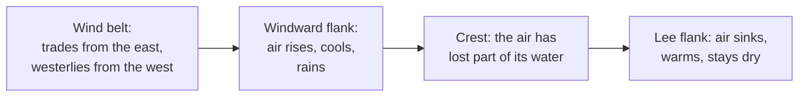

# Why is one side of a mountain range dry?

Seen from: the planet view, through the **Moisture** layer (from "arid" to
"wet") and the **Biomes** layer, where forest or jungle on one flank of a
range faces shrubland or desert on the other; and the **Moisture** line of
the point information (−1 arid · 1 wet).

## Short answer

Wind that meets a mountain range has to climb it. Rising air expands and
cools, and cool air holds less water vapour, so the vapour condenses into
cloud and falls as rain or snow on the side the wind comes from. Over the
crest the air sinks, warms up again and arrives on the far side warm and
dry: that side lies in a *rain shadow*. Which side is wet depends on the
planet's prevailing winds: westerlies at mid-latitudes, easterly trade
winds in the tropics.

## The science


### Rising air cools

A parcel of air that rises meets lower pressure, expands and cools, without
exchanging heat with its surroundings. While it is not saturated it cools
at the *dry adiabatic lapse rate*, set by gravity $g$ and the heat capacity
of air at constant pressure $c_p$:

```math
\Gamma_d = \frac{g}{c_p}
```

**In words.** Every kilometre a dry parcel rises, it loses the same number
of degrees, whatever its starting temperature.

**Orders of magnitude.** With $g = 9.81$ m/s² and $c_p = 1004$ J/(kg K),
$\Gamma_d$ is 9.8 °C per kilometre, the value the US National Weather
Service gives for "parcels that remain unsaturated during lifting". The
real atmosphere around a parcel cools more slowly with height: about
6.5 °C per kilometre in the standard atmosphere, whose temperature in the
troposphere is $T = 15.04 - 0.00649\,h$ (°C, $h$ in metres; NASA Glenn
Research Center).

### Cool air holds less water

Air is saturated when the pressure of its water vapour reaches the
saturation vapour pressure $e_\text{sat}$, which depends only on the
temperature $T$ in °C (Roe 2005, eq. 1, after Bolton 1980):

```math
e_\text{sat}(T) = 6.112\,\exp\!\left(\frac{17.67\,T}{243.5 + T}\right)
\ \text{hPa}
```

**In words.** The vapour air can hold grows steeply with temperature.
Roe (2005) gives the rule of thumb: "a decrease of 10 °C halves the
saturated moisture content of the atmosphere", and 30 °C reduces it by an
order of magnitude.

**Orders of magnitude.** At 20 °C saturated air holds 23 hPa of vapour,
at 0 °C only 6.1 hPa. Because air cools as it rises, the vapour saturated
air can carry falls by a factor e (2.7) about every 4 km of height in the
tropics and every 2 km at high latitudes (Roe 2005).

Once the parcel is saturated, further lifting condenses vapour. The rate
of condensation is the upward speed $w$ times how fast the saturated
vapour density $\rho q_\text{sat}$ falls with height $z$ (Roe 2005,
eq. 5):

```math
C \simeq -w\,\frac{\partial(\rho q_\text{sat})}{\partial z}
```

Condensation releases latent heat, so a saturated parcel cools more slowly
than a dry one. This *moist adiabatic lapse rate* is not a constant: it
depends on the parcel's temperature and pressure (National Weather Service
glossary). Computed from the standard formula for a saturated adiabat, it
is about 4 °C per kilometre for saturated air at 20 °C near sea level and
6.5 °C per kilometre at 0 °C: warm, moist air releases more heat.

### The windward side and the lee

Where the wind meets a range, the ground forces it up. In the classic
picture, "the windward flank of the mountain range receives much more
precipitation than the leeward flank, resulting in the well-known rain
shadow" (Roe 2005). For large ranges the wettest place is on the windward
flank, short of the crest; for small hills it is closer to the crest. The
upslope model works well "at spatial scales greater than approximately
40 km, and for mountain ranges exceeding approximately 1.5 km in height"
(Roe 2005).

The air that crosses the crest has left part of its water behind. As it
sinks down the lee slope it warms at the dry rate, since nothing is
condensing any more. Having cooled more slowly on the way up than it warms
on the way down, it arrives warmer and drier than it set out: the warm,
dry *foehn* wind of the lee side (Elvidge & Renfrew 2016).

**Orders of magnitude.** The diagram follows a parcel that leaves the sea
at 20 °C with 60 % relative humidity, computed with the rates above. It
saturates at 1 km, at 10 °C. By the crest at 3 km it is at −0.6 °C and 40 %
of its vapour has condensed. If all of it rains out, the parcel comes down
the lee slope to sea level at 28.7 °C with 21 % relative humidity. On the
Southern Alps of New Zealand, in the westerlies, 2 to 3 m of rain a year
fall on the western lowlands, 11 to 12 m about 20 km upwind of the
divide, and less than 1 m on the eastern plains (Roe 2005).

### Which side is windward: the wind belts

The side that gets the rain is the side the prevailing wind comes from.
Earth's surface winds come in belts:

- **Trade winds**, "the prevailing easterly winds that circle the Earth
  near the equator", between about 30° north and 30° south (NOAA National
  Ocean Service). They are the low branch of the Hadley cells: air rises
  near the equator and moves polewards aloft (NOAA JetStream).
- **Westerlies** between 35° and 60° north and south (NOAA JetStream).
- **Polar easterlies**, blowing out of the polar highs (NOAA JetStream).

Between the trades and the westerlies, around 30°, lies a band of high
pressure where air sinks: hence "the number of deserts located along the
30°N/S latitude around the world" (NOAA JetStream).



So on Earth a mid-latitude range is wet on its western side, and a
tropical range on its eastern side. Other planets need not have the same
belts: Kaspi & Showman (2015) find that the rotation rate, the star's
light and the mass of the atmosphere all change the circulation.

### Three ranges

- **The Andes and the Atacama.** Between 15° and 27° S the rain on the
  western slope of the central Andes comes from summer storms out of
  Amazonia, from the east, and decreases downhill: "the west slope of the
  central Andes exhibits a pronounced rainshadow effect" (Houston &
  Hartley 2003). The hyper-arid core of the Atacama runs from 15° to 30° S,
  from sea level to 3500 m. Its aridity grew with the uplift of the Andes,
  together with the cold, upwelling Peruvian Current offshore (Houston &
  Hartley 2003). Shielded by two ranges, "many decades can pass between
  rains in the high central valley of the Atacama desert of Chile" (Roe
  2005).
- **The Himalaya and Tibet.** Here the moist air comes from the south,
  with the summer monsoon. Satellite rainfall shows "wet Indian plains,
  the dry interior of Tibet, an intense band of precipitation along the
  southern flank of the Himalayas" (Roe 2005). Bookhagen & Burbank (2006)
  find two bands of maximum rain along the range, one at a mean elevation
  of 0.9 ± 0.4 km on the Lesser Himalaya, one at 2.1 ± 0.3 km on the
  Greater Himalaya. Cherrapunji, in the Khasi hills of India, recorded
  26.5 m of rain in 1860–1861 (Roe 2005).
- **The Cascades.** Washington State's Cascade Mountains "exhibit a strong
  orographic rain shadow, with much wetter western slopes than eastern
  slopes due to prevailing westerly flow during the winter storm season"
  (Siler, Roe & Durran 2013). The shadow is stronger in La Niña winters
  and weaker in El Niño winters.

### What we do not know

- **How deep the shadow is.** Roe (2005) calls a rain shadow across a range
  perpendicular to the wind "one of the most confident expectations in
  atmospheric science", but adds that "the amplitude of the rain shadow
  and the relationship between orography and precipitation at smaller
  spatial scales are much more complex questions, and the subject of
  active research". The Alps, for example, have no well-defined rain
  shadow: rain peaks on both their northern and southern flanks (Roe
  2005).
- **Why foehn air is warm.** The textbook story above (rain on the way up,
  dry warming on the way down) is one of three mechanisms. Elvidge &
  Renfrew (2016) show that warmer air drawn down from aloft and turbulent
  mixing also warm the lee, and that "depending on the flow dynamics, any
  of the three warming mechanisms can dominate".

## In the app

### What you see

- **The Moisture layer** colours every pixel from arid (−1) to wet (1).
  The scale is the base-2 logarithm of the year's rain: 125 mm a year at
  −1, 1000 mm at 0, 8000 mm at 1, so each doubling of the rain is a third
  of a unit. Behind a range, along the wind, a drier band runs downwind; on
  the slopes facing the wind, a wetter one.
- **The Biomes layer** turns moisture into vegetation at each temperature:
  desert or shrubland where the rain is below Köppen's dryness limit,
  savanna or jungle in the tropics, plain or forest in temperate land,
  tundra or taiga in the boreal zone. The air that comes down the lee of
  a range is warmer, which the Temperature layer shows.
- **The point information** gives the **Moisture** of the pixel clicked.
- While a world is generated, the stage "Blowing winds and rain" is this
  calculation.

### How it computes them

The moisture pass runs once the temperatures are set:

1. **Wind belts.** Earth's pattern is three belts per hemisphere with edges
   at 30° and 60°: trade winds from the east, westerlies, polar easterlies.
   A planet gets the same pattern stretched between its own edges. The edge
   of the Hadley cell goes as $30^\circ \times (\text{day} / 24\ \text{h})
   \times (C_\oplus / C)$, with $C$ the circumference, so it scales as
   $1/(\Omega a)$ (Held & Hou 1980; the rotation dependence as quoted by
   Kaspi & Showman 2015, the original being unavailable). It is kept
   between 15 and 70°, and the polar front sits halfway between it and the
   pole. The day is the one the planet's moons give it (24 h without moons),
   or its year when locked to its star. The east–west wind turns from
   easterly to westerly at the cell's edge and back at the polar front. A
   weaker north–south wind blows towards the equator in the trades and the
   polar easterlies and towards the poles in the westerlies, at most half
   the east–west one.
2. **Along the wind.** Each row of the map is walked twice, once eastward
   and once westward, and the two blended by the east–west wind. Each
   column is walked from where air sinks to where it rises, along the
   north–south wind. The two are blended by $|v| / (|u| + 0.25 + |v|)$, so
   the east–west run alone counts at the belts' edges. Over the sea, air
   takes up vapour towards what it can hold (an e-folding distance of
   500 km), so that marine air holds 80 % of its capacity. What the air can
   hold follows the saturation vapour pressure above (Bolton 1980), relative
   to 27 °C. Over land it drizzles out slowly (2000 km). Of that rain, 60 %
   evaporates again, as land loses 59 % of its rain to evapotranspiration
   (Oki & Kanae 2006, figures not checked at the source). Wherever the
   air has cooled and can no longer hold its vapour, because it climbed or
   moved to colder latitudes, the excess condenses at once and runs off. The
   air drifts towards a background humidity set by the ocean of nearby
   latitudes (3000 km), less under the sinking air of the Hadley edge. All
   these lengths stretch with the planet's circumference,
   between 0.5 and 2 times Earth's.
3. **Foehn.** The rain wrung out on a climb releases its latent heat: 54.5 K
   per unit of humidity ($L/c_p$ times the vapour that saturated air
   holds at 27 °C). The air shows that warmth once it stops climbing, and
   loses it over 200 km. It is added to the stored temperature of land, and
   it raises the air's capacity on the way down, so the lee is drier.
4. **Into moisture.** The rain rate is smoothed over 25 km, then scaled into
   a year's rain in mm: 2120 mm per unit of rate, divided by the capacity
   to the power 0.8 (cold air rains less), times two to the power of the
   circulation's octaves (rising air at the equator and the polar front
   gains, the Hadley edge and the poles lose). Moisture is
   $\log_2(\text{rain} / 1000\ \text{mm}) / 3$, plus the moisture noise,
   the planet preset's shift and a regional variability term, clamped to
   $[-1, 1]$.
5. **Biomes.** Land is arid when its rain falls under 10 times a dryness
   threshold, and desert under 5 times it (Köppen's B; Kottek et al. 2006).
   The threshold is $P_\text{th} = 2\,|T| + 0$, $14$ or $28$ mm, for rain
   mostly in the winter half-year, spread, or mostly in the summer one. The
   app has no monthly rain: it takes the share of each half-year from the
   air's capacity at the half-years' temperatures. Wetter land is forest,
   jungle or taiga above these thresholds:

   | Zone | Wetter than | Rain a year |
   | --- | --- | --- |
   | Tropical | jungle above 0.10 | 1200 mm |
   | Temperate | forest above −0.25 | 600 mm |
   | Boreal | taiga above −0.33 | 500 mm |
   | Shore | wetland above 0.00 | 1000 mm |

The land step, trimmed (from `crates/mapgen/src/climate.rs`):

```rust
pub fn zonal_wind(&self, latitude: f64) -> f32 {
    let b = self.earth_latitude(latitude);
    (if b < 30.0 {
        -(3.0 * b).to_radians().cos()
    } else if b < 60.0 {
        (6.0 * (b - 30.0)).to_radians().sin()
    } else {
        -(3.0 * (b - 60.0)).to_radians().sin()
    }) as f32
}

fn holding_capacity(temperature: f32) -> f32 {
    saturation_vapour_hpa(temperature.max(-80.0)) / saturation_vapour_hpa(27.0)
}

// In rain_along, over land: a steady drizzle, of which RECYCLING
// evaporates again, and the condensation of whatever the air can no
// longer hold, which runs off.
humidity += (background(k) * capacity - humidity).max(0.0) * supply;
let excess = (humidity - capacity).max(0.0);
let ordinary = (humidity - excess) * drizzle;
humidity -= ordinary * (1.0 - RECYCLING) + excess;
if climbing {
    foehn += LATENT_K_PER_UNIT * excess;
}
ordinary + excess
```

**Orders of magnitude.** Re-running the row model alone on an Earth-sized
map (4096 pixels round, the server's default), with a range 3 km high and
50 km wide 760 km inland from a coast facing the wind: the windward slope
gets about 9 m of rain a year at 20 °C, 19 times flat ground (Roe 2005
gives 11 to 12 m on the Southern Alps). The lee 80 km behind the crest
gets 0.41 of flat ground, and 46 times less than the windward slope. The foehn warms
that lee by about 10 K, 3 K at 320 km and 1 K at 500 km. The numbers come
from a port of the row model (checked against the test
`a_range_wrings_the_rain_out_of_the_wind_and_leaves_a_dry_warm_lee`, which
requires a windward maximum of 6 to 16 m, a lee under 0.5 of flat ground
and a warm lee).

The code is in
[`crates/mapgen/src/climate.rs`](../../crates/mapgen/src/climate.rs)
(`moisture`, `rain_along`, `Belts`, `holding_capacity`, `annual_rain_mm`),
called from the moisture pass of
[`crates/mapgen/src/generation.rs`](../../crates/mapgen/src/generation.rs)
(`belts` gives a world's wind belts); biomes are chosen in
[`crates/mapgen/src/biome.rs`](../../crates/mapgen/src/biome.rs)
(`BiomeRules::arid`).

### Where it departs from the science

- **The depth of the shadow is tuned, not derived.** The lee 80 km behind a
  3 km range gets 0.41 of the rain of flat ground, and 0.49 at 500 km. What
  sets it is the air's humidity before the climb: the app's sea air reaches
  80 % of its capacity, as the boundary layer does on average (Held & Soden
  2000, who give it for the boundary layer in general, not for marine air
  in particular). Drier sea air would deepen the shadow, wetter air would
  fill it. Roe (2005) says the amplitude of real shadows is a matter of
  active research (see above).
- **The lapse rate is the standard atmosphere's, not the moist one.** Land
  cools at 6.5 °C per km at 1 bar or more, and the capacity follows
  the saturation vapour pressure. Thinner air cools less: the rate falls
  with the pressure to the power 0.378, between Earth's 6.5 and Mars's
  0.998 °C per km at 0.007 bar (NASA Glenn). The power law between those two
  points is a calibration, with no source.
- **Foehn is the textbook mechanism only.** The warmth is the latent heat of
  the rain wrung out on the climb. Elvidge & Renfrew (2016) show that air
  drawn down from aloft and turbulent mixing also warm the lee, and these
  are not modelled. The 200 km over which the warmth fades is a calibration,
  with no source.
- **Winds are a steady annual mean.** There are no storms, fronts or
  seasons, which bring most orographic rain: the Cascades' shadow, strongest
  in winter storms and in La Niña years, would come out the same every
  year. There is no monsoon: the winds do not reverse with the season, and
  the rain that makes the Himalaya wet and Tibet dry cannot happen.
- **The strength of the north–south wind is a calibration.** It is at most
  half the east–west one, and the weight 0.25 that keeps the east–west run
  at the belts' edges was chosen to remove seams there. Neither has a
  source. The north–south wind itself is real: a range that runs east–west
  now casts a shadow from the trades and the westerlies.
- **The atmosphere's mass is ignored in the belts.** Kaspi & Showman (2015)
  find narrower cells under heavier air, with no scaling the app could use.
  The belts follow the rotation and the size only. Gravity is left out as
  well: Held & Hou give a square-root widening, Kaspi & Showman find less.
  The 15–70° clamp on the Hadley edge is a calibration.
- **No cold currents.** The Atacama owes part of its dryness to the cold
  Peruvian Current. The app has no ocean currents: its large-scale
  temperature anomaly stands in for them as noise. A rule would need a
  sourced magnitude and width of the cooling, and the ocean basins found
  row by row (`docs/backlog.md`).
- **The rain is calibrated, not derived.** The rate is scaled in mm to
  match the mean of Earth's land, 821 mm a year, and its zonal means, in
  GPCP v2.3 (Adler et al. 2018, Table 1). The scale, the cold damping
  (power 0.8), the circulation's octaves (0.4 and 0.6) and the humidity under
  sinking air (0.5) are calibrations, with no source. The land mean of the
  generated worlds is about 5 % above 821 mm at 1024 pixels, and the ocean's
  rain is 30 % under GPCP's. The rain index that the clouds read, a rain
  over the capacity, is a calibration too.
- **Arid land is near Earth's but its kinds are not.** On `earth-like`
  worlds arid land (Köppen's B) covers 26 to 30 % of land, against 30.2 %
  for Earth (Peel, Finlayson & McMahon 2007). But desert is 6 to 9 % of land
  and steppe about 20 %, where Earth's are about half and half, because the
  app has only annual rain and no rain peaking in winter (the
  Mediterranean). On the default `terran` draws, arid land is often
  21 to 48 %, by where the random land lies.
- **Coarse and smoothed.** The rain is smoothed over 25 km, rounded to at
  least a pixel: a pixel of an Earth-sized map is 10 km wide at 4096 pixels
  (21 km at the CLI's 1920). Ranges narrower than about 50 km are blurred
  out.
- **A tilted world keeps the belts of a vertical axis.** The belts and the
  rain bands follow geographic latitude whatever the tilt (see
  [the axial tilt article](axial-tilt-climate.md)).

## Sources

1. Roe, G. H. 2005, "Orographic precipitation", *Annual Review of Earth
   and Planetary Sciences* 33, 645–671,
   [doi:10.1146/annurev.earth.33.092203.122541](https://doi.org/10.1146/annurev.earth.33.092203.122541).
   Saturation vapour pressure (eq. 1, after Bolton 1980), condensation
   rate (eq. 5), the Southern Alps (from Wratt et al. 2000), the Alps, the
   Himalaya, the Atacama, Cherrapunji.
2. Bolton, D. 1980, "The computation of equivalent potential temperature",
   *Monthly Weather Review* 108, 1046–1053,
   [doi:10.1175/1520-0493(1980)108<1046:TCOEPT>2.0.CO;2](https://doi.org/10.1175/1520-0493(1980)108%3C1046:TCOEPT%3E2.0.CO;2),
   as cited by source 1.
3. National Weather Service, [glossary: lapse
   rate](https://forecast.weather.gov/glossary.php?word=Lapse+rate) (dry
   adiabatic lapse rate 9.8 °C per km; the moist rate depends on
   temperature and pressure).
4. NASA Glenn Research Center, [Earth atmosphere model, metric
   units](https://www.grc.nasa.gov/www/k-12/airplane/atmosmet.html)
   (standard troposphere, 6.49 °C per km) and [Mars atmosphere model,
   metric units](https://www.grc.nasa.gov/www/k-12/airplane/atmosmrm.html)
   (`T = −31 − 0.000998 h`, 0.998 °C per km below 7 km).
5. Elvidge, A. D. & Renfrew, I. A. 2016, "The causes of foehn warming in
   the lee of mountains", *Bulletin of the American Meteorological
   Society* 97, 455–466,
   [doi:10.1175/BAMS-D-14-00194.1](https://doi.org/10.1175/BAMS-D-14-00194.1).
6. NOAA National Ocean Service, [What are the trade
   winds?](https://oceanservice.noaa.gov/facts/tradewinds.html)
7. NOAA JetStream, [Global atmospheric
   circulations](https://www.noaa.gov/jetstream/global/global-atmospheric-circulations)
   (Hadley cell, westerlies between 35° and 60°, polar easterlies, the
   30° high-pressure belt and its deserts).
8. Kaspi, Y. & Showman, A. P. 2015, "Atmospheric dynamics of terrestrial
   exoplanets over a wide range of orbital and atmospheric parameters",
   *The Astrophysical Journal* 804, 60,
   [doi:10.1088/0004-637X/804/1/60](https://doi.org/10.1088/0004-637X/804/1/60),
   preprint [arXiv:1407.6349](https://arxiv.org/abs/1407.6349).
9. Houston, J. & Hartley, A. J. 2003, "The central Andean west-slope
   rainshadow and its potential contribution to the origin of
   hyper-aridity in the Atacama Desert", *International Journal of
   Climatology* 23, 1453–1464,
   [doi:10.1002/joc.938](https://doi.org/10.1002/joc.938).
10. Bookhagen, B. & Burbank, D. W. 2006, "Topography, relief, and
    TRMM-derived rainfall variations along the Himalaya", *Geophysical
    Research Letters* 33, L08405,
    [doi:10.1029/2006GL026037](https://doi.org/10.1029/2006GL026037).
11. Siler, N., Roe, G. & Durran, D. 2013, "On the dynamical causes of
    variability in the rain-shadow effect: a case study of the Washington
    Cascades", *Journal of Hydrometeorology* 14, 122–139,
    [doi:10.1175/JHM-D-12-045.1](https://doi.org/10.1175/JHM-D-12-045.1).
12. Held, I. M. & Hou, A. Y. 1980, "Nonlinear axially symmetric
    circulations in a nearly inviscid atmosphere", *Journal of the
    Atmospheric Sciences* 37, 515–533,
    [doi:10.1175/1520-0469(1980)037<0515:NASCIA>2.0.CO;2](https://doi.org/10.1175/1520-0469(1980)037%3C0515:NASCIA%3E2.0.CO;2).
    Not read (no open copy): the width of the Hadley cell going as the
    inverse of the rotation rate is quoted from Kaspi & Showman 2015
    (source 8), which gives $\Omega^{-1}$ and a $g^{1/2}$ widening after
    Held & Hou. The radius in $1/(\Omega a)$ comes from the app's code
    notes, not from the paper.
13. Oki, T. & Kanae, S. 2006, "Global hydrological cycles and world water
    resources", *Science* 313, 1068–1072,
    [doi:10.1126/science.1128845](https://doi.org/10.1126/science.1128845).
    Not read (paywalled): the land evapotranspiration of 65 500 km³ a
    year against 111 000 km³ of rain is quoted from the app's code notes,
    which cite this paper, and is not checked against it.
14. Held, I. M. & Soden, B. J. 2000, "Water vapor feedback and global
    warming", *Annual Review of Energy and the Environment* 25, 441–475,
    [doi:10.1146/annurev.energy.25.1.441](https://doi.org/10.1146/annurev.energy.25.1.441).
    The relative humidity of the lower boundary layer, about 80 % on
    average.
15. Adler, R. F. et al. 2018, "The Global Precipitation Climatology Project
    (GPCP) monthly analysis (new version 2.3) and a review of 2017 global
    precipitation", *Atmosphere* 9, 138,
    [doi:10.3390/atmos9040138](https://doi.org/10.3390/atmos9040138).
    Table 1: the mean precipitation over land, 2.25 mm a day.
16. Kottek, M., Grieser, J., Beck, C., Rudolf, B. & Rubel, F. 2006, "World
    map of the Köppen-Geiger climate classification updated",
    *Meteorologische Zeitschrift* 15, 259–263,
    [doi:10.1127/0941-2948/2006/0130](https://doi.org/10.1127/0941-2948/2006/0130).
    Table 1 and eq. 2.1: the arid climates B and the dryness threshold.
17. Peel, M. C., Finlayson, B. L. & McMahon, T. A. 2007, "Updated world
    map of the Köppen-Geiger climate classification", *Hydrology and Earth
    System Sciences* 11, 1633–1644,
    [doi:10.5194/hess-11-1633-2007](https://doi.org/10.5194/hess-11-1633-2007).
    The share of Earth's land in each climate class (arid 30.2 %).

The parcel in the diagram, the moist lapse rates and the app's ridge run
were computed for this article from sources 1 to 3 and from the code.

## See also

- [README, "Moisture — winds and rain
  shadows"](../../README.md#moisture--winds-and-rain-shadows): the app's
  moisture model in full.
- [docs/analysis/02-biome-banding.md](../analysis/02-biome-banding.md),
  option D "Moisture transport": why dry interiors and moisture bands were
  studied, and what was deferred.
- Related articles: [How does axial tilt make climate zones and
  seasons?](axial-tilt-climate.md), [Why are mountains lower on heavier
  planets?](mountains-and-gravity.md), [What decides whether a world has
  an atmosphere?](atmospheres.md).
