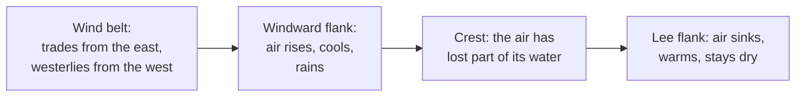

# Why is one side of a mountain range dry?

Seen from: the planet view, through the **Moisture** layer (from "arid" to
"wet") and the **Biomes** layer, where forest or jungle on one flank of a
range faces shrubland or desert on the other; and the **Moisture** line of
the point information (−1 arid · 1 wet).

## Short answer

Wind that meets a mountain range has to climb it. Rising air expands and
cools, and cool air holds less water vapour, so the vapour condenses into
cloud and falls as rain or snow on the side the wind comes from. Over the
crest the air sinks, warms up again and arrives on the far side warm and
dry: that side lies in a *rain shadow*. Which side is wet depends on the
planet's prevailing winds: westerlies at mid-latitudes, easterly trade
winds in the tropics.

## The science


### Rising air cools

A parcel of air that rises meets lower pressure, expands and cools, without
exchanging heat with its surroundings. While it is not saturated it cools
at the *dry adiabatic lapse rate*, set by gravity $g$ and the heat capacity
of air at constant pressure $c_p$:

```math
\Gamma_d = \frac{g}{c_p}
```

**In words.** Every kilometre a dry parcel rises, it loses the same number
of degrees, whatever its starting temperature.

**Orders of magnitude.** With $g = 9.81$ m/s² and $c_p = 1004$ J/(kg K),
$\Gamma_d$ is 9.8 °C per kilometre, the value the US National Weather
Service gives for "parcels that remain unsaturated during lifting". The
real atmosphere around a parcel cools more slowly with height: about
6.5 °C per kilometre in the standard atmosphere, whose temperature in the
troposphere is $T = 15.04 - 0.00649\,h$ (°C, $h$ in metres; NASA Glenn
Research Center).

### Cool air holds less water

Air is saturated when the pressure of its water vapour reaches the
saturation vapour pressure $e_\text{sat}$, which depends only on the
temperature $T$ in °C (Roe 2005, eq. 1, after Bolton 1980):

```math
e_\text{sat}(T) = 6.112\,\exp\!\left(\frac{17.67\,T}{243.5 + T}\right)
\ \text{hPa}
```

**In words.** The vapour air can hold grows steeply with temperature.
Roe (2005) gives the rule of thumb: "a decrease of 10 °C halves the
saturated moisture content of the atmosphere", and 30 °C reduces it by an
order of magnitude.

**Orders of magnitude.** At 20 °C saturated air holds 23 hPa of vapour,
at 0 °C only 6.1 hPa. Because air cools as it rises, the vapour saturated
air can carry falls by a factor e (2.7) about every 4 km of height in the
tropics and every 2 km at high latitudes (Roe 2005).

Once the parcel is saturated, further lifting condenses vapour. The rate
of condensation is the upward speed $w$ times how fast the saturated
vapour density $\rho q_\text{sat}$ falls with height $z$ (Roe 2005,
eq. 5):

```math
C \simeq -w\,\frac{\partial(\rho q_\text{sat})}{\partial z}
```

Condensation releases latent heat, so a saturated parcel cools more slowly
than a dry one. This *moist adiabatic lapse rate* is not a constant: it
depends on the parcel's temperature and pressure (National Weather Service
glossary). Computed from the standard formula for a saturated adiabat, it
is about 4 °C per kilometre for saturated air at 20 °C near sea level and
6.5 °C per kilometre at 0 °C: warm, moist air releases more heat.

### The windward side and the lee

Where the wind meets a range, the ground forces it up. In the classic
picture, "the windward flank of the mountain range receives much more
precipitation than the leeward flank, resulting in the well-known rain
shadow" (Roe 2005). For large ranges the wettest place is on the windward
flank, short of the crest; for small hills it is closer to the crest. The
upslope model works well "at spatial scales greater than approximately
40 km, and for mountain ranges exceeding approximately 1.5 km in height"
(Roe 2005).

The air that crosses the crest has left part of its water behind. As it
sinks down the lee slope it warms at the dry rate, since nothing is
condensing any more. Having cooled more slowly on the way up than it warms
on the way down, it arrives warmer and drier than it set out: the warm,
dry *foehn* wind of the lee side (Elvidge & Renfrew 2016).

**Orders of magnitude.** The diagram follows a parcel that leaves the sea
at 20 °C with 60 % relative humidity, computed with the rates above. It
saturates at 1 km, at 10 °C. By the crest at 3 km it is at −0.6 °C and 40 %
of its vapour has condensed. If all of it rains out, the parcel comes down
the lee slope to sea level at 28.7 °C with 21 % relative humidity. On the
Southern Alps of New Zealand, in the westerlies, 2 to 3 m of rain a year
fall on the western lowlands, 11 to 12 m about 20 km upwind of the
divide, and less than 1 m on the eastern plains (Roe 2005).

### Which side is windward: the wind belts

The side that gets the rain is the side the prevailing wind comes from.
Earth's surface winds come in belts:

- **Trade winds**, "the prevailing easterly winds that circle the Earth
  near the equator", between about 30° north and 30° south (NOAA National
  Ocean Service). They are the low branch of the Hadley cells: air rises
  near the equator and moves polewards aloft (NOAA JetStream).
- **Westerlies** between 35° and 60° north and south (NOAA JetStream).
- **Polar easterlies**, blowing out of the polar highs (NOAA JetStream).

Between the trades and the westerlies, around 30°, lies a band of high
pressure where air sinks: hence "the number of deserts located along the
30°N/S latitude around the world" (NOAA JetStream).



So on Earth a mid-latitude range is wet on its western side, and a
tropical range on its eastern side. Other planets need not have the same
belts: Kaspi & Showman (2015) find that the rotation rate, the star's
light and the mass of the atmosphere all change the circulation.

### Three ranges

- **The Andes and the Atacama.** Between 15° and 27° S the rain on the
  western slope of the central Andes comes from summer storms out of
  Amazonia, from the east, and decreases downhill: "the west slope of the
  central Andes exhibits a pronounced rainshadow effect" (Houston &
  Hartley 2003). The hyper-arid core of the Atacama runs from 15° to 30° S,
  from sea level to 3500 m. Its aridity grew with the uplift of the Andes,
  together with the cold, upwelling Peruvian Current offshore (Houston &
  Hartley 2003). Shielded by two ranges, "many decades can pass between
  rains in the high central valley of the Atacama desert of Chile" (Roe
  2005).
- **The Himalaya and Tibet.** Here the moist air comes from the south,
  with the summer monsoon. Satellite rainfall shows "wet Indian plains,
  the dry interior of Tibet, an intense band of precipitation along the
  southern flank of the Himalayas" (Roe 2005). Bookhagen & Burbank (2006)
  find two bands of maximum rain along the range, one at a mean elevation
  of 0.9 ± 0.4 km on the Lesser Himalaya, one at 2.1 ± 0.3 km on the
  Greater Himalaya. Cherrapunji, in the Khasi hills of India, recorded
  26.5 m of rain in 1860–1861 (Roe 2005).
- **The Cascades.** Washington State's Cascade Mountains "exhibit a strong
  orographic rain shadow, with much wetter western slopes than eastern
  slopes due to prevailing westerly flow during the winter storm season"
  (Siler, Roe & Durran 2013). The shadow is stronger in La Niña winters
  and weaker in El Niño winters.

### What we do not know

- **How deep the shadow is.** Roe (2005) calls a rain shadow across a range
  perpendicular to the wind "one of the most confident expectations in
  atmospheric science", but adds that "the amplitude of the rain shadow
  and the relationship between orography and precipitation at smaller
  spatial scales are much more complex questions, and the subject of
  active research". The Alps, for example, have no well-defined rain
  shadow: rain peaks on both their northern and southern flanks (Roe
  2005).
- **Why foehn air is warm.** The textbook story above (rain on the way up,
  dry warming on the way down) is one of three mechanisms. Elvidge &
  Renfrew (2016) show that warmer air drawn down from aloft and turbulent
  mixing also warm the lee, and that "depending on the flow dynamics, any
  of the three warming mechanisms can dominate".

## In the app

### What you see

- **The Moisture layer** colours every pixel from arid (−1) to wet (1).
  Behind a range, across the wind, a drier band runs downwind; on the
  slopes facing the wind, a wetter one.
- **The Biomes layer** turns moisture into vegetation at each temperature:
  in the tropics desert, savanna or jungle; in temperate land shrubland,
  plain or forest; in the boreal zone tundra or taiga.
- **The point information** gives the **Moisture** of the pixel clicked.
- While a world is generated, the stage "Blowing winds and rain" is this
  calculation.

### How it computes them

The moisture pass runs once the temperatures are set:

1. **Wind belts.** The east–west wind at latitude $\varphi$ is
   $u = -\cos 4\varphi$: from the east at the equator and the poles, from
   the west around 45°. Each row of the map is simulated twice, with the
   wind blowing east and blowing west, and the two blended by $u$.
2. **Along the row.** Over the sea, air takes up vapour towards what it
   can hold (an e-folding distance of 1500 km). What it can hold rises
   linearly with temperature, five times more at 27 °C than at −18 °C.
   Over land it drizzles out slowly (2000 km), rains much harder where the
   ground ahead climbs (4 times the climb, in elevation units), and dumps
   at once whatever exceeds what it can hold. 60 % of the rain on land
   evaporates back into the air, and the air drifts towards a background
   humidity set by the ocean of nearby latitudes (3000 km).
3. **Into moisture.** The rain rate is smoothed over 100 km and mapped to
   $[-1, 1]$ by $1 - 2 \cdot 2^{-r/0.08}$. Moisture is then
   $0.75 \times \text{rain} + 0.25 \cos 6\varphi + 0.5 \times
   \text{noise}$, clamped: the cosine adds the wet equator and 60° belts
   and the dry 30° belts.
4. **Biomes.** The planet preset's shift and a regional variability term
   are added, then the thresholds below pick a biome.

The land step, trimmed (from `crates/mapgen/src/climate.rs`):

```rust
/// Extra fraction of humidity rained out per unit of elevation climbed.
const OROGRAPHIC_RAIN: f32 = 4.0;

pub fn zonal_wind(latitude: f64) -> f32 {
    -(4.0 * latitude).cos() as f32
}

// In rain_along_row, over land: steady drizzle, heavy rain where the
// wind climbs, and forced condensation where the air cools below what
// it holds.
humidity += (background * capacity - humidity).max(0.0) * supply;
let climb = (input.height_above_water[row + next] - here).max(0.0);
let fraction = (drizzle + OROGRAPHIC_RAIN * climb).min(1.0);
let excess = (humidity - capacity).max(0.0);
let fallen = (humidity - excess) * fraction + excess;
// 60 % of the rain on land evaporates again.
humidity -= fallen * (1.0 - RECYCLING);
```

The moisture thresholds of the biomes (from `crates/mapgen/src/biome.rs`):

| Zone | Drier | Middle | Wetter |
| --- | --- | --- | --- |
| Tropical | desert below −0.05 | savanna | jungle above 0.30 |
| Temperate | shrubland below −0.10 | plain | forest above 0.20 |
| Boreal | tundra up to 0.05 | | taiga above 0.05 |
| Shore | beach up to 0.30 | | wetland above 0.30 |

**Orders of magnitude.** Re-running the row model alone on an Earth-sized
map (4096 pixels round, the server's default), with a range 3 km high and
200 km wide on a coast facing the wind: the windward slope gets about 10
times the rain of flat ground, and the lee about 17 % less than flat
ground, still 14 % less 500 km further on. The air loses about a fifth of
its humidity crossing the range.

The code is in
[`crates/mapgen/src/climate.rs`](../../crates/mapgen/src/climate.rs)
(`moisture`, `rain_along_row`, `zonal_wind`, `circulation_band`), called
from the moisture pass of
[`crates/mapgen/src/generation.rs`](../../crates/mapgen/src/generation.rs);
biomes are chosen in
[`crates/mapgen/src/biome.rs`](../../crates/mapgen/src/biome.rs).

### Where it departs from the science

- **The shadow is shallow.** In the run above the lee gets 17 % less rain
  than flat ground, where the Southern Alps go from 11–12 m to under 1 m a
  year. Most of the gap comes from recycling: 60 % of the rain that falls
  on land goes back into the air, on the slopes as everywhere. With no
  recycling the same range leaves the lee about 40 % drier. The windward slopes
  are clearly wetter; the lee is only a little drier. Large dry interiors
  in the app come more from distance to the sea and from the 30° belts
  than from mountains.
- **Climbing does not cool the air enough to matter.** In nature the rain
  comes from the cooling of rising air. In the app the climb triggers rain
  through a fixed coefficient, and the cooling barely counts. Land cools by
  13.5 °C per elevation unit, which is 0.54 °C per km if one unit is 25 km
  (the scale the craters and the viewer's relief use): a twelfth of the
  real 6.5 °C per km. And what air can hold grows linearly, five times from
  −18 °C to 27 °C, where the saturation vapour pressure grows 24 times.
- **No foehn.** The temperature field does not know about wind or rain:
  the lee of a range is not warmer than the windward side at the same
  height.
- **Winds blow only east or west.** There is no north–south wind and no
  monsoon. A range that runs east–west, like the Himalaya, lies along the
  wind and casts no shadow, and the monsoon rain that makes the Himalaya
  wet and Tibet dry cannot happen.
- **The belts sit a little off Earth's.** $-\cos 4\varphi$ turns from
  easterly to westerly at 22.5° and back at 67.5°, where Earth's trade
  winds reach about 30° and its westerlies 60°. A range between 22.5° and
  30° gets its rain from the west in the app, from the east on Earth.
- **The same belts on every planet.** Every rocky world gets Earth's
  three-belt pattern, whatever its rotation, size or air. Real circulations
  change with all three (Kaspi & Showman 2015).
- **A year's mean, no weather.** Moisture is an annual mean of a steady
  wind. Storms, fronts and seasons, which bring most orographic rain, are
  not simulated: the Cascades' shadow, strongest in winter storms and in
  La Niña years, would come out the same every year.
- **Coarse and smoothed.** The rain is smoothed over 100 km, and a pixel
  of an Earth-sized map is 10 km wide at 4096 pixels (21 km at the CLI's
  1920). The windward peak 20 km short of the divide, and ranges narrower
  than about 100 km, are blurred out.
- **No cold currents.** The Atacama owes part of its dryness to the cold
  Peruvian Current. The app has no ocean currents: its large-scale
  temperature anomaly stands in for them as noise.

## Sources

1. Roe, G. H. 2005, "Orographic precipitation", *Annual Review of Earth
   and Planetary Sciences* 33, 645–671,
   [doi:10.1146/annurev.earth.33.092203.122541](https://doi.org/10.1146/annurev.earth.33.092203.122541).
   Saturation vapour pressure (eq. 1, after Bolton 1980), condensation
   rate (eq. 5), the Southern Alps (from Wratt et al. 2000), the Alps, the
   Himalaya, the Atacama, Cherrapunji.
2. Bolton, D. 1980, "The computation of equivalent potential temperature",
   *Monthly Weather Review* 108, 1046–1053,
   [doi:10.1175/1520-0493(1980)108<1046:TCOEPT>2.0.CO;2](https://doi.org/10.1175/1520-0493(1980)108%3C1046:TCOEPT%3E2.0.CO;2),
   as cited by source 1.
3. National Weather Service, [glossary: lapse
   rate](https://forecast.weather.gov/glossary.php?word=Lapse+rate) (dry
   adiabatic lapse rate 9.8 °C per km; the moist rate depends on
   temperature and pressure).
4. NASA Glenn Research Center, [Earth atmosphere model, metric
   units](https://www.grc.nasa.gov/www/k-12/airplane/atmosmet.html)
   (standard troposphere, 6.49 °C per km).
5. Elvidge, A. D. & Renfrew, I. A. 2016, "The causes of foehn warming in
   the lee of mountains", *Bulletin of the American Meteorological
   Society* 97, 455–466,
   [doi:10.1175/BAMS-D-14-00194.1](https://doi.org/10.1175/BAMS-D-14-00194.1).
6. NOAA National Ocean Service, [What are the trade
   winds?](https://oceanservice.noaa.gov/facts/tradewinds.html)
7. NOAA JetStream, [Global atmospheric
   circulations](https://www.noaa.gov/jetstream/global/global-atmospheric-circulations)
   (Hadley cell, westerlies between 35° and 60°, polar easterlies, the
   30° high-pressure belt and its deserts).
8. Kaspi, Y. & Showman, A. P. 2015, "Atmospheric dynamics of terrestrial
   exoplanets over a wide range of orbital and atmospheric parameters",
   *The Astrophysical Journal* 804, 60,
   [doi:10.1088/0004-637X/804/1/60](https://doi.org/10.1088/0004-637X/804/1/60),
   preprint [arXiv:1407.6349](https://arxiv.org/abs/1407.6349).
9. Houston, J. & Hartley, A. J. 2003, "The central Andean west-slope
   rainshadow and its potential contribution to the origin of
   hyper-aridity in the Atacama Desert", *International Journal of
   Climatology* 23, 1453–1464,
   [doi:10.1002/joc.938](https://doi.org/10.1002/joc.938).
10. Bookhagen, B. & Burbank, D. W. 2006, "Topography, relief, and
    TRMM-derived rainfall variations along the Himalaya", *Geophysical
    Research Letters* 33, L08405,
    [doi:10.1029/2006GL026037](https://doi.org/10.1029/2006GL026037).
11. Siler, N., Roe, G. & Durran, D. 2013, "On the dynamical causes of
    variability in the rain-shadow effect: a case study of the Washington
    Cascades", *Journal of Hydrometeorology* 14, 122–139,
    [doi:10.1175/JHM-D-12-045.1](https://doi.org/10.1175/JHM-D-12-045.1).

The parcel in the diagram, the moist lapse rates and the app's ridge run
were computed for this article from sources 1 to 3 and from the code.

## See also

- [README, "Moisture — winds and rain
  shadows"](../../README.md#moisture--winds-and-rain-shadows): the app's
  moisture model in full.
- [docs/analysis/02-biome-banding.md](../analysis/02-biome-banding.md),
  option D "Moisture transport": why dry interiors and moisture bands were
  studied, and what was deferred.
- Related articles: [How does axial tilt make climate zones and
  seasons?](axial-tilt-climate.md), [Why are mountains lower on heavier
  planets?](mountains-and-gravity.md), [What decides whether a world has
  an atmosphere?](atmospheres.md).
