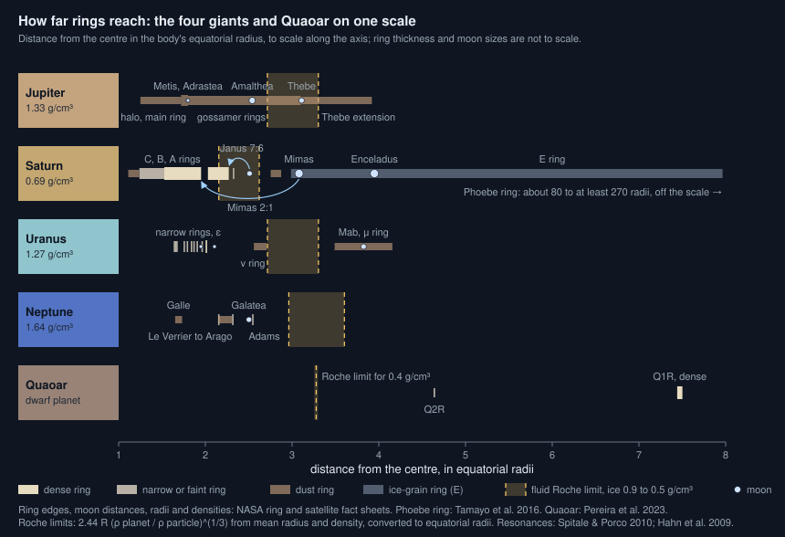

# How far can rings reach?

Seen from: the planet view of a giant with rings, and the **Rings** and
**Dust rings** rows of its card.

## Short answer

It depends on the kind of ring. A dense, bright ring like Saturn's is made
of loose ice that the planet's tides keep from clumping into moons. It can
only last where those tides win, inside the fluid Roche limit, about two
to three and a half planet radii out. A faint dust ring has no such limit:
it is fed by a moon that sheds dust, and it lies wherever that moon is,
from just outside the main rings to hundreds of planet radii out. The
inner edge is set by the planet's upper atmosphere, which drags the
innermost dust down. Within the rings, the moons outside them cut sharp
edges through their resonances.

## The science



### Dense rings end near the fluid Roche limit

A clump of ring particles is held together only by its own gravity. The
planet's tides pull it apart inside the *fluid Roche limit*. For a planet
of mean radius $R$ and mean density $\rho_p$, and particles of density
$\rho_m$ (Murray & Dermott 1999):

```math
d_\text{fluid} \approx 2.44\,R\left(\frac{\rho_p}{\rho_m}\right)^{1/3}
```

**In words.** The denser the planet compared with the particles, the
farther out its tides tear clumps apart. Inside that distance loose
material stays a ring; outside it, it gathers into moons. The limit is a
band, not a line, because ring particles are porous ice of uncertain
density. Why moons cannot grow inside it, and how small the moons there
stay, is told in [Why are ring moons so small?](ring-moons.md).

**Orders of magnitude.** For ring ice of 0.9 to 0.5 g/cm³, with the
planets' mean densities and radii from NASA's fact sheets, converted to
their equatorial radii (the unit ring distances are given in):

| Planet | Density (g/cm³) | Fluid Roche limit | Densest ring ends at |
| --- | --- | --- | --- |
| Jupiter | 1.33 | 2.72 to 3.30 R | none: dust only |
| Saturn | 0.69 | 2.15 to 2.62 R | 2.27 R (A ring) |
| Uranus | 1.27 | 2.72 to 3.30 R | 2.01 R (ε ring) |
| Neptune | 1.64 | 2.96 to 3.60 R | 2.54 R (Adams ring) |

No dense or narrow ring of the giants reaches past its planet's band
(NASA ring fact sheets). Saturn's A ring ends within it. The others stop
well short: their edges are held by moons, not by the Roche limit
itself.

The masses differ hugely. Saturn's B ring holds 20 to 100 g of ice on
each square centimetre; Jupiter's main ring holds 5 × 10⁻⁶ g (NASA ring
fact sheets), millions of times less. Only Saturn has a massive ring
system.

### Dust rings follow their source moon

Dust grains, micrometres across or smaller, are not held by the Roche
limit: they never need to clump. They are knocked off small moons by
impacts or blown out of geysers, then drift away under drag (Burns et al.
1999), so a dust ring lasts only while its source feeds it.

- **Jupiter's gossamer rings.** Burns et al. (1999) found that Jupiter's
  outermost ring "is actually two rings circumscribed by the orbits of the
  small satellites Amalthea and Thebe". Dust knocked off each moon drifts
  inwards under Poynting–Robertson drag, so each ring runs from its moon's
  orbit in towards the planet: the Amalthea ring from 1.80 to 2.54
  Jupiter radii, the Thebe ring out to 3.10 (NASA). A fainter extension
  reaches 3.92 radii, beyond Thebe itself.
- **Saturn's E ring.** It spans 2.99 to 7.96 Saturn radii (NASA) round
  Enceladus, at 3.95. Cassini's dust detector found grains streaming from
  Enceladus's south polar region, which "may provide the dominant source
  of Saturn's E ring" (Spahn et al. 2006).
- **Saturn's Phoebe ring.** Found with the Spitzer telescope round the
  far moon Phoebe (Verbiscer, Skrutskie & Hamilton 2009), it is very
  faint: a normal optical depth of about 10⁻⁸. Cassini images along
  Saturn's shadow traced it from 80 to 260 Saturn radii, and it reaches
  at least 270 (Tamayo et al. 2016).
- **Uranus's μ ring.** Mab, a small moon at 3.82 Uranus radii, "shares
  its orbit with a dust ring" (Showalter & Lissauer 2006).

Burns et al. (1999) suggested that "faint rings may accompany all small
inner satellites of the other jovian planets". So a dust ring has no
maximum of its own: it reaches as far as the moon that feeds it.

### The inner edge: the planet's atmosphere

Inwards, rings run until the planet's upper atmosphere takes them. During
Cassini's last orbits, which passed between Saturn and its D ring,
Mitchell et al. (2018) measured nanometre grains of the D ring
colliding with hydrogen of the exosphere and falling into the planet,
about 5 kg every second. The D ring's inner edge lies at 1.11 Saturn
radii, Jupiter's halo at 1.25 Jupiter radii (NASA).

### Sharp edges: resonances with moons outside

A moon outside the rings pulls on the particles that orbit in step with
it. A particle at the $m{:}(m-1)$ *inner Lindblad resonance* of a moon at
$a_\text{moon}$ goes round $m$ times while the moon goes round $m-1$
times. Kepler's third law puts it at

```math
a_\text{res} \approx a_\text{moon}\left(\frac{m-1}{m}\right)^{2/3}
```

**In words.** Each nudge comes at the same place of the particle's orbit,
so the nudges add up instead of cancelling. At a strong resonance they
push the ring material away, and a sharp edge forms there.

**Orders of magnitude.** Mimas orbits at 185,520 km (NASA). Its 2:1
resonance, at about 0.63 of that distance, holds the outer edge of the B
ring. Spitale & Porco (2010) put the resonance at 117,556 km; the B
ring's edge lies at 117,507 km, 1.95 Saturn radii (NASA), pulled by
Mimas into an oval that swings about 75 km in and out. The Cassini
Division, emptier, lies outside it. The outer edge of the A ring, at
2.27 radii, is held the same way by the 7:6 resonance of Janus and
Epimetheus (Hahn, Spitale & Porco 2009). Goldreich & Tremaine (1978)
first explained the Cassini Division this way. The equation above, Kepler
alone, puts the Mimas 2:1 about 690 km closer in: the precise condition
of Spitale & Porco (2010) adds the precession of orbits round the
flattened planet (its $J_2$).

### The exception: Quaoar

Quaoar, a dwarf planet beyond Neptune, 543 km in radius, has a dense ring
at 4,057 km from its centre, 7.5 of its radii, and a fainter one at
2,520 km (Pereira et al. 2023). Its classical Roche limit for particles of
0.4 g/cm³ lies at 1,780 km: both rings are outside it, where a ring
should gather into moons within a century. Morgado et al. (2023) showed
in simulations that elastic collisions, based on laboratory
experiments, can keep a ring from accreting there, "thus
indicating that this limit does not always determine where ring material
can survive". Nothing like it is known round a giant.

### Masses and ages

Saturn's rings weigh (1.54 ± 0.49) × 10¹⁹ kg, 0.41 times the mass of
Mimas, measured from Cassini's last orbits (Iess et al. 2019). Their ice
holds only 0.1 to 2 % of non-icy material by volume, which infalling
micrometeoroids keep adding; from the measured infall, Kempf et al.
(2023) give them an exposure age of at most 100 to 400 million years.
Dust rings are younger still: they are lost as they are made, and
renewed while their moons feed them.

### What we do not know

- **The age of Saturn's rings.** Iess et al. (2019) and Kempf et al.
  (2023) find them young; Crida et al. (2019) question whether their
  clean ice proves it.
- **Why Quaoar's rings do not accrete.** Elastic collisions are one
  answer; Pereira et al. (2023) note that both rings lie near resonances
  with Quaoar's spin or its moon Weywot, which may confine them.
- **Some sources are missing.** Uranus's ν ring lies "in a region with no
  known source bodies" (Showalter & Lissauer 2006).

## In the app

### What you see

A giant drawn in a planetary system gets bright rings, faint narrow rings,
or none, with the odds of its preset (`[giant] rings`: 25 % bright and
50 % faint on gas giants, 70 % faint on ice giants, 5 % faint on hot
ones). Its card gives their edges in its radii and their gaps. The planet
view draws them round the globe, with the gaps their moons open.

On top of the main rings, some giants have dust rings, listed under
**Dust rings** on the card and drawn as broad, smooth, faint annuli,
densest along their source moon's orbit:

- **Gossamer rings** from the outer edge of bright rings out to the small
  moons just beyond them.
- **A plume ring** round an icy regular moon close in, like the E ring.

The source moon's card says what it feeds.

### How it computes them

The system first draws each giant's rings with its preset's odds
([`draw_rings`](../../crates/mapgen/src/giant_world.rs)): a bright ring
from 1.2–1.5 to 2.1–2.5 radii, or a faint ring 0.05 to 0.3 radii wide
starting at 1.5 to 1.9. Then
[`shape_rings`](../../crates/mapgen/src/system.rs) computes the giant's
mean density from its mass and radius and hands the rings to
[`rings::shape`](../../crates/mapgen/src/rings.rs):

1. **The outer edge of bright rings** becomes the fluid Roche limit for
   particles of 0.5 to 0.9 g/cm³, kept between 2.0 and 2.5 radii.
2. **A resonance gap**, on 60 % of bright rings: a moon of 150 to 250 km
   outside the rings opens a gap 0.04 to 0.09 radii wide at its 2:1
   resonance, `RESONANCE_FACTOR` (0.63) times its distance.
3. **Faint rings** keep their drawn edges.

Then [`rings::dust_rings`](../../crates/mapgen/src/rings.rs) adds the dust
rings from the giant's moons:

1. **Gossamer rings:** each of the one or two outermost edge moons beyond
   bright rings feeds one, with odds of 80 %, from the rings' outer edge
   out to 1.03 times the moon's distance.
2. **A plume ring:** with odds of 25 %, the innermost icy regular moon
   within 12 radii feeds a ring from 0.75 to 2 times its distance (the E
   ring spans 0.76 to 2.02 times Enceladus's).

The outer edge and the resonance, trimmed (from
`crates/mapgen/src/rings.rs`):

```rust
/// The 2:1 resonance of a moon lies at `2^(-2/3)` of its distance.
pub const RESONANCE_FACTOR: f64 = 0.629_960_5;

pub fn fluid_roche(giant_density: f64, density: f64) -> f64 {
    2.44 * (giant_density / density).cbrt()
}

// In `shape`, for bright rings:
let particles = rng.random_range(PARTICLE_DENSITY.0..PARTICLE_DENSITY.1);
let outer = fluid_roche(giant_density, particles)
    .clamp(OUTER_EDGE.0, OUTER_EDGE.1); // 2.0 to 2.5 radii
// The resonant moon: far enough out to be a moon, its 2:1 in the rings.
let from = (outer + 0.5).max(fluid_roche(giant_density, density) + 0.1);
let to = (outer - 0.1) / RESONANCE_FACTOR;
let a = from + at * (to - from);
let gap_at = a * RESONANCE_FACTOR;
```

The giant's density comes from the same radius the rings are measured
in (its equatorial radius, Saturn's 9.45 Earth radii), so the limit comes
out in the rings' own unit: the conversion the table above makes. The
viewer draws the main rings with `ringFragment` and the
dust rings with `dustRingFragment`
([`ringShaders.ts`](../../web/src/lib/viewer/ringShaders.ts)); the cards
read them through [`ringMoons.ts`](../../web/src/lib/ringMoons.ts).

### Where it departs from the science

- **The cap at 2.5 radii hides the Roche limit on most giants.** The
  fluid limit for ice exceeds 2.5 radii round any giant denser than about
  0.97 g/cm³. In the app that is every gas giant below about 43 or above
  about 205 Earth masses: their bright rings always end at 2.5. Only
  between those masses, round the least dense giants (0.62 g/cm³ for a
  Saturn-mass giant, whose density the app takes from its equatorial
  radius), does the edge follow the planet. The cap keeps the rings like
  Saturn's, the only massive ones we know, rather than letting them grow
  to the 3 to 3.6 radii the formula allows round a dense giant.
- **A giant asked directly keeps unshaped rings.** When a giant is the
  world asked for (a giant preset generated as a world, such as
  `--planet gas-giant`), the system skips `shape_rings` for it. Its rings
  keep the draw: an outer edge of 2.1 to 2.5 radii whatever its density,
  and one to three gaps at random places, tied to no moon. Drawing that
  preset with seeds 1 to 12 (`--draw-only`) gives three giants with bright
  rings, ending at 2.14, 2.15 and 2.43 radii, their gaps owned by no
  moon; shaped, the two above 1,000 Earth masses would end at 2.5. Only
  the other giants of its system get the Roche edge and ring moons.
- **The resonance opens a gap, not an edge.** Mimas's 2:1 sets the outer
  edge of the dense B ring, and the Cassini Division lies outside it. The
  app centres its gap on the resonance, with ring on both sides.
- **The resonance is Keplerian.** `RESONANCE_FACTOR` ignores the giant's
  flattening, which moves Saturn's real Mimas 2:1 about 690 km
  outwards. That is 0.01 radii, smaller than the drawn gap.
- **No other resonance edges.** The A ring's outer edge is set by the
  Janus 7:6 resonance; in the app, the edge moons sit beyond the rings
  without setting their edge, which the Roche limit alone places.
- **Gossamer rings need bright rings.** Jupiter has no dense rings, yet
  it has gossamer rings. In the app only the edge moons of bright rings
  feed one, so a giant with faint rings or none never gets a dust ring
  from its small moons, and no ring like Uranus's μ ring round Mab.
  The gossamer ring also stops at 1.03 times its moon's distance, while
  Jupiter's Thebe extension reaches 1.26 times Thebe's.
- **The plume moon is not chosen by its heat.** The module's
  documentation says the plume ring circles a moon "heated by the tides
  of its resonant chain". The code does not compute any heating: it picks
  the innermost icy regular moon within 12 radii, with odds of 25 %.
- **No Phoebe ring.** Captured far moons feed no dust ring.
- **No inner-edge physics.** A bright ring's inner edge is drawn between
  1.2 and 1.5 radii, near Saturn's C ring (1.24); nothing ties it to the
  atmosphere's drag, and there is no faint D ring inside it.
- **Rings do not age.** They are drawn once and stay as they are: no
  mass, no darkening, no dust ring fading when its moon stops feeding it.

## Sources

1. Murray, C. D. & Dermott, S. F. 1999, *Solar System Dynamics*, Cambridge
   University Press,
   [doi:10.1017/CBO9781139174817](https://doi.org/10.1017/CBO9781139174817),
   §4.7 (Roche limits).
2. NASA Space Science Data Coordinated Archive, planetary fact sheets for
   [Jupiter](https://nssdc.gsfc.nasa.gov/planetary/factsheet/jupiterfact.html),
   [Saturn](https://nssdc.gsfc.nasa.gov/planetary/factsheet/saturnfact.html),
   [Uranus](https://nssdc.gsfc.nasa.gov/planetary/factsheet/uranusfact.html)
   and
   [Neptune](https://nssdc.gsfc.nasa.gov/planetary/factsheet/neptunefact.html)
   (radii, densities); their ring fact sheets
   ([Jupiter](https://nssdc.gsfc.nasa.gov/planetary/factsheet/jupringfact.html),
   [Saturn](https://nssdc.gsfc.nasa.gov/planetary/factsheet/satringfact.html),
   [Uranus](https://nssdc.gsfc.nasa.gov/planetary/factsheet/uranringfact.html),
   [Neptune](https://nssdc.gsfc.nasa.gov/planetary/factsheet/nepringfact.html))
   and satellite fact sheets
   ([Jupiter](https://nssdc.gsfc.nasa.gov/planetary/factsheet/joviansatfact.html),
   [Saturn](https://nssdc.gsfc.nasa.gov/planetary/factsheet/saturniansatfact.html),
   [Uranus](https://nssdc.gsfc.nasa.gov/planetary/factsheet/uraniansatfact.html),
   [Neptune](https://nssdc.gsfc.nasa.gov/planetary/factsheet/neptuniansatfact.html)).
3. Burns, J. A. et al. 1999, "The formation of Jupiter's faint rings",
   *Science* 284, 1146–1150,
   [doi:10.1126/science.284.5417.1146](https://doi.org/10.1126/science.284.5417.1146).
4. Spahn, F. et al. 2006, "Cassini dust measurements at Enceladus and
   implications for the origin of the E ring", *Science* 311, 1416–1418,
   [doi:10.1126/science.1121375](https://doi.org/10.1126/science.1121375).
5. Verbiscer, A. J., Skrutskie, M. F. & Hamilton, D. P. 2009, "Saturn's
   largest ring", *Nature* 461, 1098–1100,
   [doi:10.1038/nature08515](https://doi.org/10.1038/nature08515).
6. Tamayo, D. et al. 2016, "Radial profiles of the Phoebe ring: a vast
   debris disk around Saturn", *Icarus* 275, 117–131,
   [doi:10.1016/j.icarus.2016.04.009](https://doi.org/10.1016/j.icarus.2016.04.009),
   preprint [arXiv:1604.03119](https://arxiv.org/abs/1604.03119).
7. Showalter, M. R. & Lissauer, J. J. 2006, "The second ring-moon system
   of Uranus: discovery and dynamics", *Science* 311, 973–977,
   [doi:10.1126/science.1122882](https://doi.org/10.1126/science.1122882).
8. Mitchell, D. G. et al. 2018, "Dust grains fall from Saturn's D-ring
   into its equatorial upper atmosphere", *Science* 362, eaat2236,
   [doi:10.1126/science.aat2236](https://doi.org/10.1126/science.aat2236).
9. Goldreich, P. & Tremaine, S. 1978, "The formation of the Cassini
   division in Saturn's rings", *Icarus* 34, 240–253,
   [doi:10.1016/0019-1035(78)90165-3](https://doi.org/10.1016/0019-1035(78)90165-3).
10. Spitale, J. N. & Porco, C. C. 2010, "Free unstable modes and massive
    bodies in Saturn's outer B ring", *The Astronomical Journal* 140,
    1747–1757,
    [doi:10.1088/0004-6256/140/6/1747](https://doi.org/10.1088/0004-6256/140/6/1747),
    preprint [arXiv:0912.3489](https://arxiv.org/abs/0912.3489).
11. Hahn, J. M., Spitale, J. N. & Porco, C. C. 2009, "Dynamics of the
    sharp edges of broad planetary rings", *The Astrophysical Journal*
    699, 686–710,
    [doi:10.1088/0004-637X/699/1/686](https://doi.org/10.1088/0004-637X/699/1/686),
    preprint [arXiv:0904.0743](https://arxiv.org/abs/0904.0743).
12. Morgado, B. E. et al. 2023, "A dense ring of the trans-Neptunian
    object Quaoar outside its Roche limit", *Nature* 614, 239–243,
    [doi:10.1038/s41586-022-05629-6](https://doi.org/10.1038/s41586-022-05629-6).
13. Pereira, C. L. et al. 2023, "The two rings of (50000) Quaoar",
    *Astronomy & Astrophysics* 673, L4,
    [doi:10.1051/0004-6361/202346365](https://doi.org/10.1051/0004-6361/202346365),
    preprint [arXiv:2304.09237](https://arxiv.org/abs/2304.09237).
14. Iess, L. et al. 2019, "Measurement and implications of Saturn's
    gravity field and ring mass", *Science* 364, eaat2965,
    [doi:10.1126/science.aat2965](https://doi.org/10.1126/science.aat2965).
15. Kempf, S. et al. 2023, "Micrometeoroid infall onto Saturn's rings
    constrains their age to no more than a few hundred million years",
    *Science Advances* 9, eadf8537,
    [doi:10.1126/sciadv.adf8537](https://doi.org/10.1126/sciadv.adf8537).
16. Crida, A. et al. 2019, "Are Saturn's rings actually young?", *Nature
    Astronomy* 3, 967–970,
    [doi:10.1038/s41550-019-0876-y](https://doi.org/10.1038/s41550-019-0876-y).

## See also

- [docs/analysis/14-rings.md](../analysis/14-rings.md): the study behind the
  app's rings, ring moons and dust rings.
- [Why are ring moons so small?](ring-moons.md): the moons in and next to
  the rings, and the Roche zone they live in.
- [docs/system-spec.md](../system-spec.md): rings and ring moons as parts
  of a planetary system.
- The README's **giant worlds** paragraph and its `[giant]` preset table,
  for the ring odds and the shaping rules.
