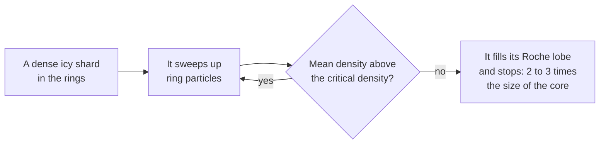

# Why are ring moons so small?

Seen from: the planet view of a giant with bright rings, and the card of
one of its ring moons ("In the rings").

## Short answer

Close to a giant planet, its tides pull loose ring particles apart faster
than their own gravity can gather them: that is why rings stay rings. A moon
can only grow there around a dense solid core. It stops growing once it fills
the small region its gravity controls, its Roche lobe. By then it is two to
three times the size of its core: a few to a few tens of kilometres. Farther
out, past the Roche limit, moons form freely from the material the rings
spread out, and they get larger the farther they are from the rings.

## The science


### The Roche limit: where rings end and moons begin

A body held together only by its own gravity is torn apart by the planet's
tides inside a distance called the Roche limit. For a planet of radius $R$
and density $\rho_p$, and a body of density $\rho_m$ (Murray & Dermott 1999):

```math
d_\text{fluid} \approx 2.44\,R\left(\frac{\rho_p}{\rho_m}\right)^{1/3}
\qquad
d_\text{rigid} \approx 1.26\,R\left(\frac{\rho_p}{\rho_m}\right)^{1/3}
```

**In words.** The *fluid* limit is for a loose pile with no strength, like a
clump of ring particles. The *rigid* limit is for a solid body that its
material strength also holds together. Between the two lies the *Roche
zone*: a solid body survives there, but loose material cannot gather into a
new one.

**Orders of magnitude.** For Saturn (mean density 0.69 g/cm³) and ring ice
(0.5 to 0.9 g/cm³, porous), the fluid limit lies 130,000 to 158,000 km from
Saturn's centre: 2.15 to 2.62 equatorial radii. (The density is the mean one,
so $R$ is the mean radius, 58,232 km; the equatorial radius is 60,268 km.)
Saturn's main rings end at 2.27 equatorial radii, inside that band. A solid
ice body would hold down to 1.11 equatorial radii, inside the rings.

### The Roche lobe: how much a moon can hold on to

A moon of mass $m$ at a distance $a$ from a planet of mass $M$ holds on to
particles only within its Roche lobe. Its long semi-axis, pointing at the
planet, is the Hill radius (Porco et al. 2007):

```math
r_H = a\left(\frac{m}{3M}\right)^{1/3}
```

**In words.** The closer to the planet, the smaller the region a moon of a
given mass controls. A particle that settles on the moon but sticks out of
that region is pulled off by the planet.

**Orders of magnitude.** Pan, 5 × 10¹⁵ kg at 133,584 km from Saturn, has a
Hill radius of 19 km. Its long semi-axis is 17.4 km: it fills 91 % of its
Roche lobe.

A moon fills its lobe exactly when its mean density equals the *critical
density* at its distance (Porco et al. 2007, eq. 1 and 2):

```math
\rho_\text{crit} = \frac{3M}{\gamma\,a^3},
\qquad
\gamma = \frac{2\pi\ln\!\left(2+\sqrt{3}\right)}{3\sqrt{3}} \approx 1.59
```

$\gamma a^3$ is the volume of the lobe, a shape with axes in the ratio
3 : 2 : 2.

**In words.** The critical density depends only on the distance, not on the
moon's size: a bigger moon has a bigger lobe in proportion. Below it, the
moon's own gravity cannot keep what it gathers.

**Orders of magnitude.** Round Saturn it is 0.45 g/cm³ at Pan's distance and
0.38 at Pandora's. The small moons there weigh 0.34 to 0.50 g/cm³: half the
density of solid ice, and very close to the critical density at their
distance (Porco et al. 2007, Table 1).

### Why they stop at a few tens of kilometres

Porco et al. (2007) simulated ring particles, with the porosity and the
spread of sizes of Saturn's A ring, settling on a solid core. The core
gathered particles until its mean density fell to the critical density.
After that, every new particle knocked off as many as stuck. The moonlet
had grown to fill its Roche lobe and could grow no further.



The final long semi-axis $a$ of a moon grown from a core of radius $R_c$ and
density $\rho_c$, with a mantle of accreted particles of density $\rho_m$,
follows from its mass (Porco et al. 2007, eq. 3):

```math
\frac{a}{R_c} = \left(\frac{4\pi}{3\gamma}\,
\frac{\rho_c - \rho_m}{\rho_\text{crit} - \rho_m}\right)^{1/3}
\qquad (\rho_m < \rho_\text{crit})
```

**In words.** The final size is set by the core, not by how much ring
material lies around. A loose mantle is lighter than the critical density,
so it can only be held because the dense core raises the mean. The more the
core outweighs the mantle, the more mantle the moon can carry. Without a
core, the moon cannot even start: loose particles near the critical density
do not stick together under the tides.

**Orders of magnitude.** With a solid ice core (0.9 g/cm³), a mantle packed
like the simulated one (particles of 0.4 g/cm³ with 65 % voids: 0.14 g/cm³)
and the critical density at Pan's distance (0.45 g/cm³), the moon ends at
1.9 times the size of its core. Porco et al. (2007) find, for the moons
from Pan to Pandora, cores of one third to one half of their present size.
Their sizes run from 4 km (Daphnis) to 43 km (Prometheus) in mean radius.

A moonlet embedded in the rings also cuts off its own supply. It clears a
gap round its orbit (Pan keeps the 325 km Encke gap, Daphnis the Keeler
gap, about 40 km wide), and it stops gathering once the gap is open. Porco et al.
(2007) conclude that both grew to their present size early on, before their
gaps were cleared.

### Beyond the Roche limit: moons grow with distance

Outside the fluid Roche limit, clumps hold together without a core. Rings
spread slowly, as their particles collide. The material that crosses the
Roche limit gathers into new moonlets, and the rings' gravity pushes them
outwards.


Charnoz, Salmon & Crida (2010) reproduced this way the small moons just
outside Saturn's rings: Atlas, Prometheus, Pandora, Janus and Epimetheus.
In their model these moons formed less than 10 million years ago, and their
mass grows with distance from the rings' edge.
Crida & Charnoz (2012) extended the model: "when the spreading is slow, a
retinue of satellites appear with masses increasing with distance to the
Roche radius", in agreement with the moon systems of Saturn, Uranus and
Neptune. When the spreading is fast, a single large moon forms instead.

**Orders of magnitude.** The material is scarce. Saturn's rings weigh about
1.5 × 10¹⁹ kg (Iess et al. 2019). Pan weighs a three-thousandth of that.
Mimas (198 km in radius, 3.08 Saturn radii out) weighs 3.75 × 10¹⁹ kg:
more than the rings themselves, and over ten times all the small moons from
Pan to Janus together. Porco et al. (2007) suggest that Janus and Epimetheus
ran out of ring material before they reached their critical density.

### What we do not know

- **The rings' age.** The rings may be 10 to a few hundred million years old
  (Iess et al. 2019; Kempf et al. 2023), or much older: Crida et al. (2019)
  argue that their clean ice does not prove they are young. Either way, the
  small moons at their edge are young or have been rebuilt since.
- **The cores.** Nobody has seen a core. Their sizes come from the moons'
  densities and the model above, not from observation.

## In the app

### What you see

A giant's bright rings end at the fluid Roche limit of their particles. Its
ring moons are bodies of the system:

- **Moonlets** inside the rings, each clearing a gap.
- **Edge moons** just beyond the rings' outer edge.
- **Shepherds**: a pair on either side of a faint narrow ring.
- **A resonant moon** outside the rings, which cuts an edge in them at its
  2:1 resonance and clears a division outward of it (like Mimas and the
  Cassini Division).
- **Dust sources**: small inner moons beyond a faint ring, whose impact
  dust may feed a faint dust ring (like Amalthea, Thebe and Mab).

Each one's card tells its part ("orbits inside the rings and clears a gap
40 km wide round its orbit"). The rules and their sources are in
[docs/analysis/14-rings.md](../analysis/14-rings.md).

### How it computes them

The system draws a giant's rings, then
[`rings::shape`](../../crates/mapgen/src/rings.rs) shapes them with the
giant's density and mass:

1. **The outer edge** is the fluid Roche limit of the ring particles, their
   density drawn between 0.5 and 0.9 g/cm³. Nothing keeps it near Saturn's
   2.27 radii: only Hill stability inside the giant's other moons, a third
   of its Hill radius and room above its atmosphere bound it.
2. **Moonlets**, zero to two, sit in the outer 40 % of the rings, each
   *grown*. A core of solid ice (0.9 g/cm³) of 1.5 to 10 km in radius,
   log-uniform, lies under a mantle of the rings' particles packed at
   35 % (65 % voids, Porco et al. 2007). The moonlet grows to fill its
   Roche lobe, by the third equation above, 2.7 times the core at most. It
   ends at the critical density of its distance, in the lobe's 3 : 2 : 2
   shape with its long axis at the giant. Where the critical density
   exceeds solid ice's, the core stays bare. The core is kept outside its
   rigid Roche limit.
3. **Each moonlet's gap** is 7.5 to 17 of its Hill radii wide, the
   narrowest for the lightest moonlet. The Hill radius is the long
   semi-axis of its Roche lobe, from the second equation above.
4. **Edge moons and shepherds** are placed outside the rings or on either
   side of the narrow ring, each outside its own rigid Roche limit. Edge
   moons draw their sizes, then take them in increasing order of
   distance. Edge moons, shepherds and sources denser than the critical
   density at their distance keep their drawn density. Those below it are
   raised to it, in the lobe's shape, as long as it does not exceed solid
   ice's; where it does, they are bare solid ice of 0.9 g/cm³, irregular.
5. **The resonant moon**, 150 to 250 km in radius, is irregular below
   200 km and round above, where ice is round (Lineweaver & Norman 2010).
6. **Dust sources** (faint rings only): one or two moons of 4 to 90 km at
   2 to 3.2 radii, outside the narrow ring and their rigid Roche limit,
   and with odds of 50 % one of 5 to 20 km at 3.4 to 4.2 radii.

The critical density and the growth, trimmed (from
`crates/mapgen/src/rings.rs`):

```rust
pub fn critical_density(giant_density: f64, a_radii: f64) -> f64 {
    4.0 * PI * giant_density / (LOBE_VOLUME * a_radii.powi(3))
}

fn grown(core_km: f64, mantle: f64, crit: f64, draws: [f64; 2])
    -> (f64, f64, [f64; 3]) {
    if crit >= CORE_DENSITY {
        return (core_km, CORE_DENSITY, irregular(core_km, draws));
    }
    let growth =
        (4.0 * PI / (3.0 * LOBE_VOLUME) * (CORE_DENSITY - mantle) / (crit - mantle)).cbrt();
    let hill_km = core_km * growth;
    let radius_km = hill_km * (3.0 * LOBE_VOLUME / (4.0 * PI)).cbrt();
    let density = mantle + (CORE_DENSITY - mantle) * (core_km / radius_km).powi(3);
    (radius_km, density, LOBE_SHAPE)
}
```

Round a Saturn, a 9 km core at Pan's distance ends 1.86 times its size, at
0.449 g/cm³ (a test of the app). The sizes each kind of ring moon is
drawn from:

- **Moonlet:** grown from a core of 1.5 to 10 km, 2 to 14 km in mean
  radius round a Saturn, at the critical density (Daphnis, Pan).
- **Edge moon:** 10 to 100 km in radius, larger farther out, 0.4 to 0.7
  g/cm³ and at least the critical density (Atlas, Janus).
- **Shepherd:** 10 to 25 km in radius, 0.5 to 1.0 g/cm³ and at least the
  critical density (Cordelia, Ophelia).
- **Resonant moon:** 150 to 250 km in radius, irregular below 200, 1.1 to
  1.3 g/cm³ (Mimas).
- **Source:** 4 to 90 km in radius (close) or 5 to 20 km (far), 0.4 to 0.9
  g/cm³ and at least the critical density (Amalthea, Thebe, Mab).

"At least the critical density" holds up to solid ice's 0.9 g/cm³. Small
moons that do not fill their lobe get irregular shapes, the more elongated
the smaller they are (`irregular` in the same file).

### Where it departs from the science

- **The cores are drawn.** Their sizes, 1.5 to 10 km, are calibrated so
  that the moonlets span Daphnis to Pan. Nobody has seen a core.
- **Growth with distance is an order, not a law.** Edge moons take their
  drawn sizes in increasing order of distance. No mass–distance power law
  from Crida & Charnoz (2012) is applied, and the resonant moon is drawn
  apart. Moonlets, shepherds and sources get no such order.
- **Ridges are a calibrated band.** Embedded moonlets and edge moons up to
  30 km in radius wear an equatorial ridge of ring material, as Pan, Atlas
  and Daphnis do (Charnoz et al. 2007; Buratti et al. 2019), 12 to 25 % of
  the radius high in a band 0.3 wide in the sine of the latitude, holding
  10 to 25 % of the volume. The limit of 30 km and the band's width are
  calibrations; the real ridges differ between the moons (lobed, sloped,
  hemispheric), which the app does not model.
- **Small moons are raised to the critical density, not grown.** An edge
  moon, shepherd or source drawn below it takes the critical density and
  the lobe's shape without a core or a mantle. Where the critical density
  is above solid ice's, it is bare ice, kept by its strength, as Metis and
  Adrastea are inside Jupiter's Roche zone.
- **Moonlet swings are scaled by calibration.** A moonlet's eccentricity
  is scaled down past Daphnis's distance (136,505 km) so that its swing
  stays a few km in its gap round a larger giant. This rests on Daphnis
  alone.
- **Dust sources are drawn, not derived.** Their range (2 to 3.2 radii),
  sizes and the odds of a far one (50 %) rest on Jupiter, Neptune and
  Uranus, and a giant with no rings gets none.

## Sources

1. Murray, C. D. & Dermott, S. F. 1999, *Solar System Dynamics*, Cambridge
   University Press, §4.7 (Roche limits).
2. Porco, C. C., Thomas, P. C., Weiss, J. W. & Richardson, D. C. 2007,
   "Saturn's small inner satellites: clues to their origins", *Science* 318,
   1602–1607, [doi:10.1126/science.1143977](https://doi.org/10.1126/science.1143977).
   Roche lobes, critical density (eq. 1–3), the moons' sizes and densities
   (Table 1), the core simulations.
3. Charnoz, S., Salmon, J. & Crida, A. 2010, "The recent formation of
   Saturn's moonlets from viscous spreading of the main rings", *Nature*
   465, 752–754, [doi:10.1038/nature09096](https://doi.org/10.1038/nature09096).
4. Crida, A. & Charnoz, S. 2012, "Formation of regular satellites from
   ancient massive rings in the Solar System", *Science* 338, 1196–1199,
   [doi:10.1126/science.1226477](https://doi.org/10.1126/science.1226477),
   preprint [arXiv:1301.3808](https://arxiv.org/abs/1301.3808).
5. Iess, L. et al. 2019, "Measurement and implications of Saturn's gravity
   field and ring mass", *Science* 364, eaat2965,
   [doi:10.1126/science.aat2965](https://doi.org/10.1126/science.aat2965).
6. Kempf, S. et al. 2023, "Micrometeoroid infall onto Saturn's rings
   constrains their age to no more than a few hundred million years",
   *Science Advances* 9, eadf8537,
   [doi:10.1126/sciadv.adf8537](https://doi.org/10.1126/sciadv.adf8537).
7. Crida, A. et al. 2019, "Are Saturn's rings actually young?", *Nature
   Astronomy* 3, 967–970,
   [doi:10.1038/s41550-019-0876-y](https://doi.org/10.1038/s41550-019-0876-y).
8. NASA Space Science Data Coordinated Archive, [Saturnian rings fact
   sheet](https://nssdc.gsfc.nasa.gov/planetary/factsheet/satringfact.html)
   and [Saturnian satellite fact
   sheet](https://nssdc.gsfc.nasa.gov/planetary/factsheet/saturniansatfact.html)
   (ring edges; Mimas).
9. Lineweaver, C. H. & Norman, M. 2010, "The potato radius: a lower minimum
   size for dwarf planets", preprint
   [arXiv:1004.1091](https://arxiv.org/abs/1004.1091).

## See also

- [docs/analysis/14-rings.md](../analysis/14-rings.md): the study behind the
  app's rings and ring moons, with more sources.
- [docs/system-spec.md](../system-spec.md): ring moons as bodies of a
  system.
