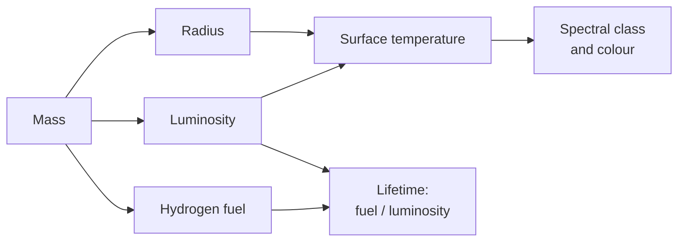

# What does a G-type star mean?

Seen from: the star view's card ("G2V · yellow dwarf, like the Sun"), and
the star selector of the form ("Spectral class", "Subtype").

## Short answer

A star's type is a temperature label. The letter, one of O B A F G K M, is
its spectral class, from the hottest to the coolest. The digit after it,
from 0 to 9, splits the class into ten steps. The Roman numeral is its
luminosity class: `V` means a dwarf on the main sequence, a star that burns
hydrogen in its core, as the Sun does. On the main sequence one number sets
all the others: the star's mass. A heavier star is hotter, larger, far
brighter and much shorter-lived. Most stars are the lightest kind, the M
dwarfs: cool, dim, red, and almost eternal.

## The science

### Spectral classes are temperatures

Astronomers first sorted stars by the dark lines in their spectra.
Annie Jump Cannon put the classes in the order used today, by falling
temperature: O, B, A, F, G, K and M (Fraknoi et al. 2022, §17.3). The lines
differ mostly because of the temperature, not the composition: "The primary
reason that stellar spectra look different is because the stars have
different temperatures" (Fraknoi et al. 2022, §17.3). In the hottest
stars hydrogen is completely ionized and cannot absorb. In the coolest,
nearly all its atoms sit in their lowest state and absorb little of the
light such stars give. In M stars below 3,500 K, bands of titanium oxide
and other molecules are very strong (Fraknoi et al. 2022, §17.3). Each
class is split into ten subclasses, 0 to 9: "A B0 star is the hottest type
of B star; a B9 star is the coolest type of B star" (same section).

| Class | Colour | Surface (K) | Strongest lines | Examples |
| --- | --- | --- | --- | --- |
| O | blue | > 30,000 | helium; weak hydrogen | 10 Lacertae |
| B | blue-white | 10,000–30,000 | neutral helium; hydrogen | Rigel, Spica |
| A | white | 7,500–10,000 | hydrogen at its strongest | Sirius, Vega |
| F | yellow-white | 6,000–7,500 | hydrogen; ionized metals | Procyon |
| G | yellow | 5,200–6,000 | weaker hydrogen; sodium | the Sun |
| K | orange | 3,700–5,200 | neutral metals | Arcturus |
| M | red | 2,400–3,700 | metals; titanium oxide bands | Betelgeuse |

The table follows Table 17.2 of Fraknoi et al. (2022), with their colour
names and examples; the lines are summed up. Arcturus and Betelgeuse are
giants, not dwarfs: the class only gives the temperature.

### The colour: a glowing body

A star shines nearly like a black body, an ideal glowing object whose
light depends only on its temperature. Its light peaks at the wavelength
$\lambda_\text{max}$, in nanometres, for a surface temperature $T$ in
kelvins (Wien's law, Fraknoi et al. 2022, §5.2):

```math
\lambda_\text{max} \approx \frac{3\times10^{6}\ \text{nm K}}{T}
```

**In words.** The hotter the surface, the bluer the light. Blue light has
the shorter wavelength, so it is the sign of a hotter star.

**Orders of magnitude.** The Sun's surface is at 5,772 K (Prša et al.
2016): its light peaks near 520 nm, in the green. A 3,060 K M5 dwarf
peaks near 980 nm, in the infrared that our eyes do not see: what we see
of it is the red end of its light. A 9,700 K A0 star peaks near 310 nm, in
the ultraviolet: we see the blue end of its light.

### The luminosity class: the V of G2V

Stars of the same temperature can be dwarfs or giants. The luminosity
class says which kind a star is (Fraknoi et al. 2022, §19.4):

| Class | Kind |
| --- | --- |
| Ia, Ib | supergiants, the brightest and less bright |
| II | bright giants |
| III | giants |
| IV | subgiants, between giants and the main sequence |
| V | main-sequence stars, the dwarfs |

A full type puts both together: "a main-sequence star with spectral class
F3 is written as F3 V" (Fraknoi et al. 2022, §19.4). On average, 90 % of
stars lie on the main sequence (Fraknoi et al. 2022, §18.4).

### Size and temperature make the luminosity

A surface at temperature $T$ radiates $\sigma T^4$ watts per square metre,
with $\sigma$ the Stefan–Boltzmann constant (Fraknoi et al. 2022, §5.2).
A star of radius $R$ has a surface of $4\pi R^2$, so its luminosity $L$,
the power it radiates, is:

```math
L = 4\pi R^2 \sigma T^4
\qquad\Longleftrightarrow\qquad
\frac{L}{L_\odot} = \left(\frac{R}{R_\odot}\right)^2
\left(\frac{T}{T_\odot}\right)^4
```

**In words.** Twice the size gives four times the light; twice the
temperature gives sixteen times. The temperature weighs much more.

**Orders of magnitude.** The Sun radiates 3.828 × 10²⁶ W from a radius of
695,700 km (Prša et al. 2016, who derive the Sun's 5,772 K from this very
law). An M5 dwarf, 3,060 K and 0.196 Sun radii, gives
$0.196^2 \times (3060/5772)^4 = 0.003$: three thousandths of the Sun, as
measured (Pecaut & Mamajek 2013).

### Mass sets everything

On the main sequence the position of a star is set by its mass: "the main
sequence turns out to be a sequence of stellar masses" (Fraknoi et al.
2022, §18.4). Luminosity grows with mass $M$ as a power law (Eker et al.
2015):

```math
\frac{L}{L_\odot} \approx \left(\frac{M}{M_\odot}\right)^{\alpha}
```

**In words.** A little more mass gives a lot more light.

**Orders of magnitude.** From 268 stars with well-measured masses, Eker
et al. (2015) find $\alpha \approx 4.8$ from 0.38 to 1.05 Sun masses, 4.3
up to 2.4, 4.0 up to 7 and 2.7 up to 32 (the values of their preprint's
Table 3). A star of twice the Sun's mass is about 20 times brighter; one
of half its mass, about 30 times dimmer.



### Mass sets the lifetime

A star's life on the main sequence is "roughly given by amount of fuel
available divided by the rate of fuel consumption" (Adams & Laughlin
1997). The fuel grows as the mass, the rate as the luminosity. A star of
the Sun's mass stays on the main sequence for roughly 10 billion years
(Fraknoi et al. 2022, §22.1). With that as the yardstick, a lifetime
$\tau$ is:

```math
\tau \approx 10\ \text{Gyr}\ \frac{M/M_\odot}{L/L_\odot}
\approx 10\ \text{Gyr}\left(\frac{M}{M_\odot}\right)^{1-\alpha}
```

Adams & Laughlin (1997) write it $\tau = 10^{10}$ yr $(M/M_\odot)^{-\alpha}$
with $\alpha \approx 3$ to 4 for stars of low mass.

**In words.** A heavier star has more fuel, but it burns it so much faster
that it dies sooner.

**Orders of magnitude.** From Table 22.1 of Fraknoi et al. (2022): an O5
star of 40 Sun masses lives 1 million years, a B0 star 10 million, an A0
star 500 million, an F0 star 2.7 billion, a G0 star 9 billion, a K0 star
14 billion and an M0 dwarf 200 billion. The smallest stars do better
still. Below about 0.25 Sun masses a star stirs all its gas, so it can burn
all its hydrogen, not only its core's. The lightest star, about 0.08 Sun
masses, keeps shining for about 11 trillion years before its core changes
(Adams & Laughlin 1997).

### How common each class is

Counting every star near the Sun shows how rare the bright ones are.
Within 10 parsecs (33 light-years), Reylé et al. (2021) list:

| Class | Stars | Share of A to M |
| --- | --- | --- |
| O, B | 0 | 0 % |
| A | 4 | 1 % |
| F | 8 | 3 % |
| G | 19, the Sun included | 6 % |
| K | 38 | 12 % |
| M | 249 | 78 % |

They also find 20 white dwarfs and 85 objects of the cooler classes L, T
and Y, mostly brown dwarfs. "Among the stars and brown dwarfs, we estimate
that around 61% are M stars" (Reylé et al. 2021). The shares in the last
column are counted from their Table 3.

### What we do not know

- **How red dwarfs die.** No red dwarf has left the main sequence yet:
  only stars of more than about 0.8 Sun masses have had the time to evolve
  (Adams & Laughlin 1997). Their lifetimes come from models, not from
  stars seen ageing.
- **The smallest masses.** The relation of Eker et al. (2015) starts at
  0.38 Sun masses: their sample has no lighter star.

## In the app

### What you see

The form's star selector offers a class and a subtype, or "Auto", which
draws a star like the stars nearby. Each class comes with a line
("M: red dwarf, cool and dim, three quarters of all stars").

The star view's card names the type and the kind of star ("G2V · yellow
dwarf, like the Sun"), then its surface temperature, luminosity, radius
and mass, metallicity, lifetime and habitable zone. The star in the middle
of the view is drawn in the colour of its light, darker at its limb, with
spots on cool stars, flares on M dwarfs, and a glow that grows with its
luminosity.

### How it computes them

The model lives in [`star.rs`](../../crates/mapgen/src/star.rs):

1. **A type is a number.** The class is 0 for O to 6 for M; the type is
   `class × 10 + subtype`, so G2 is 42 and M4.5 is 64.5. Only luminosity
   class V exists.
2. **Its values come from a table.** `SEQUENCE` copies the mean dwarf
   sequence of Pecaut & Mamajek (2013), as Mamajek's table of 2022.04.16
   gives it, from O3V to M9.5V: temperature, luminosity, radius and mass.
   Between two rows, `values` interpolates each value in log.
3. **The lifetime** is `10 Gyr × M / L`, the formula above.
4. **The colour** is a black body at the star's temperature, weighted by
   the CIE 1931 colour matching functions (the analytic fit of Wyman et
   al. 2013), turned into linear sRGB, divided by the Sun's and scaled so
   the brightest channel is 1. The Sun is white.
5. **A random star** is drawn with `CLASS_SHARES`: 76.6 % M, 12.1 % K,
   7.6 % G, 3 % F, 0.6 % A, 0.13 % B and 0.00003 % O.

Trimmed, from `crates/mapgen/src/star.rs`:

```rust
// Pecaut & Mamajek (2013): code, Teff (K), log L (L☉), R (R☉), M (M☉).
const SEQUENCE: &[Row] = &[
    // ...
    row(42.0, 5770.0, 0.01, 1.012, 1.00),  // G2V, the Sun
    // ...
    row(65.0, 3060.0, -2.52, 0.196, 0.162), // M5V
    // ...
];

/// Main-sequence lifetime, Gyr: `10 Gyr × M / L`.
pub fn lifetime_gyr(mass: f32, luminosity: f32) -> f32 {
    10.0 * mass / luminosity
}

/// The colour of a star's light, linear RGB, white-balanced on the Sun.
pub fn light_colour(teff_k: f32) -> [f32; 3] {
    let star = black_body_rgb(teff_k); // Planck × CIE 1931 → sRGB
    let sun = black_body_rgb(SUN_TEFF_K);
    let rgb = [0, 1, 2].map(|k| (star[k] / sun[k]).max(0.0));
    let max = rgb.iter().cloned().fold(f64::MIN, f64::max);
    rgb.map(|c| (c / max) as f32)
}
```

What the model gives for a few types:

| Type | Teff (K) | L (L☉) | R (R☉) | M (M☉) | Lifetime | Light (RGB) |
| --- | --- | --- | --- | --- | --- | --- |
| B0V | 31,400 | 44,700 | 7.16 | 17.7 | 4 Myr | 0.30, 0.46, 1 |
| A0V | 9,700 | 38 | 2.19 | 2.18 | 0.57 Gyr | 0.52, 0.66, 1 |
| F5V | 6,550 | 3.6 | 1.47 | 1.33 | 3.7 Gyr | 0.82, 0.88, 1 |
| G2V | 5,770 | 1.02 | 1.01 | 1.00 | 9.8 Gyr | 1, 1, 1 |
| K5V | 4,440 | 0.17 | 0.70 | 0.70 | 40 Gyr | 1, 0.82, 0.59 |
| M0V | 3,850 | 0.069 | 0.59 | 0.57 | 82 Gyr | 1, 0.72, 0.42 |
| M5V | 3,060 | 0.0030 | 0.20 | 0.162 | 540 Gyr | 1, 0.56, 0.20 |

Light colours: linear RGB, the Sun white, as `light_colour` returns them.

The star view reads the class letter for its looks
([`starSurface`](../../web/src/lib/viewer/starSystem.ts)): limb darkening
from the temperature, granulation below 7,500 K, spots on F to M stars
(strongest on M), flares on M dwarfs only. Its glow grows with the log of
the luminosity, within bounds
([`StarView.ts`](../../web/src/lib/viewer/StarView.ts)).

### Where it departs from the science

- **Only dwarfs.** Every star is on the main sequence, at the mean of its
  type. There are no giants, white dwarfs or binaries, and a star does not
  age: it keeps the same luminosity forever, while a real star brightens
  slowly as it burns its hydrogen.
- **Red dwarfs die too young.** `10 Gyr × M / L` assumes every star burns
  the same share of its hydrogen as the Sun. The app gives an M0 dwarf
  82 billion years, where Fraknoi et al. (2022) give 200 billion, and an
  M5 dwarf 540 billion years, where a fully mixed star would last
  trillions (Adams & Laughlin 1997). It never shows: any of these is far
  longer than the age of the Universe. For hot stars it errs the other
  way: B0V gets 4 million years, against 10 million in the same table.
- **The colour is a black body's.** Real M dwarfs are "strongly
  non-blackbody emitters" (Kiang et al. 2007): molecules carve wide bands
  out of their light. The app's red dwarfs have a smooth spectrum, without
  those bands.
- **Class names are traditional.** The card calls a G star a "yellow
  dwarf", the usual name, but the app draws the Sun white, as daylight
  looks to an eye used to it.
- **The shares come from a different count.** `CLASS_SHARES` follows
  Mamajek's densities of nearby stars (see the study). It is close to the
  10-parsec count above (78 % M, 12 % K, 6 % G), within the small numbers
  of that count.

## Sources

1. Fraknoi, A., Morrison, D. & Wolff, S. C. 2022, *Astronomy 2e*,
   OpenStax: [§5.2](https://openstax.org/books/astronomy-2e/pages/5-2-the-electromagnetic-spectrum)
   (Wien's and Stefan–Boltzmann's laws),
   [§17.3](https://openstax.org/books/astronomy-2e/pages/17-3-the-spectra-of-stars-and-brown-dwarfs)
   (spectral classes, Table 17.2),
   [§18.4](https://openstax.org/books/astronomy-2e/pages/18-4-the-h-r-diagram)
   (the main sequence),
   [§19.4](https://openstax.org/books/astronomy-2e/pages/19-4-the-h-r-diagram-and-cosmic-distances)
   (luminosity classes),
   [§22.1](https://openstax.org/books/astronomy-2e/pages/22-1-evolution-from-the-main-sequence-to-red-giants)
   (lifetimes, Table 22.1).
2. Prša, A. et al. 2016, "Nominal values for selected solar and planetary
   quantities: IAU 2015 Resolution B3", *The Astronomical Journal* 152, 41,
   [doi:10.3847/0004-6256/152/2/41](https://doi.org/10.3847/0004-6256/152/2/41),
   preprint [arXiv:1605.09788](https://arxiv.org/abs/1605.09788).
3. Pecaut, M. J. & Mamajek, E. E. 2013, "Intrinsic colors, temperatures,
   and bolometric corrections of pre-main-sequence stars", *The
   Astrophysical Journal Supplement Series* 208, 9,
   [doi:10.1088/0067-0049/208/1/9](https://doi.org/10.1088/0067-0049/208/1/9),
   preprint [arXiv:1307.2657](https://arxiv.org/abs/1307.2657); and
   Mamajek's updated table, ["A Modern Mean Dwarf Stellar Color and
   Effective Temperature
   Sequence"](https://www.pas.rochester.edu/~emamajek/EEM_dwarf_UBVIJHK_colors_Teff.txt),
   version 2022.04.16.
4. Eker, Z. et al. 2015, "Main-sequence effective temperatures from a
   revised mass-luminosity relation based on accurate properties", *The
   Astronomical Journal* 149, 131,
   [doi:10.1088/0004-6256/149/4/131](https://doi.org/10.1088/0004-6256/149/4/131),
   preprint [arXiv:1501.06585](https://arxiv.org/abs/1501.06585).
5. Adams, F. C. & Laughlin, G. 1997, "A dying universe: the long-term fate
   and evolution of astrophysical objects", *Reviews of Modern Physics*
   69, 337–372,
   [doi:10.1103/RevModPhys.69.337](https://doi.org/10.1103/RevModPhys.69.337),
   preprint [arXiv:astro-ph/9701131](https://arxiv.org/abs/astro-ph/9701131).
6. Reylé, C. et al. 2021, "The 10 parsec sample in the Gaia era",
   *Astronomy & Astrophysics* 650, A201,
   [doi:10.1051/0004-6361/202140985](https://doi.org/10.1051/0004-6361/202140985),
   preprint [arXiv:2104.14972](https://arxiv.org/abs/2104.14972).
7. Kiang, N. Y. et al. 2007, "Spectral signatures of photosynthesis. II.
   Coevolution with other stars and the atmosphere on extrasolar worlds",
   *Astrobiology* 7, 252–274,
   [doi:10.1089/ast.2006.0108](https://doi.org/10.1089/ast.2006.0108),
   preprint [arXiv:astro-ph/0701391](https://arxiv.org/abs/astro-ph/0701391).
8. Wyman, C., Sloan, P.-P. & Shirley, P. 2013, "Simple analytic
   approximations to the CIE XYZ color matching functions", *Journal of
   Computer Graphics Techniques* 2(2),
   [jcgt.org/published/0002/02/01](https://jcgt.org/published/0002/02/01/).

## See also

- [docs/analysis/10-stars.md](../analysis/10-stars.md): the study behind
  the app's stars, with its reference values.
- [What is the habitable zone?](habitable-zone.md): where a planet of each
  type of star can keep liquid water.
- [What colour would plants be under another star?](plant-colours.md):
  what the colour of the light does to leaves.
- [docs/system-spec.md](../system-spec.md): the star at the centre of a
  planetary system.
