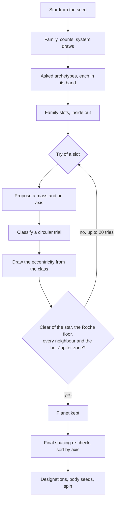

# What does a random planetary system look like?

Seen from: the star view of a system the app draws by itself (no asked
archetype, or a few asked ones the draw fills around), and the spin shown
on each planet's card.

## Short answer

Real systems come in a few recurring shapes, so the app draws one of five
"families" first (compact, solar-like, hot Jupiter, eccentric giants,
sparse) and fills it with planets. Small planets are packed a few
hundredths of an astronomical unit (au) apart, in Kepler's period ratios;
giants sit beyond the ice line, which moves out with the star's mass.
Every pair of neighbours keeps a minimum gap, counted in mutual Hill
radii, so a system that could not last is not drawn. Each planet is born
spinning: rocky ones from the giant impacts that built them, giants from
the gas they gathered. Where the sources give a range but no shape, the
app picks a shape and says so in the code.

## The science

### Five recurring shapes

No survey shows one "typical" system. Kepler's small planets come in
tightly packed chains (Weiss et al. 2018; He et al. 2019), the Solar
System has rocky planets inside and giants outside, hot Jupiters orbit
within a few days, and many giants beyond a few au travel on eccentric
orbits (Rosenthal et al. 2023). The app keeps five families, each drawn
with probability 1/5 (a choice of what to draw, not a measurement):

| Family | Planets | What it stands for |
| --- | --- | --- |
| Compact | 4 to 7 small planets within about 640 d | Kepler's multi-planet systems |
| Solar-like | 2 to 4 rocky planets inside the ice line, 1 to 4 giants beyond | The Solar System |
| Hot Jupiter | One giant within 10 d, a distant giant in 7 systems of 10 | Dawson & Johnson 2018 |
| Eccentric giants | 1 or 2 giants, 0 to 2 small planets inside them | Rosenthal et al. 2023, Zhu & Wu 2018 |
| Sparse | 0 to 2 planets, small or giant | Systems with little to show |

A hot Jupiter and a close companion rarely coexist: Huang et al. (2016)
found a companion in 0.52 % of hot-Jupiter systems against 37 % for warm
Jupiters, so the app keeps the zone inside the distant companion's band
empty.

### How far apart two neighbours sit

Two planets of masses $m_1$ and $m_2$ around a star of mass $M$, at
semi-major axes $a_1$ and $a_2$, are separated by

```math
\Delta = \frac{a_2 - a_1}{R_H},
\qquad
R_H = \left(\frac{m_1 + m_2}{3M}\right)^{1/3}\frac{a_1 + a_2}{2}
```

where $R_H$ is their mutual Hill radius (see [How close can two planets
orbit?](planet-spacing.md)). For eccentric orbits, He et al. (2019, 2020)
replace $a_2 - a_1$ by the outer planet's periapsis minus the inner
planet's apoapsis, so one formula covers every orbit.

**In words.** The gap is counted in the planets' own gravitational reach,
and an orbit that swings closer to its neighbour eats into the gap.

**Orders of magnitude.** Two 5 M⊕ planets at a period ratio of 1.5 around
a Sun-like star sit about 13 mutual Hill radii apart (derived).

Two stability rules decide whether a gap is enough:

- Two planets stay apart for ever when $\Delta > 2\sqrt{3} \approx 3.46$
  (Gladman 1993, as quoted by Fabrycky et al. 2014 and Pu & Wu 2015).
- Three planets or more have no such safe distance. Pu & Wu (2015, eq. 12
  and 14) fit the gap at which half of a population survives to age $t$:

  ```math
  K_{50} = 0.7\log_{10}\frac{t}{T_1} + 2.87
         + \frac{\sigma_e}{0.01} + \frac{\sigma_{inc}}{0.04}
  ```

  with $T_1$ the innermost period and $\sigma_e$, $\sigma_{inc}$ the
  Rayleigh scales of the eccentricities and of the mutual inclinations
  (in radians).

**In words.** The older the system, the wider the gap it needs, and
stirred-up orbits need more room.

**Orders of magnitude.** About 10 at 1 Gyr on circular, flat orbits; about
12 for Kepler-like eccentricities.

### Where the first planet sits

- **Compact systems.** The period of the innermost planet follows a broken
  power law, peaking at 12 d, rising as $P^{1.6}$ below and falling as
  $P^{-0.9}$ above (EPOS I, Mulders et al. 2018). The next planets follow
  by period ratios from the same study: the log of the fractional
  separation of neighbours is normal, with no ratio below 1.2 (the "wall"
  of Weiss et al. 2018). Near 29 % of planets sit just outside a 3:2 or 2:1
  resonance (He et al. 2019, within 5 %).
- **Rocky planets of a solar-like system.** Masses 0.4 to 2.6 Earth masses
  and gaps drawn as a shifted Rayleigh in Hill radii, offset 3.5 and scale
  14.5 (Fang & Margot 2013; Raymond et al. 2006).
- **Giants.** The first giant follows Fulton et al. (2021)'s broken power
  law in $a$: index +0.72 inside a break at 3.6 au, -0.86 beyond, up to
  30 au. The next one lies at a ratio $a_2/a_1$ below 10, peaking near 3
  (Rosenthal et al. 2023).
- **Hot Jupiters.** Between twice the Roche separation and 10 d (Dawson &
  Johnson 2018; Ford & Rasio 2006).

### The inner edge and the ice line

Nothing lives inside the star, or inside the Roche limit, where tides
tear a fluid body apart. Rappaport et al. (2013) give the shortest
surviving period of a fluid planet of density $\rho$:

```math
P_{\min} = 12.6\ \mathrm{h}\,\left(\frac{\rho}{1\ \mathrm{g\,cm^{-3}}}\right)^{-1/2}
```

**In words.** The denser the planet, the closer it can orbit; the host's
mass drops out.

**Orders of magnitude.** An Earth-density planet (5.5 g/cm³) survives down
to about 5.4 h.

The ice line is where water freezes out of the disk. Ida & Lin (2005), as
quoted by Kennedy & Kenyon (2008), give $a_{snow} = 2.7\ \mathrm{au}\times
M/M_\odot$. Giants scale their positions with it: Fulton's break near
3.6 au for the Sun moves to $3.6 \times a_{snow}/2.7$ au for another host.

### The spin a planet is born with

- **Rocky planets** gather their spin from giant impacts. Kokubo & Genda
  (2010, table 2) find a spin vector with three independent Gaussian
  components of zero mean and $\sigma = 0.41\,\omega_{cr}$, with
  $\omega_{cr}=\sqrt{GM/R^3}$ the break-up rate. The rate follows from its
  length, and the obliquity (the tilt of the spin from the orbit normal)
  from its direction, so it is isotropic: half the planets spin
  retrograde. Miguel & Brunini (2010) find the same isotropy.
- **Giants** gather gas. Bryan et al. (2018) measure spins at about 0.126
  of break-up on average, Bryan et al. (2020) a spread of a factor 4 to 5,
  and the Solar System's giants lie at 0.25 to 0.33. The period is
  $P = 2\pi R/(f\,v_{break})$ with $v_{break} = \sqrt{GM/R}$.

**What we do not know.** No source gives an obliquity for giants, nor a
primordial spin for ice giants (Bryan et al. 2018 leave them out of their
test). Tidal despinning and Cassini states change the birth spin later;
they are a separate track (#604).

## In the app

### What you see

`mapgen system` (and the app's system view) shows a star with its planets
in order of distance, `b` the closest. Each planet has a rotation period
and an obliquity on its card; the family is one of the five codes
`compact`, `solar-like`, `hot-jupiter`, `eccentric-giants`, `sparse`.
Asking for archetypes places them first, in their own bands, and the draw
fills around them without moving them.

### How it computes them

The code is in [`crates/system/src/draw`](../../crates/system/src/draw/),
[`families`](../../crates/system/src/families/),
[`spin.rs`](../../crates/system/src/spin.rs) and
[`orbit.rs`](../../crates/science/src/orbit.rs) (Kepler, ice line, Roche
floor, Hill spacing, K50).



1. **Family.** Drawn evenly on `seed.derive("family")` among the families
   that fit the host. A family is dropped only when its whole period
   support lies inside the star (never, for 0.08 to 8 M☉). The same stream
   draws the counts, one system mass and one eccentricity scale for the
   compact family, and whether a solar-like system is "stirred".
2. **Slots.** Asked archetypes come first and are never moved, then the
   family's slots from the inside out (the eccentric family places its
   giants first, so an inner planet knows the periapsis it must stay
   inside). Each slot has its own stream, `trial/<id>`, `trial/<id>/<k>`
   for copy $k \ge 2$ of an asked archetype, `trial/slot-<n>` for family
   slot $n$, so adding a draw never shifts another.
3. **A try.** Propose a mass and an axis, classify a circular trial with
   the planet model, draw the eccentricity from the class, then check the
   periapsis against the star and the Roche floor (twice that for a hot
   Jupiter), the spacing against every planet already placed, and the hot
   Jupiter's cleared zone. A slot has 20 tries; a drawn slot that spends
   them stays empty, an asked archetype is refused with `NoRoom`.
4. **Re-check.** Once every orbit is placed, $T_1$ is known and the
   pairs are checked again with the final $K_{50}$; the outer planet of a
   violating pair is dropped when drawn. Asked planets are never dropped.
5. **Names and spin.** The planets are sorted by axis, `Designation::planet`
   gives the closest rank 0, the body seed is `derive(<designation text>)`
   and the spin comes from `body_seed.derive("spin")`. The system number is
   `10 000 + hash("designation") % 90 000`.

The spacing rule of a pair, as the draw applies it:

```rust
// crates/system/src/draw/place.rs, Rules::holds
let delta = orbit::mutual_hill_spacing(inner, outer, self.host);
let k50_applies = drawn && self.total >= 3;
delta >= TWO_PLANET_FLOOR && (!k50_applies || delta >= k50)
```

The eccentricity depends on the class and the family: hot Jupiters below
0.1; giants from the family's Beta law (Rosenthal et al. 2023: the lower
half of the multi-giant law in a solar-like system, the upper half in one
system of ten and in the eccentric family; the whole multi-giant law for a
hot Jupiter's companion; the whole single-giant law when sparse); small
planets from a Rayleigh law (0.02 to 0.035 compact, 0.05 solar-like) or
the half-Gaussian of 0.32 (Van Eylen et al. 2019) in the other families.

Every count range, the 1-in-10 above and the tries per slot live in one
table, [`families/table.rs`](../../crates/system/src/families/table.rs).

The contract for the other engines: the planet model reads a `Trial`
through `classify`, which returns a `TrialOutcome` of plain values (class,
radius, mean density), since it runs on a scratch trace. The orbit's
perihelion longitude draws from `seed.derive("orbit/<trial label>")`. The
engine version is 2.

### Choices of the app

A `Definition:` picks what to draw, never a physical rule. These are the
choices this draw makes where no source gives one:

- Small-planet masses from Neil & Rogers (2020) model 2 (the planet
  interior study recommends model 2 or 3).
- A compact system takes one mass and scatters each planet's radius by
  $\sigma_R = 0.31$ (He et al. 2019); the app converts that to a mass
  scatter with the planet model's own mass-radius slope, read by two
  `classify` calls, once per system. The probe stays inside one envelope
  regime of the model (bounds 0.1, 5, 10 and 20 M⊕, given by the model's
  owner), and when both sides cross a bound the planets keep the system
  mass. A scattered mass outside 0.1 to 30 M⊕ is redrawn up to 64 times.
- $K_{50}$ applies only to pairs that hold a drawn planet, with a per-family
  $\sigma_e$ clamped to 0.05 (the top of Pu & Wu's fit).
- 20 tries per slot. A near-resonant pair picks 3:2 or 2:1 with equal
  odds; the next giant's $\ln(a_2/a_1)$ is uniform from 0.5 to $\ln 10$.
- Giant spin fraction $f$ log-uniform from 0.07 to 0.35, for gas and ice
  giants alike (it holds 0.126 and the Solar System's 0.25 to 0.33;
  Uranus 0.17 and Neptune 0.16 lie inside, Saturn's 0.40 above). A rocky
  spin is redrawn 64 times when it reaches break-up, then scaled to 0.99
  of it.
- Where a class has no law in a family, a fallback: a giant in a compact
  system draws as a small planet there (compact Rayleigh), a small planet
  in a hot-Jupiter family draws the half-Gaussian of 0.32, an ice giant
  in the eccentric family the giant Beta.
- Ice line $2.7\ \mathrm{au}\times M/M_\odot$ (user decision, 2026-11-21).

### Where it departs from the science

- **Spacing against every planet.** The sources space neighbours. The draw
  checks a new planet against every planet already placed, not only its
  neighbours, so it can only refuse more orbits than the sources do.
- **Eccentricity counted twice.** The eccentric Hill spacing uses
  periapsis and apoapsis, which already include the eccentricity, and
  $K_{50}$ adds $\sigma_e/0.01$ again. The study's own rule asks for both,
  so eccentricity is counted twice and the draw is stricter than either
  source alone.
- **$K_{50}$ is a median.** Half of the systems at that spacing survive.
  Used as a floor it keeps drawn systems on the stable side, but it is
  applied only to pairs with a drawn planet, so two asked planets face
  only the two-planet floor.
- **A $K_{50}$ of 13 to 14 removes most near-3:2 pairs of 5 M⊕ or
  more.** A pair drawn 0 to 5 % wide of 3:2 (period ratio 1.5 to 1.575)
  sits at 12.5 to 14 mutual Hill radii for two 5 M⊕ planets around a
  Sun-like star, and closer for heavier ones (derived). A floor of 13 to
  14 therefore rejects most of them, and the near-resonant share of
  compact systems falls below the 29 % drawn.
- **Fits outside their range.** $K_{50}$ is fitted on seven planets of 3
  to 9 M⊕ at 0.1 au and $\sigma_e \le 0.05$, and the spacing laws on
  Sun-like and M-dwarf Kepler hosts (0.2 to 1.4 M☉); the draw extrapolates
  to 0.08 to 8 M☉ by constant period and the ice line, and the ice line's
  linear form overshoots above 3 M☉ (21.6 au at 8 M☉, where Kennedy &
  Kenyon find 10 to 15).
- **Empty slots.** A slot that finds no valid orbit within 20 tries stays
  empty. With the tests' stand-in classifier, about 30 % of eccentric-giant
  slots and about 45 % of solar-like slots round a 0.08 M☉ star stay
  empty; both depend on the real classifier and must be measured again
  once it runs.
- **Eccentric family from the outside in.** Giants first, then the small
  planets inside their periapsis: a real system forms the other way round.
- **No tidal locking.** The spin is the birth value. A planet close to its
  star, which would be locked or in a Cassini state today, still shows its
  primordial rotation until track T2 (#604) lands.
- **Giant obliquity and ice-giant spin are guesses.** The isotropic law
  and the gas-giant spin law are not sourced for those cases.
- **Moderately eccentric hot Jupiters** (e above 0.2, still
  circularising) are left out: no distribution was found.

## Sources

The study
[architecture families](../superpowers/studies/2026-11-21-architecture-families/README.md)
gives the page of every number and how each paper was read (full text,
abstract or second-hand). Papers are listed by their arXiv preprint; the
DOIs were not re-checked for this article.

1. Weiss, L. M. et al. 2018, "The California-Kepler Survey. V. Peas in a
   Pod", AJ 155, 48,
   [arXiv:1706.06204](https://arxiv.org/abs/1706.06204).
2. Fabrycky, D. C. et al. 2014, "Architecture of Kepler's multi-transiting
   systems II", ApJ 790, 146,
   [arXiv:1202.6328](https://arxiv.org/abs/1202.6328).
3. Pu, B. & Wu, Y. 2015, "Spacing of Kepler Planets", ApJ 807, 44,
   [arXiv:1502.05449](https://arxiv.org/abs/1502.05449).
4. Fang, J. & Margot, J.-L. 2013, ApJ 767, 115,
   [arXiv:1302.7190](https://arxiv.org/abs/1302.7190).
5. He, M. Y., Ford, E. B. & Ragozzine, D. 2019, MNRAS 490, 4575,
   [arXiv:1907.07773](https://arxiv.org/abs/1907.07773); 2020,
   [arXiv:2003.04348](https://arxiv.org/abs/2003.04348) and
   [arXiv:2007.14473](https://arxiv.org/abs/2007.14473).
6. Mulders, G. D. et al. 2018 (EPOS I),
   [arXiv:1805.08211](https://arxiv.org/abs/1805.08211).
7. Van Eylen, V. et al. 2019, AJ 157, 61,
   [arXiv:1807.00549](https://arxiv.org/abs/1807.00549).
8. Raymond, S. N., Quinn, T. & Lunine, J. I. 2006, Icarus,
   [arXiv:astro-ph/0510284](https://arxiv.org/abs/astro-ph/0510284).
9. Neil, A. R. & Rogers, L. A. 2020, ApJ,
   [arXiv:1911.03582](https://arxiv.org/abs/1911.03582).
10. Dawson, R. I. & Johnson, J. A. 2018, "Origins of Hot Jupiters", ARA&A
    56, [arXiv:1801.06117](https://arxiv.org/abs/1801.06117).
11. Ford, E. B. & Rasio, F. A. 2006, ApJ 638, L45,
    [arXiv:astro-ph/0512632](https://arxiv.org/abs/astro-ph/0512632).
12. Huang, C. et al. 2016, ApJ 825, 98,
    [arXiv:1601.05095](https://arxiv.org/abs/1601.05095).
13. Rosenthal, L. J. et al. 2023 (CLS IV),
    [arXiv:2310.08707](https://arxiv.org/abs/2310.08707).
14. Fulton, B. J. et al. 2021 (CLS II), ApJS 255, 14,
    [arXiv:2105.11584](https://arxiv.org/abs/2105.11584).
15. Zhu, W. & Wu, Y. 2018, AJ 156, 92,
    [arXiv:1805.02660](https://arxiv.org/abs/1805.02660).
16. Rappaport, S. et al. 2013, ApJL 773, L15,
    [arXiv:1307.4080](https://arxiv.org/abs/1307.4080).
17. Kennedy, G. M. & Kenyon, S. J. 2008, ApJ 673,
    [arXiv:0710.1065](https://arxiv.org/abs/0710.1065), quoting Ida, S. &
    Lin, D. N. C. 2005.
18. Kokubo, E. & Genda, H. 2010, ApJL 714, L21,
    [arXiv:1003.4384](https://arxiv.org/abs/1003.4384).
19. Miguel, Y. & Brunini, A. 2010, MNRAS,
    [arXiv:1004.1406](https://arxiv.org/abs/1004.1406).
20. Bryan, M. L. et al. 2018, Nature Astronomy,
    [arXiv:1712.00457](https://arxiv.org/abs/1712.00457); 2020, ApJ,
    [arXiv:2010.07315](https://arxiv.org/abs/2010.07315).

## See also

- The studies: [architecture
  families](../superpowers/studies/2026-11-21-architecture-families/README.md)
  and its [spin](../superpowers/studies/2026-11-21-architecture-families/spin.md).
- [How close can two planets orbit?](planet-spacing.md), [Why are giant
  planets far from their star, and what is a hot
  Jupiter?](giant-planet-placement.md) and [What does an eccentric orbit
  change?](eccentric-orbits.md).
- The spec: [system draw at the
  present](../superpowers/specs/2026-11-21-system-draw-design.md).
