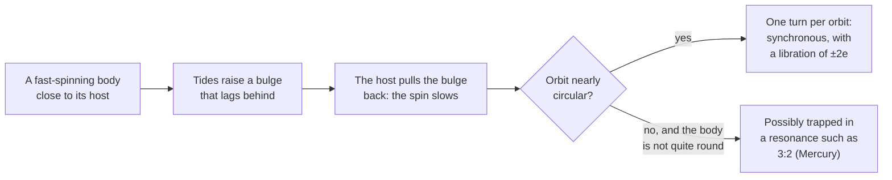

# Why does a world always show the same face to its host?

Seen from: the planet view of a moon or of a planet close to a red dwarf:
the world card ("tidally locked"), the body card in the **Info** panel ("Day:
locked to its parent"), the *Light and season* panel, and the **Rotation
dial**, whose figures read "Synchronous rotation · Libration".

## Short answer

A planet raises tides on its moon, and a star on a close planet. The tidal
bulges lag a little behind, so the host's gravity pulls on them like a brake
and slows the spin. The spin stops slowing when one turn takes exactly one
orbit: the body then keeps the same face towards its host. The brake is
fierce close in and feeble far out, which is why the Moon is locked to the
Earth but the Earth is not locked to the Sun. Locked bodies on an
elliptical orbit still turn at a steady pace while their orbital speed
changes, so their host swings a little back and forth in their sky: the
libration. A strongly eccentric orbit can trap the spin in another rhythm
instead, like Mercury's three turns every two years.

## The science


### Tides brake the spin

A host of mass $M$ stretches a body along the line between them. If the
body were perfectly elastic, its bulges would point straight at the host.
Real bodies are not: "Frictional forces inside the planet prevent the bulges
from aligning perfectly with the host star and result in torques that alter
the planet's rotational angular momentum. Eventually the tidal torques fix
the rotation rate at a specific frequency, a process called tidal locking"
(Barnes 2017). A body that spins faster than it orbits carries its bulges
ahead of the host, and the host pulls them back: the spin slows. The end
point for a circular orbit is synchronous rotation, one turn per orbit.

For a body of radius $R$, moment of inertia $I$ and initial spin rate
$\omega$, on an orbit of semi-major axis $a$ round a host of mass $M$, the
time to despin is (Gladman et al. 1996, as quoted by Thirouin et al. 2014):

```math
t_\text{lock} \approx \frac{\omega\,a^6\,I\,Q}{3\,G\,M^2\,k_2\,R^5}
```

$G$ is the gravitational constant. $Q$ measures how much tidal energy the
body loses as heat each cycle (a low $Q$ loses more), and the Love number
$k_2$ how far it deforms. For a solid body of density $\rho$, surface
gravity $g$ and rigidity $\mu$ (Thirouin et al. 2014, after Gladman et al.
1996):

```math
k_2 \approx \frac{1.5}{1 + \dfrac{19\,\mu}{2\,\rho\,g\,R}}
```

**In words.** The time grows as the sixth power of the distance: a body
twice as far out takes 64 times as long to lock. It shrinks as the square of
the host's mass. With $I$ proportional to the body's mass times $R^2$, the
body's own size drops out at a given density, except through $k_2$: small,
rigid bodies deform less and lock more slowly.

**Orders of magnitude.** With an initial day of 12 hours, $Q = 100$,
$k_2 = 0.3$ and Earth's moment of inertia ($0.33\,mR^2$, NASA), the formula
gives:

| Body and host | Distance | Time to lock |
| --- | --- | --- |
| Earth, the Sun | 1 AU | about 166 Gyr, 36 times the Sun's age |
| Mercury's distance, the Sun | 0.387 AU | about 0.56 Gyr |
| Any rocky planet, a 0.2 M☉ red dwarf | 0.1 AU | a few thousand years |

These are this article's evaluations of the formula, not measured values:
$Q$ and $k_2$ are uncertain by factors of several. For the Moon at its
present distance from the Earth, with its own moment of inertia
($0.394\,mR^2$, NASA), they give about 4 million years with $k_2 = 0.3$,
and about 24 million years with $k_2 \approx 0.05$ from
the rigidity of rock ($\mu = 3 \times 10^{10}$ Pa, the value Thirouin et
al. 2014 take from Gladman et al. 1996). The Moon formed much closer than
that (Canup 2005), where the brake is stronger still: it locked early.

### The Moon, and close-in planets

The Moon turns once in 27.32 days, exactly its orbital period round the
Earth (NASA Moon fact sheet): we always see the same hemisphere. The tide it
raises in turn on the Earth pushes it outwards (Canup 2005), now by 3.8 cm a
year (NASA).

Pluto and Charon went one step further: each keeps the same face to the
other. Pluto's day of 6.387 days equals Charon's orbit (NASA Pluto fact
sheet; JPL satellite elements).

Round other stars, the brake is strongest where planets orbit closest to
light, low-mass stars. Barnes (2017) finds "tidal locking is possible for
most planets in the habitable zones of GKM dwarf stars", and that the
habitable-zone planets of the smallest M dwarfs are "very likely to be
circularized within 1 Gyr and hence those planets will be synchronous
rotators". Close-in giants lock too: the hot Jupiter HD 209458 b "was
likely tidally spun down to synchronous rotation very quickly" (Barnes &
O'Brien 2002).

The same tides also stand a locked body upright. Heller, Leconte & Barnes
(2011) find that "Earth-like obliquities of terrestrial planets in the IHZ
around <0.25 solar mass (M_sun) stars are eroded in <0.1 Gyr". A tilted
axis would make the host climb and sink in the sky over a year.

### Libration: a steady spin on an uneven orbit

A locked body turns at a steady rate, the mean motion of its orbit. On an
elliptical orbit, though, it moves fast near periapsis and slowly near
apoapsis (Kepler's second law: equal areas in equal times). Its position
on the orbit is given by the true anomaly $\nu$; the mean anomaly $M_a$
grows steadily with time and is what the spin follows. The host's direction
seen from the body therefore drifts from the face that points to it on
average by (Murray & Dermott 1999, ch. 2, the equation of the centre):

```math
\nu - M_a \approx 2e\,\sin M_a + \tfrac{5}{4}\,e^2 \sin 2M_a
```

where $e$ is the eccentricity.

**In words.** Out of periapsis the body runs ahead of its steady spin, so
the host drifts one way in its sky; past apoapsis it lags and the host
drifts back. The swing, about $\pm 2e$ radians, is the optical libration in
longitude. Nothing wobbles: the body's spin is steady, its orbital speed is
not.

**Orders of magnitude.** The Moon's eccentricity, 0.0549 (NASA), gives
$\pm 6.3°$: from the Earth we see a little round each limb in turn. Io's,
0.004 (JPL), gives $\pm 0.5°$. The Moon's spin axis also leans 6.68° from
its orbit's axis (NASA), which tips the Earth north and south in its sky:
the libration in latitude.

### Spin–orbit resonances: Mercury's three turns in two years

A body that is not quite round, on an eccentric orbit, can be caught
before it reaches one turn per orbit. Mercury turns in 58.65 days and
orbits in 87.97 (NASA): three turns every two orbits, a 3:2 resonance. Its
solar day lasts 176 days, two of its years. The rhythm holds because "the
axis of minimum moment of inertia is always aligned with the direction to
the Sun when Mercury is at the perihelion of its orbit" (Correia & Laskar
2009).

How it got there is a matter of chance. Mercury's eccentricity has varied
chaotically, between near zero and more than 0.45, and in simulations of its
history the 3:2 state is the most likely outcome, "occurring about 55.4% of
the time" (Correia & Laskar 2009, summarising Correia & Laskar 2004). Barnes
(2017) puts the general case plainly: locked planets "on eccentric orbits
will either librate or rotate super-synchronously".



### What we do not know

- **$Q$ and $k_2$.** They depend on a body's interior and on the tidal
  frequency, and the common models disagree. Barnes (2017) compares two
  of them and finds, for example, that one predicts "the Earth's rotation
  rate would have synchronized after 4.5 Gyr if its initial rotation period
  was 3 days, it had no satellites, and it always maintained the modern
  Earth's tidal properties". Locking times are good to orders of magnitude
  at best.
- **Atmospheres.** A star heats an atmosphere unevenly, and the resulting
  thermal tide pushes against the solid tide: thermal tides "cause Venus to
  rotate retrogradely" (Leconte et al. 2015). The same authors find that
  "even a relatively thin atmosphere can drive terrestrial planets' rotation
  away from synchronicity" round stars more massive than about 0.5 to 0.7
  solar masses. Habitable-zone planets of K stars may not be locked at
  all.
- **Which resonance.** Capture into 1:1, 3:2 or 2:1 depends on the
  eccentricity's history, which is chaotic for Mercury and unknown for
  exoplanets (Correia & Laskar 2009).

## In the app

### What you see

- **A planet locked to its star** has "tidally locked" on its world card,
  beside the star's apparent size, with the tooltip "One face always lit:
  the star does not move in its sky". Its map has the point under the star
  at its centre, a hot day side and a frozen night side, and the *Light and
  season* panel says "Tidally locked: the star stays above the centre of
  the map on average, with no seasons". It has no moons.
- **A moon** is locked to its planet unless it was captured. Its body card
  in the **Info** panel reads "Day: locked to its parent"; its sky label
  "Locked: the same face to its planet: a turn per orbit". In its sky, the
  planet hangs over longitude 180° of its map and swings slightly. A
  captured moon says instead "This captured moon is not locked: it spins in
  … h, its planet rising and setting".
- **A planet with a heavy moon** (a binary such as Pluto and Charon) turns
  with that moon: its day is the moon's month, and the moon hangs over the
  same point of its sky.
- **The Rotation dial** (icon bar, sky group) draws a ring round the
  equator of a body of a system. On a locked body the ring is graduated
  against the host, 0° pointing at it; the pointer starts from the face
  turned to the host and swings round 0° by the libration. The *Light and
  season* panel then reads, for example, "Synchronous rotation · Libration
  +0.3° (±0.4°)", and its glossary defines synchronous rotation and
  libration. The camera turns with a locked body by default, so the host
  stays still on screen.

### How it computes them

**Whether a planet is locked.** The generator keeps the scaling of the
first equation for an Earth-like planet (`locking_gyr` in
[star.rs](../../crates/mapgen/src/star.rs)), and compares it with the star's
age, 4.6 Gyr or the star's whole main-sequence life if shorter:

```rust
/// Time for the star's tides to lock an Earth-like planet's spin, Gyr
/// (Gladman et al. 1996, with an initial 12 h day, Q = 100, k₂ = 0.3):
/// about 166 Gyr × a⁶ / M², so Earth is far from it and a habitable planet
/// of an M dwarf locks within a million years.
pub fn locking_gyr(orbit_au: f32, mass: f32) -> f32 {
    166.0 * orbit_au.powi(6) / (mass * mass)
}

// In StarInfo::new:
let locking = locking_gyr(orbit_au, v.mass);
let tidally_locked = locking < AGE_GYR.min(lifetime);
```

`a` is in AU and `M` in solar masses. A locked planet then:

1. **Turns once a year.** Its day is its year in the system
   ([system.rs](../../crates/mapgen/src/system.rs)); a hot or locked giant's
   too ([giant_world.rs](../../crates/mapgen/src/giant_world.rs)).
2. **Gets a substellar climate.** Its temperature follows the angle from
   the point under the star instead of the latitude (`LockedClimate`, see
   [generation.rs](../../crates/mapgen/src/generation.rs)).
3. **Gets a circular orbit** when its eccentricity is drawn, tides having
   circularised it
   ([request.rs](../../crates/mapgen/src/request.rs)).
4. **Keeps no moons**: its synchronous orbit lies beyond its Hill sphere
   ([moons.rs](../../crates/mapgen/src/moons.rs); see
   [How many moons can a planet keep?](how-many-moons.md)).
5. **Draws more craters on its leading side** since it locked
   ([craters.rs](../../crates/mapgen/src/craters.rs)).

**Whether a moon is locked.** [moons.rs](../../crates/mapgen/src/moons.rs)
does not compute a time: giant-impact, debris and disk moons are locked,
captured ones are not (`tidally_locked: c.origin != MoonOrigin::Captured`).
A moon of 0.05 of its planet's mass or more also locks the planet: the
planet's day becomes the moon's month (`BINARY_MASS_RATIO`).

**The libration.** The viewer places each body from `system.json`
([systemSky.ts](../../web/src/lib/systemSky.ts)). A locked body turns
steadily: its longitude 180° faces the point of its orbit at the mean
anomaly, not the host itself, so the host is off by the true minus the mean
anomaly:

```ts
// placeSystem: a locked body faces where its host would be on a circular
// orbit at the same mean anomaly.
if (body.spin.locked) {
  z = pointOnOrbit(plane, body.orbit.periapsis_deg * DEG
    + anomalies(body.orbit, days).mean, 1);
}

// The libration after `days`, radians in (-pi, pi].
export function libration(orbit: Orbit, days: number): number {
  const { mean, true: nu } = anomalies(orbit, days);
  return Math.atan2(Math.sin(nu - mean), Math.cos(nu - mean));
}
```

The dial ([rotationDial.ts](../../web/src/lib/rotationDial.ts), drawn by
[viewer/rotationDial.ts](../../web/src/lib/viewer/rotationDial.ts)) reads
the host's bearing on the equator and shows the amplitude as $2e$.

### Where it departs from the science

- **One brake for every world.** The locking time uses Earth's $Q$, $k_2$,
  moment of inertia and a 12-hour first day for every planet, giants
  included. Real values vary by orders of magnitude between bodies (Barnes
  2017), so the line between locked and free is only a rough one. Giants
  deform and lose tidal energy quite differently from rock, yet get the same
  rule.
- **All or nothing.** A planet just outside the limit keeps a day drawn
  from 12 to 36 hours, as fast as one far out. Real planets slow down
  gradually before they lock.
- **No spin–orbit resonances.** Every locked body is in 1:1. A world like
  the `mercury-like` preset (the Sun, 0.387 AU, eccentricity 0.2056) comes
  out locked, its locking time 0.56 Gyr, with a fixed substellar point.
  The real Mercury turns three times every two orbits, with a 176-day solar
  day. This would show on any locked planet with a large eccentricity.
- **Eccentric locked planets in systems.** A lone world locked to its star
  gets a circular orbit when its eccentricity is drawn, and the main README
  says so. A planet of a planetary system keeps the eccentricity the system
  drew for its slot, locked or not ([system.rs](../../crates/mapgen/src/system.rs)).
  Its star then swings by $\pm 2e$ in its sky and on the dial, while its
  climate keeps a fixed substellar point. At $e = 0.3$ the swing is about
  ±35°.
- **Tilted locked planets.** Tides should stand a locked planet upright
  (Heller et al. 2011), but a planet locked to its star keeps its drawn
  axial tilt, from 0 to 60° since it has no moon. Its climate ignores the
  tilt; its sky in a system does not, so the star climbs and sinks by the
  tilt over the year there.
- **No libration in latitude for moons.** Moons of a system get an axial
  tilt of 0 (`params_tilt` in
  [system.rs](../../crates/mapgen/src/system.rs)), so their planet only
  swings east and west, not north and south as the Earth does in the Moon's
  sky. Their own worlds are generated with a tilt of 1.5°
  (`MOON_TILT_DEG` in [moons.rs](../../crates/mapgen/src/moons.rs)): the two
  disagree slightly.
- **Moons locked by origin.** A moon's lock comes from how it formed, not
  from a timescale. A small moon far out, formed in a debris disk, would be
  locked even where tides are too weak to have done it.
- **Binaries by mass ratio.** The planet turns with its moon from a mass
  ratio of 0.05, a calibration choice: no time is computed for the planet's
  own despinning.
- **The amplitude is first order.** The dial shows $2e$; the true swing is
  slightly larger at high eccentricity (28.9° rather than 28.6° at
  $e = 0.25$). The angle drawn is exact.
- **No atmospheric tides.** The thermal tides that may keep habitable-zone
  planets of K stars turning (Leconte et al. 2015) are not modelled.

## Sources

1. Gladman, B., Quinn, D. D., Nicholson, P. & Rand, R. 1996, "Synchronous
   locking of tidally evolving satellites", *Icarus* 122, 166–192,
   [doi:10.1006/icar.1996.0117](https://doi.org/10.1006/icar.1996.0117).
   The despinning time and the rigidity of rock.
2. Thirouin, A., Noll, K. S., Ortiz, J. L. & Morales, N. 2014, "Rotational
   properties of the binary and non-binary populations in the
   Trans-Neptunian belt", *Astronomy & Astrophysics* 569, A3,
   [doi:10.1051/0004-6361/201423567](https://doi.org/10.1051/0004-6361/201423567),
   preprint [arXiv:1407.1214](https://arxiv.org/abs/1407.1214). Quotes
   Gladman et al.'s locking time (eq. 7) and Love number (eq. 6).
3. Barnes, R. 2017, "Tidal locking of habitable exoplanets", *Celestial
   Mechanics and Dynamical Astronomy* 129, 509–536,
   [doi:10.1007/s10569-017-9783-7](https://doi.org/10.1007/s10569-017-9783-7),
   preprint [arXiv:1708.02981](https://arxiv.org/abs/1708.02981).
4. Barnes, J. W. & O'Brien, D. P. 2002, "Stability of satellites around
   close-in extrasolar giant planets", *The Astrophysical Journal* 575,
   1087–1093, [doi:10.1086/341477](https://doi.org/10.1086/341477),
   preprint [arXiv:astro-ph/0205035](https://arxiv.org/abs/astro-ph/0205035).
5. Heller, R., Leconte, J. & Barnes, R. 2011, "Tidal obliquity evolution of
   potentially habitable planets", *Astronomy & Astrophysics* 528, A27,
   [doi:10.1051/0004-6361/201015809](https://doi.org/10.1051/0004-6361/201015809),
   preprint [arXiv:1101.2156](https://arxiv.org/abs/1101.2156).
6. Leconte, J., Wu, H., Menou, K. & Murray, N. 2015, "Asynchronous rotation
   of Earth-mass planets in the habitable zone of lower-mass stars",
   *Science* 347, 632–635,
   [doi:10.1126/science.1258686](https://doi.org/10.1126/science.1258686),
   preprint [arXiv:1502.01952](https://arxiv.org/abs/1502.01952).
7. Correia, A. C. M. & Laskar, J. 2004, "Mercury's capture into the 3/2
   spin-orbit resonance as a result of its chaotic dynamics", *Nature* 429,
   848–850, [doi:10.1038/nature02609](https://doi.org/10.1038/nature02609).
8. Correia, A. C. M. & Laskar, J. 2009, "Mercury's capture into the 3/2
   spin–orbit resonance including the effect of core–mantle friction",
   *Icarus* 201, 1–11,
   [doi:10.1016/j.icarus.2008.12.034](https://doi.org/10.1016/j.icarus.2008.12.034),
   preprint [arXiv:0901.1843](https://arxiv.org/abs/0901.1843).
9. Canup, R. M. 2005, "A giant impact origin of Pluto-Charon", *Science*
   307, 546–550,
   [doi:10.1126/science.1106818](https://doi.org/10.1126/science.1106818).
   The Moon and Charon formed closer in and were pushed out by tides.
10. Murray, C. D. & Dermott, S. F. 1999, *Solar System Dynamics*, Cambridge
    University Press, ch. 2 (the equation of the centre).
11. NASA Space Science Data Coordinated Archive, [Moon fact
    sheet](https://nssdc.gsfc.nasa.gov/planetary/factsheet/moonfact.html),
    [Mercury fact
    sheet](https://nssdc.gsfc.nasa.gov/planetary/factsheet/mercuryfact.html),
    [Pluto fact
    sheet](https://nssdc.gsfc.nasa.gov/planetary/factsheet/plutofact.html)
    and [Earth fact
    sheet](https://nssdc.gsfc.nasa.gov/planetary/factsheet/earthfact.html).
12. JPL Solar System Dynamics, [planetary satellite mean
    elements](https://ssd.jpl.nasa.gov/sats/elem/) (Io's eccentricity,
    Charon's period).

## See also

- [docs/analysis/10-stars.md](../analysis/10-stars.md), step 5: the study
  behind locked planets and their climate.
- [docs/analysis/11-moons.md](../analysis/11-moons.md): locked moons and
  binaries.
- [The rotation dial spec](../superpowers/specs/2026-11-06-rotation-dial-design.md):
  the steady spin of locked bodies and how the dial shows the libration.
- [docs/system-spec.md](../system-spec.md): how a body's spin is stored.
- [How many moons can a planet keep, and how large?](how-many-moons.md)
- [What does an eccentric orbit change?](eccentric-orbits.md)
