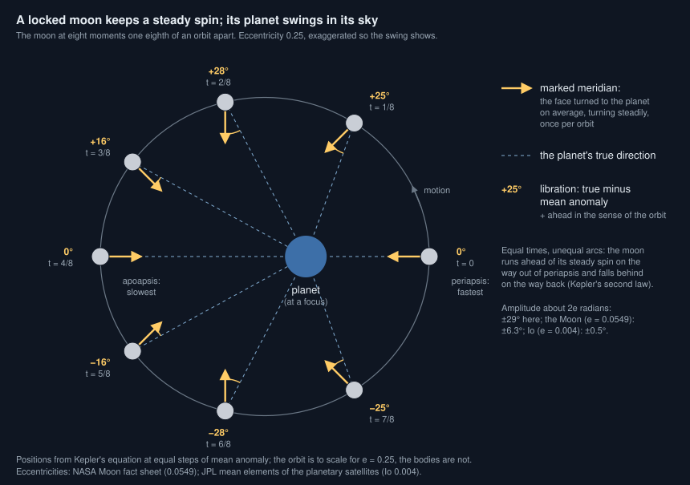
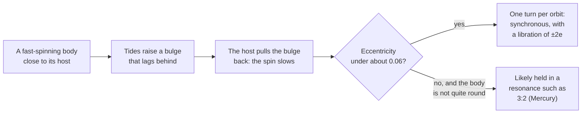

# Why does a world always show the same face to its host?

Seen from: the planet view of a moon or of a planet close to a red dwarf:
the world card ("tidally locked", or "3:2 spin–orbit resonance"), the body
card in the **Info** panel ("Day: locked to its parent", or "3:2
resonance"), the *Light and season* panel, and the **Rotation dial**, whose
figures read "Synchronous rotation · Libration" or "3:2 spin–orbit
resonance · Rotation".

## Short answer

A planet raises tides on its moon, and a star on a close planet. The tidal
bulges lag a little behind, so the host's gravity pulls on them like a brake
and slows the spin. The spin stops slowing when one turn takes exactly one
orbit: the body then keeps the same face towards its host. The brake is
fierce close in and feeble far out, which is why the Moon is locked to the
Earth but the Earth is not locked to the Sun. Locked bodies on an
elliptical orbit still turn at a steady pace while their orbital speed
changes, so their host swings a little back and forth in their sky: the
libration. A markedly eccentric orbit can trap the spin in another rhythm
instead, like Mercury's three turns every two years. The same tides also
round the orbit, but far more slowly than they brake the spin, so only the
closest planets lose their eccentricity.

## The science



### Tides brake the spin

A host of mass $M$ stretches a body along the line between them. If the
body were perfectly elastic, its bulges would point straight at the host.
Real bodies are not: "Frictional forces inside the planet prevent the bulges
from aligning perfectly with the host star and result in torques that alter
the planet's rotational angular momentum. Eventually the tidal torques fix
the rotation rate at a specific frequency, a process called tidal locking"
(Barnes 2017). A body that spins faster than it orbits carries its bulges
ahead of the host, and the host pulls them back: the spin slows. The end
point for a circular orbit is synchronous rotation, one turn per orbit.

For a body of radius $R$, moment of inertia $I$ and initial spin rate
$\omega$, on an orbit of semi-major axis $a$ round a host of mass $M$, the
time to despin is (Gladman et al. 1996, as quoted by Thirouin et al. 2014):

```math
t_\text{lock} \approx \frac{\omega\,a^6\,I\,Q}{3\,G\,M^2\,k_2\,R^5}
```

$G$ is the gravitational constant. $Q$ measures how much tidal energy the
body loses as heat each cycle (a low $Q$ loses more), and the Love number
$k_2$ how far it deforms. For a solid body of density $\rho$, surface
gravity $g$ and rigidity $\mu$ (Thirouin et al. 2014, after Gladman et al.
1996):

```math
k_2 \approx \frac{1.5}{1 + \dfrac{19\,\mu}{2\,\rho\,g\,R}}
```

**In words.** The time grows as the sixth power of the distance: a body
twice as far out takes 64 times as long to lock. It shrinks as the square of
the host's mass. With $I$ proportional to the body's mass times $R^2$, the
body's own size drops out at a given density, except through $k_2$: small,
rigid bodies deform less and lock more slowly.

**Orders of magnitude.** With an initial day of 12 hours, $Q = 100$,
$k_2 = 0.3$ and Earth's moment of inertia ($0.33\,mR^2$, NASA), the formula
gives:

| Body and host | Distance | Time to lock |
| --- | --- | --- |
| Earth, the Sun | 1 AU | about 166 Gyr, 36 times the Sun's age |
| Mercury's distance, the Sun | 0.387 AU | about 0.56 Gyr |
| Any rocky planet, a 0.2 M☉ red dwarf | 0.1 AU | a few thousand years |

These are this article's evaluations of the formula, not measured values:
$Q$ and $k_2$ are uncertain by factors of several. For the Moon at its
present distance from the Earth, with its own moment of inertia
($0.394\,mR^2$, NASA), they give about 4 million years with $k_2 = 0.3$,
and about 24 million years with $k_2 \approx 0.05$ from
the rigidity of rock ($\mu = 3 \times 10^{10}$ Pa, the value Thirouin et
al. 2014 take from Gladman et al. 1996). The Moon formed much closer than
that (Canup 2005), where the brake is stronger still: it locked early.

### The Moon, and close-in planets

The Moon turns once in 27.32 days, exactly its orbital period round the
Earth (NASA Moon fact sheet): we always see the same hemisphere. The tide it
raises in turn on the Earth pushes it outwards (Canup 2005), now by 3.8 cm a
year (NASA).

Pluto and Charon went one step further: each keeps the same face to the
other. Pluto's day of 6.387 days equals Charon's orbit (NASA Pluto fact
sheet; JPL satellite elements).

Round other stars, the brake is strongest where planets orbit closest to
light, low-mass stars. Barnes (2017) finds "tidal locking is possible for
most planets in the habitable zones of GKM dwarf stars", and that the
habitable-zone planets of the smallest M dwarfs are "very likely to be
circularized within 1 Gyr and hence those planets will be synchronous
rotators". Close-in giants lock too: the hot Jupiter HD 209458 b "was
likely tidally spun down to synchronous rotation very quickly" (Barnes &
O'Brien 2002).

The same tides also stand a locked body upright. Heller, Leconte & Barnes
(2011) find that "Earth-like obliquities of terrestrial planets in the IHZ
around <0.25 solar mass (M_sun) stars are eroded in <0.1 Gyr". A tilted
axis would make the host climb and sink in the sky over a year.

### Libration: a steady spin on an uneven orbit

A locked body turns at a steady rate, the mean motion of its orbit. On an
elliptical orbit, though, it moves fast near periapsis and slowly near
apoapsis (Kepler's second law: equal areas in equal times). Its position
on the orbit is given by the true anomaly $\nu$; the mean anomaly $M_a$
grows steadily with time and is what the spin follows. The host's direction
seen from the body therefore drifts from the face that points to it on
average by (Murray & Dermott 1999, ch. 2, the equation of the centre):

```math
\nu - M_a \approx 2e\,\sin M_a + \tfrac{5}{4}\,e^2 \sin 2M_a
```

where $e$ is the eccentricity.

**In words.** Out of periapsis the body runs ahead of its steady spin, so
the host drifts one way in its sky; past apoapsis it lags and the host
drifts back. The swing, about $\pm 2e$ radians, is the optical libration in
longitude. Nothing wobbles: the body's spin is steady, its orbital speed is
not.

**Orders of magnitude.** The Moon's eccentricity, 0.0549 (NASA), gives
$\pm 6.3°$: from the Earth we see a little round each limb in turn. Io's,
0.004 (JPL), gives $\pm 0.5°$. The Moon's spin axis also leans 6.68° from
its orbit's axis (NASA), which tips the Earth north and south in its sky:
the libration in latitude.

### Spin–orbit resonances: Mercury's three turns in two years

A body that is not quite round, on an eccentric orbit, can be caught
before it reaches one turn per orbit. Mercury turns in 58.65 days and
orbits in 87.97 (NASA): three turns every two orbits, a 3:2 resonance. Its
solar day lasts 176 days, two of its years. The rhythm holds because "the
axis of minimum moment of inertia is always aligned with the direction to
the Sun when Mercury is at the perihelion of its orbit" (Correia & Laskar
2009).

How it got there is a matter of chance. Mercury's eccentricity has varied
chaotically, between near zero and more than 0.45, and in simulations of its
history the 3:2 state is the most likely outcome, "occurring about 55.4% of
the time" (Correia & Laskar 2009, summarising Correia & Laskar 2004). Barnes
(2017) puts the general case plainly: locked planets "on eccentric orbits
will either librate or rotate super-synchronously".

Where is the line between one turn per orbit and three turns every two?
Ribas et al. (2016) follow the spin of Proxima b, an Earth-mass planet of
a red dwarf, with a tidal model (a Maxwell rheology, as in Makarov 2012).
"the ω≈3n/2 rotation becomes stable for an eccentricity greater than
0.06–0.07", and "capture is rather unlikely for an eccentricity below
0.06": "At eccentricities lower than 0.06, the most probable state becomes
the synchronous one". Capture into 3:2 gets likelier as the eccentricity
grows: Makarov (2012) finds "entrapment in the 3:2 resonance is inevitable
at eccentricities between 0.2 and 0.41" for a Mercury-like planet. Above
$e = 0.16$ the 2:1 rhythm becomes stable too (Ribas et al. 2016). The
0.06 line is for Proxima b's orbital period and one tidal model.

### Tides round the orbit too, but slowly

The tides raised on a planet also damp its orbital eccentricity. For a
planet of mass $m$ and radius $R$ on an orbit of semi-major axis $a$ and
mean motion $n$ round a star of mass $M$, with the modified quality factor
$Q' = 3Q/2k_2$, the time to round the orbit is (Goldreich & Soter 1966,
as written by Jackson, Greenberg & Barnes 2008):

```math
\tau_e = \frac{4}{63}\,Q'\,\frac{m}{M}\left(\frac{a}{R}\right)^5\frac{1}{n}
```

**In words.** It grows as the 6.5th power of the distance, against the
sixth for the spin: the tides round an orbit a hundred thousand to a
million times more slowly than they despin the planet.

**Orders of magnitude.** For an Earth with $Q = 100$ and $k_2 = 0.3$
($Q' = 500$), this article's evaluation is about $10^8$ Gyr at 1 AU from
the Sun. Only planets within about 0.05 AU of a red dwarf, or 0.07 AU of
the Sun, are circularised in 4.6 Gyr (the Sun's age; the generator uses the age
of each system). The habitable zone of a red dwarf is
despun but keeps its eccentricity, which is why Mercury-like and
red-dwarf planets can be in 3:2. The formula is the planetary term of
Jackson et al.'s equation 4, read in their preprint; it is rewritten here
with $Q'$ for their $Q_p$ (they fold the Love number into $Q$, "similar to
the $Q'$ of Goldreich & Soter").



### What we do not know

- **$Q$ and $k_2$.** They depend on a body's interior and on the tidal
  frequency, and the common models disagree. Barnes (2017) compares two
  of them and finds, for example, that one predicts "the Earth's rotation
  rate would have synchronized after 4.5 Gyr if its initial rotation period
  was 3 days, it had no satellites, and it always maintained the modern
  Earth's tidal properties". Locking times are good to orders of magnitude
  at best.
- **Atmospheres.** A star heats an atmosphere unevenly, and the resulting
  thermal tide pushes against the solid tide: thermal tides "cause Venus to
  rotate retrogradely" (Leconte et al. 2015). The same authors find that
  "even a relatively thin atmosphere can drive terrestrial planets' rotation
  away from synchronicity" round stars more massive than about 0.5 to 0.7
  solar masses. Habitable-zone planets of K stars may not be locked at
  all.
- **Which resonance.** Capture into 1:1, 3:2 or 2:1 depends on the
  eccentricity's history, which is chaotic for Mercury and unknown for
  exoplanets (Correia & Laskar 2009). Ribas et al. (2016) add: "This
  highlights the need for further constraints on the eccentricity of the
  planet, its possible evolution, and the existence of additional
  planets".

## In the app

### What you see

- **A planet locked to its star** has "tidally locked" on its world card,
  beside the star's apparent size, with the tooltip "One face always lit:
  the star does not move in its sky". Its map has the point under the star
  at its centre, a hot day side and a frozen night side, and the *Light and
  season* panel says "Tidally locked: the star stays above the centre of
  the map on average, with no seasons". Its axis stands upright (a drawn
  tilt is 0). It may keep a moonlet light enough to outlast the system's
  age, never a large moon.
- **A planet in the 3:2 resonance** (a despun planet on an orbit of
  eccentricity 0.06 or more, such as the `mercury-like` preset) has "3:2
  spin–orbit resonance" on its world card instead, with the tooltip "Like
  Mercury: the star's tides hold it at three turns every two orbits, its
  eccentric orbit keeping it from locking; its solar day lasts two years".
  Its climate is that of a rotating planet, with seasons. Its body card
  says "Day: …, 3:2 resonance: three turns every two orbits", and the dial
  reads "3:2 spin–orbit resonance · Rotation …". The `mercury-like` preset
  has a 176-day solar day, two of its 88-day years.
- **A moon** is locked to its planet when the planet's tides have despun it
  within the system's age, which is the case of the giant-impact and debris
  moons, and usually of the regular moons of a giant. Its body card in the
  **Info** panel reads "Day: locked to its parent"; its sky label "Locked:
  the same face to its planet: a turn per orbit". In its sky, the planet
  hangs over longitude 180° of its map and swings slightly. A small captured
  moon far out, whose despinning would take longer than the age, says
  instead "This captured moon is not locked: it spins in … h, its planet
  rising and setting". The world of a moon is never locked to the star: it
  keeps the climate of a rotating world, its star rising and setting.
- **A planet with a heavy moon** (a binary such as Pluto and Charon) turns
  with that moon when the moon's tides despin it within the age: its day
  is the moon's month, and the moon hangs over the same point of its sky.
- **The Rotation dial** (icon bar, sky group) draws a ring round the
  equator of a body of a system. On a locked body the ring is graduated
  against the host, 0° pointing at it; the pointer starts from the face
  turned to the host and swings round 0° by the libration. The *Light and
  season* panel then reads, for example, "Synchronous rotation · Libration
  +0.3° (±0.4°)", and its glossary defines synchronous rotation, libration
  and the 3:2 resonance. The camera turns with a locked body by default, so
  the host stays still on screen.

### How it computes them

**Whether a planet is despun, locked or in 3:2.** The generator keeps the
scaling of the first equation for an Earth-like planet (`locking_gyr` in
[star.rs](../../crates/mapgen/src/star.rs)) and compares it with the star's
age (`age_gyr` of the star: drawn per system between 0.5 and 10 Gyr, or
the star's whole main-sequence life if shorter; 4.6 Gyr, the Sun's, for
stored files that have none). An older system therefore locks more of its
planets. A despun
planet is then locked below an eccentricity of 0.06 and in the 3:2
resonance from it (`locked` and `resonant` in
[spin.rs](../../crates/mapgen/src/spin.rs), the rule of Ribas et al. 2016):

```rust
/// Time for the star's tides to lock an Earth-like planet's spin, Gyr
/// (Gladman et al. 1996, with an initial 12 h day, Q = 100, k₂ = 0.3):
/// about 166 Gyr × a⁶ / M², so Earth is far from it and a habitable planet
/// of an M dwarf locks within a million years.
pub fn locking_gyr(orbit_au: f32, mass: f32) -> f32 {
    166.0 * orbit_au.powi(6) / (mass * mass)
}

// In StarInfo::new:
let locking = locking_gyr(orbit_au, v.mass);
tidally_locked: crate::spin::locked(locking, age_gyr, eccentricity),
spin_orbit_3_2: crate::spin::resonant(locking, age_gyr, eccentricity),

// spin.rs
pub const RESONANCE_CAPTURE_ECCENTRICITY: f32 = 0.06;

pub fn locked(locking_gyr: f32, age_gyr: f32, eccentricity: f32) -> bool {
    locking_gyr < age_gyr && eccentricity < RESONANCE_CAPTURE_ECCENTRICITY
}

pub fn resonant(locking_gyr: f32, age_gyr: f32, eccentricity: f32) -> bool {
    locking_gyr < age_gyr && eccentricity >= RESONANCE_CAPTURE_ECCENTRICITY
}
```

`a` is in AU and `M` in solar masses. The orbit's eccentricity is 0 only
when the tides have circularised it: `circularisation_gyr` evaluates
$\tau_e$ above for an Earth-like planet (`Q' = 500`) and compares it with
the same age. Anything farther out than about 0.05 AU from a red dwarf, or
0.07 AU from the Sun, keeps the eccentricity it was drawn or given, and
those closer in end locked. A despun planet then:

1. **Turns once a year** (locked), or **three times every two years**
   (3:2): its sidereal day is its year divided by 1 or by 1.5 in the
   system ([system.rs](../../crates/mapgen/src/system.rs)) and in the moons
   of a lone world ([moons.rs](../../crates/mapgen/src/moons.rs)). A hot or
   locked giant turns once a year too
   ([giant_world.rs](../../crates/mapgen/src/giant_world.rs)).
2. **Gets a substellar climate if locked.** Its temperature follows the
   angle from the point under the star instead of the latitude
   (`LockedClimate`, see
   [generation.rs](../../crates/mapgen/src/generation.rs)). A planet in
   3:2 has the climate of a rotating one, with the wind belts of its
   slow day.
3. **Gets a circular orbit** when the tides have circularised it, in a
   lone world and in a system alike
   ([request.rs](../../crates/mapgen/src/request.rs),
   `tidal_eccentricity` in
   [system.rs](../../crates/mapgen/src/system.rs)).
4. **Stands upright:** a drawn axial tilt becomes 0 (`spin::upright`, after
   Heller et al. 2011: the Cassini state, Mercury's obliquity being 2
   arcminutes). A tilt the user sets stays.
5. **Keeps only the moons light enough to outlast its age** (Barnes &
   O'Brien 2002, eq. 8; see
   [How many moons can a planet keep?](how-many-moons.md)).
6. **Draws more craters on its leading side** since it locked, if it is
   locked, not in 3:2
   ([craters.rs](../../crates/mapgen/src/craters.rs)).

**Giants.** A giant has its own constants in `giant_locking_gyr`: the Love
number $k_2 = 0.565$ measured by Juno (Durante et al. 2020), $Q \approx
5 \times 10^4$ from the $k_2/Q$ Lainey et al. (2009) measured in the
Galilean moons' orbits, a moment of inertia of $0.254\,mR^2$ and a first
day of 10 hours. Jupiter's density makes its locking time about 56 times
a rocky planet's at the same place: a hot Jupiter locks in a hundred
thousand years, a giant at 0.3 AU from the Sun never does. A despun giant
is locked, never in 3:2, and its orbit is circularised by its own tides
(`giant_circularised`).

**Whether a moon is locked.** [moons.rs](../../crates/mapgen/src/moons.rs)
computes the time with `despin_gyr`, Gladman et al.'s formula for the
moon: a first day of 12 hours, $Q = 100$, a moment of inertia of
$0.4\,mR^2$, and a Love number from the rigidity of rock
($\mu = 3 \times 10^{10}$ Pa, at most 0.3). A moon is locked when that is
shorter than the age. Phobos takes about 20,000 years; the Earth would
take 35 Gyr to turn with the Moon, so only a heavy, close moon can lock its
planet (a binary like Pluto and Charon: under 0.05 Gyr). A moon locked
this way also gets the shape of a tidal ellipsoid (see
[Why are small moons shaped like potatoes?](moon-shapes.md)).

**The moon's tilt.** A moon's world and its spin in the system share one
tilt (`moon_tilt_deg`): 6.68° for a giant-impact moon, the Moon's
obliquity to its orbit, so that its planet swings north and south in its
sky; 0 for the others (a calibration with no source).

**The libration.** The viewer places each body from `system.json`
([systemSky.ts](../../web/src/lib/systemSky.ts)). A locked body turns
steadily: its longitude 180° faces the point of its orbit at the mean
anomaly, not the host itself, so the host is off by the true minus the mean
anomaly. A body in 3:2 turns at 1.5 times the mean anomaly from its
periapsis, so its long axis faces the star at each periapsis:

```ts
// placeSystem: a locked body faces where its host would be on a circular
// orbit at the same mean anomaly.
if (body.spin.locked) {
  z = pointOnOrbit(plane, body.orbit.periapsis_deg * DEG
    + anomalies(body.orbit, days).mean, 1);
}

// The libration after `days`, radians in (-pi, pi].
export function libration(orbit: Orbit, days: number): number {
  const { mean, true: nu } = anomalies(orbit, days);
  return Math.atan2(Math.sin(nu - mean), Math.cos(nu - mean));
}
```

The dial ([rotationDial.ts](../../web/src/lib/rotationDial.ts), drawn by
[viewer/rotationDial.ts](../../web/src/lib/viewer/rotationDial.ts)) reads
the host's bearing on the equator. It shows the exact amplitude
(`librationAmplitude` in `systemSky.ts`, the greatest true minus mean
anomaly from Kepler's equation: 28.9° at $e = 0.25$, against $2e = 28.6°$).

### Where it departs from the science

- **One brake for every rocky world.** The locking time uses Earth's $Q$,
  $k_2$, moment of inertia and a 12-hour first day for every rocky planet,
  and its circularisation Earth's mass and radius (a super-Earth of 5.5
  Earth masses would circularise about three times faster). Real values
  vary by orders of magnitude between bodies (Barnes 2017), so the line
  between locked and free is only a rough one. Giants have their own
  values, but one set for all of them: the $Q$ is Jupiter's, measured at
  Io's tidal frequency. Jackson, Greenberg & Barnes (2008) find the best
  fits to the eccentricities of close-in giants for a planetary $Q'$ of
  about $10^{6.5}$, about 20 times the 1.4 × 10⁵ the app takes from
  Jupiter, which would circularise them about 20 times more slowly.
- **All or nothing.** A planet just outside the limit keeps a day drawn
  from 12 to 36 hours, as fast as one far out. Real planets slow down
  gradually before they lock.
- **A sharp line at 0.06.** The app locks a despun planet below an
  eccentricity of 0.06 and holds it in 3:2 above. In Ribas et al. (2016)
  the odds of capture rise gradually, for Proxima b's period and one
  rheology, and the seed could draw the state instead. A planet at 0.059
  and one at 0.061 differ completely in the app.
- **Only 3:2.** Mercury at 0.2056 could have been caught in 2:1 or 5:2
  first; its chaotic eccentricity brought it to 3:2 (Correia & Laskar
  2004, 2009; Makarov 2012 gives 2:1 a probability of about 0.23 for a
  Mercury-like planet). Large
  eccentricities favour the higher resonances, which the app does not
  model.
- **A rotating climate for 3:2 worlds.** Their solar day lasts two years,
  so a night would last a year. The app gives them the rotating climate
  (day-night average, seasons) regardless, as it does a planet that turns
  freely.
- **Most despun red-dwarf planets are in 3:2.** The eccentricities are
  drawn from the distribution Kipping (2013) fitted to the known planets,
  mostly giants: four draws in five are above 0.06 (this article's
  evaluation of the distribution), though small close-in planets are
  likely less eccentric. The circularisation reaches only the closest
  planets, so few habitable-zone planets of M dwarfs come out locked,
  against the common picture of locked red-dwarf planets. This follows
  from the rule above and from Barnes (2017): locked planets "on eccentric
  orbits will either librate or rotate super-synchronously", but it
  changes how often a locked world turns up.
- **Giants lock once despun.** A fluid planet on an eccentric orbit would
  turn pseudo-synchronously, not exactly once per orbit.
- **A moon's tilt is a rule, not a state.** A giant-impact moon takes the
  Moon's 6.68° and the others 0, instead of the Cassini state each would
  have for its own orbit and shape.
- **Moons locked by timescale, with Earth's tides.** A moon's despinning
  uses $Q = 100$ and the rigidity of rock, even for an icy moon, which
  would lock a little slower than it should. A captured moon far out may
  come out unlocked where a real one, spun by its capture, could be
  locked.
- **No atmospheric tides.** The thermal tides that may keep habitable-zone
  planets of K stars turning (Leconte et al. 2015) are not modelled.

## Sources

1. Gladman, B., Quinn, D. D., Nicholson, P. & Rand, R. 1996, "Synchronous
   locking of tidally evolving satellites", *Icarus* 122, 166–192,
   [doi:10.1006/icar.1996.0117](https://doi.org/10.1006/icar.1996.0117).
   The despinning time and the rigidity of rock.
2. Thirouin, A., Noll, K. S., Ortiz, J. L. & Morales, N. 2014, "Rotational
   properties of the binary and non-binary populations in the
   Trans-Neptunian belt", *Astronomy & Astrophysics* 569, A3,
   [doi:10.1051/0004-6361/201423567](https://doi.org/10.1051/0004-6361/201423567),
   preprint [arXiv:1407.1214](https://arxiv.org/abs/1407.1214). Quotes
   Gladman et al.'s locking time (eq. 7) and Love number (eq. 6).
3. Barnes, R. 2017, "Tidal locking of habitable exoplanets", *Celestial
   Mechanics and Dynamical Astronomy* 129, 509–536,
   [doi:10.1007/s10569-017-9783-7](https://doi.org/10.1007/s10569-017-9783-7),
   preprint [arXiv:1708.02981](https://arxiv.org/abs/1708.02981).
4. Barnes, J. W. & O'Brien, D. P. 2002, "Stability of satellites around
   close-in extrasolar giant planets", *The Astrophysical Journal* 575,
   1087–1093, [doi:10.1086/341477](https://doi.org/10.1086/341477),
   preprint [arXiv:astro-ph/0205035](https://arxiv.org/abs/astro-ph/0205035).
5. Heller, R., Leconte, J. & Barnes, R. 2011, "Tidal obliquity evolution of
   potentially habitable planets", *Astronomy & Astrophysics* 528, A27,
   [doi:10.1051/0004-6361/201015809](https://doi.org/10.1051/0004-6361/201015809),
   preprint [arXiv:1101.2156](https://arxiv.org/abs/1101.2156).
6. Leconte, J., Wu, H., Menou, K. & Murray, N. 2015, "Asynchronous rotation
   of Earth-mass planets in the habitable zone of lower-mass stars",
   *Science* 347, 632–635,
   [doi:10.1126/science.1258686](https://doi.org/10.1126/science.1258686),
   preprint [arXiv:1502.01952](https://arxiv.org/abs/1502.01952).
7. Correia, A. C. M. & Laskar, J. 2004, "Mercury's capture into the 3/2
   spin-orbit resonance as a result of its chaotic dynamics", *Nature* 429,
   848–850, [doi:10.1038/nature02609](https://doi.org/10.1038/nature02609).
8. Correia, A. C. M. & Laskar, J. 2009, "Mercury's capture into the 3/2
   spin–orbit resonance including the effect of core–mantle friction",
   *Icarus* 201, 1–11,
   [doi:10.1016/j.icarus.2008.12.034](https://doi.org/10.1016/j.icarus.2008.12.034),
   preprint [arXiv:0901.1843](https://arxiv.org/abs/0901.1843).
9. Canup, R. M. 2005, "A giant impact origin of Pluto-Charon", *Science*
   307, 546–550,
   [doi:10.1126/science.1106818](https://doi.org/10.1126/science.1106818).
   The Moon and Charon formed closer in and were pushed out by tides.
10. Murray, C. D. & Dermott, S. F. 1999, *Solar System Dynamics*, Cambridge
    University Press, ch. 2 (the equation of the centre).
11. NASA Space Science Data Coordinated Archive, [Moon fact
    sheet](https://nssdc.gsfc.nasa.gov/planetary/factsheet/moonfact.html),
    [Mercury fact
    sheet](https://nssdc.gsfc.nasa.gov/planetary/factsheet/mercuryfact.html),
    [Pluto fact
    sheet](https://nssdc.gsfc.nasa.gov/planetary/factsheet/plutofact.html)
    and [Earth fact
    sheet](https://nssdc.gsfc.nasa.gov/planetary/factsheet/earthfact.html).
12. JPL Solar System Dynamics, [planetary satellite mean
    elements](https://ssd.jpl.nasa.gov/sats/elem/) (Io's eccentricity,
    Charon's period).
13. Ribas, I., Bolmont, E., Selsis, F., Reiners, A., Leconte, J., Raymond,
    S. N. et al. 2016, "The habitability of Proxima Centauri b. I.
    Irradiation, rotation and volatile inventory from formation to the
    present", *Astronomy & Astrophysics* 596, A111,
    [doi:10.1051/0004-6361/201629576](https://doi.org/10.1051/0004-6361/201629576),
    preprint [arXiv:1608.06813](https://arxiv.org/abs/1608.06813). Section
    4.6: the eccentricity above which the 3:2 resonance is likely (read
    in the preprint).
14. Makarov, V. V. 2012, "Conditions of passage and entrapment of
    terrestrial planets in spin-orbit resonances", *The Astrophysical
    Journal* 752, 73,
    [doi:10.1088/0004-637X/752/1/73](https://doi.org/10.1088/0004-637X/752/1/73).
    Capture into 3:2 and 2:1 for a Mercury-like planet (quoted from the
    abstract).
15. Goldreich, P. & Soter, S. 1966, "Q in the solar system", *Icarus* 5,
    375–389,
    [doi:10.1016/0019-1035(66)90051-0](https://doi.org/10.1016/0019-1035(66)90051-0).
    The circularisation time. Not read (paywalled, no open copy found):
    the formula is taken from equation 4 of source 16, which cites it.
16. Jackson, B., Greenberg, R. & Barnes, R. 2008, "Tidal evolution of
    close-in extrasolar planets", *The Astrophysical Journal* 678,
    1396–1406,
    [doi:10.1086/529187](https://doi.org/10.1086/529187). The
    circularisation time (equation 4, with the Love number folded into
    $Q$) and the best-fit planetary $Q'$ of about $10^{6.5}$ (abstract),
    read in the preprint
    [arXiv:0801.0716](https://arxiv.org/abs/0801.0716).
17. Kipping, D. M. 2013, "Parametrizing the exoplanet eccentricity
    distribution with the beta distribution", *Monthly Notices of the Royal
    Astronomical Society: Letters* 434, L51–L55,
    [doi:10.1093/mnrasl/slt075](https://doi.org/10.1093/mnrasl/slt075).
    The eccentricity distribution the app draws from.
18. Durante, D. et al. 2020, "Jupiter's gravity field halfway through the
    Juno mission", *Geophysical Research Letters* 47, e2019GL086572,
    [doi:10.1029/2019GL086572](https://doi.org/10.1029/2019GL086572).
    Jupiter's $k_2 = 0.565 \pm 0.006$ at perijove 17. Not read (the
    publisher refuses automated access): the value is quoted from Idini &
    Stevenson 2021, [arXiv:2102.09072](https://arxiv.org/abs/2102.09072),
    which gives it as Juno's Love number and attributes it to this paper.
19. Lainey, V., Arlot, J.-E., Karatekin, Ö. & Van Hoolst, T. 2009, "Strong
    tidal dissipation in Io and Jupiter from astrometric observations",
    *Nature* 459, 957–959,
    [doi:10.1038/nature08108](https://doi.org/10.1038/nature08108).
    Jupiter's $k_2/Q = (1.102 \pm 0.203) \times 10^{-5}$, read in the
    abstract.

## See also

- [docs/analysis/10-stars.md](../analysis/10-stars.md), step 5: the study
  behind locked planets and their climate.
- [docs/analysis/11-moons.md](../analysis/11-moons.md): locked moons and
  binaries.
- [docs/backlog.md](../backlog.md), item 19: what the tides and moons
  fixes left open (higher resonances, a gradual capture, the slow-rotator
  climate of 3:2 worlds).
- [The rotation dial spec](../superpowers/specs/2026-11-06-rotation-dial-design.md):
  the steady spin of locked bodies and how the dial shows the libration.
- [docs/system-spec.md](../system-spec.md): how a body's spin is stored.
- [How many moons can a planet keep, and how large?](how-many-moons.md)
- [What does an eccentric orbit change?](eccentric-orbits.md)
